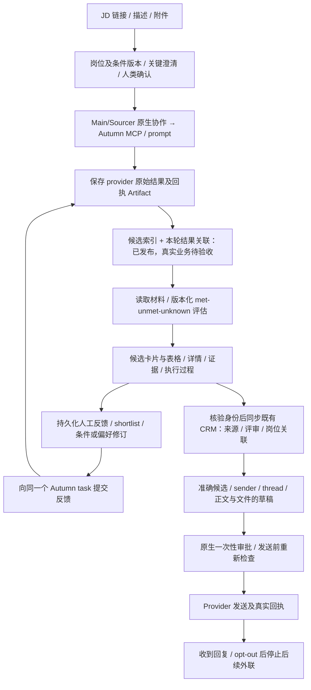

# WeKruit Recruiting Implementation Plan

## 当前交付状态（2026-10-21）

**普通内部保存已在真实网页跑通。** 内部候选保存、去重、岗位关联、普通 CRM 记录、草稿及记忆更新默认直接执行；真正外发邮件、发送或修改外部面试邀请保留精确原生审批。真实重试在原岗位对话发起，同一份尚未派发的保存请求经原生恢复后完成；候选读取与岗位关联读回均成功，网页显示 `CRM · Synced`，没有新增内部审批卡或候选外发。完整原来源、匹配值及证据缺口保持。旧失败记录未删除或重开，招聘协作偏好已实际写入并跨第一次发布替换保持。这不代表完整 playbook、邮件/排期闭环或多用户验收完成。

**修复沿用原生执行与恢复。** 所选源码 `98a58331`（公开工作分支 `9c5a0dc3`）修复消息所属关系查询，并只允许同账号、同岗位对话、同 Bot 的无卡片且从未派发的内部保存请求，在旧运行完成/失败后由新授权运行接续。原请求、来源及唯一回执保留；已批准、拒绝、取消、执行中或结果未知的历史操作不按此路径重发。CRM MCP `6429193` 已发布，六个内部写工具的模型可见描述与默认策略一致；真实写入标记、OAuth、组织权限和工具分配未改变。

**延迟仍需继续优化，不能归因于几百条记录的容量。** 历史一次事务超过 15 秒限制，约 17.7 秒后失败。云端只读计时中，完整来源约 2.56 MB/134 行，来源读取约 0.5 秒、解析约 5 毫秒、规范化约 24 毫秒；不支持将大文件处理认定为主要根因。无锁准备路径诊断含 39 次串行查询、约 3 秒，不能代表原锁等待。真实重试的十次工具调用全部成功；候选读取工具约 11.9 秒，完整导入工具约 18.6 秒，后者包含多个事务与服务调用，不能称作单个事务耗时。`f2a02d91` 另行复用同事务中已授权的所属关系，去掉两轮重复读取，未提高超时、放松校验或新增缓存/harness；已发布 `f2a02d91`（公开工作分支对应 `29d51761`）；健康/就绪与所选源码一致，二十组完整数据、逐行摘要、旧卡、记忆、配置、七份 Routine 及 109 项迁移跨替换严格保持。真实网页重载后同一候选仍显示 `Synced`，没有重放。此优化尚无同条件端到端提速对照，不提前声称更快。

**整体目标仍未完成。** 本轮没有新增数据库迁移、账号权限、资源或订阅，没有联系候选人。原明确业务决定、暂停状态和旧卡继续保留；完整发送/排期、全部卡型、多用户和 M1–M5 验收仍分别追踪，不用一次 CRM 保存替代全产品完成。

## 此前发布与验收记录

**此前发布 v163（2026-10-21）：** `9e41991e` 只在现有网页刷新入口合并重叠导航读取，保留触发时的版本、归档/排序意图、失败语义和账号/卸载隔离；没有新增缓存、超时、表、迁移、依赖、权限或资源。六项真实 UI caller 的 deferred 回归、Web 类型及独立复核通过；隔离发布同六项通过，批次不累加。103份实际源码、health/ready、109项迁移及29项完整发布前后保护检查通过，原待答卡、候选、记忆和七份停用 Routine 保留。

**真实网页已恢复：** 同一原岗位页面加载了新前端资源，原 Main/Sourcer 对话、候选筛选、原排名和来源轮次保留；Dashboard显示134位候选，候选详情实际打开五版保存报告，当前无可见错误或新控制台错误。本轮岗位、列表、搜索记录、反馈及来源 RPC 均返回200，候选列表约2.2秒、搜索记录约4.2秒、五版来源约7.0秒；这是一次真实观察，不当受控因果提速或所有间歇失败已修复。

**原生 Agent 读取已接通：** `595736f0` 复用网页既有的原件报告阅读器，原生来源读取沿用账号/岗位/来源、字节/hash及行号校验，列表返回和受保护内部原件限制保持。正常聊天已由 Main 原生交接 Sourcer，只读取指定真实候选和一份保存报告，原对话返回贡献、雇主信息缺口、来源、简历和未知；两次运行完成、七次工具成功，无电脑拆解、供应商研究、重评、CRM写入或外发。整轮约184秒，不能宣称端到端提速。聊天新产生的群元数据与两份原生上下文原件单独核对，不冒称全程每行相同。

**CRM SQL/MCP 已获准发布，真实导入待原卡审批：** [CRM Draft PR #57](https://github.com/WeKruit/headhunter-agent/pull/57) 的 `ae3e191` 复用原生 MCP、已有身份规范化和原子候选/来源/多岗位关联，不覆盖原资料或 canonical pipeline。生产只读检查发现旧数据含不规范地址和重复身份；本次已移除“先治理全库才能导入一人”的前提，改由原生 PostgreSQL 事务锁后按组织及本次身份读取：零条新增、一条复用、多条明确报错，不静默合并或清理历史。同一来源重复调用复用存储回执。锁持有到外层事务结束；普通读取继续，但当前方案会串行化全表候选写入，不宣称没有并发成本。

**数据库实现检查已实际通过：** 既有云端 PostgreSQL 16 RLS job 的[41项检查全部通过](https://github.com/WeKruit/headhunter-agent/actions/runs/39559315852/job/119086491961)，包含完整导入 SQL 回归、双连接同人并发、等待外部写入后读取新提交、外层事务回滚及组织隔离。没有在 Mac 启动数据库、Docker 或新增测试基础设施。另50项 MCP/auth 检查、DB/MCP 类型、格式及独立 SPEC/QUALITY 复核通过；此前42项未改动 CRM/review 网页检查不重复累加。这些是隔离数据库与源码检查，不是生产业务验收。

**本次获准生产执行（2026-10-21）：** 仅应用两份指定 SQL：身份/候选抑制读取前置函数，以及原子导入/多岗位关联/现有列表计数。生产 PostgreSQL 17 的七个函数正文、设置、限定 ACL 及新关联表 RLS/约束均与获准源码匹配；六张原业务表的数量和逐行摘要前后完全一致。既有规范化函数 owner/ACL/设置及去空白正文一致，原始定义 hash 因源码空白变化而不同，不冒称逐字未变。原生 Supabase 页面发布同一 MCP，下载读回七份源码全部匹配，原认证设置保持且匿名请求401。只给 Main 原八个读工具追加导入及岗位关联读取；其他 Bot 含归档者的分配、服务器元数据/版本和20行旧待答卡/检查点保持。实际运行的五份相关原生源码也与所选发布一致。未部署 CRM 前端、改动 canonical pipeline、写候选或外发；没有登记迁移账本或应用其他 pending 文件。正常人类问法已在原岗位发起目标绑定及单人导入的审批准备，实际目标/候选写入仍须原生一次性审批，不把上线等同业务完成。

**原卡展示修复已发布并读回（2026-10-21）：** 所选发布 `b918c645` 仅修正原生 CRM 审批展示；公开工作分支对应 `4b1ab80c`，保留该分支已有候选考虑状态逻辑。新卡沿用可信目标，旧卡由现有授权消息 DTO 投影同一已保存卡片，history/pages/SSE 共享一处；只改显示文案，不改原卡、effect、检查点或按钮。274项聚焦检查、API类型及两项独立复核通过。实际运行四份改动源码hash匹配、健康/就绪均200；重启前后20组数据摘要、逐行摘要、23行待答记录、109条迁移、Bot/skills/memory/routines均保持。原岗位网页已显示可读的 CRM 岗位关联审核与真实候选证据；尚未代点岗位关联或候选导入，不把卡片可见称为业务导入验收完成。

**此前缺口记录（CRM 进展由上文替代）：** 旧读取失败原件保留；一次原15秒限制的物理只读测量约5.6秒，其中五份约12.6MB原件查询约3.4秒、后续JavaScript间隔约27ms，不支持“JSON解析卡死”的归因。后续仍需持续运行验收。CRM SQL/MCP及Main受限工具配置已完成，接下来核对原会话真实目标/导入审批、服务回执、网页读回及恢复；候选池尚未绑定或导入。Gmail授权超时关闭，仍待本人处理Google安全提示和实际账户grant。原材料/十人校准决定、完整发送/排期、全部卡型和多用户验收未完成；P6及M1–M5均未完成。

> **For agentic workers:** Follow [AGENTS.md — WeKruit design principles](../../AGENTS.md#wekruit-design-principles). This plan defines product outcomes and records evidence; it does not authorize another harness or a fixed recruiting workflow. Reuse native capability first and change only a demonstrated integration gap.

**Goal:** 在现有 Rakazo 网页交付 Main/Sourcer 原生协作、可恢复交互与记忆，迁入现有招聘工作，完成 [GOAL.md](GOAL.md) 的 P0–P6 基础闭环与 [PRODUCT-SCOPE.md](PRODUCT-SCOPE.md) 的 Juicebox / Metix / Grok Bot 完整产品范围。

**Architecture:** 用户聊天/反馈 → Rakazo 原生 Main ↔ Sourcer ↔ Autumn Agent（已有 MCP/API）→ 结果/证据 → 用户反馈 → 同一个 Autumn task 继续。Main/Sourcer 通过 prompt、skills 和 playbook 自主协作；Rakazo/Pi 提供现成 harness、群聊、委派、会话、记忆和交互。网页、数据库和 Dashboard 保存并呈现真实输出，不接管 Agent 的推理和招聘步骤。

**同一角色对话的 Skill 采用补验（2026-10-21）：** 继续使用 v161，没有新代码发布。原生每次运行会重读 Skill 名称/简介目录，正文由 `skill_read` 按当前用户/空间重新读取；未发现需要重建会话的正文缓存。只在现有 Candidate Skill 补真实 Autumn 结构化 cell 的按字段读法，并让简介覆盖已保存候选查询；原生编辑器和物理只读数据库全文核对一致，其他配置及业务记录在该配置检查点保持。随后正常问法、没有 Skill 名或工具参数的单人查询，实际匹配并完成 `skill_read`，同一原岗位返回贡献/公司业务/来源/简历和缺口，网页显示对应真实候选卡。约165秒、13次工具完成事件，候选/来源/要求、旧卡、原消息及原回执、记忆、Routine和已采集的模型/工具策略保持；完整 Bot 元数据摘要变化仍保留。不是全套 Playbook/P6 完成。

**该补验的效率限制：** 首个字段读取仍失败，模型随后使用现有文件和 `jq` 能力恢复；一次不存在的解释器尝试及 heredoc 保护拒绝均保留。没有证据证明具体失败 selector、因果提速或所有读取错误已解决，也不据此再堆 parser、harness 或猜测字段规则。原件的结构化行与重复文本表示应区别；使用同一来源版本的真实零基行号，已有证据足够就结束。运行完成时原生会清理临时 progress，Skill 匹配证明采用保留的运行中快照，不将完成快照里缺少 progress 当成没有执行。Gmail 已沿同一批准客户端重新打开原生授权；账户 grant 仍停在本人处理的 Google 安全提示，工具分配和真实发送没有放开。

**此前发布 v161 / `cbe5f5c7`（2026-10-20）：** 原生 Bot 切换快捷键与弹层复用已有「部署所有者且 Developer view 开启」条件；关闭该视图会卸载弹层和快捷键，普通岗位导航保持。这是产品呈现边界，不是新增跨账号授权边界。四项回归先失败后通过，公共分支相关96项、隔离发布四项及 Web 类型检查通过，批次不累加。102份实际源码、health/ready、原109迁移及二十组完整发布前后记录严格保持；首次冷启动未就绪保留。真实网页确认开发视图仍能打开原生切换器，关闭视图后弹层消失，普通招聘视图快捷键不再打开它，原岗位地址不变；未冒称第二个真人账号已验收。

**现有 Skill 的读取范围优化：** 完整读取线上原文后，仅在 Candidate evidence and feedback 的结果交付项补充：按当前岗位的指定人/子集读取，优先复用最新来源，只在需要时翻历史，使用原生字段选择、分页及必要的文件处理，证据已足够就结束。原有正文、Autumn 评估归属及审批边界保持，没有新增 harness、解析器或缓存。原生编辑器重新读取与物理只读数据库逐字核对一致，只有选中的 Skill 改变，其他配置和业务记录保持；随后一条没有 @Bot 的正常单人问题已由 Main 在原岗位对话完成，候选卡、来源链接及缺简历标记对应；原候选、来源、岗位要求、旧卡和记忆保持。约183秒且仍请求多个来源并读取历史，保留原生文件/命令错误后恢复；没有证明模型读取了具体新 Skill 正文或因它提速。正常工作期间完整 Bot 元数据摘要及一项 MCP 声明更新时间变化均保留，已采集的模型/工具策略、服务身份/endpoint/启用/revision字段不变，不冒称完整元数据保持。

**此前发布 v160 / `31247ac8`（2026-10-20）：** 仅批量读取当前候选来源的 CRM 关联，并为原生候选读取补操作、分页标记、耗时和成功/失败状态；不记录候选、查询内容或原始错误。精确来源组合、岗位/候选范围及每条回执校验保持，空来源页不查询关联。没有新增依赖、迁移、资源、工具分配或超时。102份实际源码、health/ready、原109迁移及二十组完整发布前后记录严格一致；原待答卡、失败回执、候选、记忆及已完成一次性 Routine 保持且无重放。

**真实读取对照与限制：** 同一位真实候选的五条来源返回内容及顺序 hash 完全一致，CRM 关联查询由五次减为一次，该阶段合计约952ms降为243ms；整次代表性读取却由约4.1秒变为5.1秒，因此不声称端到端变快，也不把它当作原十五秒失败的复现或所有超时的解决。新部署后正常聊天的原生列表和来源读取均已成功，安全分支计时能区分它们；Agent 用原生文件和命令能力提取保存原件，约216秒完成单人证据答复，网页正常显示该人及五个来源版本。原生命令保护的一次拒绝和额外本地处理均保留，仍需缩小不必要的读取范围，不新增 harness。岗位、候选、来源、原卡、记忆、Routine及已采集的模型/工具策略字段保持；Main完整元数据行摘要发生变化，之前只保存该行 hash，不能据此声称全部配置行完全不变，原严格失败记录保留。隔离发布源两份相关文件329项检查通过，DB、contracts及 adapter 生产源码类型检查通过；检查目录曾因依赖链接混入较新工作分支而报错，已用私有精确源码映射核对，无产品补丁。完整 adapter 检查仍有旧测试 mock 的两项类型诊断，不宣称全套通过。P6与完整产品目标仍未完成。

**真实一次性定时协作补验（2026-10-20，运行版本仍为 v159）：** 原岗位对话中正常安排一次保存结果复核；到期前受控替换容器，十八组完整记录保持。到期后 Main 仅交接一次，Sourcer 读取原共享笔记、原十人审阅及后续修订，保存并读回一份岗位专属私有检查点，没有覆盖另一个旧岗位的笔记或共享偏好。两次执行均完成，一次性安排自然停用且无残留唤醒；完成后再次受控替换，二十组完整记录严格一致，没有第二次触发或写入。原候选、来源、岗位要求、旧卡、旧笔记及全部历史保持；活动群元数据摘要在新工作期间变化，未冒称整轮所有元数据完全不变。

**此次复核保留的真实缺口：** 候选读取在十五秒事务过期后失败，Agent 如实报告只核对了保留原件和审阅内容，没有声称重新验证所有 Dashboard 卡片。原工具参数与分支没有持久化，原生 Pi 全载荷录制未开启，不为调试擅自开启。重启后对真实保存数据的代表性默认列表读取与单人来源读取分别成功，不能冒称原调用复现或问题修复；来源读取观察到五次逐来源 CRM 关联查询，后续仅优化已证实的重复读取并补安全分支计时，不提高超时或降低来源/权限校验。P6、完整 Playbook、邮件排期及全部卡型目标仍未完成。

**独立对话召回补验（2026-10-20，运行版本仍为 v159）：** 分别进入 Main、Sourcer 已有的原生私聊，确认没有岗位绑定或待答运行后，用不包含答案的正常提问读取当前共享岗位笔记。两次原生 `read_memory` 执行均完成，网页返回相同第三版内容，包含最新修订；没有新建会话、群或岗位，也没有外部 effect。共享原文和全部三版历史逐字段保持一致。未绑定岗位的私聊不会生成岗位上下文采用原件，本次未审计完整模型指令或精确读取 selector，不扩大为这两项证明。

**此前发布 v159 / `dbea7002`（2026-10-20）：** 沿用原生记忆编辑、审批与 CAS，返回具体且已脱敏的校验错误；唯一精确原文可由服务端确定位置，重复或缺失原文、错误显式位置及 Unicode 边界仍拒绝，审计保留解析后的完整位置。真实共享笔记已只删指定原文、保存第三版并保留前两版；Main 正常委派 Sourcer 后，两者实际加载的上下文原件均包含同一第三版及正确 hash。该真实写入使用 v158 的位置卡；v159 新原文输入的在线新写入尚未补验。没有新增 harness、依赖、迁移、资源或工具分配。隔离发布源的记忆相关183项、候选读取423项及三条 Pi wire 检查分别通过，批次不累加为完整验收；独立静态复核通过，更广检查中的既有描述断言失败保留。101份运行源码、health/ready、原109迁移及26项严格重启比较通过。真实网页重启后逐字恢复第三版笔记和三版历史，原候选池与证据页两次重载成功，本轮未出现新控制台读取错误；不据此称历史间歇503或并发压力验收完成。原材料待答卡、失败回执和业务决定保留，P6与完整产品目标仍未完成。

**新增真实读取诊断与优化：** 一次列表读取的15秒事务实际在19.219秒后失败；五份已保存原件的 provider JSON 合计约12.6MB，并非候选人数过多。只读查询确认现有事件索引可用，该事件查找约156ms，不增加索引或超时。同一快照原始 JSON 与 TEXT 读取对照得到约2115ms与1002ms，后者另需约34ms解析；五份完整数据、所属关系、canonical hash 与长度全部相同，顺序执行的缓存影响仍保留。共享校验现改为 TEXT 后单次解析，继续执行全部原有来源、hash、权限和重复回执检查。两次真实重载已成功，不能将本次优化当作所有500/503的根因结论。Cal.com 已通过现有 broker 核对真实工具契约并正常续期旧 grant，没有新授权、工具分配或预约；Gmail 仍待用户本人处理安全提示及账户授权。

**此前发布 v157 / `0787acb6`（2026-10-20）：** 在原审批卡复用现有授权来源阅读器展示 JD；只读附件呈现字段由服务端核对原生请求、账号/空间/会话、文件 hash 和当前岗位版本后生成。持久卡片、文件元数据、审批目标和原始 JSON 权限不变，首屏、历史、分页及消息更新共用同一投影。手机原生问题/审批消息保留同条附件，PDF、图片和 Markdown 继续走既有路径；没有新增表、迁移、依赖、资源或工具分配。真实网页已从原待答卡阅读完整保存正文及两页 PDF，按钮名称正常、原筛选/来源保留，未代替真人批准。101份运行源码、health/ready、原109迁移和26项严格重启比较通过。首次发布发现的生产翻译占位符缺失已修正，增加现有十语言 catalog 的实际编译检查；原缺陷及冷启动未就绪证据保留。聚焦单元、类型和独立静态复核通过不代表手机设备或全部用户/卡型验收；现有另一个 catalog 检查缺失旧词条，未称全套通过。Gmail 账号 grant、真人材料/校准决定、供应商来源引用等价性和完整外联/排期闭环仍未完成。

**原生指令与真实协作补验（2026-10-20）：** 完整读取线上原文后，通过现有共享 skill 编辑器更新两处配置：Sourcing 要求 Autumn 的说明使用完整业务条件名称，不猜测编号含义；Intake 在确实缺少决定时使用已发布的要求、材料与十人校准原生卡，复用有效确认和业务回执，不把普通问答转换成批准。逐字读回及独立只读核验通过，其他已核对的 skills、两位 Bot instructions 和岗位要求保持。正常招聘聊天已实际完成 Main → Sourcer 的保存证据解释，没有额外业务调用；不能据此声称 Sourcer 已读取特定新 skill 版本。随后同一 Autumn 研究完成一人的三段文案整理并保存，网页显示完整条件名称；分数、排名、证据链接及其余人的完整原始记录不变。原生 Sandbox 仅复制原件和运行本地 JSON 比对，首次解释器尝试失败也保留。改写字段的供应商来源引用被调整，现有回执不能解析其等价性，因此严格来源检查仍未通过；旧原件、失败检查和当前材料审批缺口均保留，不称完整 Playbook 或 P6 完成。

**此前发布 v155 / `7fa9ede6`（2026-10-20）：** 只发布现有 UI 的两项增量：候选卡片、表格与保存报告的长摘要用原生 Details 展开完整正文；网页及手机端显示原生动作自带的业务标签，保留提交 ID、历史无选项答案和创建/取消结果。没有新依赖、schema、迁移、资源或权限。隔离发布源的42项审批组件检查、6项候选报告聚焦检查和独立静态复核通过；手机完整类型检查因既有 Expo/React 依赖缺失未通过，不冒充设备验收。单次发布退出0，99份运行源码、health/ready、109份原迁移及26项严格重启比较通过。网页实际验证原材料卡仍未答、业务按钮正确，候选卡/表格/报告可用鼠标和键盘展开，原筛选与来源版本保留；没有代替真人批准。重建期间一次 no-upstream 读取失败保留，就绪后恢复，不代表此前间歇读取问题已根治。

**v155 时的材料阅读展示缺口（已由 v157 完成该原卡验收）：** 普通网页已实际通过现有岗位来源阅读器打开保存的完整 JD 原文，没有重抓官网或放宽内部原件权限。待批材料的机器文件名仍外露；已只读确认它与当前岗位的合法原文引用精确对应。后续应复用该阅读器改善同一原卡的附件呈现，不能只改名掩盖原始 JSON 下载边界，也不能重写卡片或伪造已批准。Gmail 账户授权、材料/校准真人决定、供应商来源引用等价性、完整招聘外联与排期验收仍未完成。

**此前发布 v154 / `8653e5ca`（2026-10-20）：** 在原应用隔离发布两项原生增量：聊天内的要求确认卡，以及 OAuth 等待时间与后端既有十分钟有效期对齐。要求卡冻结当前版本并展示服务端保存的完整要求，只接受原卡一次性真人批准；复用 Role 面板的同一事务内确认，版本、确认回执及 effect 完成一并保存。过期版本不能确认，拒绝及已完成重放保留，旧通用问答不补造审批。没有新 schema、迁移、资源、工具分配或外联。隔离发布源五份相关文件324项检查及独立复核通过；这是实现检查，不是真实数据库回滚或新卡在线验收。一次部署退出0，98份实际源码、health/ready、原109迁移和26项严格重启比较通过，原历史失败及配置完全保留。

**第二岗位的真实反馈闭环已补验：** 正常对话只要求补查一位候选人的已列证据缺口，Main 保存单人范围并委派 Sourcer；Autumn 在原研究仅一次 reply，完整新结果继续保存。独立只读核对两份原件及32条来源投影，16身份不重复，恰好一人的原始字段改变，其余15人包括分数、排名、元数据在内逐行 hash 完全一致；岗位及已确认要求未变。网页能读取指定人的新旧来源，发布后原对话、结果、筛选与来源选择恢复。来源事实真伪、候选合格与本人批准扩量仍不是此项结论。

**历史发布 v153 / `8a46bc26`（2026-10-20）：** 仅隔离发布 MCP 列表读取状态与既有 SDK OAuth 两项修复。读取期间不再误称没有服务器，失败保留已成功列表；显式 Connect 在服务公开初始化但未返回 challenge 时，通过既有 SDK auth 发起预注册授权，沿用受控网络、同一15秒取消信号、PKCE、加密 pending session 及旧 grant 保护。没有新 harness、依赖、迁移或工具分配。隔离源47项聚焦检查、相关类型/格式与独立复核通过；部署一次退出0。98份运行源码、health/ready JSON200、原109迁移已核对；重启前后26项严格比较全部一致，没有归一化或忽略差异。首次发布前诊断脚本的引号错误与修正后成功采集均保留，不计作业务失败或已执行检查。

**本轮第二岗位已继续到十人审阅：** 用户明确官网未给薪资则保留未披露，原卡自定义回答已实际续接。Main 通过原岗位工具保存已知披露政策与原来源 location；薪资金额仍未知，筛选条件与前版 hash 一致。测试者依据已确认要求在原生页面完成 brief 确认，没有把普通答案直接改成确认回执，也不冒充用户本人点击。正常请求后 Main 实际委派 Sourcer，Autumn 研究完成，原生保存16位结果并返回恰好十人的来源/缺口表，完整池没有被截成十人。排序沿用供应商输出，未进行本地重评；单人目标反馈已按本轮记录补验；本人校准及后续扩量/外联批准仍未完成。

**Gmail 当前接入状态：** 用户本人 GCP 登录恢复并逐项批准专用客户端与 Gmail MCP API；两者实际创建/启用。现有网页加入官方 server，尚未分配 Agent 工具。首次连接因公开 initialize 未触发授权而停止，失败保留；上述原生修复已发布，实际重试已打开 Google 授权并选择现有账号，目前停在 Google 的应用尚未验证安全提示，交由本人处理，代理未绕过。新客户端凭据仅沿原生加密连接流程处理，不进入源码或本机文件；尚未取得账户 grant，不称邮箱读取、草稿或发送通过。Cal.com 工具分配及真实预约继续保留实际授权边界。

**当前读取失败调查：** v153 的候选请求由 Modal 入口在分配容器前返回503，处理约49微秒，应用/DB未收到该调用；同一时期当前容器无重启或错误，其他已进入应用的请求成功。入口未公开具体拒绝路由原因，不能归因候选 SQL 或宣称根因修复。保留失败后单次正常刷新已恢复16人 Dashboard，v154 重启后原会话、单人反馈及来源版本再次可读；恢复与入口稳定性分别验收。普通 Evidence 原始供应商描述仍出现规则编号，尚未证明编号与本地要求的映射，不能猜测替换、隐藏重要事实或改写原件；需沿已有研究要求返回完整业务名称。

**历史发布 v152 / `e6657719`（2026-10-20）：** 在 v151 上仅发布两份功能增量 `2e15f545`、`1cd15d52`。共享消息与群交接的两个纯数据库事务复用已有冲突重试；通知、入队、模型和供应商调用不进入重试。候选摘要的明确关卡表达复用既有业务标签；歧义公司名、原始来源、数值排名和开发原文保留，尚不是所有自由文本的全面清理。二十项发布源聚焦检查、相关类型、网页构建及独立复核通过；不把未选中的检查计作通过。九十八份运行源码、health/ready JSON 和原一百零九份迁移已核对；重启前后二十六项严格数据比较完全一致，两个冷启动未就绪探测与最终有效采集均保留，无数据归一化、历史状态清理或任务重派。没有新迁移、权限、依赖或资源。

**v152 新运行与共享记忆真实验收（2026-10-20）：** 原岗位正常询问已有机器人／传感器经历，Main 完成并返回保存证据及缺口；该回合没有工具调用或外部 effect，不将其称为新工具读取或并发故障复现。现有候选池与来源保持，旧失败记录未改写。

随后用自然对话更新已有岗位共享备注，原卡仅 Allow once；Main 保存唯一新版本，原正文逐字保留，追加内容可追溯到实际人类消息。原生交接后的 Sourcer 完成独立读回，其自身采用的上下文原件经过字节长度和 SHA256 校验，目标 memory 的版本、hash 和全文与保存版本一致。回复正确区分公司经验偏好、技术 alternatives 与缺少简历，识别旧技术问题说明已被后续澄清取代。这证明本次增补、来源历史及跨 bot 采用；没有测试精确删除／撤回、其他用户或全部卡型。未重新研究、重评、扩量或外联，不将这一片段列为完整 P6/M1–M5 通过。

**历史发布 v151 / `bb791987`（2026-10-20）：** 功能提交 `bb037dc3` 只复用已有能力：原生模型上下文展示现有 brief 校验生成的具体缺项，普通岗位面板在未确认的按钮旁展示同一业务问题；只读上下文采用事件不再触发整块招聘面板重读。没有新表、迁移、权限、依赖、资源或编排层。现有 intake skill 仅补明确区分普通问题作答与正式确认，缺项不能误称审批记录错误。聚焦回归、类型、网页构建和独立检查通过；运行中的九十七份源码、health/ready JSON 与原迁移数已核对。实例替换前后二十六项严格数据比较均完全一致，无归一化或被忽略差异；首次冷启动探测失败及唯一成功重试都保留。真实网页已在原第二岗位的禁用确认旁展示薪资问题，不编造缺失信息或绕过确认。

**本轮已完成的实际业务片段：** 普通岗位聊天恢复 Main → Sourcer，保存并展示既有真实 Autumn 候选池、恰好十人的校准表；用户对两人的自然语言反馈经单次原生 reply 续接同一供应商研究，新增结果来源已保存，原池身份和历史版本保留。普通与开发视图均能读到贡献、实际来源、公司背景与未证实事项。原排名可在单份结果范围内使用现有卡片／表格排序；混合结果不伪造全局可比名次。供应商报告局部修订，尚未逐字段独立对照其余候选；保存时岗位绑定也不证明旧研究最初采用了全部当前准则。不得据此称完整校准、外联或 Playbook 完成。

**实际原卡继续：** 第二岗位首次继续仍错误要求用户点击禁用的确认按钮，该失败保留。精确只读检查确认其已保存上下文包含具体缺项；没有最终模型载荷记录，不将此称为已观察到模型实际注意了字段。读取、修正并重载读回现有 Main 原生 instructions 后，在原卡如实回答按钮禁用、薪资未知、已有地域及到岗事实；同一运行已返回具体薪资问题、选择和可填输入框，两套视图均可见。未假点确认、未编造薪资、未重开研究。岗位中到岗事实与 canonical location 尚未对齐，仍可由已有岗位工具保留原来源修正；不新增 schema 或 harness。最新真实反馈结果已在普通网页重新读取，候选去重人数与三份保存来源均可见。部分供应商摘要及岗位备注仍露出内部 gate 简写，属于未完成的产品展示清理，不改写原始证据来伪装通过。

**本轮真实验收起点 / v149（2026-10-20）：** 按用户要求归档此前两个活动岗位，保留原件与专家配置，再分别从旧控制台和普通招聘界面的空对话读取两个真实公开 JD。选择、自定义输入、文件返回、PDF 预览及 brief 确认均已实际操作。一次实例替换前后，两岗位的二十一条消息、三个运行、三十一份操作回执、岗位／偏好／成员及两张待答卡逐项一致；随后继续原审批与原问题，没有重开任务。截图与完整对话证据保留在私有验收包，不使用演示候选。

**已修复并发布的产品缺口：** 普通界面现在复用原生岗位归档／恢复；用户可明确选择一个归档岗位，仅复用其有序团队开新对话，不恢复旧岗位或复制旧消息。切换来源重置新建表单，提交期间禁止更换来源。正常网页已从选定归档岗位创建空白内部协调对话。Cal.com 使用其官方托管 MCP 和原生 OAuth，已显示连接成功；五类预约变更沿现有执行器强制一次性原卡审批、冻结参数与去重。工具分配、账号／空闲读取及实际预约仍待验证，连接成功不是预约成功。功能提交 `79163a69`、`9c5816f4`；隔离发布源 `c67703a6` 的九十六份源码及 health/ready 已核对，无新迁移、依赖或资源。

**材料与业务边界：** 两岗位均已实际返回两页具名 JD PDF。第二岗位在原问题继续后复用已成功的生成方法，全文和原链接已核对，保留首次失败，没有把另一岗位的要求／薪资或招聘内部校准备注混入文件。正常对话已核验现有 Instantly 账号，并以自然语言指定一个账号完成真实小范围读取；两次工具调用约十四秒不当作完整盘点的受控性能对照。共享现有审核 skill 仅增加账号小页读取指导，所有发送检查保留。当时 Google 本人验证仍阻塞 Gmail 接入；本轮已恢复本人登录，现阶段仍待账户 grant。Cal.com 走独立官方 MCP，工具分配与真实预约仍待验证。此发布时新十人校准、反馈、Dashboard、外发与预约尚未整条验收；后续实际片段见当前发布记录。

**历史发布 v150 / `94a84c52`（2026-10-20）：** 两项最小增量已发布到现有应用：复用已授权事务内上下文，减少研究准备中的重复来源／线程校验；普通对话计时复用原生运行时间，切换页面不再归零。保留 artifact 原定位查询、旧运行和其他线程的完整授权检查，不放宽事务超时，不新增迁移、资源、依赖或工具权限。功能提交 `74b9d884`、`358f3b61` 已推送；九十六份运行源码、health/ready JSON、原一百零九份迁移已核对。重启前后业务行、消息、卡片、文件和配置一致；唯一完整线程摘要变化已逐字段反算证明为打开对话造成的已读标记变化，严格比较的 false 与解释均保留。首次冷启动未就绪及其后成功探测均保留。普通 UI 实际切走再返回，当前运行显示由五十八秒继续到一分七秒。

**当前真实缺口：** 第一岗位的旧研究准备超时和旧执行中本地回执原样保留；新反馈续接走实际原生 Autumn，并没有重新触发该 prepare，因此不能把保存成功当作其在线修复验收。候选单份读取曾失败、普通刷新后恢复，具体错误未定位；应用请求日志出现连接排队及较长处理时间，不把本次减少无效刷新当成整体性能已解决。第二岗位已按本轮真实答案保存薪资未披露与已来源化 location，并通过独立原生确认进入十人审阅；不编造薪资，也不再重复要求该答案。完整十人反馈验收、两岗位规模搜索、邮件发送、预约、多用户与全部卡型恢复仍未全部通过，M1–M5 和整体产品 Goal 保持未完成。

**继续验收中的新失败与实际结果：** 正常聊天要求 Autumn 完善同一十人表，未扩搜或全池复评。Sourcer 已创建并实际发送原研究跟进，Main 随后因原生 `thread.update` 事务写冲突失败；子任务最终完成，两个实际供应商跟进均使用原研究。新增两份结果来源，候选身份池保持不变，没有本地评估。十行表已实际展示个人贡献、独立公司业务来源、简历状态与剩余缺口；未找到简历链接不等于没有简历或拒绝理由，缺口未伪装成全部合格。旧摘要由供应商仅对齐原十人；未逐字段独立对照其他人员。父失败和子完成均保留，不重派、不强改状态。源码确认的两个重试缺口已补，历史异常缺少栈信息，具体失败入口仍未证明；不能把聚焦实现检查称为已强制复现该线上故障。Cal.com 的正常创建／改期自带供应商端空闲检查，先核验实际托管 MCP schema 与预约回执，不为此另外建设预约服务；连接不等于已分配工具、发送或预约验收。

**当前并行交付（2026-10-20）：招聘产品界面与原生能力验证。** 普通工作区已采用指定 `codex/wekruit-branding` 模板（实际 `c7f2dd6a`）的品牌、字体和导航，接现有 Rakazo 的同一岗位会话、结果面板、原生输入与审批；无需选择专员或输入 `@`。多 Agent 控制台沿用既有 deployment-owner 身份与显式 Developer diagnostics 开关，切换不复制会话或卡片。两个新岗位群均实读确认 Main 是原生首成员；普通消息与 Main → Sourcer 委派已真实执行，不新增关键词路由器或 gateway。独立只读核查确认 Pi 已承担 Agent、工具执行及当前上下文压缩；现有文件、业务授权、原卡和数据库回执各有职责，未发现可直接删除的第二套 harness，本轮不另建框架。

**模板工作区及导航修正已发布。** 功能提交 `8fc36e9a`、发布源 `abbe5610` 的九十五份运行源码及 health/ready 已核对。替换后两个实际岗位的全部十六条消息、六个运行记录、岗位版本、偏好、成员顺序、回执及反馈逐项保持，限定范围内没有重复执行。Simulation 的原选项和自定义输入框仍可用；Data Infra 的已答卡仍保留。实际 owner 在同一会话切换普通／开发者展示，未发送草稿随视图切换及刷新恢复；随后从普通界面无提及发送自然语言询问，Main 在原岗位会话完成回复，沿用已存要求、偏好及暂缓决定，未搜索或外联。首版新增文案漏入语言目录的真实缺陷已修复并发布，新增生产目录检查通过。侧栏 Dashboard 已实页验证会选中原生 Dashboard 页签，返回 Conversation 保留当前岗位而不跳到另一私聊；延迟线程读取及页签恢复等九项聚焦检查、相关类型／构建及独立审查通过，不新增路由器或重挂面板。旧目录一项及旧面板两项陈旧断言仍失败，不计为全套通过。新岗位表单已实页确认只要求岗位名，不要求用户选择子 Agent。截图取自真实云端岗位，未使用合成候选；本轮不冒称全部卡型、多用户或完整 Playbook 已通过。

**岗位事务修复已发布并完成限定的真实验收。** `faa2de97` 只修改既有岗位数据库方法及其检查，复用同事务已授权的角色／线程，授权后批量锁定、读取消息，保留每条来源验证及原子回执；没有新表、迁移、依赖或超时放宽。发布源 `32bd53dc` 的八十八份运行源码和 health/ready 已核对，启动期不可用记录保留。原测试群已按用户要求原生归档，随后从两个全新真实 Dyna 对话开始：两岗位分别保存草稿；Data Infra 原生问题卡接收自定义输入并继续，限定反馈保存后，一条无提及普通消息又将岗位偏好更新至版本二。网页刷新后原卡答案、版本二及该偏好仍在，物理只读数据库复核一致；三次成功保存／修订的完整工具耗时分别约 9.24、9.09、9.67 秒。首次来源归属参数拒绝也保留，Agent 纠正后才保存，不能宣称无失败或所有读写已彻底修复。相关离线检查通过不替代业务验收；本轮没有新 Autumn 搜索、实际外发或新的完整 Playbook／M1–M5 完成结论。

**职责边界：** Autumn 负责研究、匹配和候选判断；Sourcer/Autumn agent 只做联络：传递 JD/playbook，把真人反馈转成同一 task 的 prompt/reply，接收并保存实际输出，简洁转述结果与问题。收到输出后不另读岗位/旧评估去重做候选评审、排序或资格判断；保存与连续性沿用原生记录。 用户可反馈任意一人、几人或整体方向；仅传递实际涉及的对象与规则，不强制整批复审，也不把局部反馈扩成全池重新评估。

**当前找人顺序（用户已恢复原 Playbook）：S1/S2 → S3 十人校准 → S4 反馈及本人 G2 批准 → S5 扩量。** 分别对两个真实岗位验证完整闭环，实际 G0/G1 不能从历史摘要或其他岗位继承，也不替用户批准。十人是首次校准审阅规模，不是保存上限；保留全部已返回者、原匹配、来源及未知，优先复用已有 Autumn 结果，不删除已有池或为校准重复研究。此前“大池优先”的覆盖规则已撤回，下方相关段落仅记录当时实际执行。任意范围反馈、同研究连续性、外联/导入/预约审批、账号隔离、抑制名单和原累计预算保持。由 Autumn 完成匹配与反馈修订，本方不重做本地筛选引擎；G2 是实际人类业务决定，不是每次工具调用都弹审批。

Supabase 独立数据库、原生 memory provider、Modal Volume 和 E2B 沿用现有职责。Schema 仅服务实际返回/持久化/展示；不新增规则语言、固定问卷、筛选引擎、第二层编排器或逐搜索审批。每 bot 的模型/连接及 memory/skills/MCP 替换先用原生设置。历史实现清单不能成为继续扩建自定义领域层的依据，也不授权盲删既有工作。

**业务能力统一给 Agent 调用。** 用户可以从网页、对话或已授权 Routine 发起同一业务动作。Agent 通过既有 `ConnectorTool`/`ToolHost`、Pi 与原生执行器调用已分配的 MCP 或内置工具；网页控件复用同一业务服务及持久记录，不要求网页请求绕经模型或 MCP。优先接现有服务操作，只在缺少实际可调用动作时做最小适配；不另建工具路由器，不为每个功能启动一个 MCP server，也不向普通招聘 Agent 开放管理员通用 SQL。

**产品审批边界（2026-10-21 修正）：** 搜索、续搜、筛选、保存、去重、岗位关联、普通 CRM 记录更新、草稿、记忆更新和内部委派默认直接执行，不逐操作要求用户批准。真正对外发送邮件、发出或修改面试邀请时，才展示实际收件人、内容和时间供用户确认。关键条件澄清、接收反馈以及用户明确要求的人选校准是业务对话，不是读写权限审批。执行继续使用原生账号/组织隔离、工具分配、版本和来源校验、幂等回执及预算约束；既有明确拒绝/暂停和未知执行结果不能被新的默认策略抹去。本条替代历史计划中把普通内部 CRM 写入一律设成人工审批的设计。

| 业务职责 | 复用的调用边界 | Prompt / skill 的责任 |
| --- | --- | --- |
| 找人、筛选、接收反馈后继续 | 已连接 Autumn MCP 与既有结果保存工具 | Sourcer 转发 JD/playbook 和任意范围反馈，在同一研究继续，保存原返回；不本地重评。 |
| 保存候选、读取证据、反馈、内部决定 | 既有招聘工具/API及共享数据库业务函数；shortlist 已真实接通，hold/pass 不能用收藏代替 | 解析用户所指人选与岗位，保留原来源和历史，只修改实际授权的范围。 |
| CRM 来源、阶段和备注 | 既有 CRM MCP 及按账号/组织授权的业务函数 | 读当前记录、执行已授权动作并读回；未开放或未验证的写操作保持待完成。 |
| 邮件、回复、会议链接和面试 | 既有 Instantly / Composio / 邮件日历 MCP | Outreach、Scheduling 负责准备、核实和协作；发送、预约及同步成功必须有真实回执，不能由一段回复代替。 |
| 群聊、委派、记忆、文件、定时任务、原卡审批 | Rakazo 原生工具和执行恢复 | Main 分配目标与责任人，专员完成其职责并交回结果/阻塞；不把原生能力再次包装成一套 MCP/harness。 |

Playbook 定义闭环所需的目标、证据、澄清、完成条件与下一责任人；各 Agent 的 instructions/skills 决定具体工作方式，不固化成必须依次经过全部节点的业务图。各专员沿用自己的工具权限、上下文与私有记忆，共享信息仍受原有账号/Space范围约束。权限、精确审批、幂等回执和恢复继续由现有执行层保证。内部 hold/pass/拒绝决定不自动等于发送拒信。工具定义存在、MCP 可发现、Agent 已获分配、真实动作成功是四项不同状态，不能互相替代。

已按实际接线缺口补原生 `recruiting_shortlist`：复用网页 shortlist 的同一事务业务函数，保留原只读 list/sources；从当前执行取得可信账号、线程、Bot 与 lease，校验岗位/候选版本和来源授权。Agent 记录标明 Bot 作者，不冒充用户决定；候选变更、消息、完成回执和刷新事件原子保存。中断后仅重用既有本地原子变更恢复路径，不重放远程 MCP 写操作；原配置要求审批时展示已核验人名、岗位和加入/移除动作，不展示内部键。新增入口不代表候选合格、CRM 阶段或外发授权。655项相关数据库/执行器离线检查通过；网页与卡片105项、网页类型检查通过，独立复核后的19项聚焦检查通过；这些批次有重叠，不累加，不当真实业务验收。已随 v134 发布并通过原真实对话的加入、刷新保持及后续移出验收，详情见当前发布记录。CRM 写入与邮件/日历的真实闭环仍以各自连接、工具分配及实际回执验收为准。

工具链优化执行既有研究：保持稳定的 prompt/工具定义，按需发现已授权工具与读取 skill；完整返回留在原生 Artifact/数据库，跨 Agent 传摘要、引用、分页和涉及的变化；复用已付费结果与 Pi 原生压缩。先度量主/子 Agent、重试和外部服务的完整成功任务用量，再决定是否需要 Jev 等额外检索/压缩能力，不先增加另一套 harness 或逐轮付费评审。

**Tech Stack:** Rakazo/TypeScript、Pi、官方 Codex OAuth、Supabase Postgres、Graphile、Modal、E2B。

## 最新验收进度（2026-10-20）

**当前发布 v144 / `839f53d0`：业务文案与原生 OAuth 配置。** 在 v143 上隔离纳入 `3a59dd24`、`74aae140`，不带未批准的候选决定迁移。问题与错误采用业务名称，岗位面板标明薪资、地点和公司材料；共享工具要求先复用已知事实，再问具体未决事项，内部标识不交给招聘用户。不会改写历史问题、代答原卡或将公开事实视为外发授权。预注册 OAuth client 复用现有 MCP 入口、SDK、加密会话及成功后的凭证事务；失败保留原连接。Google 官方写操作按真实连接与规范化端点走原生一次审批，不能由 Always allow 或自动审核绕过。独立复核发现的 URL 等价形式与授权请求对象覆盖问题已修复。九文件聚焦离线检查 523 项、五包类型及格式通过；文案 118 项是另一批，不累加为业务验收。

现有云端构建通过，八十八份运行源码匹配；冷启动首次端口探测失败保留，同一容器随后 health/ready JSON 200、非 degraded。重启前后二十组数据、七套逐行摘要、两张待答卡、岗位与候选原件、迁移、权限、记忆及技能保持，十九项比较通过。未新增迁移、连接分配、模型调用或外发。Chrome 后台页面控制超时，本轮未声称新文案与 OAuth 完成在线 UI 验收。

**薪资是采用缺口，不是抓取丢失。** SWE 官方 JD、带补偿参数的 Posting API 与实际保存原件均含 USD 180,000–270,000 年薪及股权，正式 brief 仍为空；共享指引已要求按原来源带入草稿，但原生 Agent 尚未补写或获得人类确认。Simulation 当前官方页面及 API 未披露薪资，不能借用 SWE 的数值或推断历史页面始终为空。

**Google 连接仍待本人验证及真实授权。** 已核对源产品 Gmail/Calendar 的连接与公开 HTTP MCP；本产品须使用自己的 AI-agent OAuth client，不能搬用源产品凭证。官方服务要求 Workspace Developer Preview 资格；现有 Google Cloud 页面仍停在本人验证，尚未核验资格、创建 client、启用 API 或赋予工具权限。暂不索要另一把服务 API key，也不将 Composio 设为必需。公开 Gmail MCP 目前明确支持读取、标签和草稿，未据此声称发送与附件已接通。两个真实岗位的完整 Playbook 与邮件/日历闭环仍待实际回执验收。

**最新人类决定：完整按 v1.0 Playbook 验证两个岗位后再交付验收。** 本节此前的大池优先记录属于当时实际执行，不再是当前流程授权。仓库指引、原生三份 skill 和两个岗位偏好已恢复 H23；只读快照确认其余四份 skill、模型配置及六份 MCP 分配保持，全部候选业务记录和七份来源页保持。CRM 连接的已采集身份/版本字段保持，但完整行摘要不同，原因未采集，不称整行无变化。两个原生运行均在等待准备信息，brief 仍为空；尚无实际 G0/G1/G2 批准。已保存的大池与旧审批都保留，不补签、替人批准或重新搜索来制造通过记录。

**历史发布 v143 / `da66dc15`：统一请求关联已上线，仍未宣称读取错误修好。** 沿现有 Web RPC fetch 为每个原请求发送请求关联标识，保留调用方已有标识；失败只记录发送/返回标识、UTC 和耗时，不记录正文、凭证或完整头，也不重试。十二项 Web/Electron 聚焦检查、类型、格式及复核通过。隔离发布仅含两份 RPC 文件，未纳入未批准迁移；实际八十三份运行源码匹配，启动后 API health/ready JSON 200、非 degraded。完整 PRE→POST 二十六组保护比较通过，包括二十组数据、七组逐行摘要、两个待答卡、线程头、既有权限/记忆/技能及两份当前 JD、最新两份候选原件实际字节。首次冷探测失败和网页供应商“no upstreams available”原件保留，没有重复发布。先前间歇 503 的请求级日志只覆盖故障之后，根因仍未确定；本次关联改动是诊断能力，不是错误恢复或性能验收。正常 Chrome 原标签在启动就绪后刷新，恢复同一 SWE 对话的一百三十四人及原准备卡；切到 Simulation 并打开原工作台后恢复一百九十人及其原准备卡，当前原分数和未知仍保留，真实截图已保存。冷启动首次网页错误未抹除。实际两岗位 Playbook 与外发仍未完成。

**CRM 复用增量已推送，尚未生产发布。** 原 [Draft PR #57](https://github.com/WeKruit/headhunter-agent/pull/57) 的 `bb8deb6` 复用已有组织范围 outreach-context 读取，保持 nullable pipeline、邮箱/抑制未知和数据库拥有的 LinkedIn 身份，不新增表、传输层或规范化器。四十二项认证/MCP mock 检查、入口类型、格式及独立源码复核通过，不当数据库验收。随后已从现有 Supabase 原生 Functions 页面实际核对：所需身份函数尚未出现在 public 目录；抑制函数仍只按显式邮箱比较，没有候选 ID 抑制关联、首尾空白处理或函数内成员检查。组织写入和候选岗位兴趣函数的成员隔离定义可见，实际 EXECUTE 权限仍待核验。官方页面下载的现有 MCP 七份源码中，六份与当前源码逐字一致，仅 CRM 工具文件不同；实际线上版本还没有新的 outreach-context 读取。`b8c84b3` 只复用两份已有函数准备独立事务，不采用旧候选导入迁移中的表、约束或索引；精确源码比较、格式及独立 review 通过，既有 RLS suite 添加三项用例但未运行，生产 SQL 尚未执行。原网页 CRM OAuth connected，Main/Sourcer 各仅八个读工具，Outreach/Scheduling 未分配；没有保存分配、扩大权限或外发。新的读取也不能替代 Gmail、旧 hold/pass 来源和实际供应商完整历史检查。

**两个原岗位已实际交付 S1 文件草稿，尚未完成 S1/G0。** 在原群用正常 `@Sourcer` 消息各准备公司说明、岗位画像和待决事项，三个原生运行自然完成；网页预览、下载及来源逐条复核已做。保存条件和引文保持，未知没有改成批准，也没有增加年限计算或跨岗位套用条件。Simulation 初稿中的无关候选姓名经限定反馈修订为不具名历史说明，三份修订稿的实际字节仅有该替换；原、修订共九份下载与对应运行的云端 artifact 长度/hash 匹配。初次核验错误把自动上下文文件也纳入草稿大小限制，失败记录保留，后续只核对实际附件，未重跑业务。最终物理只读快照的二十三项保护比较通过：既有招聘记录、两张原待答卡、旧消息/运行/效果、技能、记忆、Routine、成员、迁移和精确工具分配保持；模型/指令及 MCP 标识、版本、启用字段保持。Bot/MCP 完整行摘要有差异、原因未采集，不宣称整行未变。原生回执只有文件、命令和消息，未捕获 MCP 或招聘业务写操作。业务输入、正式 brief、G0/G1、PDF/deck 和实际十人 G2 仍待完成，草稿与已有池均不是审批。 两条初始准备进度未附 PT ETA，H18 的实际行为也仍须修正验收。

**S1 公司背景草稿与 H18 已继续通过原生工作验证，仍未形成 G0。** 两个原岗位对话分别补交公司背景和回复政策草稿，未决事项保持未知、未批准。Main/Sourcer 只修订原 reporting 句子，明确首条和每条进行中回复包含诚实的 PT 时刻 ETA；两次真实文件任务的首条自然回复均满足此项，并在各自 ETA 前完成。这只验证 Sourcer 的这两次行为，Main 后续真实进行中回复仍待验收。只读核验确认两份 instructions 精确匹配拟改内容，其余所核声明配置、技能、记忆、Routine、工具分配、招聘记录及原卡保持；不是整个数据库或全部卡片验收。此前六条文件检查命令已逐项读回：三条执行前被拦截、两条因缺少 Python 退出 127、最后一条比较成功；不再以 effect completed 代替命令成功。新增两份真实下载与所属原生运行的存储长度/hash 匹配；首次按下载文件名查询存储名称未匹配的结果保留，不能抹成原检查全绿，没有另读后端文件正文。没有新增研究、评估、外联、迁移或部署。

**G0 与十人校准的边界已对照原文核清。** v1.0 的 O1 明确将薪资范围列为 G0 必填，现有确认路径也要求有来源的薪资和地点；不能只依据 H5 的 campaign 阶段措辞自行放宽。Deck 和回复政策没有统一必填拦截，未影响决策的未知可继续保留。十人校准是审阅样本，原生 G2 校验不要求十人全部硬条件已证实；仍需真实来源、公开证据、当前岗位绑定和本人决定。现有技能保留未知，没有发现需要另建评估器或修改校准校验的依据。

**邮件完整历史仍缺实际契约证明，不据此增建传输层。** 已有连接器公开 discovery 的当前 Instantly `list_emails` schema 禁止额外参数，没有声明 `mode`、`latest_of_thread`、`preview_only`，不能强塞 REST 参数。官方 MCP 文档说明工具映射 API，但没有说明省略这些参数的历史覆盖语义；API 文档也没有明确这些默认值。缺少参数不证明返回一定不完整，目前也不能证明已核全。先核对当前连接的真实契约，保持现有 preflight，避免凭假设删除保护或新增 REST/replay 路径。现有 Bot HTTP 工具还有原生 policy、凭证版本、分页截断和批准后恢复的接线约束；不能直接调用 helper 绕过它们。Gmail、旧 hold/pass 来源及 CRM 的实际读取也仍待接通，工具目录发现不当邮件发送验收。

**托管邮件／日历的实际配置缺口已定位。** 当前用户／Space 没有已配置的托管集成提供方或托管连接，云端和现有私有环境均未配置 Composio；原生网页也提示先配置插件目录。此前的登录失败页面属于 Composio 控制台，不是已证明的 Rakazo OAuth 回调错误。复用原生 Server integrations 配置及后续账户 OAuth，不新增登录层。托管连接由该用户／Space 内 Bot 共享，不能用 Outreach／Scheduling 的 MCP 分配为零推导其托管连接权限。当前只打开原生配置页供用户填写，未提交密钥、创建连接或发送邮件。Instantly 现有连接的官方 origin 已由原生 UI 核实，但 handler 版本及完整历史覆盖语义仍未证明。

**历史发布 v142 / `a710ee9f`：两项原生 Playbook 接线已上线，业务验收仍未完成。** 已复核的 `4c7c1dd2`、`05312b36` 经隔离发布源对既有应用发布一次，未纳入主分支候选处理决定迁移，本次未新增迁移、资源、权限或依赖。八十三份实际运行源码精确匹配；后续容器内 API health/ready 返回 JSON 200、非 degraded。完整 PRE→POST 二十五项检查通过：二十组数据、七组完整行摘要、十九项保护对象、两张当前待答表单及线程头保持，顶层仅采集时间不同。两份当前 JD 和最新两份候选页实际字节、长度/hash 保持；旧历史文件仅核对元数据。首次冷启动探测失败和公共 health 路径 404 记录保留。实际 G0/G1/G2 仍未批准，完整 Playbook 未验收。

**发布后网页仍有间歇读取错误。** 实际 `getWorkspace` 请求返回过 JSON 503，未带请求关联标识；第一岗位两次普通 Refresh 随后均返回 200，并显示一百三十四位候选，第二岗位正常切换后也显示一百九十位、原排名和原待答表单。成功读取不证明错误已修复，当前没有确定根因或受控性能结论。既有供应商统计只提供状态族口径，不能用缺少精确 503 键否认浏览器已见错误。

**SWE 的条件来源和额外年限限制已通过原生群聊修正。** 两次正常 `@Sourcer` 请求均完成，所捕获效果只有岗位读取/修订。十四条条件改为对应保存 JD 原句或真实人类消息，网页已展开并高亮 Python 条件原句；随后只从第一条条件移除未经确认的附加年限计算对象（含完整自然月口径及日期截止），保留“5+ 年专业软件经验”的原文、hard 强度和其他条件。一次物理只读核验确认两岗位三百二十四条候选完整行、七份来源页、来源关联、两个原待答卡及另一岗位状态保持；原 JD 实际字节/hash 与历史版本保持。严格审计为二十二项通过、三项差异保留：问题列表追加一条来源缺口并在随后修订为解决说明，另有审计前缀假设未包含原生 @ 提及文本；不把这些差异归一化成原审计全绿。独立离线复核进一步确认十四条条件的十二份 JD 引用和七份人类引用均为实际原文连续段落，两次请求、运行及原生授权来源精确对应；原五条问题、偏好和 brief 保持。Agent 报告未搜索或重评，本轮没有新增候选/来源页或下游完成回执。这不构成 G0/G1/G2 批准或完整招聘验收。

**已发布的最小接线修复：原生 G2 直接审批 Autumn 已保存证据。** 已追踪现有 `recruiting_request_approval` 的输入、证据验证、原卡回答及后续消费：此前新 G2 依赖本地 `recruiting_assess` 版本，而原生 Autumn saver 只保存真实页面/身份/来源。普通 `ask_user` 不会生成正式 G2 回执。修复只沿现有合同、来源验证器和原生审批实现，不为过闸重做评估，不新建表或调度层。

- [x] 在现有 contracts/DB approval 测试中复现原生页面引用无法准备 G2 的缺口；伪造来源、重复身份、跨角色/账号、缺失公共证据及过期版本继续拒绝。确定性测试数据仅用于代码边界，不当真实岗位验收。
- [x] `4c7c1dd2` 复用已有候选来源引用、页面原件校验和审批生命周期，让新 G2 引用对应十人原件及规则变化；不制造 assessment，不改历史请求/hash/回执或旧卡。已批准的旧包只允许当前运行精确回放，不开放新的旧格式请求。已随 v142 发布。
- [x] 现有审批卡显示可信岗位、人名、LinkedIn 和证据，保留 Allow once/Deny 与原回答恢复。实际 Pi 校验入口的旧卡回放已复现并修复；旧格式恢复运行仍仅接受该运行原批准包，新审批须在后续原生运行发起。这一已知限制不称全部历史卡片验收。
- [x] `05312b36` 沿现有正式 research purpose/approval/action 边界接入原生来源：scale continuation 可从实际已批准 G2 推导唯一原研究，原子复用或建立既有任务映射及真实 continue action。预检、准备、admission 和最终 claim 都核对同一来源目标；显式任务也不能改接其他原生研究，不创建伪造的历史 create action，不改七份旧页。保留原精确请求、nonce、权限和未知结果恢复，没有新表、目的正则、envelope 或路由器。已随 v142 发布。
- [x] 所改合同、DB、适配与执行器完成聚焦类型/格式及独立复核；最终十二文件检查为九百二十一项通过，两项未改旧断言显式排除，独立十七项聚焦检查通过。批次有重叠，不累计；DB 使用 mock，没有真实 PostgreSQL 或供应商执行。
- [ ] 发布后在两个真实岗位分别核对当前材料、十人原卡、本人决定、原研究续接与下游真实回执。离线检查不代替业务验收。

第一项修复的十一文件聚焦检查为八百三十四项通过，显式排除两项未改动的旧断言失败；相关包类型、十三文件格式及独立复核通过，没有真实 PostgreSQL、供应商或网页审批执行。后续接线复用原正式 `continue → start`：当前两个供应商研究没有本地正式任务映射，不能因页面带供应商编号就称已可继续。只从真实已批准 G2 的原来源推导唯一连接和研究，原子复用或创建已有任务映射及真实 follow-up，不重建研究或伪造 create 历史。

**当前业务输入与后段缺口。** 两岗位原生准备卡已实际显示并保留待答，收集 deck、披露、批准外联薪资、回复政策及仍未知的工作安排，不把收集信息当审批。邮件/日历的既有登录仍需本人恢复，内部测试邮箱尚未指定。完整 S9 还缺真实 CRM outreach context、Gmail 历史及旧 hold/pass 来源的可信消费；当前原生 MCP 没有声明完整历史所需的 REST 控制参数，不能把未验证默认值、工具分配或一次发信批准当作历史已核净。保留不派发保护，不能为了演示闭环放行。这些是实际产品接线与业务输入缺口，不称两个岗位已完成 Playbook。

CRM 的 outreach context 读工具已存在于既有工作分支，返回结构与当前回复 preflight 一致，继续复用，不另写 handler 或身份规范化器。其数据库身份函数、候选级抑制修正、线上发布和 Bot 分配仍需分别核对；不能把较旧 checkout 缺少该函数解释为整个工程从未实现，也不能为发布读取功能盲目应用含更广导入结构的迁移。连接成功仍不能代替完整邮件历史、旧 hold 来源和实际 CRM 写入读回。

**历史执行记录：先大池、再反馈收敛曾成为实际岗位偏好，现已撤回。** 两个原岗位当时通过普通对话由 Main 原生修订，分别只替换原十人前置偏好、追加先建池偏好及实际人类来源；标题、条件、brief 和问题保持。十九项只读检查通过，原来源继续保留原岗位版本，不回填成新版本。当前实际池仍分别为一百三十四人和一百九十人，保存全部返回者，未入重点审阅名单不等于删除、淘汰或人类批准。

**一百三十四人全池匹配与网页原排名排序已真实接通。** Main 在原岗位对话委派 Sourcer，沿同一已有研究匹配全部保存候选，随后只同步现有摘要；两份新原返回均已原生保存，身份集合保持。三十二项真实只读检查通过，新文件逐字节匹配实际工具回执；另外一百九十人的业务状态和原来源保持。Autumn 提供完整的一至一百三十四名及分数，并给出二十位重点审阅者，不能称二十人已满足全部硬要求。到岗意愿、部分具名技术证据和供应商报告的来源验证失败仍为缺口，缺少简历不自动扣分。

本轮真实返回曾把新值放在按人数命名的新字段，原显示列保留旧值，导致网页分数落后。只修订现有 sourcing skill，要求供应商在同一研究把已计算的原值导出到现有当前排名/分数字段，不增加按人数解析器或本地评分。新原件完整字节与 MCP 回执一致，全部一百三十四个新排名/分数逐身份等于上一轮供应商计算值；全部三百二十四条候选业务记录、六百二十条旧来源映射和六份旧页元数据保持。当前第一岗位为四份来源页、五百三十六条版本化来源；网页已实际显示完整一百三十四人、提供原排名和原分数排序，目标卡的旧分数已变为供应商当前值并显示其排名。二十八项审计检查通过，但严格的“只有排名字段变化”为 false：供应商还改了两条未知职位/公司标注，其中一条新增 absent 标记，值仍为 null、来源身份不变；差异保留并在原对话说明，没有归一化隐藏。十三条实际文件/脚本回执仅复制原件、核对已有数字、按供应商排名展示及生成可排序附件，静态所见无本地评分或网络研究代码，三次失败保留。两个原生运行已完成，供应商终态仍为 partial；不把导出成功称为全部招聘要求满足或完整研究成功。

**第二岗位的八条条件已修正为真实 JD 引用。** 原生 Main 读取已有完整 JD，只修订八条逐条件来源及本次实际人类授权；条件含义、强弱、偏好、brief、候选与匹配保持。八段引文均在原保存 JD 连续出现，原件字节和 hash 与既有证明一致，网页已实际打开一段对应高亮。没有重新抓取 JD 或研究候选；第一岗位的条件来源修订仍待完成。上述三十二项包含这次来源核验，与其他批次重叠，不累加成产品验收总数。

**历史发布 v140 / `58ba127a`：条件来源写入及两项日历写审批修复已上线。** 仅将已复核的 `0f91a2fb`、`370b5db5` 从实际 v139 增量发布到原应用一次，未新增迁移、资源、权限、依赖或外发。八十二份实际运行源码精确匹配，health/ready200、非 degraded；完整 PRE→POST 二十项检查通过，二十组数据、七组完整行摘要、十九项保护对象、两岗位原卡、记忆和 Routine 保持。两份当前 JD 与两份候选来源文件均实际读取字节并核对长度/hash，发布前后一致；旧历史文件不冒称重新实读。发布后当时的正常网页重载保留十四人、最新反馈轮次、原排名排序及扩量待答卡；后续扩池与来源修订见上方最新业务记录。首次冷启动探测失败、历史 exhausted 作业、首次检查口径/比较器错误均留存，未重启掩盖。条件来源代码上线不自动修正历史记录；第二岗位已在原生修订后验收，第一岗位仍待修订。日历连接与真实排期也仍未接通。主工作分支待批准候选决定迁移未纳入，P6/M1–M5 保持未完成。

**第二岗位已完成真实单人反馈，同一研究已保存一百九十位唯一候选。** 首轮明确要求十人校准，Autumn 实际返回十四人；随后普通对话只纠正一人的研究归属与个人贡献证据。两份原始文件逐字节核验，只有目标人的八项证据/建议字段变化，其余十三人、原排名/分数及岗位条件保持。用户明确纠正为先建大池、再逐步筛选后，已通过原卡自定义输入恢复原 run，同一 Autumn 研究实际续搜。供应商最终返回一百九十行、无下一页，原生保存完成；实际索引为一百九十个身份、三份来源页、二百一十八条版本化来源。完整新文件与原返回逐字节一致，全部行身份/来源映射及旧十四人的业务状态、旧两份原件保持，二十二项只读验收通过。最后两批新增仅四人和五人，供应商以渠道选择受阻结束，不能称已完成二百人或一百九十人合格。保存动作本身用时约五点二秒，从供应商终态回执到保存完成约十八点六秒；这些是原生时间戳区间，不能冒充纯供应商延迟或受控性能对照。

三份现有招聘 skill 已原生保存并全文读回一致，另外两份所核技能及两名 Bot 的所核配置字段保持，十四项实际只读检查通过。Main 已在正常对话展示保存排名的二十人预览，网页两页均可读；Evidence 的同一来源按 Autumn 原排名显示一百九十人，末段原返回中的真实姓名也可直接查询。随后 Sourcer 的原审阅请求也已回到同一对话；两次展示不当作新增资格验证。Main 的六条文件/脚本回执已实读：仅复制保存原件、按 Autumn 原 rank 切片和投影，未包含评分或网络调用代码；两次失败原件保留，审阅不重放脚本，十八项本地核验通过。结论限于已捕获代码，不冒充对最终文案的逐字评审。没有为凑人数另建研究、重做本地评估或发送外联；不把本窗口未读的全部权限/工具配置扩大成已核验。

**本次业务工作按一岗位一对话重新开始。** 经用户明确要求，已通过原生 Archive 归档四十一个旧测试群，保留可恢复历史、候选和 Bot 配置；原生归档会取消这些群仍在等待或执行的工作，这是本次授权的预期变化，后续发布保护不能误报为无故丢卡。未使用 Clear/Delete。已建立两个岗位群，各有 Main、Sourcer、Outreach、Scheduling，各自保存岗位与来源。第一岗位已在原技术要求卡收到同样的先建池指令，Main 完成原生 Sourcer 交接，沿既有 Data Infra 研究继续并实际保存一百三十四个唯一候选、一页和一百三十四条来源。完整原件字节/hash、逐行身份及映射、真实交接和本次续接的岗位/JD/供应商身份核验一致，二十一项只读检查通过；网页实际显示一百三十四人、原匹配与简历标记。两个岗位的研究身份不同，第一岗位年限/地域/技术口径未套入另一岗位；Simulation 的一百九十人和旧十四人的业务状态仍保持。第一岗位供应商为 partial，不把人数当作合格数或二百人全部达成；本次核验当前授权上下文与续接，不追认未读取的最初研究创建历史。原生 Main 随后按两条普通消息分别修订两岗位的保存顺序偏好，网页均已读回先建池、后逐步筛选；修订后 Evidence 仍分别显示一百三十四人和一百九十人。此处为网页读回，不冒称已逐字段核验两次偏好修订的全部数据库副作用。反馈收敛及后续闭环继续，不把第二岗位或旧测试结果充作第一岗位完成。

**邮件和排期的当前实际断点。** 新鲜只读核验确认 Main/Sourcer 的现有 Autumn、Instantly、CRM 分配保持；Outreach、Scheduling 尚无外部 MCP 分配，不能因专员存在就声称邮件/日历已连通。已读取源产品的真实排期和邮件对话及 Routine 状态，内测保留原线程、发信身份、附件、收到简历的区别、暂停和不重复发送；源产品自述不当供应商回执，也不复制其自动发送授权。当前缺现有连接登录、指定内部测试邮箱及真实供应商动作验证；实际发送和预约继续走原生精确审批。并行核对官方工具目录后，共享一次性审批集合补入移除参会人及导入事件两个精确写动作，复用全部现有执行入口，未误拦读操作；67项聚焦检查、类型/格式及独立复核通过，已在 v140 发布审批修复，尚未赋予工具权限，不代表真实排期闭环。

**历史发布 v139 / `faa3c5b5`：候选读取、Routine 委派历史和通知失败诊断已上线。** 从实际 v138 建立独立发布分支，只包含已复核的 `616a99d8`、`facf3783`、`d1484c78` 三项补丁；主工作分支及其待批准候选决定迁移保持。没有新增迁移、权限、资源、依赖、供应商调用或外发，不合并 PR。全部八十二份实际运行源码与冻结版本一致；health/ready200、非 degraded，新完整 PRE→POST 十四项保护通过，二十组数据、七组逐行摘要、十九项指定对象、原待答卡、记忆、六份 Routine 及两个新群保持。首次冷启动探测失败、早期检查失败及原生睡眠作业正常前进均留存，没有反复重启掩盖。旧来源文件沿用此前字节证明，本次只核对元数据/hash，不冒称重新逐字读取全部文件。

候选页恢复原分页深度时，先呈现经最新岗位/版本核验的第一页，再沿同一筛选逐页恢复；每页记录实际已展示页数，后页失败不造成下次恢复多读一页。旧筛选的迟到响应及后页岗位变化仍清空/拒绝，不增加缓存、接口或依赖。四十五项聚焦检查、网页类型/格式及独立复核通过；完整 Panel 为192/194，另两项已在旧基线复现，不能称全套通过。Routine 历史显示实际专员委派层级及归属，五十四项相关检查和类型/复核通过；尚无本次新 Routine 真实业务运行验收。共享通知边界只补既有脱敏日志，已提交回答不回滚或重放；事件检查113项通过。这是诊断，不宣称已定位此前界面未及时更新的根因。这些检查批次不累加为产品验收。

生产构建一次成功，用时70.838秒；发布一次，用时23.379秒。没有记录到依赖缓存命中，不能将较短构建时间归因于缓存或当作受控性能比较。原 Chrome 标签正常重载后，首个新岗位的原选择卡及输入框恢复，未替人作答；第二岗位沿原生群设置及聊天启动。两新岗位的实际 sourcing、完整候选页读取、反馈、邮件与面试闭环仍须分别验收。

**历史发布 v138 / `8301dc6a`：复用工具层修正岗位范围，首次原生依赖缓存构建通过。** 回复准备和审批后的重新核对共用一个函数；两处阶段检查现在只忽略明确属于其他岗位的阶段，未知岗位仍保留原拦截。全局拒联、suppression、review、当前岗位 declined 及 legacy/Gmail 未覆盖闸门保持，不扩大真实发送能力。独立复核发现并修正 nullable role 边界；最终二十二项聚焦检查通过，先前完整套件/类型记录与这批重叠，不累加，也不冒充真实发信验收。

原生 pnpm fetch 在完整源码之前下载，之后 offline frozen install、既有检查和生产构建实际成功；只构建一次，尚未验证后续版本缓存命中或提速。只发布到同一现有应用一次，七十九份实际运行文件匹配，health/ready200、非 degraded。新完整 PRE→POST 十四项保护通过，二十组数据、七组逐行摘要、十九项指定对象、原卡/二十九行输出/记忆/六份 Routine 及最新 CRM 只读回执保持；辅助进程和只读池关闭。旧版到新 PRE 的 Main/MCP 完整行摘要有差异，已采集的身份、模型、指令、技能、分配及审批字段保持，未采集字段原因未知；首次 false、可选依赖 postinstall 失败及冷启动探测失败保留。不新增迁移、权限或资源，不外发。

发布后复用原 Chrome 页面正常重载，最新保存轮次与完整姓名查询仍返回同一人，原匹配分数、排名、建议、缺简历标记及补充公司背景保持；七项界面观察通过，真实截图与回执私有保存。本次没有新搜索、模型调用或候选写入；不据此宣称 CRM 写入、发送、历史加载错误根因或延迟已通过验收。

**真实输入暴露的条件来源问题已在 v140 发布 / `370b5db5`。** 两份新岗位的原创建请求共二十二条条件均未提供逐条件来源，原生写入错误地把“请读 JD”的泛指授权消息回填为每条条件的依据；网页忠实显示这份错误已存来源。现移除该回填，保留明确的相关 JD/人类要求引用及顶层授权，复用已有新建/修订校验，不让 UI 自动拼接全部 JD 或新增语义评估器。工具指引同步，旧 completed 空来源请求继续读取原回执，不重新创建岗位/修订，也不自动改写历史错误。31项聚焦检查、相关类型/格式及独立复核通过；发布当时尚无新代码的线上新写入验收。后续第二岗位八条已通过原生来源修订验收，第一岗位仍待完成，不把源码修复冒称全部历史数据已修正。

**候选内部决定已提交、尚未发布 / `8391c11f`、`b6eb925a`。** 网页和 Agent 复用既有反馈与候选业务函数，记录本岗位的暂停考虑、不再考虑和恢复考虑；不把 not_fit、skip、收藏或缺少简历解释成人类决定。状态及经服务器验证的实际人类来源保存在既有候选记录，普通清空聊天后仍可读；未创建新表、工具路由或评估器。候选版本检查、原生审批及完成回执共用现有执行层；推断而非明确的人类决定先澄清。候选列表、反馈后的重新读取和已接通的回复准备/执行检查读取同一状态；保存来源及纯 CRM 存档仍允许。后续修复让现有查询同时返回已保存的决定原话和时间，不增加查询或改写历史。候选文件的272项、合同48项、原生卡片57项聚焦检查及独立源码复核通过；各批次只描述自己的检查，不累计为产品验收。隔离发布树与当前主工作分支的生产源码一致，复用已有依赖完成生产网页构建；不当独立干净安装验证，仍有既有 bundle 大小警告。部分原有 Panel/catalog 失败已在原 HEAD 复现，不称全套通过。唯一迁移为在独立应用库既有 recruiting_candidates 新增 nullable consideration JSONB 列，尚未应用；未部署、未做真实暂停→刷新/重启→恢复验收；当前 v143 亦未包含此迁移或功能。

**CRM 读取筛选已提交、尚未发布。** 既有 list_crm_candidates 工具现在接收原业务 RPC 已支持的阶段、角色/客户标签、兴趣及联系/外联筛选，分页保留筛选条件；不新增 SQL、权限或工具。相关工具检查、类型及独立复核通过。标签筛选不等于 canonical pipeline 绑定，也不证明真实 CRM 写入。

**下一业务收口优先级。** 按最新 v1.0 顺序完成两个真实岗位的准备与实际批准→十人校准及任意范围反馈→本人 G2→原研究续接；保留已有池和匹配，不重复付费研究。候选内部决定的应用库单列迁移仍待授权，不绕过它。CRM 的明确岗位绑定动作已在既有业务 RPC/MCP 准备并推送，复用已有列和审计，不新增表、路由器或初始化脚本；未绑定才写入，同岗位重复调用不变，更换已有岗位明确冲突，不静默移动流程。四项新检查先失败后通过，现有工具/认证三十二项检查、类型/格式及独立静态复核通过；这些是离线检查，不是真实 PostgreSQL 事务、权限或并发验收。该新增函数及两项现有阶段/备注函数的生产安装、账号工具分配、真实一次审批写入/读回均待完成，不能将来源标签当作 canonical pipeline。邮件/日历连接、实际审批发送/预约及完整多用户恢复验收继续并行。找人不足应报告真实 shortfall，不能把缺少简历等未知自动当成淘汰，也不能把“必须凑出 Top20”当作产品成功条件。

**历史发布 v137 / `c11f5f9d`：完整姓名查询与真实单人反馈已在网页验收。** 真实来源的人名含连续空格，界面显示为普通空格，导致用户按界面完整姓名查询时零结果。仅在既有候选查询的两侧归一化空白，保留字面短语、权限、来源范围和原存储身份；有查询的旧游标不再沿用。网页与 Agent 共用此查询函数，没有新增搜索服务、迁移或依赖。相关聚焦检查、类型/格式与独立复核通过。原 Chrome 标签正常重载后，同一完整姓名在全部轮次及明确选中的最新轮次均返回一人，原分数、排名、建议与缺简历标记保持；公司背景偏好出现在最新保存来源。此前零结果截图及修复后真实截图均私有保存。此次未复现加载错误，不宣称历史503根因或保存延迟已解决。

**真实公司背景反馈沿同一 Autumn 研究完成。** 在原招聘群给 Sourcer 一条正常人类消息，只请求为一名现有人选补有来源的当前/历史雇主业务、行业、产品及与岗位的相关性。只发一次同研究 reply，保存实际29行输出；另28人的完整原始行及相同索引、目标原分数/排名/身份/资格要求和简历空值保持。雇主能力与个人贡献分开，类似公司经验仍为偏好，缺简历不据此淘汰。三十七项持久检查通过，指定新旧原件实际字节/hash核对；首次只读核验的字段错误和随后修正记录保留。原 Main 待答技术解释卡、扩量/外联暂停、六份 Routine、二十二份记忆及二十五份修订保持。这证明直接 Sourcer 的单人反馈与保存，不冒称 Main 私有偏好自动传播；Provider 为 done/completed、error:null，但 outcome仍blocked、29/30，不能称完整研究、合格短名单或 playbook 完成。

**同一现有应用仅发布一次并完成替换保护。** 冻结提交的78份运行源码、JSON health/ready200及非 degraded 通过；前两次冷启动连接失败保留。发布后十四项检查通过，二十组数据、七组逐行摘要、十九项保护对象及最新反馈/原卡/来源保持，所有核验池与辅助进程关闭。未新增权限、资源、迁移或外发。后续文档及构建缓存改动不等于本次线上版本。

**通用工具层的剩余接线仍须分别验收。** 候选、原反馈、shortlist、记忆和 Routine 已有原生入口；内部 hold/pass 不能以收藏代替，拒绝决定不能自动发拒信。生产 CRM 的一次只读元数据查询已确认两个新写函数与对应两条迁移账本均不存在；现有八个只读工具分配不等于新增写权限。Main 在已有私聊用普通请求完成真实 CRM 读取，七份成功读回执与二十项有界检查通过；所选既有候选的名单阶段/岗位为空，review 返回 null，仅来源上下文有岗位标签，未取得可供阶段/备注写入的 canonical pipeline/role/updated_at。该标签不能替代实际绑定，也不推断整库没有实体。内部 hold/pass 采用本岗位候选记录的显式决定，不能以来源标签、收藏或尚未写入的 CRM 阶段冒称已生效。邮件/日历仍待现有账号连接及实际业务回执，不能以通用 Connector 存在当作已接通。沿既有 MCP/业务函数补实际缺口，不新建统一路由器或另一套 harness。

**PeopleSearchBench 保留真实结果，评分仍受凭证阻塞。** 两组新增保留对照已通过未改动的官方结果加载器：各两臂、每臂十人、原单元格及原序保持；连同既有待评分组不重搜。当前本机 OpenAI 配置值为空，OpenRouter一次认证请求401，未继续付费评分或猜测失效原因；既有评分记录不等于完整、盲测或等预算比较。

**历史发布 v136 / `05c9c90f`：失败请求诊断与复用已采用的岗位上下文。** 原 RPC fetch 仅在 HTTP 非成功时记录方法、路径、状态、内容类型及响应关联头，不读正文、查询参数、凭证或 Space 标识，不新增重试/缓存。候选 shortlist 工具指引复用当前执行已绑定的不可变岗位上下文，仅缺失或过期时重读；候选仍需本轮有界查询并使用最新修订，不能沿用旧轮 CAS。23项相关检查、网页类型及格式通过，独立复核未发现确定缺陷；本次重复的两文件12项聚焦检查通过，不累加计数。已发布到同一现有应用；78份运行源码与冻结提交一致，JSON health/ready200、非 degraded，首次监听前的失败探测保留。新完整 PRE→POST 的二十组数据、七组逐行摘要及十九项保护对象保持；旧五份 Routine、新建的第六份暂停记录及其原生创建/修改回执、记忆和候选保持。新基线前已有一个 MCP 完整行摘要改变，但实际已采集的身份/enabled/revision/分配/审批设置保持；原因未知，不把新基线前的差异隐藏。源文件字节核对沿用既有实际证明，本次只复核元数据/hash。正常 Chrome 原标签重载恢复同一群和全部十人，整块候选可见证据文字保持，本次没有加载错误；不能将单次未复现称为503根因已解决。随后用同一原群的两条正常人类消息恢复、再次暂停同一个检查，二十七项持久检查全通过：两份 schedule_update 完成回执及两个原生 Sourcer 执行保持同一群和岗位修订，恢复实际落为10月20日09:00 Pacific，暂停后 active:false、next/last:null、历史零次且无排队作业；同一记录及修订后说明保留，旧五份 Routine、二十二份记忆和二十五份修订、候选/来源及旧待答卡保持。没有新建、删除、供应商/CRM/外发或记忆工具调用，正常网页截图保留。schedule_cancel 实际会删除行，本轮没有调用，也不把恢复/暂停冒称删除或全部生命周期通过。旧 Dyna 待答卡确实依赖历史 recruiting_assess 的 ask 操作，保留工具和原卡，不为整理配置禁用它。只补诊断缺口及去除冗余指引，不声称延迟已解决。

**历史发布 v135 / `1f2fdc7a`：原生 Routine 编辑、暂停与恢复已上线，真实验收进行中。** 网页与 Agent 复用同一个既有更新服务，不新增调度器、表、依赖或迁移。需要审批时显示已核验 Routine 名称和确切改动，保留账号/Space/Bot/群、当前执行 lease、原 CAS、一次性完成保护及提交后 job 同步。最终冻结提交的77份运行源码匹配，JSON health/ready200、非 degraded；首次冷探测失败保留，没有再次部署掩盖。发布前后新完整基线仅采集时间不同：二十组数据、七组逐行摘要、十七项保护对象、旧五份 Routine、二十二份记忆和二十五份修订及 shortlist 两份回执保持。源码、健康和保存保护不代表首屏成功：随后正常重载真实出现五项503，点击现有 Refresh 一次才恢复全部十人；已有日志未找到这些失败请求，来源仍未知。原群用普通语言创建了新的未来一次性复查，后续同群消息暂停并将说明改成分别报告两位未解决和八位初步匹配者，网页已收到原生完成回复；数据库核对、重启保持、恢复和取消仍待完成。旧提醒和原待答卡没有操作。

**历史发布 v134 / `28abc926`：Agent 与网页已共用真实 shortlist 保存动作。** 原生 Main 在原真实招聘对话中收到普通加入请求，完成一个 Bot 作者的保存回执，网页自动勾选唯一目标；正常刷新后仍勾选。随后一句普通后续消息完成移出，网页自动取消勾选，两次均没有手动点击候选控件或 Refresh。目标仅 shortlist、修订0→1→2及回执引用改变，其余九人及其他工作区候选完整行保持；整块候选可见证据和分数字符串前后完全相同。加入的十二项、最终二十四项真实持久检查通过，角色及来源/原件记录、历史动作、五份 Routine、二十二份记忆和二十五份修订保持。两次均为原 Main 人类消息执行，仅六次原生角色/候选/shortlist 调用，没有新的 Autumn、CRM 或外发调用。原始103,458字节输出在加入时实际重读验证；最终核对保存的元数据/hash，不冒充又一次物理重读。当前群、线程、Bot 及电脑的原生更新时间变化分别保留，电脑 provider/home/状态/lease 保持；自然 sleep job 时间变化未被清理。当前版本76份源码、JSON health/ready200及发布前后保护检查通过，首次冷启动失败保留。一次请求发送完成至首次模型流仍有30.590秒未归因等待，不称保存或首屏性能问题已解决。此为可直接使用的真实工具闭环，不代表全部卡片、多用户、playbook 或 M1–M5 完成。

**历史发布 v133 / `2a485f16`：重复授权读取及一次性任务时区提示修复已上线。** 同一现有应用76份运行源码与冻结提交匹配，JSON health/ready200、非 degraded；首次监听前的失败探测保留，没有再次发布掩盖。新完整 PRE→POST 仅采集时间不同：二十组数据、七组逐行摘要、十五项指定对象及109迁移保持，三份原始搜索文件重新逐字节/hash核对通过。包括新建且已完成的一次性 Routine、笔记修订2在内，五份 Routine、二十二份记忆和二十五份修订均跨替换保持。一个 MCP 完整行摘要在本次 PRE 前已不同于 v132；已采集 enabled/revision/分配/审批设置保持，不推断原因，本次使用新 PRE 并验证其后完全不变。正常 Chrome 原标签刷新恢复同一群、十人结果和定时回报；十份 Score/Match judgment 再次逐项与冻结原返回一致。没有重新搜索、业务写入或新增资源。未做受控耗时对比，不能称整体加载慢已解决；一次性输入时区修复已由源码与现有回归验证，本次未新建日程来冒充在线输入验收。后续仅文档提交与实际部署提交分开记录。

**历史发布 v132 / `019ee9c2`：原字段排序与暂停编辑已上线，对应网页路径已有真实验收。** 当前实际保存的十行原始结果在同一来源范围内，网页原生分数降序为9、8、8、7、7、6、6、5、5、4，原排名为1–10，均与实际原始行一致；不换算分数、不重评，也不推广为跨轮次全局排名。发布后的实际持久数据保护核验全部通过。完整 Goal、M1–M5及P6继续，离线检查不替代业务验收。

**原生一次性 Routine：私有记忆更新、暂停编辑及原群单次回报已真实通过。** 正常人在当前岗位群 `@Sourcer` 自然创建只读复查 Routine，并保存该岗位的 Sourcer 私有笔记。到期前暂停后，保持 Active 关闭编辑并 Save，越过原到期时间仍无执行；随后正常群聊将同一笔记修订到2，再恢复同一 Routine。实际在23:00 UTC触发一次、约31秒完成，网页刷新后回报仍在原群，原生历史只有一条 Done；完成后自动停用、无下一次或残留作业。物理原生上下文及其采用回执绑定同一执行、岗位修订2和笔记修订2；完整3455字节内容摘要一致，全部17份适用共享/Sourcer记忆均为当前修订，未包含其他 Bot 私有文档。上下文包含证明输入绑定，不冒称模型认知过程。34项持久核验通过：旧四份 Routine、二十一份记忆及二十三份旧修订、旧卡、技能、指定模型配置和十人完整来源保持；没有供应商、检索、enrichment或外发调用。最终只核对原件元数据与记录摘要，实际字节核验沿用较早证据。本次仅网页刷新，不称新 Routine 已经历服务重启。最初预期22:57、实际保存23:54的时间核验失败保留；随后使用原生日期控件校正，未删失败记录或另建 Routine。

**历史发布 v131 / `f0889484`：真实分数与待核实判断已在网页验证。** 原生 `Score` 和 `Match judgment` 沿用现有共享组件显示，修复已返回分数却显示“Score / tier not returned”的错误。原 Chrome 标签重载后恢复同一对话及十人名单；Cards/Table 的十份原分数与判断均与冻结来源逐字相同，两位待核实人选保持 unresolved，没有被本地改为合格。表格判断沿用两行截断（本轮实际最高32像素），详情保留全文。75份运行源码、JSON health/ready200及非 degraded 通过；二十组数据、七组逐行摘要、旧卡/记忆/权限/停用 Routine 保持，三份指定原始来源实际字节/hash保持。第一次 API 尚未监听的冷探测保留，没有再次发布掩盖。

**v131 另减少无效面板刷新；效果范围保持精确。** 共享筛选仅忽略不改变面板投影的材料读取及研究读取绑定，实际保存研究输出、候选、记忆及运行终态继续刷新，原账号/群/线程隔离保持。聚焦检查、类型/格式及独立审查通过，没有新增缓存、依赖或数据结构。新真实搜索的 Autumn 终态为 completed/partial、无错误；十条完整返回已保存为十个身份，面板未手动刷新即从零变为十。两臂原始结果均在反馈前冻结，直连也有十行，尚未评分；共享账号隐藏缓存/记忆未隔离，不报胜负。该次原生历史只出现候选保存事件，未触发两类被过滤的读取事件，因此不把业务成功当作过滤修复的在线触发验收或提速证明。

**v132 实现检查的范围：原字段排序与暂停编辑。** 现有候选查询补实际返回的数值 `score` 和仅批内的 `rank_this_batch_only`，沿用单份来源比较、明确空值优先、数值校验及分页隔离，不重写原件或重评。215项现有候选查询检查、类型/格式及独立审查通过；真实原始行排序的网页验收见上。暂停且未执行的一次性 Routine 在编辑保存时只有 Active 打开才提交重新安排时间；69项现有 Shell 检查通过，实际恢复执行及最新记忆加载的边界见上。两项均无新迁移、表、依赖或另一套调度/记忆服务。

**v133 实现检查：减少重复读取并校正一次性任务时区提示。** 同一事务的工作区读取复用已验证的相同来源线程，移除一次重复线程查询及一次所属 Bot/群查询；不同来源仍校验权限，最后的界面绑定复核不变。217项现有候选检查通过，另由主会话独立重跑8项授权边界检查；未量测实际延迟，不称首屏慢已解决。原生一次性任务的日期控件按浏览器本地时间解析，提示现改为同一当地时区，循环计划继续显示保存的计划时区；两项现有暂停/重设时间检查、类型及格式通过。均不增加缓存、依赖、迁移或权限，不改变实际执行时间的序列化语义。

**历史发布 v130 / `fb687682`：Autumn 原有 Grade 已在真实候选卡与表格展示。** 复用同一研究匹配组件读取保存来源的原始 Grade，不换算数值、不重评或另排候选。正常 Chrome 原标签刷新后，原对话和十人名单恢复；真实已保存研究的卡片、表格均显示十份 Grade，跨轮次沿用最新来源，混合轮次不提供无依据的全局排名。75份运行源码匹配，health/ready200且非 degraded；发布前后二十组数据、七组逐行摘要、十四项指定对象及109份迁移保持。原 JD 待答卡、已完成的记忆原卡与执行、四份停用 Routine 和既有权限不变；原文件本次没有重新逐字节验收。

**新的真实找人与对照结果已冻结，评分尚未完成。** 一条普通网页请求经 Main→Sourcer 建立独立 Autumn 研究，真实终态 completed/complete，十份原始返回完整保存到一页、十条出现记录和十个身份。原 provider 请求、回执、保存源与实际原件字节/hash一致，网页显示来源与证据缺口。直连对照另有独立 task、十份原始输出；两臂原始结果均在反馈前冻结。任务不同不等于已隔离共享账号的隐藏记忆、缓存或检索预算，不能提前报质量胜负。官方 judge 仍缺可用凭证；单人地点反馈的独立验收见下，不用反馈后的结果替换初始样本。

**同一研究的单人反馈→保存→网页恢复已真实跑通。** 普通真人语言只指出一人的地点冲突，经 Main→Sourcer 在原 Autumn 研究恰好一次 reply、零次新 research。Autumn 只修改该人的六个地点相关字段，其余九人逐字段、全部十人的排名及顺序保持；十个候选完整行、十条原出现记录、旧来源页及实际原件字节/hash保持。新十行输出追加一页和十条来源出现，身份仍为十人，没有重复建人。原生 Feedback history 显示精确人类反馈及岗位版本；刷新后对话、新旧证据、未知地点及 Dashboard 二十条来源/十个身份均恢复。供应商最终 completed/done=true、outcome=partial/error=null：流程完成，地点仍无法证实，不称已找到十位完全合格的人。结构化 feedback effect 原始 body 未被本次 DB 投影采集，不冒称它已独立逐字段验证；旧待答卡、所采集模型/指令配置、记忆、停用 Routine 和工具分配保持，没有 CRM、外联或本地重评。

**二百人存储与当前二十人返回已分清。** 既有一次 limit200 请求实际收到20行及 next_cursor:null，并成功保存同样20个身份；未发现本地切片丢行，不能把它称为数据库容量或保存超时。历史二百人仍在原生索引；本轮正常网页在 All rounds 读到200人。先复用已存完整集合与来源，再区分单轮输出和 Top20/Top10，不增加供应商恢复机制、新研究或本地重评。

**历史发布 v129 / `f3c17f71`：CRM 审批展示的最小原生接线已上线，实际 CRM 写入仍未完成。** 同一现有云应用的75份运行源码与冻结归档匹配，JSON health/ready200、非 degraded。两次监听前的失败探测保留；实际日志随后确认正常启动，没有重复发布或重启掩盖。发布前后二十组完整数据摘要、七组逐行摘要及十五项指定对象一致，109份迁移未变；旧 JD 待答卡、已批准记忆原卡及其执行、四个停用 Routine 和全部配置保持。四 Bot、七份用户技能、二十一份记忆保持。原件与工作区文件本次只核对持久元数据，没有重新逐字节读取，不冒称完整文件验收。

**CRM 审批复用原生卡片，不向招聘用户展示内部参数。** 阶段变更或业务备注从同一执行中已完成的可信 CRM 读取取得真实候选姓名、canonical 岗位和精确原始快照，核实 actor、Space、Bot、对话、租约、服务版本及当前工具分配。新卡显示阶段前后值或完整新备注及组织可见范围，不显示内部编号、并发 token、旧备注或原始 JSON；保留原写请求、一次性审批和恢复参数。没有可信读取或最新读取失败就返回明确校验错误，不生成空卡、不猜目标或暗中调用未分配工具。99项相关离线检查、类型/格式和独立静态复核通过；不能代替实际 MCP 回执、用户审批及恢复验收。

**原生共享记忆、跨对话召回和专员交接已有本轮真实证据。** 一张记忆原卡跨 v128 实际替换后，只批准一次；同一执行继续保存一份角色专属的同账号、同 Space 共享笔记及修订1，旧二十份记忆与 Main 私有笔记保持，无永久允许。新建空 Main/Sourcer 群，仅正常询问已保存指导而不把答案放进提示，Sourcer 调用原生记忆读取并准确区分软偏好、岗位要求及未决问题。原生事件未保留该次读取的精确 selector，不能把正确回答扩大为已审计每项读取参数。原招聘群内，正常 Main→Outreach→Scheduling 三次执行及两次交接均完成，两位专员各有自己的结果；外联文案基于保存事实、没有签名或虚构 current 职称，排期回复仅列实际缺项。二十九项持久检查通过，九类招聘完整行摘要及四个停用 Routine 保持，无供应商外发、CRM 写入或新研究。这证明协作与准备，不是发信、预约或招聘决定闭环。

**最简单的对话交付复用现有导出。** 原招聘群的真实 Export conversation 下载得到包含32条可见消息的23,076字节静态 HTML，含原找人请求、反馈及最新专员结果；本机副本逐字节/hash一致、无脚本。下载观察超时发生在文件生成之后，保留该失败，没有再次点击。它是可离线查看的文字对话导出，不是公开分享链接或附件完整性验收。

**CRM 服务侧的新证据与真实剩余分开。** [Draft PR #56](https://github.com/WeKruit/headhunter-agent/pull/56) 的阶段更新及 [Draft PR #57](https://github.com/WeKruit/headhunter-agent/pull/57) 的追加备注、canonical 标签读取均未合并或生产发布。本轮直接核验已完成的精确 HEAD 与 PR 合并预览 CI：真实 PostgreSQL 各35项通过，覆盖组织/RLS、writer/viewer/匿名、精确 CAS、并发单次消费、审计及保留其他字段；不是把此前本地35项 skipped 改记通过。另有26项 MCP/认证离线检查。尚未证明 Supabase 签发 JWT、托管 PostgREST 关联读取、Edge MCP、原卡批准写入及读回。隔离 Supabase 分支的创建仍待操作时授权；不在生产或托管分支执行会删除 schema 和 auth 数据的整套 reset fixture。

**P1 收口继续并行，不能以后置或草稿代替闭环。** 邮件线验原线程历史、精确草稿审批、单次发送回执及回复/停止；排期线验可用时间、原卡等待后的同账号冲突复查、预约/改期/取消及事件读回；面试线验材料、实际人类反馈及对应 CRM 写入。当前 Gmail/Calendar 仍未连接，连接后的真实账号/schema 尚待读取，批准后日历冲突复查尚未实现。任意远程 MCP 多字段表单与跨重启回接、多用户/全部卡型、完整 playbook 和官方 benchmark 仍开放；既有 benchmark 有十六道原题的评分记录及各自限制，不能称完整榜单。M1–M5/181项与P6继续，原累计150美元上限不重置。

**历史发布 v127 / `f4a13980`：邮件/日历的一次审批收紧、已配置专员跳过通用 onboarding，以及候选内部筛选控件修复已上线。** 同一现有云应用74份源码匹配，实际 JSON health/ready200、非 degraded；首次冷启动未监听的失败保留。当前四 Bot、七份用户技能（另有原生 builtin）、四人原搜索群及指定配置/数据跨替换保持，原卡、记忆、Routine、权限和109份迁移保持。正常网页一次自然请求后，Main→Outreach→Scheduling 三个执行均正常结束；排期专员返回了准备情况，但首次外联交接没有发布自己的结论，不能称整条协作验收通过。正常追问后已得到外联准备回复；后续真实多字段输入卡在原卡回答后继续生成未发送文案，无虚构公司或联系方式。它仍不是实际邮件草稿、发送或预约验收。

**业务闭环并行推进，邮件、排期和面试不再后置。** 搜索仍优先；独立推进邮件回复/精确审批、排期/改期/取消、面试材料/会后反馈与 CRM 回写。原生 Outreach、Scheduling 已创建，沿用当前 Codex 连接及共享电脑；Main 已接入其职责。更新已有 `Review recruiting draft`、`Coordinate interview`，新增独立的 `Interview materials`、`Interview follow-through`，四份均通过原生格式/服务导入检查，并在真实网页保存后完整读回，规范化内容与仓库模板一致。没有新增 harness、模型服务、数据库迁移或工具权限；配置采用不等于发送、预约或完整业务验收。

**已核实的业务断点：** 当前服务仅有 Autumn、Instantly、CRM，Gmail/Calendar 尚未连接，托管集成目录也未配置。邮件 preflight 明确保留 Gmail 历史及既有 hold 来源缺口，不能删掉保护来放行。CRM 网页已有阶段更新 RPC，但 MCP 未暴露该入口；现有 review 工具会改变 review 且不能当通用备注写入。原生审批恢复会先重放批准动作，Calendar 还需要在该执行路径内接批准后的冲突复查。标准 Gmail/Calendar 十种已核实动作（含原生批量调用）已接强制一次人工审批，定制专员跳过通用 onboarding；聚焦检查/类型通过，已随 v127 发布。批准后日历冲突复查与真实连接验收仍分别保留。外发、邀请、迁移及访问范围仍按各自授权执行，不把本次计划更新当作批准。

**本轮真实草稿 QA 与修正：** 初次回复错误地把内部 assessment/shortlist 和无简历当作首封文案门槛，原生输入卡还重复询问已保存职位。外联指令已正常保存并完整读回：复用已知上下文，仅澄清当前动作的实质缺项；无公司事实时可准备匿名文案但不获得发送许可。共享 skill 模板同步修正并在同一原生技能完整规范化读回一致，不新增 harness。后一次个人文案仍错误地把持续任职未证实的历史职称写成 current，并忽略省略签名的要求；原回复保留。修正后的普通真人反馈得到更短文案，仅保留保存证据支持的过往工作，不再声称该未证职称为 current，也移除了姓名占位符，但仍有多余 Best 行，不能称全部文案质量通过。Main 的一次交接责任边界也已在原生指令保存读回，后续真实交接行为仍待复验。

**面试准备已在原对话真实返回：** Scheduling 复用同一岗位和目标人的已保存证据，返回内部简报、来源/日期精度限制、缺失简历/JD/deck 与待澄清事项。明确不构成推进决定，没有提议时间、创建新文件、联系或预约；这只证明原生专员能读取当前上下文并准备材料，不是完整面试、日历或 CRM 验收。

**CRM 阶段回写的早期实现记录：** [Draft PR #56](https://github.com/WeKruit/headhunter-agent/pull/56) 仅新增现有 canonical pipeline 的原子阶段更新函数及 MCP 入口，校验同组织/岗位、原 stage 和原 updated_at，只改阶段，保留备注/review 等字段并返回真实审计回执。当时22项 MCP/认证检查、类型/格式及独立静态复核通过；32项本地 PostgreSQL 检查全部 skipped，不是当时 RLS/并发验收。后续35项真实 CI 证据见上。无生产迁移、函数发布或工具授权。Rakazo `2f707eb7` 的准确 MCP 强制一次审批已随 v128 发布；v129 再补可信目标展示。邮件→回复/停止、排期→改期/取消、面试材料→会后决定→CRM 三条均继续按 P1 推进，不能由连接或草稿代替供应商回执和实际回写。

**历史发布 v126 / `56a11aa0`：候选与辅助页签并行读取已上线，原对话、候选和 Dashboard 恢复通过；完整性能与业务验收未完成。** 候选读取后仍真实复核当前会话所绑定的岗位及版本；辅助数据稍后独立复核，拒绝/过期响应继续清空。默认筛选引用保持，辅助完成不清空名单或重复读取。同事务岗位读取复用既有已授权 thread，不增加缓存或改变权限。两组分别20项、8项聚焦检查及相关类型/格式和独立审查通过；同一服务容器72份源码与归档一致，JSON health/ready200、非 degraded，没有新增迁移或资源。正常原网页显示全部十人、Autumn 排名及10条来源/10位候选的 Dashboard；原件实际字节/hash、候选/出现/来源页、旧回执及原待答卡/运行保持。旧失败运行仅核对既有捕获字段；原生上下文附件的正常新增另记，不冒称所有对象完全不变。

**真实时序与下一项：** 单次刷新中候选请求在辅助读取全部结束前已发起，窗口内仅一次；随后真实岗位复核完成。候选HTTP4.045秒包含auth1.188秒、handler2.854秒，不等于数据库执行时间。首次locator等待失败保留；DOM未连续观测，22.514秒仍Loading、49.800秒首次确认可见，不能称实际整页加载耗时或受控提速。共享池排队快照仍存在。一次普通追问仅Main复用历史回答，未新委派Sourcer或调用Autumn/文件工具；落库至回复41.125秒，模型流5.208秒，生成前27.392秒仍未定位到具体准备项，不能归因全量候选或checkpoint。新的自然单人证据反馈已在原会话交给 Sourcer：一次 reply 被原 Autumn 研究接受并完成，无新 research，仅目标一人的结果被保存。其余九人完整候选行、原出现记录、原批次排名/行序和旧来源页严格保持；旧评分样本保持。未重取供应商其余九人的新正文，也未据此宣称跨轮次全局 UI 排序通过。完整playbook、多用户/全部卡型、远程MCP表单及CRM写入闭环仍开放，M1–M5/P6与总Goal继续进行。

**历史发布 v125 / `3817424a`：实时鉴权单查询已上线，原搜索与候选跨替换恢复通过，整体加载延迟没有解决。** 同一新服务容器72份运行源码与冻结归档一致，JSON health/ready200、非 degraded；两次 API 监听前的探测失败保留。正常网页仅重载一次，原对话、全部十人和 Autumn 原排名恢复；聊天历史和候选可见的观测上界分别20.082秒、40.227秒，不能当作连续计时或受控提速。十行完整输出、顺序、来源元数据、身份、页及实际原件字节/hash保持；旧已接收回执整行保持，旧失败运行只对已读取对象核验。原待答卡及等待运行整行与发布前相同；本次不是全量恢复验收。自然休眠队列变化单独保留，没有取消、清理或强改状态。

**观测后的实际结论与下一项：** 本次保持每请求实时验证，将原四条成员查询合为一条；没有缓存、TTL、权限或连接数调整。正常刷新日志中 bootstrap8.008秒、threads.get6.847秒；候选页实际读取链17.921秒，研究/问题/记忆等辅助读取及第二次岗位核验阻挡候选请求约十一秒。共享池 waiting 快照最高34，不等于实际连接等待时长；背景流量未受控，不能宣称整体提速。下一步修既有页面把候选加载串在无关页签读取之后的依赖，同时保留新鲜授权、岗位版本一致性及错误清空，不增加缓存层或新接口。Main 复用原件、不为转述另建文件的指令已原生读回，尚未验证后续行为和耗时。完整 playbook、来源质量、多用户/全部卡型恢复及 CRM 写入仍未通过，完整 Goal 继续进行。

**历史发布 v124 / `d6b677ce`：已上线，原搜索恢复到真实保存与网页展示；整体延迟仍待改善。** 同一服务容器72份运行源码匹配冻结归档，JSON health/ready200、非 degraded，109份既有迁移无待应用项。构建容器上的过早探测及 API 监听前的健康探测失败保留；最终运行验证通过。发布前后原待答卡、原等待运行严格一致，本次仅核对指定保护对象，不冒称全量审计。正常网页仅发一次自然语言请求，Main→Sourcer 找回并继续原研究：没有新 research/reply，单次完整读取和单次保存保留十个实际行、十条来源及十个身份，网页展示全部十人及 Autumn 原排名；原失败运行和已接收回执逐字段保持。完整原件字节/hash已核对。保留两次工具错误；新历史工具选择哪张回执的参数未进入审计，不能仅凭 Agent 自述证明该分支实际使用。保存 effect 共10.018秒，不等于纯 SQL。

**延迟定位与最小修复：** 已发布授权回执读取、实时鉴权阶段与池状态计时，以及失败/中断电脑卡恢复普通轮询的共享修复。独立只读实测成员查询原为四条 SQL、约255毫秒；真实聊天恢复时共享 API 池四条连接全忙、十五请求排队，bootstrap8.257秒、threads.get7.254秒，连接快照不是单次 checkout 等待时间，也不是 Recruiting 面板提速证明。另一次正常搜索因额外生成文件，工作区导出1366文件、约291MB，导出与提交共76.162秒。Main 现有指令只修订一处，正常原生保存并完整读回：交接/回复复用已有历史与结果原件，不为转述额外要求工作区文件或脚本；后续行为及受控耗时仍待验证。保持每次实时校验的单查询优化已通过聚焦检查及四类实际只读等值比较；每个案例在同一快照比较新旧实现，尚未发布，不增加缓存、连接或资源。

**边界与下一项：** 通用来源网址不再被未来保存当成人员唯一身份；真实共享采访误合并的历史记录保留，未猜名拆分。匿名行内容变化后仍不能自动认定同一人。相关实现检查、类型及独立审查通过，不能代替全历史去重验收。官方对照有十六道原题评分记录，仍有污染、语义、来源/检索失败、人数与隔离限制，不等于十六组有效盲测；恢复题已保存、评分单独记录。接下来优先验证并发布最小鉴权优化、正常找人不额外生成文件的行为、完整 playbook/来源质量、多用户和全部卡型恢复、CRM 写入闭环。M1–M5 /181项、P6 和总 Goal 继续进行；没有新增 harness、表、迁移、访问、资源或外联，维持原累计预算。

**历史发布 v123 / `519c5c52`：已上线，延迟观测和简历状态真实验证通过，恢复闭环仍未通过。** 新容器69份运行源码匹配冻结归档，JSON health/ready200、非 degraded；两次 API 监听前的冷探测失败保留，109份既有迁移没有待应用项。发布前后原待答卡及原等待运行严格一致，本次没有重做全量数据/文件审计。现有 sourcing skill 已经正常原生保存并完整读回，保存数量/结果状态回答复用原回执，避免重读全批资料。真实五人候选页保留四份简历不可访问、一份缺失，不再统一显示缺失；正常后续提问也返回相同数量和可用状态。新的单次真实聊天记录模型生成3.330秒、记账65毫秒，原生任务总耗时14.812秒；这不是受控前后提速证明。API 读取的鉴权阶段仍有1–6.6秒等待，面板完整加载仍慢，SQL/连接排队/CPU原因尚未分离。服务关闭时保留同一运行的原生重排修复已发布，259项聚焦实现检查通过；真实抢占恢复仍待验。另一次真实恢复请求虽原生结束，仍保存零人：原已接收的搜索回执在数据库中完整保留，但后续 Agent 未取得它。没有重建研究或用人工内部标识补救，原失败保留；优先修通原生回执读取。官方对照已有13道原题评分记录，污染、输入不等价、样本和评分限制均保留，不等于13组有效盲测；另一题恢复失败未计成绩。全部仍复用 Rakazo/Autumn，未新增 harness、表、迁移、权限、资源或外联；共享150美元上限和完整产品未完成的边界不变。

**历史发布 v122 / `cf2b7fe6`：已上线，原生保存去重续存通过，完整产品验收未完成。** 同一运行容器的68份源码与冻结归档一致；首次健康探测发生在 API 监听前而失败，随后 JSON health/ready200、非 degraded。发布前后20组业务摘要、7组逐行摘要保持；40份指定来源原件及32份指定已提交文件在两侧实际读回且 hash/长度一致。自然休眠队列的变化单独保留。原待答卡、历史候选、18份记忆、两 bot、五 skill、四份停用 Routine 和109份迁移保持；不把这些保护检查称为全部恢复验收。隐藏网页暂停原有轮询已上线，未声称受控提速。

**保存链路的实际结果：** 正常网页对同一份完整十一人结果改变每页数量后，再次单次保存，候选身份保持23，新增的是一个保存版本及十一条来源关联，历史匿名重复记录没有清理。完整原始行、顺序和来源元数据一致。新阶段日志记录保存共1.564秒：读事务墙钟483毫秒、序列化及原件写入18毫秒、原子写事务墙钟1.058秒；真人消息至执行结束100.614秒，其中75.455秒在保存完成之后，包含十次原件读取及一项参数错误，剩余等待尚未细分，不能归因纯 SQL。首次发送遇到503且未持久化消息，未改动输入的原生同 nonce 重试只产生一条消息与一次执行；503来源仍未知。既往二十九行15秒事务超时的根因未证明，后续完整二十九行单次保存5.129秒通过。已有真实200人池的正常整批请求明确以 limit200 读取同一原研究，但 Autumn 原始 text 与 structuredContent 都只返回20行，next_cursor 明确为 null，未返回 total、shard 或版本元数据；不是模型只请求20或保存层截断。该20行完整保存1.029秒，读事务338毫秒、原件处理5毫秒、写事务684毫秒。原角色当前仍有200个身份；单次完整200行保存未验收，provider 当前结果为何缩为20尚不确定，没有为验收重搜、重评或分批重试。

**招聘行为、对照与剩余：** 现有 sourcing skill 已将简历可用性单独标记，并按用户要求向 Autumn 传递当前或历史公司经验偏好；新真实结果已有带来源的公司业务描述，但完整网页展示仍待验。新增岗位偏好目前只写入 Main 私有记忆，未冒称 Sourcer 已共享召回。官方对照已有11道原题的评分记录，存在两臂输入不等价、产品读取直接对照结果、实际人数不足和评分准则提取偏差等记录，不能作为11组有效独立胜负；完整30题未完成。下一批三个直接对照已保留实际9、10、10行，产品臂尚未完成评分。完整 playbook、合格 shortlist、保存后的回复耗时、多用户及全部卡型恢复、远程 MCP 表单、CRM 写入读回与去重仍未通过。复用 Rakazo/Autumn，不新增 harness、schema、权限、迁移、资源或外联，维持共享150美元预算。

**历史发布 v120 / `87605b6f`（含 v119 / `0c0e44ff`）：已上线并完成原卡与真实候选表格验收。** 同一新容器六十六份运行源码匹配冻结归档，JSON health/ready200、非 degraded；首次尚未监听的冷探测保留，没有再次发布掩盖。v119 对二十九份来源原件、二十八份已提交文件实际逐字节/hash核验；v120 的新二十组数据、七组逐行摘要、原 pending 卡及旧十二卡与前一验证严格相等，home marker/metadata保持，本次文件内容证据明确复用 v119，没有冒称重新读取全部文件。发布核验时原生等待输入保持、无执行/维护/租约/锁；自然 sleep guard 的队列变化如实保留。正常网页刷新恢复同一登录、原对话、三项可选按钮及可用自定义输入，未代用户决定 JD 口径。真实九人表格首行由1,868.5像素缩至156.5像素，其余行最高157像素，九人姓名/原分数/原排名/链接/推荐与既有原件核验基线全部一致，完整匹配理由仍在候选详情。没有候选写入、研究、权限、迁移或资源变更。

**实现和待验分开：** v119 复用现有 MIME helper 为无扩展名的原生附件生成 REST filename，不改原文件；局部保存的确定事务超时使用原效果行 CAS 核对真实回执，未提交不报保存成功，普通未知中断仍保持可恢复。相关四组208项检查与类型/格式通过，不等于线上竞态、完整根因或耗时改善已证明。v120 只让 Table 摘要显示原匹配信息，Cards/详情保留完整理由；两项相关检查通过，完整页与 HEAD 基线均180/183、同三项失败，未算全绿。完整文件及同任务确认已在随后真实流程验收；真实按成员停止仍未验收，读取仍有 Loading 阶段，未作受控提速结论。完整 playbook/合格 shortlist、来源内判断与证据矛盾、首次读取/保存耗时、真人多用户/全部卡型及 CRM 写入→读回→去重仍开放。任意远程 MCP elicitation 的持久回接尚未实现，不能与已验证的原生 Ask 卡混称全部交互已完成。随后原群完整文件接收/私有交接已实际完成；现有搜索的单人矛盾核对保留实际结果及未解决项，只由 Autumn 修正输出，不本地重评、不重搜、不改其余候选或初始 benchmark 样本。

**后续真实验收：完整文件与私有交接通过，单人反馈仍有确定缺口。** 一条正常原群请求实际上传原13,208字节文件，验证文件名并以原研究取得HTTP202接收；随后保存的 provider 消息明确确认读到文件末段、重计795条记录。该研究仍报告 blocked，不能改称整个招聘搜索完成；消息尾部不完整，未提供的部分保持 unknown。原输入和已提交共享文件 hash 一致，新2,380字节人类交接附件与 write_file 正文及已提交私有文件逐字节一致，私有记忆从原修订1更新到2，共享偏好和原待答卡保持，未重新保存不变候选。另一组真实单人反馈经 Main→Sourcer 两次同研究纠正并成功保存；两份新原件的其余十人全行/排名都保持，初始 benchmark 样本未改。但无链接的四个来源行在每份保存版本被重复建立候选，十一人的结果显示为十九个候选投影、三页/三十三条来源，不能作为十九个新人或去重通过。Provider 同时保留一项“意图 match、实际字段仍 unclear”的未解决写回冲突；不在本地改成匹配。身份去重根因现为优先修复项；原始候选/来源/人工状态保留，不做猜名合并或静默清理。原生服务发现503和命令恢复错误也保留，未称零错误或完整验收通过。

**历史发布 v118 / `d5aeddc5`：已上线并完成严格保护核验。** 六十六份运行源码与冻结归档一致，同一新容器首次 JSON health/ready 均200、非 degraded。完整二十组数据、七组逐行摘要与本次新 PRE 全相等，二十九份来源原件、二十八份已提交文件逐字节/hash保持；十二原卡、十七记忆、四份停用 Routine、两 bot/五技能及109迁移保持，最终零执行/维护/租约/锁，旧耗尽任务保留。正常网页单次刷新恢复登录、同一原对话、九人轮次和 score 排序，九人的五项实际字段与保存原件全部相等；排序标签已正常显示 Match score，不再显示消息编号。按成员停止及文件 REST 接入代码已上线，真实停止/完整文件传输仍未验收；真实附件以无扩展名的显示标题保存，文件边界不能直接将其当 filename，最小 MIME 适配修订正在审查，不复制或重命名原件。保存重复授权读取优化已上线；完整超时原因与线上提速仍未证明。

**历史发布 v117 / `22fe9ba6`：原始匹配分数排序上线时的核验。** 六十二份运行源码与同一容器 JSON health/ready200、非 degraded 已核对；首次两次 API 尚未监听的冷探测保留，没有为掩盖失败再次发布。保护的招聘数据、原卡、记忆、停用 Routine、bot/skills 与迁移保持；二十二份来源原件和十份已提交文件字节/哈希一致。原始完整比较的十九组/二十组数据、六组/七组逐行摘要相等，唯一两份私聊变化与发布前自然休眠的最终状态完全对应，所有线程无额外变化。正常网页自然恢复原对话、已答原卡、历史轮次和 Dashboard，没有重复发送或手动刷新面板。

**真实业务与 UI：** 整批反馈已由 Main→Sourcer 回到同一个 Autumn 研究，一次继续请求与真实保存均完成，但新增人数为零；Autumn 在缺少完整历史排除输入时停止，保存的是未变的原批次，不能算新找人或合格校准名单。实际 outgoing request 只包含局部名单，没有重传原完整排除输入；不能只归因为本方模型上下文长度。现有 sourcing skill 仅一处原生修改并完整读回，要求恢复已保存的授权材料、核对真正传给原研究的内容、不重试未变的 blocked 请求。随后一次正常原群请求已由 Main→Sourcer 自主找回原工作区文件并恢复完整排除输入：附件原件13,208字节实读与保存哈希一致，包含原794条有效链接及同一个未修复错误记录，没有开发侧注入名单；实际出站小段的集合零遗漏、零额外。Autumn 在新的终态消息确认完整输入及指令后，同一研究实际返回九位新人；保存原件的二十九行逐项核对为原二十人加九人，原二十人的完整字段、证据、顺序和排名完全不变。九人均未出现在恢复的有效排除名单或既有三十五人中；实际为五人 consider、四人 weak，没有全部硬条件已证实者，不是合格校准名单。随后仅纠正九人的摘要/证据一致性，不新搜或改旧二十人；一次二十九行保存真实超时，原生 Sourcer 自主改为二十行加九行保存成功，随后二十加九页的完整行已与失败前实际读取的二十九行逐字段/规范化摘要核对一致；原二十人全字段保持，九人的身份、排名、分数和排序范围保持，仅实际事实/推断/缺口等摘要修订。正常网页九人的姓名、原始分数、原排名、链接和推荐文字也逐项与修正原件相等，没有本地资格评定。正常网页未手动刷新已显示四十四人、二百五十八条历史来源、十三个保存页及零人工 shortlist；来源记录不是人数。MCP 未给出逐条排队消息状态，不从一个 turn 完成推断全部队列排空。冻结历史轮次的二十人姓名、原数值分数和原排名已逐字段与网页核对，降序及同分顺序一致，不是本地重评或跨研究总榜；排序标签遗漏原生翻译目录，修复已通过聚焦编译检查、尚未发布。按群成员停止当前原生执行的最小增量也已推送并独立审查，未上线或做真实并发验收，不包括远端 Autumn 任务取消与手机控件。认证工厂另只启用现有 Better Auth 的原生关系读取，73项相关检查、类型/格式和独立审查通过；不会启用会话缓存、修改权限或迁移。待发布组合版本还包括仅在同一事务复用已验证 run/thread 的保存读取优化，以及通过原有连接/API key、授权、ArtifactStore 与 ExternalEffect 接入 Autumn 官方文件 REST 的薄适配；不修改官方 MCP schema、不新增连接/表/权限或另一层 harness。保存优化282项聚焦检查、文件适配相关208项及三包类型/格式检查分别通过并独立审查，不相加为业务验收数。真实文件上传、实际 SQL 数量、线上提速与完整超时根因仍未验证。

**真正剩余：** 完整 playbook/合格校准与 Top10/20、来源证据质量、首次读取与文件保存延迟、真人多用户/全部卡型恢复、CRM 实际写入→读回→去重闭环。最新实际文件同步分阶段观测为 metadata9.936秒、文件批次38.249秒、commit11.207秒，不能称受控提速。一次真实刷新日志从聊天快照完成至候选返回约60秒，符合面板串行读取阶段，多个请求的 auth 占比较高；尚未区分会话/成员查询与连接等待，不增加缓存或超时掩盖。官方 PeopleSearchBench 已有七道不同原题的评分记录，余二十三题；最新题在原题加共同美元澄清、同一组冻结条件下，直连0.90/产品0.75，四个共同身份也被判得不同；产品真实保留十一人、仅原顺序前十计分，不等于网页展示的四人名单质量。其中一题任务复用污染、一题 OR 被拆成 AND，其他样本也有判分一致性边界，不是完整榜单或普遍胜负。CRM 目前仍是只读，准备好的单一来源写工具授权尚未保存。普通搜索继续既有权限和额度；实际外发、权限扩大及未知费用仍受原边界与累计 US$150 约束。M1–M5 /181 项适用动作、P6 和总 Goal 均未完成。

**原卡续跑及指定来源返回验收（历史 v113 / `dac98d65`）。** 同一新容器六十二份运行源码匹配，内部 JSON health/ready 均200、非 degraded。原完整基线的二十组数据、七组逐行摘要、十六份来源原件与七份已提交文件保持；原问题/schema、等待执行、消息和工作区版本一致。未来原生休眠自然续排及两次 API 尚未监听的冷探测单独保留，没有为掩盖探测再重启。正常网页刷新恢复同一表单，实际选择三类公开来源并提交自然语言指导一次；Main 在原执行继续并原生委派 Sourcer，同一 Autumn 研究完成指定五人的来源补强、保存，以及随后发现的摘要冲突同步。两次不同目的的回复均未新建研究；其余十五人逐行内容、全二十人的身份/顺序/排名/分数/推荐均保持。当前三十五个独立身份、一百六十条历史来源记录、八份保存页，不把历史出现次数算成人数。两份真实附件字节/哈希一致，正常网页已打开五人对照报告并展示最新二十人及 Dashboard。公开简历新增一份，其余来源、个人贡献、工作年限和到岗意愿仍有未知；Autumn 的 blocked 与 consider 原样保留，不是合格 Top20 或完整 playbook 验收。

**历史发布 v115 / `7c53d1af`：原生多行输入及历史轮次读取修复已上线。** 两项合并为一次既有应用发布；同一新容器六十二份源码、JSON health/ready200及非 degraded 已核对。对本次新基线的二十组数据、七组逐行摘要全部保持；二十份来源原件与九份已提交文件字节/哈希通过，工作区版本稳定。首次探测命中已结束的构建 helper，以及运行容器 API 尚未监听的冷探测均保留；随后同一运行容器通过，没有再次发布。原生无格式自由字符串复用多行输入控件，保留原卡校验/提交/恢复；显式选择历史轮次时，候选资料、来源与匹配字段统一来自该轮。正常网页重载后，旧轮次实际显示缺失简历与旧摘要，新轮次显示 Autumn 新返回的简历及证据摘要；两轮身份/原排名保持，完整来源历史继续可读。Dashboard 仍为三十五个独立候选、一百六十条历史来源、零人工 shortlist、八个保存轮次。数据库聚焦172项、相关网页9项通过；完整网页178/181，其余三项在原 HEAD 精确复现。相关类型、格式及独立审查通过；隔离 PostgreSQL 未运行，新多行控件没有另造业务问题冒充在线验收，移动端完整类型检查缺少原有 Expo 声明。不新增迁移、依赖、权限、资源、Autumn 查询或外发，完整 playbook/多用户/全部卡型及 CRM 写入仍未完成。

**实际 UI 与耗时边界。** 既有真实十人来源页重载后，Cards 显示原 Batch rank 1–10，仍明确 score/tier 未返回，没有变成全局排名或本地评价。本次普通刷新实际 bootstrap/threads.get 服务端总耗时约1.233/1.631秒，没有重现先前二十余秒后端读取；不是浏览器端总耗时、受控提速或 Evidence 全路径性能结论。现有原生聚合计时已测到一次完整工作区 export63.308秒、commit11.033秒：1340文件、289309719字节，metadata约20秒、读取批次等待约40秒。后续仅元数据遍历完整核对同一总量及稳定版本，浏览器目录占97.216%；不等于这些资料重复或可删除。此耗时不是候选数据库写入或纯网络时间，也不是受控提速结论。未增加缓存/超时/排除项、清理历史或改变工作区持久化；保存延迟仍未解决。

**历史 v112 网页读取延迟：** v112 发布后普通刷新三个现有真实群，登录/侧栏和正确群名先恢复，消息区曾长时间停在 Loading；随后三个群的原消息自然恢复，Dyna Evidence 也恢复最新二十人、Autumn rank 与原有分数，交接文件入口保持，没有重发、清理或重新搜索。首次读取的延迟仍未解决。现有服务日志的120条 RPC 都返回200，耗时约9.687–41.169秒、中位22.016秒；日志没有具体 procedure，不能把全部请求视为同一读取，也不能据此证明启动修复导致回归。群消息使用独立快照路径，仍需沿原生请求/取消与共享读取链定位。源码和数据保持通过不等于网页验收通过；不通过调高超时、清理历史或增加另一层 cache 掩盖。

**v112 已发布 / `9019bb34`，数据保持核验通过，网页业务验收进行中。** 同一新容器六十二份运行源码匹配，内部 JSON health/ready 均200、非 degraded；对正确新基线，二十组数据、七组逐行摘要、十二旧卡、十七记忆、四份停用 Routine、两 bot/五技能及109迁移逐项一致，十六份原件、七份已提交文件、队列及 home revision 保持。最终核验时电脑自然 suspended，活跃 run/maintenance/lease 及当前未耗尽的电脑任务均为零，所有只读 helper 已关闭。较早基线中的两份私聊/旧队列差异另行保留，不混为本次发布差异。正常网页、原生多字段表单和实际批内排名仍待验；首次冷 API 探测不可用及两份空/截断诊断输出保留，同一容器随后核验成功、没有再次重启，不从未确证诊断推断产品错误。

**历史 v111 发布 / `c9d67703`。** 五十五份运行源码匹配，内部 JSON health/ready 均200、非 degraded；二十组数据、七组逐行摘要跨替换逐项保持，十二旧卡、十六旧记忆、四份停用 Routine、两 bot/五技能和109迁移保持，无新增迁移、资源、权限或外发。下述 v110 及更早数据属于当时记录，不用后续成功覆盖旧失败。

**真实私有交接与新群召回已完成。** Sourcer 沿原生记忆保存一份 bot 私有交接笔记，十六份旧文档逐项保持、总数增至十七。全新正常群的问题未给出人数或结论，Main→Sourcer 从保存记忆及实际原件召回当前二十人、十人替换/十人保留、原证据/相对顺序及来源限制；原3474字节交接附件在另一对话重新附回，与写入正文及已提交文件字节/哈希一致。候选/来源/反馈、五技能及四 Routine 保持，无新 Autumn、候选修改、CRM 写入或联系。两项工具错误在自然继续后恢复，错误历史保留；这不是 Main 可直接读取另一 bot 私有记忆、严格文件隔离或忙碌排队验收。本次 export90.536秒、后续 commit16.221秒，共106.757秒；从真人消息到完成251.437秒，不能称同步延迟已解决。

**v112 代码范围与待验边界。** 已发布源码 `9019bb34` 仅复用现有边界：批内排名只在同一不可变来源页比较、显式未知不回退并拒绝旧排序游标；无显式 bot 的启动不再读取无关私聊/日程，群与默认会话沿现有 target 读取；多字段问题沿原生卡片/回答和恢复路径保存。聚焦实现检查不替代真实问题卡、批内排序或启动提速验收；当前两分钟加载的全部原因未证实，不另加轮询或缓存层。运行源码、健康和数据保持通过不代替正常网页业务验收，旧记录不清理。

**历史 v110 发布 / `ba04b2da`。** 五十份运行源码匹配，当前新容器 JSON health/ready 为200、非 degraded；无新迁移、资源、权限或外发。十九组业务数据、六组逐行集合完全保持；唯一差异是两份私聊事件计数各增加一，已由替换前真实 computer.status 事件及其余全字段摘要精确归因。原始二十组/七组比较的 false 保留，不把差异忽略；十二原卡、十六记忆、四暂停 Routine、两 bot/五技能、候选与原件及109迁移保持。当前队列锁/保留任务与安全发布前状态一致。v109 的首次冷失败及旧队列差异仍是各自历史记录，不用本次成功覆盖。

**真实单人简历反馈已保存并跨替换保留。** 正常原群消息经 Main→Sourcer，只向同一 Autumn 研究回复一次；Autumn 返回实际简历链接、文档内职业证据与日期冲突。仅目标一人的原始行改变，其余十九人整行和两种原序完全保持；当前二十人、历史二十五个身份、一百条出现、五份来源页，出现次数不是人数。原始332992字节结果和7743字节报告、已提交原文件均实读且哈希相符，网页显示 Resume 链接并可原生预览报告。Provider 的 completed / blocked、consider、年限和现场意愿未知保持，不宣称合格短名单；旧的绝对缺证文字与新简历技能记录仍有一致性缺口，不本地改写判断。上轮两人反馈的十八行不变、重复准备保存和旧失败仍保留。

**真实网页布局复核已通过本轮。** 长 URL 的 min-content 溢出复用现有 wrap-anywhere 修复；普通重载后，窄面板279/279像素、宽面板407/407像素（client/scroll），候选字段分别255/255和383/383，分数/名次/推荐先于长理由，完整证据未裁掉。原历史 checkpoint 失败仍显示为失败，不清理旧记录；本轮不代替全移动端验收。

**历史重复的真实替换已保存并经网页刷新读取。** 正常人类反馈后，Sourcer 用原生历史/MCP 与子代理找回同一公开 JD 的原二百人及既有 seen/pipeline 材料；向原 Autumn 研究传入794个有效排除 URL，另一个格式错误的键保留为缺口，不能称795名已验证独立人员。原二十人中确认十个历史重复，Autumn 仅替换这十人，另十人的完整单元格、证据、来源标识、rank 和相对顺序不变；原始绝对行位置未保持，rank1–20各一。当前仍二十人，累计三十五个身份、一百二十条历史出现、六份来源页；旧二十五人/一百条出现/五页、消息、回执和岗位版本逐项保持。原始结果与保存内容逐项/哈希一致，正常网页重载恢复最新轮次及 Autumn 排名。原200人来源已独立核实；更早部分 brief、pipeline 对具体 posting 的映射及完整抑制/内部备注覆盖仍未知。Provider completed / blocked 保持，新增十人均 consider、仅 LinkedIn、简历缺失；这是实际 scoped feedback/去重续搜证明，不是完整去重放行、合格 Top20 或全 playbook 验收。

**来源指导已沿原生 skill 更新并读回。** 正常 Main 私聊仅修改既有 sourcing 技能一处：让 Autumn 在当前授权人员范围跟进已给出/已发现的第一方简历链接，区分实际读过、读取失败与尚未检查，并保留日期、冲突和未知。所要求段落仅出现一次、位置正确；其余四技能、两 bot 指令/模型/工具权限和受保护业务记录保持。严格“仅插入、原字符全部保留”比较为 false：原句后的一个空格被换为段落分隔，不声称逐字符插入通过；没有其他原词或标点变化。配置读回不等于新的搜索行为验收。随后原群自然反馈已由原生历史发现、原研究续搜、保存和网页读取完成，结果与未覆盖边界见上段；没有注入开发私有身份清单冒充产品可发现性。

**此前三项修复已随 v111 发布，延迟仍待改善。** 共享侧栏预览排除原生内部交接正文；原生文件快照只略过可重建的浏览器组件包缓存和 metrics spare，不动 Cookies、站点状态、安全浏览、已安装组件或现有文件；电脑准入成功后才标记 running，繁忙回排使用原生事务事件同步 Web/移动及冷读状态。原目录元数据的134887396字节是可略过估算，不是本轮实际节省量或受控提速。原生同一 Sourcer 串行占用曾使新请求实际等待23分34秒；本次新群召回没有发生回排，不能用它验收忙碌状态或吞吐改善。此前去重候选 save effect4.086秒、checkpoint94.080秒与本次106.757秒同步均保留为各自观测，不当纯数据库时间或受控提速。

**保存计时仍未达成体验目标。** 本轮完整候选保存 effect 为5.016秒，不是纯数据库时间；报告工作区导出85.902秒、后续 ownership 检查及 home commit12.862秒，整次 checkpoint99.291秒后自然结束并释放。不同文件/目录和网络的旧130.189秒记录不能组成受控提速结论；从真人消息到 Sourcer 完成490.586秒也不能缩写成保存耗时。下一步继续沿原生工作区找实际热点，不调高超时或用状态清理掩盖。

**新的真实 JD 录入与首批结果。** 空白原生群从公开 JD 和正常聊天开始，Main 保存并修正来源归属后交给 Sourcer；完整五条明确资格保持原强度，加分项没有升为淘汰条件。Autumn 实际返回二十人，原生保存了二十个身份、二十条出现和一份完整来源页；网页 Cards/Table 可见原始 Match score（75至55）、Rank 与 consider，未新增本地评估。当前排序使用 Autumn 原有 rank；数值分数来自已验证原件的读取投影，不另建评分列，也不能将本批分数恰好递减说成独立数值分数排序能力。Provider 的 completed / blocked、二十人均 consider、来源仅 LinkedIn、全部简历缺失均保留，不称合格短名单。完整管道/抑制记录覆盖尚未证实。

**同研究地点反馈已完成，原网址完整性仍有缺口。** 正常反馈保存为原岗位第三版，原十一条规则对象保持；Main→Sourcer 沿同一原研究只有一次 reply、零次新增 research，修订二十人已真实保存并在网页读取：保留十五人、换入五人，历史旧二十人全部保留，所以累计二十五个身份、四十条出现、两页原件；本批仍是二十人。Provider 本轮 complete、全部 consider，二十份简历缺失、二十人的现场意愿均 unclear；十八人湾区 match、两人 unclear 不等于已合格。原生初读未覆盖渲染页头 On-site 等信息，truncated:false 不证明整页完整；人工反馈没有追溯修复首轮来源失败，也不新建站点解析器或本地匹配引擎。

**历史 v108 网页修复 / `22bb87fd`。** 既有招聘页签只恢复选中项的水平可见性，不抢焦点或滚动整个页面；两项聚焦交互、Web 类型/格式和独立源码检查通过。实际新容器五十份运行源码匹配，内部 JSON health/ready 为200、非 degraded；二十组数据、七组逐行摘要、十二原卡、十六记忆、四暂停 Routine、两 bot/五技能、群/成员及109迁移跨替换逐项保持。部署后曾观察到真实后台 checkpoint，未忽略、释放或清理，随后自然完成；不能把先前 activeRuns=0 当作不存在同步。正常网页重载保留完整对话、最新轮次二十人和 Autumn rank；279像素页签列表中的 Evidence 完整可见，没有主动抢焦点，另用原生面板展开展示真实75分、consider和缺口。无新增迁移、权限、资源或外发。

**现有 intake 技能已原生更新。** Main 在正常对话中先读、仅更新一次、再读回同一技能；全文差异只有第2条的一处插入，说明提取文本不证明完整页面、保留原 JD URL/未读头部缺口，由 Autumn 在已授权请求内核原链接并保留引用或 unknown。其余四份技能、两 bot 指令/模型/禁用工具配置、招聘数据/原件、十二原卡、十六记忆及四 Routine 保持。没有搜索、候选重评、权限扩展或新增 skill；这只是配置采用，后续真实来源核查行为仍未验收。

**文件同步优化已随 v109 发布 / `1c6abae0`。** 最小改动只在既有 E2B walker：兄弟目录最多八并发预取、按原 DFS 消费，list/read 已发请求全部 settle 后才传播错误或取消，保留完整快照、过滤及 symlink 边界。五项回归在原代码失败后通过，相关两套62项、adapter 类型/格式及独立静态复核通过；没有增量导出、超时放宽、新依赖或新资源，仍不能宣称线上117秒导出已提速。完整手册、来源质量、保存延迟、多用户/全卡型与 CRM 实际写入仍未完成。

**真实文件阶段已自然结束。** 普通网页请求使用当前真实结果生成交接笔记，含十五人清单、原范围反馈、来源链接及明确缺口，原生附件可直接预览。真实链为 write_file 复制现有源 JSON / 写 Python builder → 原生命令生成 Markdown → attach_file，不能误称 Markdown 等于 write_file.content。附件6276字节、实际哈希等于存储记录；三次保护/参数拒绝保留，随后正常继续，不是存储拒绝。原 workspace checkpoint 自然完成并释放：export117.810秒、commit12.379秒，共130.189秒；Main completed、error=null，原 provider reference 保持，未人工重建或清理。历史同类343.295秒仅作观察基线，不能宣称受控同负载提速；本次仍需两分钟同步，延迟不能视为解决。已提交工作区的精确文件只读比对通过：6276字节与附件逐字节/哈希一致，读取前后 home revision 保持且不调用 recovery。最终零活跃执行，所有招聘数据集、十二原卡、十六记忆、四暂停 Routine、109迁移、成员及模型/技能配置保持；新消息/run/effect/artifact/usage 和所在群/线程及 Bot 行聚合的原生变化完整保留，不能称全二十数据集或整个 Bot 行未变。

**原请求已真实恢复并保存。** 在前置确认旧进程不在、同一原远端 paused/存在后，通过原生 attended release 继续原排队请求；没有重发、重建、清理旧 job 或强改 run。Main/Sourcer 与两次 Attempt 均自然 completed，同一个 provider reference 保持。仅一次 get_rows(limit100) 返回完整十五行、next=null，随后一次 save_results completed；当前十五个身份、六十条历史出现、十六份来源页。网页正常重载后最终回复和十五人名单可读，旧失败仍可见。全部十五个旧身份、四十五条旧出现、十五份旧来源页及真实原文件哈希、七十二条旧 effect、十六条选定消息与反馈/原话、岗位整行均逐项保持；新增十五条出现与各身份旧来源字段相等，完整 provider envelope 与原始读取逐字段一致。该回复仍包含一次已恢复的 artifact_read 不可用错误，不称所有工具无错。get_rows effect 生命周期1.127秒、完整工具计时1.956秒；save effect5.722秒、完整工具计时6.430秒，均含原生处理而非纯 DB；原人类请求的长排队仍须算入总耗时，不能用恢复后的126.4秒替代。真实交接笔记的普通网页请求已发送一次，以现有结果生成/附回文件，未要求研究或改变候选；导出实测尚待完成。

**v107 发布保护边界。** 两侧唯一摘要差异为原 queued run 一行的真实领取/回排状态；其余十九组数据、六组逐行集合、十二条原卡、十六份记忆、四份暂停 Routine、两 Bot/五技能配置及109份迁移完全一致。原始 allProtectedExact=false 保留，不忽略或归一化该差异。CRM 原生写工具的首次分配仍等待已提出的明确权限确认，不影响继续实现/验证其他路径。

**v107 恢复安全修复已发布 / `2e937f9f`。** 同一实例五十份源码 hash 正确，真实内部 JSON health/ready 为200且非 degraded；首轮冷探测失败保留，同实例随后实际 ready。合作式 shutdown 在 drain 前取消，并沿既有 executor/idle maintenance/export 传播；导出未 settle 不提前清理，不确定 stop 仍保留 interrupted。原工作区接回后准备失败只回滚实际新建/替换资源，不按原状态误判所有权。共用入口及两项修复独立复核通过；原 lifecycle/recovery/reuse 115 项、idle/handlers 66 项和最后空 claim 取消竞态1项分别通过，不累加成全产品验收。旧中断记录不会被这次代码自动清除，尚待原生 attended release 后验证原排队请求；这也不是强杀恢复或实际延迟结论。没有新增迁移、权限、资源或外发。

**已处理的恢复阻塞（保留历史）。** v106 发布后的正常网页刷新只发出一次，仍 queued、Attempt 为零，尚无新模型或 Autumn 调用。Graphile 正常领取并退回，根因是上一容器在部署构建期间开始的 idle checkpoint 被替换中断，维护占用按安全设计保留。旧容器已不存在，原远端环境经官方只读查询确认为 paused、仍存在；没有释放、重建、清理旧任务或重发请求。先修复共享停机取消链及原环境恢复失败的资源所有权回滚，再通过既有 attended interrupted-release 恢复同一排队执行。聚焦检查分别为 idle/handlers 66 项、lifecycle/recovery/reuse 115 项及相关类型/格式通过，仍不等于线上恢复通过；SIGKILL/任意崩溃与全卡矩阵不能由合作式取消推出。

**v106 历史发布 / `bb3fdf06`。** 四十八份运行源码及真实 API JSON health/ready 已通过；替换前后二十组数据、七组逐行摘要、原卡、十六份记忆、四份暂停 Routine、原配置和109份迁移保持。首次冷探测早于 API listening，原始失败保留；未重启掩盖，随后同一容器实际 ready。没有新 schema、资源、权限、provider 研究或外发。

**后续真实刷新失败与本次修复边界。** v105 的新普通请求中，Autumn get_rows 实际返回十五行及随后五行，均 completed；Agent 未保存，整次对话70.768秒结束。现有原生序列化器对两份真实结果离线复用，均因元数据超限生成同一合成 error/needsRetry；这是派生投影证明，不冒称捕获了模型输入。v106 只在共享超限分支移除虚构工具错误/无条件重试提示，保留 contextTruncated 与真实布尔 isError，并用通用 notice 标明原结果未改；不承诺所有工具都有持久回执、不改12k限额。原生 Autumn 保存路径仍读同 run 的完整 completed receipt。另在原共用预览函数排除 peer receipt 正文，保留 ask/computer 的待答预览。Context 四套138项、预览四套32项及相关类型/格式通过；真实两份结果投影为有效有界 JSON、原回执 hash 不变。新的正常网页保存验收正在执行，不以离线检查代替结果。

| 用户关注项 | 已核验 | 尚未通过 / 下一步 |
| --- | --- | --- |
| 完整 playbook | 历史二百人及原 Top20/10 留存；新 JD→首二十人→任意范围反馈→同研究保存/重载；真实私有交接及新群召回 | 全手册资格、正式校准、扩量及全部专员流程未完成；记忆召回和人数不替代完整流程或合格名单 |
| 来源证据质量 | 单人实际简历补查已保存；仅替换十个历史重复、另十人完整证据/rank 保持；第六题同条件官方对照完成 | 新十人仍 LinkedIn-only、简历缺失；完整原件覆盖、年限/现场意愿、文字一致性及抑制记录仍有缺口；官方判分也有同身份不一致，不能归因为质量因果下降 |
| 保存延迟 | 候选 save effect4.086秒；本次文件 export90.536+commit16.221=106.757秒；缓存/排队状态修复已随 v111 发布，未选中 DM 启动读取修复已随 v112 发布、效果待验 | 同一 Sourcer 曾等待23分34秒，文件同步和新页加载仍慢；未证受控提速或两分钟加载的全部根因，长期并发/崩溃矩阵未过 |
| 多用户 / 全卡片恢复 | 部分原生选择/输入/审批及十二旧卡保持；私有记忆十六增至十七，新群 Main→Sourcer 召回并附回同字节文件；v113 多选＋自定义 input 原卡重启后回答，Main→Sourcer 继续 | 真人同群仍缺原生支持；原研究业务保存、第二账号、并发回答、撤权/取消和全隔离矩阵未过，两个恢复性工具错误保留 |
| CRM 写入闭环 | 原用户 OAuth/RLS、完整客户范围只读比对；既有来源 RPC 和精确审批路径可复用 | 首次写工具分配仍待已有权限确认；真实写入→原组织读回→幂等恢复未验，连接/只读成功不算写入完成 |

**v105 历史发布 / `447a5eaf`。** 四十七份运行源码和内部健康检查匹配，替换前后二十组数据、七组逐行摘要、原卡/十六份记忆/四份暂停 Routine、模型/技能/工具权限保持；109份迁移无待应用项，无新增资源、schema、权限或外发。worker 信号归属与跨目录读取优化已经发布，但原退出原因和新真实工作区耗时尚未证实。

**真实身份缺陷已修复并通过正常保存重验。** 原二十三人失败保留；八位没有 LinkedIn 的个人已有稳定、明确声明的 profile URL，只依据这些 URL 复用身份，不按姓名或来源 ID 合并。受影响旧索引均无人工标记或业务依赖；先真实事务回滚检查，再精确重建派生键，所有历史来源、原件、旧回执及其他岗位保持。新网页自然短名称反馈保存成功，原话、精确两人及岗位版本可在 Activity 回看；一次 Main→Sourcer 原研究刷新新增十五条来源且身份仍为十五。后一次保存的完整十五行与 provider 原返回一致，旧来源与人工反馈保持，网页重载成功；没有新 research/reply/assessment。该结果不修饰为一次性首次全成功：此前失败、冗余读取及两次自行纠正的工具参数错误仍留存。

**多用户和全卡型的真实能力边界（源码审计）。** 现有 Group 成员合同仅包含 Bot，群/岗位/文件/记忆按 userId 与 Space 共同隔离；组织邀请路由明确关闭，现有 Members 面板只选择 Bot。因此“第二账号登录/拒绝越权”可沿当前路径验收，“两位真人同群协作”仍需原生产品实现，不能靠放开邀请或移除 owner 条件完成。当前 shared memory 表示同一用户/Space 内的跨 Bot 共享，不等于组织共享。现有 Ask 的单答案、选择及自由输入与任意多选/多字段/URL 校验分别验收；后者仍缺原生合同/呈现/续跑接入。沿既有群、Space、卡片和 actor 边界补齐，不另建 harness；当前优先级仍是 sourcing/filter 可靠性。

第六道 Boston 原题的原序十人×两路、同三项 AND 条件已完成二十份样本/六十项官方判断：直连1.0000、产品0.8333。全部原始单元格值与完整评分输入已核对，无已证实保存或投影丢失；四个相同身份的 LLM 条件却在两路得到 met/partially_met，其中一对核心引用相同，保留呈现和判分一致性限制，不把差值解释成候选质量因果下降。独立 direct/评分线冻结前未预览产品候选；另一产品观察者在 direct 创建后读取过结果，冻结后才交给评分线。第五题历史评分为1.0000/0.9375，London 污染及 Toronto OR 拆分限制保留，仍无完整三十题榜单或相同检索预算结论。本题保守评分含条件提取0.07393584美元，原一美元评分波次累计0.31436416、余0.68563584，属于原 US$150 而非新预算；Autumn 每任务美元费用仍未知，各费用视图不相加。

**本轮新发现与修复：** Toronto原生单次Routine已真实准时执行并经Sourcer→Main在原群交付，20人及证据不变；两次私有笔记均被自定义偏好校验误拦，存储未发生。五文件修复`6081c56d`已发布为v104，只恢复当前bot普通私有笔记/isolated语义记忆的原生路径，保留有历史偏好标记文档、共享偏好、actor/Space/live-run和精确编辑审批；203项聚焦检查通过、5项skipped，类型/格式及独立review通过。原群一次真实补存已由原生remember成功、run自然结束；全新空白群的无答案提示召回也已完成，人数、缺口和限制与私有原件相符；无工具调用、重新搜索或记忆写入，沿用原生启动记忆加载，不把对话中的完成声明当成独立数据库验收。四十五份源码、health/ready及二十组原始DB数据/七套逐行hash保持；103个观察日期字符串差由真实无时区列及本机/云pg parser逐项证明，原allExact=false保留。启动期间Supabase session连接上限造成真实失败，受控停止/原生连接释放后API恢复；未强制终止DB会话或清旧job，不宣称首次退出根因或长期稳定性已解决。电脑占用只通过原生interrupted-release释放，不Recover/destroy旧文件环境，旧effect与失败保留。

## 并行交付计划（2026-10-18）

用户最新要求：完整产品缺口全部纳入并行交付，增加独立 PeopleSearchBench 线。下列优先级决定资源与发布顺序，不要求等前一里程碑全部结束才启动下一条线；M1–M5/181 项范围不缩小。先完成 sourcing/filter playbook，回复与跟进保持后置。此节是下一批工作与退出条件，不是新增能力已完成的声明；当前已发布事实见下一节。

### 优先级与交付线

| 线 / 优先级 | 本轮产品结果 | 先复用什么、只补什么 | 真实退出条件 |
| --- | --- | --- | --- |
| A / P0 找人 playbook 与反馈 | JD/描述 → 关键澄清 → 用户确认 → Autumn → 任意人/子集/方向反馈 → 原研究续搜；真人决定可回看、修订和撤销 | Main/Sourcer instructions、现有 skills、research/reply、消息/岗位版本/候选来源。v83 已发布原生人类消息中的精确候选选择、反馈历史、有界上下文读取及 handoff 真人来源追溯；单人表单原文/选择/岗位版本跨替换恢复通过。三人正常对话反馈已由 Main 记录并交给 Sourcer，沿原研究仅一次逐字 reply；Autumn complete 后十人全部保存并在原群交付。实际仅选中三人的 provider 结果改变，其余七人原始行保持；整体方向反馈也沿原研究完成：原十人保留、三位新人全部保存并在原群及十三人列表展示；跨替换保持仍在验，条件/filter 仍按真实采用收口。 | 真实岗位修改一条条件，选任意三位已有候选提交反馈；原 provider task 的实际请求只采用该范围及明确修改，新结果完整保存，页面刷新与重启后可查原文、采用版本及评审历史。单人、子集、整体方向分开核验；不强制每次反馈十人，也不代答正式业务批准。 |
| B / P0 招聘工作台与产品 UI | 候选/证据/轮次/反馈/Dashboard 连贯可用，执行进度清楚，打开页面不丢状态 | 现有 RecruitingPanel、Cards/Table、原生候选 Dialog/Activity、授权来源阅读器。v83 已发布保存来源中的 updated_rank/实际 match_tier 排序、请求内解析复用及研究证明 JOIN。真实二百人数据库排序、Top20、分页与隔离已只读核验；线上网页显示二百人，前四项累计排名与 provider 一致，英文文案及反馈表单恢复。列表状态保存沿用；本次成功不扩大为任意并发与读取可靠性验收。 | 真实二百人按实际 Autumn 等级/排名的已存值稳定分页，不编造分数或本地评审；切换/重开/刷新恢复本岗位列表状态，不串岗位。反馈状态与原聊天一致；显示真实执行、委派和可展示摘要，内部参数只进诊断，真实审批目标/正文仍完整。 |
| C / P0 PeopleSearchBench 对照 | 独立比较直连 Autumn 与正常网页 Main→Sourcer→Autumn，另测反馈采用；不另建评估 harness | 固定版本上游招聘题、现有直连与网页入口、原生任务/输出/usage 及上游 loader/judge。既有 London 无效配对和 Seattle 部分失败保留，不能算成功基线。 | 首批两题、两路、四个独立新任务；再对其中一题的两条原任务各做子集及一般方向反馈。输入、独立性、终态、保存/网页人数、证据、耗时及费用分开报告；官方评分缺依赖或额度则明确未评分，不换自制 judge。 |
| D / P1 记忆、skills 与 Routine | 偏好写入/修改/撤回，跨对话采用；每个 Agent 可有独立 Routine，按实际执行 bot 读取共享与私有记忆、协作并回原群 | 原生 MemoryStore/CAS/revisions、read_memory、skills、schedule 与 Routine history；先修复已观察的旧记忆文件引用问题，不增加记忆服务或调度器。 | 正常语言分别创建 Main 与 Sourcer 自己的任务，核对实际 bot 归属；共享记忆限定用户与 workspace，私有记忆限定 bot，不因群聊或 Routine 串入其他 Agent。更新及撤回偏好后，新对话和下一次定时采用正确版本。跨重启、暂停越过到期、部分失败回原群且不重复。本轮专项授权的首次凭证、HTTP 去重/暂停/跨替换重放已验；并发停用/入口轮换、偏好修订及撤回仍须另验。 |
| E / P1 原生 Agent 配置与协作 | 每 bot 独立配置、skills/plugins/MCP 分配、精确取消及真正的人类群成员；后续替换 runtime 不牵连其他 bot | 原生 Bot/Run、模型连接、群成员、taught skills/技能目录、工具 allowlist、stopThreadRuns。先补运行配置冻结和显式连接绑定；当前 Pi 内换模型已经存在，不冒充已接第二种 runtime。 | 只取消 Sourcer 而 Main/原卡继续；只分配 Sourcer 的技能/连接不能被 Main 调用；待答期间改配置，旧执行按原配置、新执行用新配置。指定连接失效明确停止，不借另一个账号。真人群权限验收后再接团队记忆；真实第二 runtime 必须实际跑通再显示支持。 |
| F / P1 全卡型、文件与整品可靠性 | 多选、多字段、URL input、附件/Library 与原卡恢复；第二真实用户/组织的权限完整 | 同一 Ask/event/RPC/runtime/MCP 合同和原生文件/历史/SSE 权限；扩展现有交互而不是第二层卡片系统。网页优先，适用移动工作台随后复用共享读取契约。 | 真实原生卡在重启/断线后回答原请求，双客户端只接收一次；取消/过期/撤权拒绝。两位真实用户与未获权用户验证聊天、文件、记忆、卡片及工具隔离；PDF/CSV 上传阅读和适用移动路径各自有证据。 |
| G / P1 CRM、补全与专家接入 | 现有 Supabase/CRM 状态与来源保存；data enrichment 通过已授权服务补全，避免重复付费 | 现有 CRM OAuth/RLS、MCP 读写和原生回执、候选 source link；ContactOut→LeadMagic→FullEnrich/Autumn 的现有连接与原始结果缓存。无第二个候选主库或补全执行器。 | 真实候选来源写入一次并按原组织读回，网页状态准确；拒绝越权、冲突不覆盖、未知写入不盲重试。真实补全来源/缺口保留，再查复用合法缓存；配额/限流/累计费用可核对。未开放的写权限不假装已接通。 |
| H / P1 外联、回复、ATS、面试与日常工作 | Instantly Agent、workable、scheduling、executive assistant 通过原生群聊交接，草稿、文件和业务回执贯通 | 原生专员 instructions/skills/MCP、Routine、精确审批和已有 reply preflight。与搜索独立并行接通服务、草稿、材料与业务回执；真实发送、邀请、提交及跟进运行按精确审批验收。 | 抑制/hold/pass/完整历史在发送前生效；单次批准只产生一次供应商回执及 CRM 同步，未知不重发。收到回复后停止后续跟进；排期先确认再邀请；附件/私密信息去正确收件人。未确认的 playbook [I]/[GAP] 不变成已批准政策。 |

范围归属沿用 PRODUCT-SCOPE 的稳定 ID：账号/团队 A 由 E/F 收口，Agent 配置 B 由 E，消息/历史 C 由 B/F，群聊/A2A D 由 E/F，后台/Routine E 由 D/F，原生交互 F 和 Library/文件/Computer G 由 F，memory/skills/plugins H 由 D/E，招聘服务 I 由 A/G/H，Juicebox J 与 Metix M 由 A/B/F/G/H。B 同时保留已完成 HTML 对话导出及后续最简单的图片/只读分享验收；分享权限不能借用开发者链接。既有 sandbox 继续原生可选使用，不新做电脑平台。Slack 继续暂停。

### 文件归属与集成依赖

- **业务 Agent / A、G、H：** 从实际已连接 bot instructions 和 skills 开始；代码复用 `packages/adapters/src/recruiting-feedback.ts`、`recruiting-context.ts`、`recruiting-research.ts`、`recruiting-reply.ts`。Autumn 继续负责候选研究/判断；本方记录真人决定、来源及采用，不创建本地评估者。Boss/Main 负责协调；Sourcer 负责 S1–S5；补全、Instantly、workable、scheduling、executive assistant 各按已有原生交接与 playbook 职责迁入，不新增无实际用途的专家。
- **产品 UI / B：** `apps/web/src/pages/RecruitingPanel.tsx`、候选反馈入口所在 `Shell.tsx` 区段、现有报告/Activity/导出组件。条件/filter 采用验收先于扩建编辑器；真实 provider 等级/排名排序与列表恢复、评审历史分别交付。移动端已有聊天不是移动招聘工作台，需单列适用页面验收。
- **原生平台 / D、E、F：** `packages/memory/src/index.ts`、`apps/api/src/memory-revisions.ts`、`packages/adapters/src/memory-context.ts`、`schedule-tools.ts`、`skill-tools.ts`；取消复用 `packages/db/src/cancel-runs.ts` / `apps/api/src/thread-target.ts`；连接复用 `packages/db/src/model-credentials.ts`、`packages/adapters/src/model-selection.ts`；卡片沿现有 Ask/MCP 入口。运行配置冻结 → 逐 bot 显式连接 → 实际 runtime 替换；human 群权限 → team memory；原生 Ask 合同 → 多字段/URL elicitation。后项可以先核查/准备，不能跳过前项授权语义直接发布。
- **对照与验收 / C、M5：** 复用上游 benchmark 和现有私有回执/浏览器验证，维护可复现输入、未删减结果和所有失败；不改产品评分逻辑，不读另一臂结果来指导当前搜索。共享条件及原始资料可准备，正式对照须冻结所用发布与 live 配置后开始，期间不改 benchmark bot 指令。
- `packages/contracts/src/recruiting.ts`、共享 Ask/RPC、`packages/db/src/recruiting.ts`、`schema.prisma`、`apps/api/src/router.ts`、`packages/adapters/src/executor.ts` 由主集成者统一处理；worker 只提交分配区段，避免全文件并发覆盖。A 的评审存取合同先确定，B 随即消费；不能为并行伪造返回。只补实际输出/反馈/授权所需持久字段，涉及未获准迁移时先完成可审阅版本。

### 第一批可测试交付

- [ ] **A+B：找人可连续使用。** 从真实 JD/描述进入，修改条件，反馈任意子集，查看同研究的新结果、持久决定/撤销及原证据；二百人视图的真实排序/分页/重开状态一起收口。交付普通网页入口、完整对话及截图；不再重跑一次二百人只证明相同读取能力。
- [x] **C：两题观察性初搜与反馈对照已交付。** 冻结原题/共同输出及四个独立任务，四十条初搜结果和一百二十项官方判断已核对；两路原任务的三人局部反馈及十人续到十三人的一般反馈均有回执。独立复核四十份证据文件，当前网页重开仍显示十三人及三轮结果。下文保留条件、隐藏状态和现金核算限制；此勾选不代表等条件质量胜负、完整榜单或反馈学习评分。
- [ ] **D+E+F：自主协作不丢状态。** 当前记忆修订/撤回和 Routine 引用先行验收；精确取消、连接冻结/分配、多字段原卡分别完成后集成。交付自然对话、重启后同卡继续、拒绝越权及原群历史；不以单测代替真实服务结果。
- [ ] **G+H：服务链同步准备并分批接通。** 先现有组织的 CRM 来源写读及补全缓存，再交接 Instantly 草稿/附件；审批发送、回信停止、ATS/排期与搜索独立并行收口。真实外发继续等待对应原卡批准，不阻塞其他线。

每批只运行修改路径的必要检查和真实产品验证，不等待 CodeQL/全部 CI 才推进独立工作。发布由主任务统一集成，核对线上版本及保留原数据；未通过的路径保留为失败，不抹掉旧卡或重开终止 run。性能/成本随各线记录历史读取、首响应、保存至最终回复延迟、缓存、主/子调用及重试，先定位已观察瓶颈，不另搭优化 harness。

### PeopleSearchBench 运行边界

使用 [官方仓库固定版本](https://github.com/LessieAI/people-search-bench/tree/f1afbb928e7eb6104e8255d5a882fc1820682cb7) 的 [recruiting.jsonl](https://github.com/LessieAI/people-search-bench/blob/f1afbb928e7eb6104e8255d5a882fc1820682cb7/data/queries/recruiting.jsonl)，首批 `rec_0001` 与 `rec_0002`；明确为招聘两题子集，而非全套结果。采用官方原题，双方相同输出附录、最多十人、原排名和证据；现有改写题不能标成官方原文。反馈续搜是另记的产品指标，上游静态题不提供该分数。

- [ ] 在执行前核对**同一份原 US$150 增量预算**已用与余额；所有线、失败重试和可选 judge 共用，不能每线重置。历史 `costUsd:null` 不当零美元，tokens/credits 不能凭空换算现金；收费范围无法确认时先完成已有结果回读和不收费准备，不启动新的收费批次。无新资源、订阅或模型服务。
- [ ] 冻结原始与实际 provider-bound 输入、来源权限、模型/配置、时间窗、实际可用限额和期望输出。双方任务、会话及结果不复用；审阅实际调用与来源，出现跨臂读取就判该配对无效。无法约束相同计算预算则披露，不能宣称等成本因果比较。
- [x] 初搜后，`rec_0002` 两臂各在本任务对实际非连续候选子集提交核查反馈，再提交相同整体搜索方向；检查原约束保留、范围、实际 reply、后续结果、保存与网页刷新。最小共四次建研究及四次反馈，另计轮询/模型/重试，不擅自扩成三十题或再次二百人检索。
- [x] 复用官方 CSV loader 和原版 judge，完成两道原题、两臂共四十条初搜结果的 criteria 评分。此为小样本单指标验收，不等同论文完整榜单；两臂实际提取 criteria 不同则不能作同条件评分比较，不把官方 relevance 阈值变成招聘录用门槛。
- [x] 报告逐题/臂/轮的任务独立性、provider 与应用终态、返回/保存/网页人数、来源可用性、官方原始评分或未评分原因、耗时、完整调用/重试和已确认/未知费用。原始候选和凭证仅留既有受权私有存储，不提交公共仓库。

**本轮执行进展：** 两道官方原题、共同输出附录及两臂实际输入已在私有存储逐字冻结并保存 hash，历史失败未覆盖。冻结 v81 配置后的四个独立真实初搜均完成并返回十人，两组实际 provider 输入逐字一致；网页两题均完整保存十人并完成 Main/Sourcer 执行。直连三人反馈已在同 task 完成：十人保留、所选三人的 provider 内容更新、其余七人的原始返回逐字段保持。网页对应反馈此前在 provider 前拒绝；v83 的正常新消息已由 Main 记录所选三人反馈并原生交给 Sourcer，原研究只收到一次、逐字一致的 reply。Autumn 终态 complete，原十人的身份及顺序保留，只有所选三人的原始返回变化，其余七行逐字段保持；十行全存，Sourcer 完成原群交付。此前另有一轮表单记录操作，须保留两臂交互历史差异，不能伪称严格等历史对照。两臂整体方向第二轮均由各自原研究 complete，真实返回十三个不同身份，原十人及顺序保留、只增三人。网页端十三行全存，原十人/十人历史来源仍在，原群实际展示新人证据及明确缺口。官方初搜评分已在 v86 阶段完成，分数和限制见下节；没有同条件搜索质量提升结论。准备阶段只读核对共享 Modal 账单相对原授权基线的 metered 增量约 US$6.23、billed 增量 US$3.71，是当时的共享账单快照，包含其他工作区且可能延迟，不能当本项目精确费用或当前余额。Autumn credits 与现金口径仍待核对，历史 `costUsd:null` 保持未知；官方小样本分数与条件差异须同时报告。各线继续共用原 US$150 累计增量预算，无真实外发。

**独立 Benchmark 历史结项补充（新同标准结果见当前发布节）：** 官方源码固定且干净，四十份初搜原始行及顺序与 judge CSV 一致，一百二十项判断非空；三人反馈只改变原第2/5/8条，其余七条原始行不变，两路一般反馈均保留旧十条并增加三条。当前 v97 普通浏览器重开显示十三人、三十三条历史来源及10/10/13三份结果，原反馈、交接和新人表仍在。直接/产品路径已有 criteria 汇总为0.9833/0.9916，但一题抽取的职位标准不同，不能宣布胜负；上游当前 CLI 没有冻结复用标准的接口，expected_criteria 也未被 judge 采用，重复付费重跑不能保证修复。完整隐藏记忆/账号隔离、独立网页工具成功回执、自然人会话及累计现金核清仍分别未证；自然对话由产品验收线承担。本次离线核验与网页回看没有新增 provider/model 调用，不另建评分器。

## 当前发布与缺口（2026-10-18）

**v103 历史发布 / `dec539f4`。** 原生 Routine 在认领锁后采用当前指令；普通编辑不覆盖已推进的日程，真实日程修改比对原状态，已执行的一次性 Routine 不重开，网页只提交实际改变的日程。候选列表按完整筛选范围提供排序能力：Toronto20人和 NYC10人无排名时恢复为 Name，Dyna35人仍可用 Autumn rank，均已在正常网页刷新验证。四十五份运行源码和健康检查通过。十九组数据完全保持；两条bot DM仅各增加一条 computer.status 的事件计数，已用实际事件和原前后hash精确证明，其余字段不变，原 allExact=false快照保留。原卡、十五份记忆、三份暂停Routine及配置保持；新的真实Toronto单次定时回顾已由正常聊天发出，最终协作/记忆验收尚待完成。NYC第四题官方20份原结果/100项条件判断为直连0.9900、产品0.9800，不是总体准确率或完整榜单。M1–M5仍在进行，无需重复授权或等待CI。

**v102 历史发布 / `3936c49c`。** 四十五份运行源码与独立归档匹配，health/ready 均200、非 degraded；替换前后二十组数据及全量逐行摘要、109份迁移、原卡/群/成员、十五份记忆、三份暂停 Routine 和 bot/skill 配置保持，两侧无活跃执行。先前耗尽的历史后台记录仍保持，未清理队列或强改状态。构建完成前的错误容器探测和启动期间的冷探测保留，不算应用成功验收。无新迁移、依赖、权限或资源；本版本正常浏览器已验证同一 Toronto 对话续存后的20人及原始证据，并验证刷新保留。

**本次修复及独立边界。** Routine create/update 复用原生连接、认证和 thinking 校验；Bot/共享 helper 按实际模型选择连接。文件读取的原 actor/Space 校验后，两个原生工具入口均阻止读取内部 memory-adoption/context/request 家族，按权威事件或 action 的ID/hash识别，保留普通候选/JD/附件、人类诊断和原生上下文加载；旧工具历史正文与完整私有隔离仍未验收。现有 Supabase 只读 metadata 查询已验证真实内部 context 命中、真实候选来源及普通报告不命中，没有读私有正文。候选保存复用同事务已验证的 run/thread 和 artifact，并按 task/cursor 在数据库筛选原生回执，仍保留完整 parser、来源hash、角色版本、lease和原子幂等检查。同一真实源的新代码只读对照为19→16个Prisma操作、约318KB→15KB回执载荷、3999→3121毫秒，原返回相同；空cursor也实际读通。这是单次源读取，不是完整写入或并发性能结论。26、234、358项聚焦批次与对应类型/格式通过，批次有重叠，不累加成全产品验收。

**v101 的普通状态询问已自然完成。** 一条只读正常聊天完成原目录、历史及附件读取，没有新研究、候选/CRM/记忆写入或维护操作；实际执行126.639秒。一次 read_history 因模型传入 limit>20 在参数校验阶段被拒，随后三次成功，保留原失败；不是数据库断连、源文件截断或已证实的上下文耗尽。现有小页与连续读取游标可用，不为单次自行恢复增加新机制。此前两项连接修复保留：已选凭证被删除或重连换 secret 时明确终止，群聊判断按请求模型选择对应连接。303项、151项、96项聚焦批次保留，不累加；逐 bot 显式绑定、完整运行配置快照、真实换号和所有 UI 文案仍待验。

**正常对话的 CRM 身份对照已完成。** Main 对当前三十五个保存身份读取完整六十一页、608个不同 CRM 记录，并保留另外两次范围内空窄查。所有完整页固定同一客户、每页十条、无岗位或关键词筛选；按 LinkedIn 身份确认两位匹配，姓名相同不算身份依据。两人的实际 review/stage/decision 为缺失，未查到 review-detail 或消息，不能将另三十三位无匹配或缺失记录当联系放行。独立核对、最终网页和附回报告一致；8100字节附件经原生授权读取与实际 write_file 正文/hash 相同，跨替换保持。run 自然 completed，工作区 checkpoint 为139.588秒；这不是全任务耗时、性能收益或 CRM 写入验收。原候选、来源、反馈、排名和 CRM 记录保持，没有研究或外发。

**完整 v1.0 手册与线上配置重新读过后，仅改一项实际遗漏。** 现有 sourcing skill 明确新名单采用已授权的同客户跨岗位 seen/pipeline 引用，不跨客户扩大读取、不凭姓名合并；不可见历史说明覆盖缺口，已有 hold/pass/抑制与原批准保留。通过原生 Shared skills 保存并全文读回；两 bot instructions、其他四份 skills、模型和工具权限保持。这不是完整 playbook 语义或新 sourcing 名单去重验收。

**Benchmark 同标准重评分已完成，旧接口结论已修正。** CLI 无复用标准参数，但官方原生 verify_person 已接收显式标准；无需改上游或新建 evaluator。Seattle 两路20份既有真实结果共用一次从原题提取的冻结标准，60项判断为直接0.9667、产品0.9833；零 person error，全部20份有成功搜索回执，共36次。41个模型请求的服务方 upstream cost 合计 US$0.0561856，低于本轮 US$1限额；这仍计入原 US$150，账户计数、逐请求费用和现金发票口径不混加。新60项是已有20人的重评分，不增加独立题或人数；London保留旧同定义同分结果。原始检索预算/隐藏状态、更多招聘题、完整榜单、学习收益与全部服务现金核算仍未完成。下面 v99 及更早发布段落为保留的历史证据，不覆盖本段当前状态。

**Toronto 初搜、官方条件评分和原研究续存已分别核验。** 全新自然聊天经 Main/Sourcer 建立独立 Autumn 研究，直连另建一份；各一次 research，无重启补数。实际转交扩写及账号/历史差异保留，不能声称 provider 输入或检索预算相同。Autumn 在产品路径自述20条发现中7条五项有来源支持、13条不完整；直连返回10条。首轮只保存17/20，最后一笔事务超时而原 run 已结束，旧 effect 仍 executing；完整20条 provider 返回、原17条及7份文件完整保持，不把bot结束当保存完成。v102 通过原生 membership、目标解析和 sendThreadMessage 接口只发送一条普通自然语言续存；Sourcer 在同一研究补齐三人，20个身份/20条来源均逐行等于原始完整返回，原17条、7份原件和旧失败记录不变。新 run 自然 completed，三笔保存各约1.2秒，整次对话208.522秒；这不等于一般吞吐或写重放验收。正常已登录 Chrome 看到了完整20人回复、Dashboard/Evidence20人和补存者原证据，刷新后保留。没有新搜索、重评、联系或手工候选/effect修复。最初续存消息走后端原生方法，浏览器只验证结果，不冒充浏览器发送或HTTP认证验收。

按预先原顺序10+10样本用未修改官方函数完成120项条件判断：直接0.8917、产品0.7917，零 person error。官方抽取却把 Go OR Rust 拆为两项分别计分，且35次 Tavily 调用仅33次成功、2次400；只有19/20样本有成功web回执，不能当忠于原题的资格或胜负结论。41次模型响应报告上游费用 US$0.0528988，与后续key差值一致；整波 US$1 子限额按保守记账剩 US$0.91735436，仍计原 US$150，不重置。此为第三道原题小样本；第四道既定 NYC 原题已完成真实两路初搜及官方条件评分，见下段；整套榜单未完成，Autumn/native现金口径仍未知。

**NYC 第四道原题两路及条件评分已完成。** 正常空群一次自然 @Main 请求，经原生 Sourcer 创建独立 Autumn 研究；直连只发送同一冻结正文一次，没有用产品候选指导它。两路各十条完整原始结果；产品五份实际文件/hash及逐行来源核对全通过，十身份全存，网页最终展示七位潜在匹配，Evidence保留十位；没有将二者混成Top10。产品人类消息到保存504.692秒、到执行完成525.871秒，速度仍需优化，不把首次startedAt当连续工作。未修改的官方函数使用一次冻结的原题五项标准，原序10+10样本完成100项条件判断：直连0.9900、产品0.9800。全部20份有至少一次成功web回执；共35次真实Tavily成功、1次400原样保留，person error/SDK retry均0。41个模型响应上游费用US$0.0526936与后续账户差值一致；Toronto+NYC整波保守记账US$0.16582588，原US$1子限额剩US$0.83417412，仍计原US$150，不重置。Autumn账户movement167credits不冒称逐任务USD。四道题小样本不等于全30道题、完整榜单、公平搜索预算、隐藏记忆隔离或一般质量胜负。

**v99 历史发布 / `2ada362b`。** 四十二份实际运行源码 hash 匹配，health/ready 均200、非 degraded。替换前后二十组数据与逐行摘要、109份迁移、原卡/群/成员、十五份记忆、三份暂停 Routine 和 bot/skill 配置精确保持，两侧无活跃 run。旧 sleep 锁和 stale stamp 保留，未清理队列、重开旧执行、迁移或扩权。早期 no-upstreams、慢加载及一次中间容器终止均保留；现有日志不能判断终止来源，不猜测固定回收时间或故障原因。随后普通网页重载恢复原反馈、三十五人及更新后的原卡。Goal 工具新读回为 active，不以过时 blocked 状态阻止继续工作。

**新的真实三人反馈已完成。** 一条普通 Main 消息沿原生交接到 Sourcer，同一 Autumn 研究仅一次 reply、零次新 research。三十五个身份、原顺序及所有排名保持；仅指定三人的原始行改变，其余三十二人整行精确保持，七份旧结果元数据不变。两份新保存页为五行与三十行，当前九页/235条历史来源出现记录，不当作235人。真实网页在发布前自动显示结果，替换后重载保留三人对照、证据缺口与 Dashboard。Autumn 仍为 completed / blocked：直接来源访问受阻、部分材料仅索引自述，不能称独立验证或完整 playbook 通过；其他条件是沿用旧发现，未伪称全池重评。原失败和历史证据全部保留，无 CRM 写入或外发。

本批 UI 复用既有文件 Dialog，CSV 按 UTF-8 原文预览，不解释 HTML/Markdown，下载仍使用原始 bytes。真实1932字节计数报告的可见预览与存储原件逐字节一致；浏览器下载完成仍未验证。十份既有语言目录用精确数量一处理单复数。附件相关八项、单数一项、十语言乘三数量共三十项实际目录编译检查，以及 Web 类型、格式和独立复核通过；两个不相关旧面板断言及完整移动检查边界保持，不累加成全套检查通过。v97 已发布的 viewport overflow-clip 与临时子任务诊断隔离保持，全部技术文案清理尚未完成。

**原生保存所有权修复已发布，并完成正常文件路径。** 实际保存曾超过五分钟 stamp；本轮复用现有 ComputerUpdate 的维护/中断恢复，覆盖 run checkpoint、idle、手动停止及相同归档/切换调用，执行准入与维护 claim 使用同一短行锁。export、commit、pause 全部 await 结束前保留 owner；未知暂停结果保持 interrupted，不假装已停，不在 reused provider 暂停失败后销毁环境。原归档时机保持，归档后的 owner-scoped dedicated 中断操作仍可走既有 attended release。没有新 schema、依赖、harness 或准入协议；原有 manual Boot 快路径及完整并发/真实崩溃恢复不在本轮通过项。

528项相关检查（十一套）、adapters/API/core/contracts/web 类型、格式/差异及独立静态复核通过。正常网页仅向 Sourcer 请求把既有三人发现保存成交接笔记，实际 write_file / attach_file 各一次，零新搜索和候选/CRM/记忆写入。4370字节附件与实际写入内容、hash和长度完全相同，网页原生预览可读；checkpoint 用134.263秒后自然完成并释放 reservation，run 自然结束。受保护招聘数据、旧卡、迁移、记忆、Routine、配置与成员保持，完成后无活跃 run。这不代表同步已快、真实 killed-worker 或全部卡型/多用户矩阵完成；mobile Expo 缺失、下载完成及完整 playbook/CRM 写入等边界保持。

**v94 历史发布基线 / `40705c19`。** 十六份实际运行源码 hash 匹配，二十组数据及全部逐行摘要跨替换保持；109份迁移、19个群、38个成员、15份记忆、3份暂停 Routine、12条旧取消记录和 bot/skill 配置保持。替换前后均无活跃执行，没有新迁移、旧执行重放、权限或资源扩展。后续真实测试新增的消息、执行、原件及复制附件另计，不冒充静态快照未变。

**当前研究验收：v93完成、v94保持。** 正常 Main→Sourcer 对话在 v93 上沿原 Autumn 研究一次 reply、零次新 research，补回十位新人，当前三十五个不同身份。原二十五人整行和四份历史原件保持；本轮重复保存了两份字节相同的三十五行快照，不能当作七十人或两次独立研究。随后另一条正常反馈只纠正一人的缺失证据判断，Autumn 将该项从 unmet 改为 unknown，同时更新现有摘要/推荐；其他三十四人整行及所有排名保持。当前七页、二百条历史来源出现记录，不是二百个人。两轮原生执行均完成，provider 实际状态为 completed / blocked：仍有证据缺口，且保留的一条原引文无法从 provider 当前保留的 profile 独立复核。二十四项与三十项有界持久化检查分别通过，不累加成全产品验收；网页已显示新卡及原聊天。

CRM 现有 MCP 的可选客户/职位筛选已最小发布，并将默认页长改为十条、从列表省略三个详情长字段；备注沿既有 review 读取，邮件正文通过已连接邮箱服务按保存引用读取。七份实际线上源码读回匹配，没有迁移、权限或工具分配变化。先前筛选改动的独立归档18项、工作分支35项检查是有重叠的代码证据，不累加为业务验收；当时职位筛选只有代码检查证据。首次真实多页读取有一页漏带筛选，严格范围核验22项中21项通过，该失败保留。Main/Sourcer instructions 各一句分页范围约束已通过14/14原生读回；后续正常重验的范围已正确，但条数完整性核验仍失败，不能称全量分页已通过，记录数也不等于去重人数或抑制名单放行。v94 的真实十条投影保持有效 JSON；五十条回执的元数据超过上下文上限，缩短结果仍超限，经第二次内容裁切后成为坏 JSON；七次超限参数请求在读取前被拒，失败保留。结构化 hold 示例仍未获独立证实，CRM 写入/读回业务闭环与外发仍未验。

**v94 文件等待修复已发布，并完成两条自然请求。** 历史原生日志的151.372秒 export、14.043秒 commit 共165.415秒，已确认为自动附件复制触发的 whole-Team checkpoint，不是该段模型推理。v94 删除初始消息及 steering 的隐式复制；原件沿现有 actor/Space 引用读取，需要电脑文件时才用现有 write_file 的互斥 artifactId 方式复制经校验的原始 bytes。保留确切版本、路径保护、审批/effect、图像及历史/steering 的原生权限和同步 checkpoint；恢复不扫描“缺失文件”自动补回，不复活主动删除的副本。

用户真实手册40411字节上传后，只读请求55.994秒完成：一次实际 attempt，skill_read 一次、artifact_read 五次成功，零写 effect/电脑命令，同 run 日志无 export/commit；版本整行和末项原文字词与原件一致。原件的实际字节/hash 已核对，读取审计未存分页位置或正文，不能据此认证全文覆盖。后续正常显式复制请求用189.201秒完成，write_file 参数为原件确切 artifactId，没有 content；随后 read_file 与 attach_file 成功，新附件40411字节与原件逐字节、hash和换行相同。该次真正写入仍同步等待142.589秒 export、16.808秒 commit，共159.397秒，commit后0.457秒 run 才完成；不把只读改善扩大为所有写操作都快。新附件为独立版本，但没有写前路径不存在的独立证明，不能据此断言未覆盖已有工作区文件。两条请求的受保护记忆、bot/skill 配置和暂停 Routine 均保持；复制只产生授权文件写入及附件效果，没有招聘、CRM或外发操作。

**v95 历史发布 / `56ffcb55`；当时原生计数报告未通过。** 十七份运行源码 hash 匹配，health/ready 均200、非 degraded。二十组数据及全部逐行摘要、迁移、群/成员、旧取消记录、记忆及配置跨替换保持，两侧无活跃执行；第一次启动探针在 API 尚未监听时失败，记录保留，随后成功。正常网页已重载原聊天与文件回复并打开复制附件的原生预览；原件与副本两份40411字节在新容器中实际受权读取，字节/hash均保持。

本次只改两个共用生产文件和两个既有测试：current/retrieval 使用同一 JSON 缩短；必要元数据本身超限时返回有界 needsRetry，原顶层布尔 isError 保持，不编造行/总数/游标，不自动重放写操作，原始回执不变。123项聚焦检查、相关类型/格式与独立复核通过。旧真实大页在实际新运行函数重放后，两种策略及后续内容 cap 均保持有效有界 JSON；十条小页仍完整，全部原回执 hash 不变。这是纯投影复现。新增正常网页请求已实际使用十条小页，所有实际返回投影均为完整 JSON；十二页并发完成后，事件审计写入竞争触发事务准入超时，原执行保留失败，没有完整计数报告。原生 idle computer.sleep 同步另用了379.536秒 export、10.954秒 commit；其仍在运行时五分钟 suspending 保护窗已过，新 attempt 得以进入。未强改状态或声称工作区损坏，也不能称正常恢复/写入延迟已验收。重复快照保存、窄窗口并排阅读、完整 playbook 采用、独立费用归属、CRM 写入及完整 P6/M1–M5 仍未完成；累计 US$150 预算不重置，无真实外发。

### v96：原生事务入队、文件读写和 sourcing skills

`bdfd20c8` 已部署到现有应用。十八份运行源码 hash 匹配，health/ready 均200且非 degraded；二十组数据与全部逐行摘要、109份迁移、旧卡/群/成员、十五份记忆、三份暂停 Routine 和配置跨容器替换精确保持，两侧活跃执行为零。早期误选已完成 build 容器的探测及首次入口 no-upstreams 冷启动保留，后续实际服务容器验证通过，不把它们记作运行版本或成功检查。

复用现有 appendEvent，在同一 Prisma client/thread 获取事务前串行入队，避免同线程审计突发同时占连接等数据库行锁。保留跨进程 DB 锁、原事务重试、提交后事件/通知；一次失败不污染后续项，最后项结束清理。日志只将已有脱敏错误换到可保留的 metadata 字段。先复现十二并发进入十二事务的失败，再通过216项相关检查、DB/adapter 类型/格式及独立复核；没有增加池、超时、P2028重试、依赖或 schema，不承诺解决所有跨进程/直接事务竞争。

新的正常网页 CRM 请求用完整小页成功读到首十条，但 completed 后未继续剩余页；第二条自然跟进仅读到十三页/一百三十条也提前停止，没有当次 CRM 错误。两次业务失败均保留，不把技术修复或部分读取当作全量通过。随后通过原生设置仅将 Main 改用既有 Codex 连接的 GPT-6.1 Sol；Main instructions 与 Sourcer 配置保持，没有新模型服务或订阅。普通网页请求由 Main 复用四次原生 subagent 委派，完整读取六十一页、六百零八个不同 CRM 记录 ID；每个候选页保持当前客户、每页十条及服务总数，原始回执和模型投影均完整。最终网页计数及实际附回 CSV 与全部原始行逐项一致：reviewed 为 true 二十七条、false 一条、null 五百八十条；decision/status 二十八条有值、五百八十条 null，保留二十五种原始文字，不推断新决定。记录数不等于独立人数、资格或抑制名单放行；目录元数据访问与候选页范围分开核验，不能照抄模型“完全没有读取其他客户”的宽泛说法。

该次单一 attempt 自然 completed，七十二个 called 与七十二个 completion 审计均持久化，未再观察到本次 P2028 或坏 JSON；不扩大为所有并发可靠性通过。报告由原生 write_file/attach_file 成功保存；另一次命令被原生保护拒绝、一次命令以 code 127 失败，均保留，completed effect / succeeded 审计表示工具调用已返回，退出码和 stderr 已交给模型与终端，不表示命令成功；此前称审计标签错误的判断已撤回。最终 checkpoint 用二百六十四点一二九秒 export、十九点八九九秒 commit，共二百八十四点零二八秒；提交后一秒多才完成。完整计数读取已通过这一实际路径，原生同步活性/延迟和其他隔离矩阵仍是缺口。候选、原研究/反馈及证据保持，无新搜索、CRM 写入或外发。

用户真实手册的上传、只读引用、显式原样写入、读回和附回已有自然对话证明；新容器实际受权读取两份40411字节原件/副本，hash逐字节保持，原生网页可打开复制附件并显示版本和末尾来源段。全文模型采用、写前路径不存在及所有输入类型没有因此获证。真正写入的同步 checkpoint 和超五分钟的 live idle claim 活性问题仍保留，详见前一节，不以省略持久同步掩盖。

现有 Candidate evidence and feedback、Recruitment intake and handoff、Recruitment sourcing continuation 三份 skill 共六处经过原生网页保存、全文读回及私有数据库 hash 比较；保存这些 skill 时两 bot 和另两份 skill、工具权限及记忆/Routine 未改变，后续仅有上述 Main 原生模型切换。当前请求数量优先，不把任意反馈变成固定十人重评；Autumn 按实际授权范围更新排名，卡片同步保持排名与无关证据。保留用户明确选择正式校准流程时的 G0/G1/G2 与全部下游/发送审批，普通授权搜索不新增公司/PDF准备审批。配置对齐不等于完整 playbook 行为验收；原 US$150 累计预算不重置，完整 P6/M1–M5 未完成。

### v93 历史发布；当时的真实原生反馈、文件与状态提示

真实普通反馈经 Main 原生交接 Sourcer，沿同一 Autumn 研究仅复查用户指定的一位候选的六项完整 JD 条件。本次 Autumn 终态 completed，二十五行全部保存；当时其余二十四人的原始返回和全部排名保持，二十三项只读核验通过。原两份候选原件、十五份记忆和十二条已取消记录保持。来源页的角色版本仅表示保存版本，不能据此称其他人已按新版要求重评。

这次复查只追加了本轮详细证据，旧匹配理由和推荐摘要仍未同步，失败边界保留。随后另一条普通请求只要求同步该人的已返回发现，同一研究实际一次 reply、零次新 research，原生执行与 Autumn 均自然完成。现有匹配理由及推荐已改为 Autumn 返回的三项满足、三项未知，详细复查证据及全部二十五人的排名保持；正常网页自动读取到新摘要，没有本地评分。其余二十四人的所有既有单元格、证据、评价和排名逐字段保持，但 provider 各新增四个标为缺失、值为 null 的本轮元数据字段，明确未重评。严格原始整行全等检查因此失败，二十五个子项中二十四项通过，不能称整行完全相同。原三份历史页记录及原件保持；当前仍二十五人、四份结果页和九十五条历史来源出现记录，后者不是九十五个不同来源网址。

Main/Sourcer instructions 与现有 intake/sourcing 两份 skill 已通过正常原生 UI 精确保存：默认聊天简短说明业务进展，完整 prompt 留在原生请求、回执和必要交接中；由 Autumn 同步反馈目标的既有摘要，不扩成全池复审。九项读回核验通过，其他技能、模型/工具/电脑设置、记忆、Routine 及既有权限基线保持，不宣称所有状态均有即时前后镜像或具备配置冻结。

发布前，用户真实 v1.0 招聘手册已完成普通网页上传、Markdown 预览和刷新保持，四万零四百一十一字节原件完整性一致。Main 首轮和自然补读均 completed，首末引文与原件相符；补读七次 artifact_read 成功。审计未保存这些读取的分页位置和正文，只能从留存的原文输出独立确认四百九十四行中的一百七十五行这一覆盖下界，不能认证全文覆盖，更不能称完整 playbook 已采用。两个只读执行没有记忆、配置、Routine、CRM 或供应商业务写入；没有为补齐证明新增审计 harness。

状态标签修正已发布为 v93 / `5d7a652e`，十四份运行源码 hash 实际匹配，内部 health/ready 均200、非 degraded。替换前后二十组数据及全部逐行摘要、迁移账本、群及成员、十五份记忆、三份暂停 Routine、十二条旧取消记录和 bot/skill hash 逐项相同，两侧活跃执行均为零。正常 Chrome 两页重载成功，原手册附件预览入口及两次阅读回复、原研究的自然反馈/交接/最终回复和更新后的单人摘要均保持可查；此次没有新增模型消息。替换后七份原件的实际受权读取均通过字节/hash 保持核验，涵盖真实手册、两份 Markdown 和四份候选结果页，归属及保存页引用匹配；该只读核验没有模型、供应商调用或业务数据库写入。状态标签复用 Waiting in line / Starting / Working，六十九项相关检查、Web 类型和格式检查通过；只修原有 sr-only 标签，未新增可见常驻文案、改头像动画、忙态、停止或执行准入。此次未现场重造排队执行，三态语义的依据是已部署源码和聚焦检查，不宣称新增真实队列三态全验。本轮进展不代表完整 playbook、文件类型/多用户矩阵或 M1–M5/P6 完成；原 US$150 累计增量预算不重置，无真实外发。

### v92 历史发布；旧要求下的候选研究状态

v92 / `38deb2e9` 已发布到既有应用，二十份运行源码 hash 匹配，21:00 UTC 内部 health/ready 均200、非 degraded；最初未监听的冷启动采样保留。启动确认无 pending migration，无新迁移、权限、资源或订阅。替换前后二十组持久数据及逐行 hash 完全相同，十五份记忆、三份暂停 Routine、十二条已取消记录、修订后的岗位及候选/来源保持，无旧运行重放。

复用既有当前岗位和每份来源的 roleRevisionId，只在旧来源显示“Research based on earlier requirements”。Cards/Table/详情共用原摘要，历史来源分别比较；普通原生 Autumn 来源没有自定义 task/action 也能显示。保存版本相等不标成重新评过，内部 assessment 的 Current/Outdated 不被混用。没有 schema、API、排序、候选评估或 Agent 权限变化。新增两项回归先失败再通过，合计十一个不同的相关 Web 用例通过；Web 类型/格式及十个语言目录的实际编译渲染通过。旧 broad catalog 对已不存在文案的断言失败保留，不称全套通过。正常网页已核对二十五张候选卡、表格、详情及同一人的两份历史来源，均提示基于旧版要求；第二版六条岗位要求和原对话保持。文件对话刷新后可继续聊天，原 Markdown 可预览。发布后原生只读12项核验通过，实际累计顺序仍1–25，二十五人/四十五条来源、两份候选原件及原/新 Markdown 字节/hash 全部保持；没有新研究、模型或数据库写入。此处的零模型调用仅指只读核验，不否认先前真实 Main/Sourcer 测试的调用。

### v91 历史发布；真实累计排序与重启后原文件读取

v91 / `25eddcf9` 已发布到既有应用，二十份运行源码 hash 匹配，20:45 UTC 内部 health/ready 均200、非 degraded；无新迁移、权限、资源或订阅。发布前后十九组数据完全相同；二十一条 thread 中两条行 hash 改变，其余线程保持，无法仅凭快照归因到具体字段，不宣称二十组全等。原十五份记忆、三份暂停 Routine、十二条已取消记录及岗位/候选/来源页保持，无旧任务重放。

真实二十五人原生读取及正常网页已验证累计排序。保留 updated_rank 明确值/空值优先，再采用实际 overall_rank；原名单局部 rank 不用于跨来源混排。现有 Cards/Table/详情显示 Overall rank / Original pool rank；实际顺序为1–25，去重二十五人、四十五条来源，两个保存原件及记录 hash/长度保持，未编造 score/tier 或本地重评。153项聚焦 DB 检查、相关类型/格式及独立复核通过；共享 UI 回归和网页类型/格式通过。线上有界原生读取11项核验与截图通过，不扩称任意并发或整体 UI 完全打磨。

原生文件已走实际写入 → 读回 → 附件 → Main 读取；多次容器替换后，再从普通聊天让 Sourcer 重开原 Markdown，只读并重新附回。此次原生 run 自然 completed，list_files/read_file/attach_file 成功，新附件与冻结原件均为2232字节、同一 SHA-256，首标题和末条正文与实际文件一致。没有 write_file、记忆写入、研究或其他 Agent 调用，现有记忆元数据、Routine 与审批规则保持。read_file 审计未保留其完整返回体，文件字节保持由原件和新附件的实际受权读取证明。共享记忆范围是当前用户与 Space，私有记忆再限定 bot；当前共享 Teamcomputer 的文件目录仍不是严格安全隔离。PDF/CSV 全链路、多用户文件权限和完整恢复矩阵仍未验。

文件隔离直接复用原生配置：Team 的路径处理允许访问其他 bot 目录；Private 为 bot 绑定独立 Computer/homeKey，当前 E2B provider 使用独立 sandbox，Routine 复用所属 bot 的电脑，不提供每 Routine 文件 ACL。需要共享的产物可沿原生附件和真实版本引用交接；附件按 user+Space 授权，并非 bot 私有。普通 handoff 只传文字，不自动跨电脑复制任意二进制文件。切换 Private 不迁移 Team 旧文件；迁移前须待原执行终态、保留旧 home/checkpoint、按准确自有文件及 hash/权限搬移，不能复制整个共享电脑。本轮仅核查既有能力，未切换电脑、复制工作区或新建 sandbox；不增加文件服务或 harness。

完整 JD 强度已通过现有 Main/Sourcer instructions 与两份共享 skill 的四处精确修订保留；原生网页保存、实际四份内容 hash 及另三份 skill 保持已核对，不冒称具备配置 CAS 或逐 run 配置冻结。随后从普通聊天请 Main 重读已保存 JD、补回遗漏并保留既有候选；同一原群的真人触发执行自然完成，实际岗位由第一版四条修正为第二版六条，补回现代 backend 架构和独立调试真实数据问题，原四条表达、偏好及问题保持。实际原件、真人来源及版本绑定已核对；候选、来源页、出现记录和评估的全量摘要均与修订前一致，两份候选原件字节/hash 不变，仍二十五人。没有新研究/reply、CRM 或外发。旧候选证据没有按新六条重评，后续 Autumn 采用及新版要求下的研究展示仍待验，不将岗位修正当完整 playbook 通过。

v90 恢复的原 Sourcer 已自然收尾，五位新人和二十位原人全部保留，原 research/reply 各一次。Autumn 后续终态/进度存在不一致报告，保存结果按 provisional 呈现，不用早期完成回执覆盖较晚状态。完整 playbook、千人目标、CRM 写入及 M1–M5/P6 均未完成，所有线仍共用原 US$150 增量预算，无真实外发。

### v90 历史发布；原生运行及同一保存回执已恢复

v90 / `00fd7c2c` 已发布；二十份运行源码 hash 匹配，20:31 UTC health/ready 均200、非 degraded，首次启动尚未监听的采样保留。未新增迁移、资源、工具权限或 provider 操作。旧 Graphile 作业保持锁定、仅由其原生替换语义移出键并停止重试；同一 Sourcer 执行自动以 fence2/新 attempt 接回，没有手工改租约或效果状态。

20:32 UTC 原本被打断的同一 save_results 效果实际 completed/saved。新二十五行结果已存为第二来源页，去重后共二十五人，原二十人页及原文件保持；正常网页显示二十五人与五位新增人的对话交付。原 research/reply 仍各一次。182份受保护旧执行及十二条已取消记录保持。后续 Sourcer 收尾与 Main 返还、provider 实际终态分别核对，不以一次保存代替整个招聘目标完成。

真实返回还确认了一处展示缺口：二十五行均有 numeric overall_rank（1–25），rank/original_pool_rank 只覆盖原二十人，五位新人明确为空。现有摘要隐藏 Overall rank / Original pool rank，累计查询只认 updated_rank，因此网页新人的普通排名为 Unknown、默认列表按无排名处理。下一发布只复用原查询/摘要：保留 updated_rank 的明确值/空值优先，再采用 overall_rank；普通 rank 仍只在同一来源页比较。展示真实 Overall rank / Original pool rank，不重算候选分数、填补空值或使用原名单局部排名混排。153项聚焦 DB 检查、类型/格式及独立复核通过；共享 Cards/Table/详情回归及网页类型/格式通过。真实发布、排序与截图仍待验。

### v89 历史发布；真实排名、冷加载与恢复故障

v89 / `c15e4692` 已发布，十六份运行源码 hash 与冻结归档一致；20:16 UTC 内部 health/ready 均200、非 degraded。原生候选摘要、单个保存结果的原排名和同身份冷预加载复用已上线。正常网页二十人 Cards/Table 已显示真实 rank、推荐和匹配理由；没有返回的 score/tier 保持缺失。多个结果不混比局部排名。Chrome Disable cache 的真实重载只发一次 bootstrap，响应200、该请求耗时1.43秒；这是一次请求证据，不是整页可用耗时或通用性能保证。

新的自然反馈经 Main→Sourcer 沿同一 Autumn 研究恰好一次 reply；Autumn 已完成并返回二十五行，带 rank、original_pool_rank 和 overall_rank，原二十人保存页保持。替换容器打断原生 save_results 后，运行租约到期仍未接回。只读核验定位到旧 Graphile 作业锁：后台重复 unsafe_dedupe 保留旧锁，供应商未重复执行；依赖默认清理要等四小时。当前网页仍只有原二十人，不能把二十五行供应商返回称为保存或交付完成。现有执行器已经支持沿原 executing 保存回执恢复并原子提交，不应清空效果状态。

下一发布只修复原生唤醒：queued 作业保留失败退避，过期 leased/running 使用 Graphile 现成替换，由原运行租约和 fence 保护接管。两项回归先复现失败，修复后137项聚焦检查、类型/格式通过；仍须真实发布与原执行恢复验收。同批保留失败的推测预加载只进行一次正常身份读取，及文件保存阶段的安全诊断日志；不加新队列、锁重置、重试服务、数据库迁移或 provider 重搜。

另有 playbook 语义缺口：原官方 JD 的现代 backend 架构及独立 debugging 两项被当前提示词降为上下文，保存岗位仅四项，不能称完整要求已采用。已读取实际 Main/Sourcer 和五份 skills，准备在现有 instructions/intake/sourcing 的四处保留完整 JD 原强度；等当前执行结束后沿原生配置更新，不本地重评候选或新增规则引擎。纯聊天曾被电脑 suspending 阶段阻塞约四分钟；记录来源的日志已准备，尚未声称行为修复。原生文件写入、读回、附件交接和保存版本保持已有实际证据；共享 Teamcomputer 的目录不是私有文件安全边界。

### v88 已发布；真实二十人、原生文件与冷加载

v88 / `bbda02c7` 已发布到现有应用，仅将原生 Modal HTTP admission 上限32改为128；无新迁移、权限、电脑、硬件或 Agent 并发调整。十三份运行源码 hash 与冻结归档一致；20:00 UTC 内部 health/ready 均200、非 degraded，首次冷启动未就绪采样保留。发布前后均无运行中执行，二十组持久数据及逐行 hash、十五份记忆、原卡、群成员、bot/skill、三份原暂停 Routine 与迁移逐项一致。这是完成状态保持，不是运行中断点恢复。

Chrome Disable cache 开启后实际重载原会话，模块及 API 可见响应均200，原共享记忆审批/最终回复恢复；未见此次原先的必需脚本429。DevTools 记录页面完成约21秒，bootstrap 两次约7.3/8.5秒；因此不把一次成功冷加载称为任意并发或启动性能验收。检查后恢复浏览器缓存设置，不新增客户端重试或缓存服务。

新空白 Dyna 流程已完成一次原生 Main→Sourcer→Autumn 探索，二十人全存，Dashboard 和 Evidence 已实际展示职业资料、来源及缺口。完整6258字符研究 brief 保留；新建岗位的来源参数拒绝已在此真实流程中解除。后续受权原件读取证实228106字节、hash、provider 结果与页面报告一致：20/20有原始 rank 和推荐/条件证据，0/20有 score/tier；当前 v88 摘要未突出已有排名。新的同研究反馈已提交但结果尚未完成，不本地补评估，也不声称千人目标、全部 JD/playbook 或 M1–M5/P6 完成。

记忆和文件分别有真实证据：最新自然偏好只使长共享笔记 r2→r3，增加所要求的一条范围说明，旧正文零删除/替换；原卡一次批准、一次写入，另一共享笔记 r2 与 Sourcer 私有检查点 r3 保持，16项证据检查通过。共享范围是当前用户与 Space，非组织所有人。文件沿用原生 Sourcer write/read/attach→Main artifact_read，2232字节原件、归属、版本及 hash 跨替换保持；网页可预览。当前共享电脑的子目录不是安全隔离，严格私有文件及完整多用户验收仍未完成。

### v87 历史发布；新 JD 创建、文件与原审批恢复

v87 / `869219f2` 已发布；十二份运行源码 hash 与归档一致，冷启动后内部 health/ready 均200、非 degraded。替换前后二十组数据、逐行 hash、十五份记忆、bot/skill 配置、原审批及迁移保持。原始五个已取消执行的十二条记录没有被重开；新共享记忆卡在正常网页恢复，Allow once 后仍是同一 run/card/effect，只写一次，共享文档 r1→r2，实际人类来源和审批请求 hash 匹配，旧正文保留；另一共享文档及 Sourcer 私有检查点不变。新生成的普通原生记忆审批也已在网页核对：显示准确文档、真实范围及完整保密过滤正文，审批选择保持。无路径的语义 memory 仍不推断其 provider 范围。

**新建职位拒绝已在一条真实自然流程中解除。** 新空白群只收到 Dyna JD 和约一千人的目标，Main 一次创建岗位成功，Sourcer 实际重读的是同一已存岗位/版本，原生交接只有一次。随后仅一次真实 Autumn research，先做有界二十人探索；完整6258字符的实际检索 brief 保存在聊天，未被五百字符裁剪。十项证据断言通过，不等于 JD/完整 playbook 的全部语义覆盖通过。Sourcer 于19:53 UTC 完成；二十个真实候选全部保存，Dashboard 显示二十条来源及二十人，Evidence 展示原职业资料、LinkedIn 和明确缺口。当前页面没有匹配等级；需区分 provider 未返回与投影遗漏，不本地补评分。同研究自然反馈及这批结果的跨替换保持待验，不能称二十位合格候选或千人目标完成。

Markdown 原件在 v87 替换后通过一次受权 ArtifactStore 字节重读：同一归属/版本、2232字节及 hash 均与 v86 冻结原件一致，无 sandbox/model/provider 调用。Sourcer 自有 Routine 的两次执行、私有笔记三次修订、共享/Main 私有记忆保持及自然停止的既有证据仍在；严格文件隔离、多用户与长周期运行未由此代验。

**新页面加载故障已保留。** Chrome 实际控制台记录必需的预加载 rpc 脚本429，页面停在入口 HTML 的 module-pending，早于登录/i18n/Router；常规工具未捕获到这条早期错误。相同静态文件的后续公网/容器读取字节一致且200，正常重载恢复；关闭三张旧测试页没有单独解决，因此不称已修复。现有 Modal Server 的32为容器级 HTTP 硬限制，长 SSE 与模块预加载共用；官方说明触顶返回429，实际历史峰值/拒绝正文未保留，归因于容量是有依据的推断。已准备只把 max_concurrency 改为128；单容器、CPU/内存、Agent 并发、数据库池及资源均不变，待发布及真实冷加载验证。不添加客户端重试、缓存服务或另一套事件通道。

### v86 历史发布；真实文件协作与当时阻塞

v86 / `657fce49` 已发布，十一份运行源码与归档一致，冷启动完成后内部 health/ready 均200、非 degraded；初次未就绪采样保留。替换前后二十组持久数据、原记忆、bot/skill 配置、迁移及旧取消执行记录逐项保持，无旧研究重放。仅 CREATE 路径允许沿真实原生澄清链引用原始人类意图；其余写入来源检查不变。携带 recruitingFeedback 的偏好审批投影已修复，旧卡不改写；随后实际普通 save_shared_memory 卡仍展示路径/版本/正文参数，暴露未覆盖的原生写入分支。该分支现有投影已补齐有效文档的名称、真实范围与完整保密过滤正文，不改效果参数或审批选择，待下一次发布；无文档路径的语义 save_memory 不推断未知 provider 范围。

**当前 P0：从零创建岗位仍未通过。** 新空白群收到真实 Dyna JD 和约一千人的目标后，Main 主动区分“来源名单、合格人选、外联就绪”三种交付，原卡接受自定义回答“先来源名单，再收敛到约二十人”。后续创建被现有严格校验拒绝，未开始 Autumn 或联系候选。只读审计确认原文完整、四段引文逐字存在，原生读取回执和权限正确；失败是 Agent 参数：同一局部来源 ID 对应不同引文、已知真人要求缺来源、条件缺对应 brief 规则，先前三次还有对象形状错误。需修既有工具约定和精确错误反馈，不增加 schema、默认补全、评估器或放宽来源检查；修复后重新进行自然对话验收。 已完成最小代码修改：现有 schema 仅补描述，原生工具说明反而缩短，校验明确指出错误位置/来源/缺失规则；原 schema 必填项、来源证明和五条数据库调用路径保持。100项聚焦检查、三个包类型检查及独立复核通过；原生记忆审批另有23项聚焦检查通过。以上均为实现检查，尚非新岗位在线验收。

**文件读写和协作已有真实证明。** 普通请求经 Sourcer 写 Markdown、成功 read_file、attach_file 并原生交给 Main；Main artifact_read 成功并完成回复。写入正文、附件元数据及受权 ArtifactStore 原件的2232字节/hash 一致，同一版本只发布一次；17项本地证据断言通过。只读工具审计未保存完整参数/返回体，因此不能独立恢复 Main 精确读回字节的 hash。网页附件预览可读。两 bot 当前共享原生 E2B 电脑，bot 文件目录是命名空间而非安全隔离；未新增电脑、执行 shell 或使用浏览器。

**DB/MCP 当前边界。** 独立 Supabase 应用库读取正常；两个 bot 的现有 MCP 工具目录均按分配返回，CRM 各八个读工具、零写工具。Main 沿既有原生适配器执行一次 CRM whoami，身份认证成功且匹配此前获准连接的账号，无业务数据读取或写入。此证明认证和工具发现，不冒充 CRM 业务写入闭环或通用 SQL MCP。

**记忆和 Routine 继续分别验收。** 原生共享记忆属于当前用户与 Space，私有记忆再限定执行 bot，并非整个组织共享。Main 周期委派、共享偏好修订已有历史证据；新自然请求已创建 Sourcer 自有 Routine，两次原生触发均由 Sourcer 完成、实际读取记忆，私有检查点 r1→r2→r3。共享偏好 r2 与两份 Main 私有记忆保持；无变化不发聊天。自然一句停止后只删除这份临时 Routine，检查点保留，越过下一到期点没有新增触发；22项证据断言通过。此为取消，不等于暂停、长时间运行或多用户隔离验收。新任务观察到首次模型执行前约四分钟队列反复领取，随后自然恢复；当前快照不能确定历史阻塞 lease 的持有者，不归因于文件 IO 或模型速度，也未强改 lease、增加重试或延长超时。

**官方 PeopleSearchBench 初搜评分完成。** 未修改的上游四组/四十条结果、120项条件评估均完成，无 person error；direct Autumn 的 criteria/weighted_avg 为0.9833，网页 wrapper 为0.9916。London 两臂均1.0000，Seattle 分别0.9667/0.9833；Seattle 自动提取的条件措辞不同，不能据此宣布 wrapper 更好或因果收益。仅两题、一个指标，不是完整榜单；评分日志没有保留 Tavily 工具轨迹，成功独立搜索次数仍未知。正确 workspace 的 OpenAI BYOK 路由已核对；评分 key 跟踪本轮评分 US$0.1133784，加连通探测总计 US$0.1133872，尚非发票结算证明。没有充值或订阅，所有线继续共用原 US$150 增量预算。

### v85 历史发布与当时阻塞

v85 / `4a3b2ed0` 已发布到原 Modal 应用，内部 health/ready 均200、十份源码 hash 与归档一致。替换前后二十组数据、旧取消执行记录、十四份记忆、bot/skill 配置及迁移逐项保持；一张实际 waiting_input 的新 JD 卡也保持，旧执行未重放。两臂初搜及反馈使用技术性冻结说明，只算接入/范围证据。官方质量评分仍为零：四组四十条原始结果已冻结，OpenRouter/Tavily 凭证已验证；一次限定 OpenAI 的连通探测返回402，没有 generation、judge 或 Tavily 搜索。后续真实账户/API 元数据及 UI 联合核对发现本机 key 属于个人账号，BYOK 已保存于另一个 workspace；不能据此断言 BYOK 必须先充值。用户当场批准后已在正确 workspace 创建一天有效、累计 US$10（包含 BYOK、不重置）的普通评分 key，保存于既有私有配置，原凭证另行保留；正在核对原生 BYOK 路由后运行官方评分，不新建 bridge、充值或订阅。

实际模型侧参数格式丢失分支的必填集合，Main 两次先漏当前岗位/版本、经原生验证错误后纠正。v84 仅在现有工具说明前部明确 role/round/candidate 必填 roleId 和 expectedRoleRevision；不增加默认值或绕过校验。四十项现有原生工具/参数检查通过，不宣称因此消除任何模型漏填。

新空白 Main/Sourcer 群只收到自然语言“需要给一个新岗位找大约一千人”。Main 主动给 JD 选择/自定义输入；实际替换后原卡恢复、在原卡选链接继续，再输入真实 Dyna JD。Main 读取公开原文并只追问关键地点条件；自然回答 Bay Area/no remote 后，建职位失败，尚未交给 Autumn。真实根因已定位：原始招聘意图被后续原生澄清回答取代，当前来源校验要求引文来自最新回答，因此拒绝了合法原始意图。仅创建路径的原生来源链修复已通过聚焦检查、类型及独立审查，待发布验收；其他写入/反馈边界保持严格。自主拆批/校准/预算和后续真实新搜索仍未验收，不能以此前二百人结果替代。

观察到的两段预发送完整检索要求被原生自动 narration 在保存前截成五百字符并清空原段；持久消息已含省略号，两个执行均无 message_user 工具事件，实际 provider 输入仍完整。`4a3b2ed0` 只移除自动 narration 两处错误的长度裁剪，保留保密过滤、原生消息/effect/nonce/恢复及显式 message_user 的短消息限制。先失败后修复的现有 executor 回归证明 Unicode 后缀、保密过滤、事件/消息保存及无最终重复；178项相关检查、类型和独立复核通过。该增量已在 v85 发布且源码核对，完整长自动 narration 的新自然交互仍待验收；不改 schema、上下文预算、模型或 harness。

自然记忆写入已核对：普通记住沟通偏好的请求经 Main→Sourcer 和原卡一次性审批保存为共享 r2，r1 逐字保留，唯一新增为用户要求的沟通约定；审批与写入来源锚定原始真人消息。写入前后有成功读取审计，但审计未保存返回修订，不能冒称捕获了模型的精确读回。首次新对话召回没有显式读取；源码支持自动注入，但未保留该次上下文快照。正常语言创建 Main 周期检查、两次实际定时触发及 Main→Sourcer 读取协作完成；一句停止实际调用原生取消并删除临时 Routine，并非暂停。原三份暂停任务所选元数据保持；已触发历史需用原生 fired 事件核对，完整取消后历史体验仍有缺口。每个子 Agent 独立 Routine 以及共享/私有记忆边界需分别验收，不拿 Main 委派替代 Sourcer 自有任务。实际审批显示技术参数的问题已在现有共享投影中修复并通过27项检查及独立复核，待发布；旧卡不改写。

候选读取当前证据：实际网页刷新恢复二百人、Autumn 排名与表格，当前只读原生三十人查询约1.765秒、来源齐全且可继续分页。旧候选读取失败与研究历史失败是两个路径；候选失败在十五秒事务已过期后进入来源事件校验，哪条前序查询消耗时间尚未证实。保留历史失败，不为当前未复现的问题增加重试、超时或新缓存，不宣称所有并发与冷启动读取稳定。

### v83 发布记录：原生反馈与研究读取

**v83 发布 / `8116fbc9`，部署及有界在线复查已通过。** 内部 health/ready 均为200，八份实际运行源码 hash 与发布归档一致；实际替换前后二十组数据、五个已取消执行的十二条 checkpoint/消息记录、十四份记忆及现有配置/迁移逐项保持，无旧研究或执行重放。本批沿用原生人类消息、effect、候选来源和既有 API，无 DDL、第二套 harness 或本地评估器。候选表单的选择及准确候选子集与消息同事务准入，核对 actor/Space、当前岗位/版本及候选归属；保存后即可读取，不依赖模型先分类。历史真人原文与已分类回执按原来源授权读取、合并去重；运行上下文最多取最近20条，并按12,000序列化字符预算纳入完整记录，省略项仍可定位原生历史。候选及整体方向反馈用于向 Autumn 传话，不触发本地 Assessment 或资格/排名重算；原卡和业务批准保持各自范围。

**真实只读数据与性能证据。** 既有 Supabase 二百人来源的 `updated_rank`、实际 `match_tier` 顺序、Top20、数值/未知值分页与错误 actor 拒绝均已核验。排序使用已保存、经来源核验的 provider 字段；未知值保留且置后。保存报告解析只在同一次 actor/role 请求内复用，字节/hash、来源绑定和每个人的 rowIndex 检查仍逐项执行。真实五十人 API 读取对照中，大 JSON 解析次数从92降至20、解析字符从约1,460万降至360万，输出 hash 相同；此证明解析工作减少，不推断通用延迟或招聘质量收益。

v82 的离线246项聚焦检查及五个相关包类型检查通过；独立报告 API 复核的37项检查另记，与前者重叠，不相加，不称全套测试通过。真实单人表单反馈与消息同事务保存，候选级原文读取及网页回显通过，当时 Sourcer 遵守暂不调用 Autumn 的指令。三人正常 Main→Sourcer 反馈曾在进入 provider 前被原生来源校验拒绝，两份失败记录保留。v83 替换后，单人表单的原文、选择及岗位版本重新回显，输入字段可用；二百人岗位正常读取，网页前四项累计排名与实际 provider 一致，反馈/排序英文文案恢复。18:21 UTC 后的本次复查未见新增 console error，不扩大为任意读取或并发可靠性验收。M1–M5/P6 保持未完成。

**v83 的实际修复与剩余退出条件。** 复用既有原生 handoff 证明，追溯到真实用户原文，拒绝伪造事件、错误成员、取消/更新输入及循环；不把 bot 转述认证为用户输入。重现的网页失败是研究历史十五秒交互事务过期：真实岗位没有 legacy task/action，十七份 native 来源的 ORM 关联产生额外往返，不能误判为旧动作逐条校验。参数化 JOIN 保持完整 provider 字节及原有 actor/run/thread/parent/event/hash 检查，真实只读对照从21次物理调用降至12次、约4.2–5.3秒降至2.7秒，返回 hash 一致且错误 actor 拒绝。已有明确来源筛选下可按该份原件的 rank 排序；全轮次仍仅采用 updated_rank，不把各份局部排名混成总榜。262项相关回归、类型与独立来源/权限复核通过。v83 的正常新消息已由 Main 持久记录所选三人反馈并原生交给 Sourcer；原研究恰好收到一次逐字 reply，Autumn complete 后十行全部保存，Sourcer 自动完成证据变化交付。实际选中三人的 provider 内容变化，其余七行原始内容及十人顺序保持；网页候选反馈历史可查原文、版本和之前的单人表单。Dyna 整页刷新保持二百人、原排序与视图，Table 可切换；整体方向续搜已在两臂各自原研究完成：原十人保留、各增三人；网页十三行全存并自主交付三位新人证据及缺口。此轮新结果及反馈的跨替换保持仍在验。Sourcer 已仅调整现有指令避免重复归档，不改模型或权限；真实后续开销与质量待测。

### 历史验收记录（v81 及以前）

**v81 历史发布 / `8c2b8d19`：列表状态恢复上线，原生 webhook 只读全链路已验。** 复用已有 RecruitingPanel 与 right-panel state，按实际 actor/Space/thread/role 保存页签、Cards/Table、筛选、轮次、页深和候选选择引用；不缓存候选记录，每次通过现有授权读取刷新。四份文件的聚焦检查为 232 通过、2 项已在原 HEAD 独立复现的基线断言排除；类型、格式、Web 构建与独立审查通过，不称全套测试通过。真实二百人列表以 Table/recent 加载六十条后，关闭再打开保持相同状态。真实候选筛选、来源轮次和详情在第二次整页刷新自动恢复；第一次刷新出现候选读取失败，经原生 Refresh 恢复，失败记录保留。原生同条件只读读取成功，不据此确定浏览器请求失败原因；间歇读取错误、跨角色/真实多用户与全量性能仍未收口。没有重搜、复评、shortlist 或业务写入。

本轮用户明确批准后，Main 的首把原生 webhook 密钥已加密保存在既有云端，未导出。正常原生编辑器创建只读偏好复查 Routine；实际 HTTP 同一 delivery key 两次返回同一消息/执行回执，仅产生一次执行和一条原对话回复。实际完成的工具只有目录和记忆读取，无外部 effect；Routine 原生历史的 View chat 对应实际回复。暂停后新事件被忽略，无新增消息、执行或 usage；真实容器替换后再次暂停验证、启用重放原 delivery，仍返回原回执且零新增用量，随后已再次暂停保存。去重依赖调用方传入原生 Idempotency-Key，不声称相同正文自动去重；原目标为 Main 原私聊，不冒充群聊事件已验。入口轮换、并发停用、入站邮件和完整 Routine 生命周期仍未验。

v81 四份实际运行源码 hash 与冻结归档一致，最终 health/ready 为 200、非 degraded；初始冷启动曾无 upstream，记录保留。容器替换前后二十组数据及行 hash、全部记忆/配置、109 份迁移及十二张旧待答卡逐项保持。没有新迁移、依赖、工具权限、资源、订阅或真实外发。当前已创建的验收 Routine 均保持暂停；不代表完整 M1–M5 已完成。

**v80 历史发布 / `e1853223`：事件 Routine 归属与中断恢复修复已上线。** 每条匹配 Routine 独立关联原生执行、去重与历史；提交时重查活动状态、来源、所有者、目标会话和入口。HTTP 无匹配时忽略，正常聊天在没有消息 Routine 时保持原有处理。独立审查发现的多 Routine 部分成功、首条执行前中断及 ambient 消息恢复遗漏均已修复：原生隐藏事件与既有路由占用同事务保存原目标及来源，现有恢复路径只重试缺失的原目标，不转成普通 bot 调用。没有新增 schema、队列或 outbox。最终七个文件合并运行 301 项聚焦检查，API/DB/adapters 类型、格式、Web 构建及独立审查通过；十份运行源码 hash 符合冻结归档，health/ready 为 200、非 degraded。当时 HTTP 回放、并发停用及入口轮换未验，首次密钥尚待专项授权；本轮 v81 的授权与实际验收更新见上文，入口轮换及并发停用仍未验。

**真实周期、记忆与恢复：有界路径已验。** 正常网页创建一个每两分钟、绑定原群的临时 Routine，分别在 15:48、15:50、15:52 UTC 自动触发；第一次后完成容器替换，三次均只有一个 Main 执行和一次原生 Sourcer 交接，全部完成。前两次因 Main 将定义写死为旧记忆文件，Sourcer 正确报告该文件没有新偏好；失败结果保留。在原生编辑器修正同一 Routine 为读取当前相关共享文档后，第三次实际读回两份文档并确认新偏好。此处含一次人工配置修正，不称自然创建的记忆引用完全自主通过。第三次领取后暂停，nextRunAt 为空；越过下一次到期时间后仍只有三次执行，当前无活动执行或周期任务。

新偏好写入后、重启后的另一全新空群，仅用未给出答案的普通问题询问 Sourcer；它实际完成三次 read_memory，正确返回真实材料验收偏好和既有协作偏好，无写入、委派或业务调用。新偏好第 1 版的正文、真人来源执行/会话和唯一完成的写入回执已核验。全部十三份旧记忆保持，新文档随重启保持；旧 run/message/effect 行、十一组招聘业务数据、bot/skill 配置、109 份迁移及 12 张原待答卡保留。没有 Autumn 检索、CRM 修改、外联、新资源或订阅。私有截图及实际回执另存，未将账号、群标识或原始内容提交公共仓库。

太平洋早九点跨春秋换时只有确定性检查，不能扩大为全年墙钟验收。长期周期、并发和所有专家/事件生命周期仍未完成。邮件服务的官方只读 webhook 列表调用成功，但不把列出能力等同新增订阅资格、邮件连接或投递验收；没有自建收信服务。

**v79 已发布 / `4dd34182`：自然记忆写入说明修复。** 仅完善原生工具的精确编辑说明与确定性未写入错误，保留版本、真人来源和审批校验，不新增记忆层或自动重试服务。全新群用正常语言要求保存真实工作偏好，没有指定工具、字段或文件名；Main 自行读取记忆，经原生单次审批保存并完成回复。新偏好是一份原生 user-scope 第 1 版文档，不冒充对原偏好文档的合并。旧共享偏好保持。服务 health/ready 为 200、非 degraded；六份运行源码 hash 符合冻结归档，发布前后 20 组数据、配置、记忆、109 份迁移与 12 张旧待答卡逐项一致。

**v78 已发布 / `797988dd`：只读对话分享与一次性 Routine 全链路通过。** 对话右上角的 “Export conversation” 沿用现有认证、分页历史、Markdown 与文件下载。实际原有招聘对话下载为独立 HTML：27 条可读内容、五张完整表格/42 行（含表头）、36 个链接，保留原始需求、反馈、二百人保存与原有前二十展示。原生已回答选项复用现有 label 解析，不输出内部选项编号；不嵌入工具字段、秘密答案、可执行控件或附件原件。浏览器文件协议策略阻止自动打开本地文件，未尝试绕过；下载与内容校验通过，独立阅读/打印 PDF 未作自动验收。无新依赖、分享服务、权限或迁移。

原生 `@once` 在独立 Crew 创建后、到期前完成第一次容器替换；安排及原卡恢复，随后自动触发一次，Main 原生交给 Sourcer，原群中的一次性审批后只写入一份专用共享记忆的第 1 版。再替换容器，原任务/消息/审批/记忆/usage 全行保持；全新空 Crew 的问题不含标记，Main 真实调用一次 read_memory，正确返回标记与第 1 版，无写入或委派。原业务数据、133 条 run、354 条消息、607 条 effect、11 份记忆及 12 张待答卡保留，109 条迁移账本未变；无业务集成或外联调用。原群失效时的自动 Routine 现会暂停，避免错误转入私聊。没有开启周期循环；长期 recurrence、DST 等生命周期仍待验收。

本批四文件合计 136 项聚焦检查、相关类型/格式、Web 构建及独立导出 review 通过。Web E2E 截图检查已加入且可收集，但未运行该套件，不计通过。运行中六份源文件 hash 与发布源码一致，真实 API health/ready 正常、非 degraded。完整私有回执、两次替换的前后逐行核对、原生截图及可重跑断言另存；这只是上述路径验收，不是完整 playbook、M1–M5、多人协作分享或全部周期任务验收。

**v77 招聘路径验收基线 / `61a1e3f4`；当前线上已是上述 v78，完整 M1–M5 仍未完成。** v75 修复大结果返回和原生页签遮挡，v76 合并来源证明读取，v77 修复精简结果省略职业字段时的共享投影。只复用 Rakazo/Pi、Autumn、现有 Supabase 和来源记录，没有新增 schema、harness、评估器、权限、迁移或资源。普通网页已验证二百人 Dashboard、证据、原有前二十及其前十；重载后两张十人表的全部身份、链接、排名和星标与已核验版本相同。

**v77 发布与资料读取证据。** 运行源码 hash 与冻结归档一致，health/ready 为 200、非 degraded。fresh 替换前后 19 组数据计数/逐行 hash 相同，109 份迁移无 pending，旧失败执行、完成的恢复和 Top 执行、原卡、配置与记忆保持。真实原生 API 五十人四页返回二百人，无遗漏或重复、最终游标结束；20 人的七项资料共 140 个字段逐项符合原始来源，保留一项职位未知、一项公司未知，不从旧资料误补。原 Top 来源、报告、等级和空分数保持，内部贡献页元数据不出 API。十七份来源文件共 5,505,083 字节，通过 actor 授权重读后 hash/长度全部相同。API 候选四页含真实报告读取为 6.01/5.07/5.71/5.23 秒，十七条历史读取 4.79 秒；与 v76 不含报告的读耗时不作等输入性能比较。正常网页已复看真实候选的职位/公司/地点和最新证据，截图私有保存。248 项聚焦检查、DB 类型/格式及独立审查通过；精确 SQL 的两项只读 CTE 检查通过。新增既有 PostgreSQL fixture 回归没有运行，不计通过，也不把实现检查当业务验收。

- **上下文：已修复并发布。** 原实现把 UTF-8 字节近似当成 token，与模型窗口比较；还无条件把旧工具输出裁至 1KB。现在共用已安装 Pi 的原生 token/usage+tail 估计，预算足够时保留完整结果，摘要使旧 usage 失效，立即重试同样适用。原窗口、输出预留及真实超限保护不变。七份现有检查文件的 223 项检查、相关类型/格式和独立审查通过。此前没有完整原生会话记录，不将这些确定缺陷称为所有历史错误的唯一原因。
- **同研究反馈与找新人：已实际自主完成。** 原任务先返回数值匹配，后按反馈返回分级，继续找到五位新人；这些版本及来源均保留。v72 新人轮需要一条收尾 steering，不能称为自主通过。v74 再从原网页提交一次证据反馈，Agent 只发一次 Autumn reply，沿同一研究读取并保存五行，自动交付最终表格，无新增研究、人工 steering、上下文错误或本地评审。该轮后原岗位 35 人、60 条来源。再在原群反馈需要更直接的个人实现证据，沿同一 Autumn 研究只发送一次 reply，实际返回三位不在已保存名单中的候选，provider outcome=complete；三行全部保存，原生 Sourcer 自行完成最终三人表，无 steering 或研究重试。Dashboard 自动更新为 38 人/63 条来源，新三行轮次可选；原岗位版本、业务问题和全部旧来源保留。
- **运行完成不等于资格通过。** v74 五人复核轮约 5 分 55 秒，17 次 answer、零 compaction；Autumn 该轮终态 blocked，五人均 possible，实质证据不足。后续三位新人轮约六分钟、22 次 answer 加两次 retrieval、零 compaction；三人原始等级均 possible，没有返回数值分数。保留未知、未答业务卡和 JD 原要求。此前 33 次 answer/七次 compaction 与本次不是等输入性能实验，不声称固定速度或费用提升。实际记录 33,140 uncached input / 643,968 cache-read tokens；外部 credits 的美元换算未提供。
- **Recruiting 面板：真实网页通过当前路径。** 卡片、表格及详情直接读取最新原始 score/tier，保留历史报告，未做本地评估者也展示；没有分数/等级时明确显示未返回。原来源授权、hash、分页、去重、轮次关联及错误 actor 拒绝保持。五人轮后 Dashboard 为 35 人/60 条来源，原始证据可打开且刷新保留；新人轮自动增至 38 人/63 条来源，实际刷新后新三人轮次与原报告仍可读。正文字体实测 16px。此前间歇加载失败未定位到确定根因，不能因当前重开成功就称所有加载故障已消除。
- **Main/Sourcer 分工：已修正原生配置。** 新请求原来把岗位保存委派给 bot-triggered Sourcer，正确的真人来源校验拒绝转述。Main 现先用当前真人原话保存并自动绑定草稿，再由 Sourcer 联络 Autumn；复用现有工具，没有修改 DB、来源准入或权限。真实新请求已保存原有三条条件并建立独立研究；不带入其他岗位条件，草稿不冒充人工批准。
- **PeopleSearchBench：有界真实对照已记录。** 两道招聘原题与共同输出要求事先冻结。London 直连返回十人，但包装路径读取了直连任务，独立性失败，保留原记录且不计有效配对。Seattle 在两边执行前冻结新建任务/禁止复用的控制；修正 Main 分工后包装与直连分别建立独立 Autumn 研究。直连已 complete；包装返回十条并保存，但 provider 终态 failed，失败与实际输出分别记录。包装路径最终回复、岗位原有三条条件、10 人/10 来源 Dashboard、全部候选和来源报告均已实际刷新核对；未人工 steering 或重跑。Main/Sourcer 共 30 次 answer、零 compaction，端到端约 6 分 47 秒；保存后约 3 分 13 秒才收尾，延迟原因未定位。两组各十人的有界公共来源审阅已完成：LinkedIn 正文均不可直接读取，替代主来源对角色、地点、经验的覆盖不全；未知不当作不匹配，不能据此判胜或宣布招聘质量提升。没有官方 judge 或分数。包装路径额外要求证据字段，输入并非逐字等同；无原生等预算控制，不宣称等成本因果比较。
- **发布与恢复：限定证据通过。** v74 的 32 份运行源码/目录 hash 匹配归档，最终 health/ready/Web 均为 200，ready 非 degraded，冷启动未就绪记录单独保留。替换前后 19 组数据逐项一致：119 runs、304 messages、379 effects、109 migrations、35 人/55 来源；之后五人证据更新及三位新人续搜实际新增八条来源。没有迁移或旧研究重放。
- **仍待完成：** 正式首轮业务校准与真实人类决定、全部专家/卡片/多用户/自动任务恢复及完整 M1–M5。一次原生记忆写入/干净对话召回已经通过；不扩称所有用户/bot/长期偏好场景通过。Crew-bound routine 手动目的地守卫已发布，未启用循环任务。Jev/skills 成本研究没有变成新 harness，也没有测得可泛化节省比例。

GSD 的五阶段索引在 `.planning/ROADMAP.md`；总目标仍为 GOAL / PRODUCT-SCOPE 的 M1–M5，P0–P6 只是基础范围，整个目标没有完成。旧发布段落中的“待验/未完成”描述其记录时点；当前状态以上述实际证据为准，历史失败和限制不删除。

**新空群真实扩量：二百人已保存，原有 Top20/Top10 已展示并独立核验。** 当前完整官方 JD、独立岗位与 Autumn 研究从零开始。首轮十人已保存；首次反馈被缩成十人复核，额外一次搜索方向/容量确认后，同一研究扩到一百，不能称首次请求无需澄清。后续仅反馈一人，同一研究实际返回二百个唯一职业档案，原百人全部保留、净新增一百，供应商累计排名恰为 1–200。首个二百人执行在原生返回后处理以 aborted 失败，完整服务回执保留，没有重开该执行；v75 修复后，正常新消息通过原生读取、二十行连续分页和保存，自然完成恢复，没有 research/reply、重搜或重评。独立核验十页完整原件字节/hash、全部行与原回执相等、身份/游标/来源投影，以及原生五十行四页读取均通过：二百人、三百二十条历史来源、十三份来源页。恢复轮 34 次 answer、零 compaction，美元费用未返回。供应商 outcome=partial，等级为 20 Strong / 51 Promising / 103 Partial / 26 Uncertain；全部数值匹配分为空，不填零，不称二百位合格者。共享 sourcing skill 已通过正常网页改为接受任意一人、子集或整体反馈，取消自动要求新十人，其他初始人工校准规则保持。

**真实网页读取缺口与修复。** v75 网页曾在数据已经保存二百人后仍显示缓存的一百八十人并报加载失败；服务器实际 listResearch 逐页证明读取耗尽十五秒事务，原生候选读取也出现同类超时。v76 合并共享证明读取，不扩大事务期限或放宽校验。v75 的六个原生页签正常点击及 Enter 激活已验；v76 正常网页重载后 Dashboard 实际显示二百人、三百二十条历史来源，Evidence 同样显示二百人和原始 tier/证据入口，没有加载失败；原卡和记录经过本次实例替换保持。同一研究通过两次纯输出格式 reply 提取原有前二十，四页各五人真实返回并保存；随后原生执行自然结束，33 次 answer、3 次 retrieval、零 compaction，无人为 steering、新研究、重评或本地打分。实际网页两张十人表的全部姓名、profile URL、累计排名 1–20 及星标 1–10 均与此前二百人原件逐项相等；来源链接属于各自原始证据，原 tier、空分数/简历及矛盾说明保持。当前 provider 输出是二十行精简视图，完整二百人及原 partial 输出仍保存在旧十三份来源；不能仅凭 provider 声称保留快照就证明其内部完整池状态。岗位仍为二百人，来源增至三百四十条、十七页；人类 shortlist 仍为零，没有冒充人工选择或新的二十进十反馈评审。真实人名、内部引用、原文、截图与完整快照均保留于私有证据。

**资料展示缺口：已修复并发布 v77。** 精简排名返回没有提供职位/公司/地点字段；既有索引已经将缺失键和显式 null 分开记录，但共享读取投影整行选择最新来源，导致这二十人的已知职业资料在当前视图变空。旧完整资料未丢失。修复沿用现有缺失标记与批量来源证明，按字段采用最新实际提供值，显式 null/无效/空白仍保持未知；最新 rank/tier/report 来源不换成旧版本。实际贡献这些字段的历史页与最新页都进入原有批量授权/hash/长度校验，列表与 shortlist 共用同一实现；内部页引用不新增到 API。无新表、字段合同、提示词强制重传、搜索或评审。真实 API 与正常网页验收通过，人工 shortlist 保持零。

## Grok Bot 工作方式的采用与差距

2026-10-18 直接查看现有 Grok Bot 的 Crew、Main、Sourcer、enrichment、outreach、scheduling、运营检查及暂停的 ATS 对话和可见 Routine。原生列表同时包含日历定时、间隔、单次、webhook 和入站邮件触发；另有多条已暂停的旧轮询。详细名称、账号、候选原文、当前开关和截图只保留在私有参考资料，不提交本公共仓库。此前导出的对话是历史材料，不替代本次实际查看。

**证据边界：** 已看到配置和真实对话中的交接、纠正与回报；没有重放旧任务、切换 Routine 开关、读取 webhook 密钥或独立核验外部供应商的历史发送/费用。应用中的“已发送”“已完成”和启用状态分别只是原对话报告及配置，不能标为本产品已迁移或已验收。Routine 列表和原生跳转没有展示完整定义正文，本轮不声称导出了全部 prompt 或运行日志。

**2026-10-20 已直接向原 Crew 询问邮件与排期分工。** Instantly Agent 和 scheduling 在同一原会话实际回复：候选冷外联及早期往来留在 Instantly；招聘方介绍、附件和确认邮件用 Gmail；查空闲、创建面试及 Meet 邀请用 Google Calendar；Cal.com/Calendly 在当前工作中只是传递的预约链接。Instantly Agent 说明文本回复走 MCP/API，附件仍走 Unibox 浏览器；scheduling 说明 Gmail 附件沿创建草稿→上传→发送，主要浏览器例外是 Meet access 设置。双方说明了先读历史、检查已发和追踪记录、再交接的做法。这些是本次真实回答，不是独立供应商回执、已取得的连接配置或本产品的实际发送／排期验收。随后限定只读工具说明的追问得到补充：Instantly Agent 报告其同样不支持三个 REST 历史控制字段，实际沿 list_emails 的 inbox/campaign、邮件类型和 cursor 分页，再用 get_email 按 id 读取需要的正文；scheduling 仅说明草稿上传、free/busy 与建会语义，未提供内部工具名。下一步应实测现有 MCP 的该组合读取路径，而不是继续假定能传入不存在的参数；这些自述仍不构成独立完整历史证明，不据此删除覆盖检查。

**面向招聘者的问题应围绕眼前决定。** 先显示已读 JD 中的岗位、地点、薪资等事实，再仅询问真正未决的口径；材料确认展示具体 JD/附件，方向确认展示实际十人及反馈。G0/G1/G2 只保留在内部记录，不作为用户要理解的编号或问题。原 Crew 表示其已批准政策下有兴趣回复可自动发送材料，但该来源产品的旧批准不转移到本产品。原有精确发送／预约审批继续；Composio 是可选连接机制，邮件日历配置不能被误当作找人的前置条件。上述文案约束已写入 AGENTS，尚未改写旧待答卡或宣称线上 Agent 已采用。

**本次实际采用：** 通用招聘协作偏好已由 Main 在现有对话通过原生精确偏好编辑保存为 user-scope 第 1 版，原生 Memory 设置页独立读回的完整正文与本轮要求一致，同一用户的 bots 可读取；没有新调度、委派、候选变更或业务连接调用。首次普通 memory-write 因完整正文与嵌套偏好摘要不一致而拒绝，未写入；使用现有精确编辑修正后成功，没有修改校验或放宽权限。这证明本次保存和读回，不代表自然请求的自动纠错、每个专家的新任务采用或偏好撤回已全部通过。

| 应采用的用户体验 | 在本产品中的落实方式 | 当前证据与下一项真实验收 |
| --- | --- | --- |
| 正常聊天纠正方向，Agent 自己找回上下文 | Main 理解本次人类意图；Sourcer 把任意一人、子集或整体反馈传给原 Autumn 研究；沿既有结果和来源保存，不再本地全池评审 | 已有真实扩量、单人反馈、二百人保存和原排名展示证据；继续沿用，不因参考旧脚本新增本地评估器 |
| 专家交接后由负责业务的 Agent 回报 | 复用群内 `handoff_to_bot` 和异步 `message_bot`；传必要的候选/岗位、实际结果引用、数量、授权边界和未完成事项；由当前负责者报告实际结果 | 原生 Main/Sourcer 和一次性定时交接已验；完整专家链、失败回传及不重复报信仍须实测。技术引用留在系统内部 |
| 长期偏好可纠正，临时意思不会变成永久规则 | 复用原生 bot/user scope、read-before-merge 和 expectedRevision；只存已确认的稳定协作偏好。岗位条件、候选 hold/pass、任务游标和完整输出留在既有对应记录 | 一次共享写入与全新对话召回已验；稳定偏好被撤回后不再采用、跨用户隔离和已运行 Agent 的刷新仍须验收。user scope 只共享同一用户在同一 Space 的 bots，不等于多人团队共享 |
| 后台持续工作，有用时才打扰人 | 授权后使用现有 Routine 的原房间、时区、启停和历史；有效且已接通的事件可代替冗余轮询。避免多个 Agent 反复确认同一交接；只报结果、异常或真实决定 | v78 一次性路径、v80 有界三次周期/原群交接/跨替换/暂停及记忆召回有实证；一次记忆引用需人工修正。循环现已暂停；v81 只读 webhook 去重/原私聊历史/暂停/跨替换重放已验，长期周期、墙钟 DST 和全部事件生命周期仍待验 |
| 搜索和 enrichment 不因重复查找多付费 | 先复用持久结果、去重和现成 provider cache；核对实际额度与并发调用影响，不根据口头估算假报美元上限 | 既有候选身份去重和来源保存已验；共享付费账号的并发预算及 enrichment 缓存/远端 job 恢复另验，不把记忆文本当作付费去重保证 |
| “稍后再看”、hold、pass、暂停能够跨 Agent 保持 | 继续复用当前持久状态和精确原生授权；处理名单不代表允许外发，向 active campaign 加人可能立即发送。暂停、拒绝或撤回不能被旧交接自动覆盖 | 本次参考对话实际展示了这些决定和回报；本产品完整业务链尚须真实验收，不能从旧账号继承永久批准或自动启用外发 |
| 低频检查效率，而非制造更多后台循环 | 在获准的原生 Routine 中检查重复查询、交接循环、过密轮询、重复付费和可用 API；仅给有依据的发现和建议，不擅自更改连接/权限/业务决定 | 原生 schedule、history、memory、handoff 可复用；未新建第二套监控、调度或成本 harness，也未启用新的检查任务 |

**已核对的原生复用边界。** `schedule-tools.ts`/`executor.ts` 已有 cron、timezone、interval、one-shot、原 thread、原子领取和恢复；`RoutineRunHistory.tsx` 已有历史及回原对话。暂停取消未来唤醒，不等于取消已经运行的任务；lastRunAt 是领取时间，不代表业务完成。`webhook.ts` 已有 bearer 校验和 delivery 去重，`webhook-inbound.ts` 复用原生消息唤醒，无需另建 gateway。最初核对发现匹配 prompt 被合并、执行未绑定单一 Routine、lastRunAt/history 不完整及无匹配仍唤醒的问题；v80 已在原链路修复，并补部分中断恢复，专项授权后的有界 HTTP 去重、原私聊归属、暂停及跨替换重放已在 v81 验收；并发停用/入口轮换仍未验。当前没有发现原生入站邮件接收器，不把来源产品的邮件触发当作本产品已有能力。

**采用顺序。** 通用协作偏好存入现有原生共享记忆，开发约束保持在 AGENTS/本计划；先保证真实找人和反馈，继续并行补既有 Routine 的事件归属、历史、暂停和周期恢复验收，再接业务事件。复用现成群聊、记忆与 Routine，不为来源产品每个角色新建平台或机械复制所有后台任务。候选外联、简历跟进、日历及 ATS 仍按现有优先级后置。旧 CSV 目录、一次性脚本、当地岗位条件，以及旧 Sourcer 的本地复评/重大变更另开研究做法，均不覆盖当前用户确定的 Autumn 负责评估、反馈优先续原研究和来源保留原则。

## 历史发布证据

**v69 历史发布 / `538a56b3`。** 候选反馈可在原生 Dialog 选择当前群内接收 Agent，默认保持首位成员；私聊沿原路径。显式接收者在原所属群锁内重新核对，未知/移除的成员拒绝，不从候选证据或正文中的 @ 文本推断接收者。一次人类消息/事件交付到选中成员的原生执行或 steering；重试保留原候选、原文、接收者与 nonce，不消费任何待答卡。共享消息读取现在也给人类 follow-up 提供原始来源引用，Bot handoff 仍不冒充人类授权。没有新 endpoint、表、迁移、依赖或第二套 harness。

本批五个文件的 472 项聚焦检查、Core/Contracts/Adapters/API/Web 类型与十个文件格式检查通过，独立 SPEC/QUALITY 通过。本机原生 Lingui 提取/编译读取已验证十份语言目录的 14 条反馈文案。云端 27 份源码/语言目录 hash 与归档一致，health/ready/Web 为 200、ready 非 degraded；首次冷启动未就绪单独保留。正常网页向预存虚构候选提交一条明确发给 Sourcer 的本轮反馈，同时 Main 保持新建的纯展示待答卡。Sourcer 实际调用既有反馈工具，保存 proposed/round/scope，准确引用原人类消息并在原群回复。独立数据库核对唯一消息/事件/task/run、一次 completed 内部反馈效果及回复；没有研究/续搜、候选判断、岗位/记忆/权限变化或外联。13 组业务/配置快照和所有旧执行/消息/效果保持，原有 27 张卡逐字不变。

实际容器替换保留全部 17 组完成后快照、同一反馈提议/原文回执和 28 张问题块，未重复执行；当时为 109 runs、271 messages、281 effects、109 migrations。网页重新打开已恢复 Sourcer 回复与 Main 的同一待答卡。反馈分类是本轮提议，不是新条件已采用、持久评审结论、G2 通过或同 Autumn task 候选续搜。真实十人校准、反馈采用、新结果完整保存及完整 P6/M1–M5 均未完成。

随后在恢复后的同一 Main 测试卡点击原选项，原卡保存该选择、同一 run completed 并正常回复；只新增两条消息，最终为 109 runs、273 messages、281 effects、109 migrations。原有 27 张卡、全部旧消息/执行/效果及 13 组业务/配置数据保持；Main 测试卡已收尾，真实岗位地点卡未回答。该群原生后台摘要游标和摘要 hash 另有更新，旧消息仍保留，未将摘要语义或全部长任务恢复标为通过。

**v68 历史发布 / `7f770e12`（反馈主体 `62d3ad15`）。** 候选 Dialog 现在可展开 Give feedback，明确选择 Good example / Not a fit / Skip for now 并输入原因，前两种必须有非空原因。复用原生 `threads.followUp` 保存人类原文并交给当前对话的 Agent；有待答卡时排入 steering，不把候选反馈当作该卡答案。未确认结果保留草稿和原 nonce，成功后清空本次输入；编辑、切换和迟到回执保持当前范围。群 follow-up 在同一原生所属群锁内检查 nonce，避免并发重放只一条保存却返回失败。没有新 endpoint、表、schema、规则引擎或工具权限。

198 项界面、188 项 API/router/target 聚焦检查及相关类型/格式检查分批通过，独立 SPEC/QUALITY 通过；API 并发检查使用模拟事务，不冒充真实 PostgreSQL 并发验收。第一版网页新按钮显示了翻译编号，验收失败保留；随后按原生 Lingui 提取更新十份语言目录，12 条反馈文案的实际编译读取检查通过。修正版正常网页确认选择/原因均为 16px、正负示例须填原因；真实候选只查看表单，没有提交判断。

已有虚构候选在正常网页实际提交 Skip for now 和多行含 emoji 的英文备注，Main 在原 Crew 回复，原生 follow-up 执行 completed。真实数据库核对原文空格/换行/emoji、所属线程、唯一 Message/Event、原生 task/run 和一条回复；仅新增一个 run、两条消息及对应线程序号，14 组业务/配置等快照不变，全部旧记录保持。27 份运行源码/语言目录与归档一致，health/ready/Web 为 200、ready 非 degraded。两次发布前后 17 组数据均保持；反馈完成后另一次实际容器替换保留 17 组快照和反馈回执，没有重放，最后为 107 runs、267 messages、280 effects、109 migrations。27 张原生历史问题/审批块逐字保持；正常网页刷新恢复反馈及 Main 回复，再回原 Intake 保留四选项、空白 Answer/聊天草稿和 30 人名单。候选、岗位、记忆与外部操作未改变，无新研究、外联、迁移、资源或权限。

这次证明反馈作为原生消息保存、交付和恢复，不等于逐人接受/拒绝的持久评审账本、G2 校准通过、条件已采用或同 Autumn task 的候选续搜。真实十人校准及完整业务链继续作为首要缺口。现有 Main/Sourcer 指令与五份 skills 已读回核对，已经包含反馈分类、保持未知和沿原研究继续的指导，本批没有重复加 prompt。

**v66 历史发布 / `8675395a`。** 已保存研究报告接入既有候选来源和评估 Source，未评估者也能读本人报告、缺口与来源链接。沿用原生/历史来源、actor、实际字节/hash、行号和精确引文校验；不返回周围请求或其他人的行，也不把 provider 的 tier/规则标记当作资格结论。缺失值和原生 absence-only 说明保留；无法读取时明确显示不可用。只补原接口返回与展示，没有新 endpoint、表、迁移、搜索或判断引擎。

最终 API/adapter 聚焦 137 项、界面 139 项及相关类型/格式检查通过，独立 SPEC/QUALITY 复核通过；较早包含 contracts 的检查批次与这些重叠，不相加。标准 JSON AST 库复用已锁定版本，支持原保存格式中的不完整数组引文，稀疏同职位、跨人、跨行、改值和错误请求路径均拒绝。云端 16 份源码 hash 与发布归档一致；health/ready/Web 全部 200、非 degraded，初始冷启动未就绪单独保留。真实只读 API 验证一位已评估者的两份来源、一位未评估者的一份来源，每份 24 字段，原评估引文准确回到其保存报告，错误 actor 拒绝。正常网页实际打开这两种报告，正文 16px/26px，原评估仍为 Unknown，未评估状态保持；Close 返回原候选，原问题输入与聊天草稿仍空。截图私有保存。容器替换及网页读取后，17 组数据逐项相同：106 runs、280 effects、265 messages、109 migrations、30 人/45 条来源及全部岗位/记忆/配置/原卡保持，无新增研究或业务写入。

**下一优先：真实候选业务验收。** 当前已保存结果可查看，但新十人校准 → 用户反馈 → 原 Autumn task 继续 → 新结果完整保存尚未整条通过。原岗位仍有真实待答决定，不能代答或把普通执行授权当作业务确认。通用审批扁平明细、全部附件/卡片、多用户及完整 P6/M1–M5 也仍待验。

**v65 历史发布 / `41cff7f2`。** Cards/Table 点击姓名直接打开同一个原生候选 Dialog，复用已有资料、来源与评估。Close/Escape 返回原姓名；Discuss/Message 关闭后再交给原生聊天，角色变化、权限拒绝和离开对话会丢弃未完成交接。正文实测 Geist 16px/26px；记忆中的 bot 内部编号只在显式诊断显示。127 项界面检查、16 项历史检索检查、Web/DB 类型及格式检查通过，独立界面复核通过。

旧文件可按完整名称或分隔词检索，不再依赖附言。原正文 GIN 表达式、授权范围、时间/服务端截止、顺序、去重和游标保持；文件名支路目前扫描授权范围内文件，不承诺任意规模的延迟或模糊匹配。现有 Supabase 只读事务实际执行 14 个 CTE 合成查询，并按分隔词找回真实旧上传的两份文件引用；查询计划保留原索引，没有写测试行或启动本地数据库。八份云端源码、health/ready/Web 与实际替换后的 17 组快照均核对通过；初始冷启动另行保留。106 个 run、280 个 effect、265 条消息、109 份迁移、30 人/45 条来源及原 Main 待答卡保持。正常网页已打开现有评估与缺口、从 Table 打开未评估者，Close/Escape 回到原姓名；Discuss 将同一人选上下文放回已聚焦的输入框，没有发送，验收草稿已清空。

v65 当时报告正文仍为缺口，已由上方 v66 补齐；不以报告展示通过代替新候选校准、反馈续搜或完整业务验收。

Execution priority: filter playbook and sourcing (S1–S5) come first; reply and follow-up work is deferred. Feature implementation and direct product validation come before CI waits. Do not wait for CodeQL/CI after each push. The owner authorized an incremental spending cap of US$150; track usage against the private authorization baseline and retain existing resources. The latest instruction authorizes continuing feature fixes, deployment and testing on the existing resources without repeated confirmation. PR merge, unapproved production migrations, access expansion and real outbound remain separate. A pending business question does not block independent product work, and broad execution access does not supply its answer.

**Playbook 按角色的实际缺口。** 线上仅有 Main、Sourcer 两位 bot 和五份共享 skills；职责指导存在不等于整个阶段已验收。当前 harness 为 Rakazo 原生 Pi，Codex OAuth 提供模型连接，不冒称 Codex CLI 的原生 session。

| 角色 | 已有基础 | 尚未完成的业务结果 |
|---|---|---|
| Main / Boss | 连续聊天、Crew、委派、原生问题/审批、记忆 | 全部专员交接、升级处理、hold/pass 与完整业务验收 |
| Sourcer（S1–S5） | JD 阅读、来源化条件、Autumn、候选/去重/来源、证据及未知项 | 新十人校准、逐人反馈采用、原研究续搜及新结果保存；具名/匿名 JD PDF 与 deck 流程 |
| Data enrichment（S6） | 已有凭证及部分服务连接检查 | 可用专员、waterfall、缓存、验证邮箱及交接 |
| Instantly（S7–S10） | 只读连接、部分草稿/审批基础 | Campaign、导入/发送、回复分类、退订和筛查闭环；当前后置 |
| Workable（S11） | 职责规划 | 专员、ATS/客户提交、审批与回执 |
| Scheduling（S12–S13） | 职责规划及可复用连接器 | 专员、约面/改期审批、冲突及面试后交接 |
| Executive assistant | 职责规划 | 专员、日程冲突、面试 briefing 和提醒 |

LinkedIn 专员为可选项，尚未启用。已有结果导入和保存报告不等于新十人校准。网页已有候选 Cards/Table、未评估者、来源/报告、服务端查询、shortlist 和原生 Activity；仍缺持久逐人评审/撤销、整批校准确认、反馈采用与下一轮的连贯展示、完整履历/简历阅读、项目/岗位总览、招聘漏斗及外联/面试视图。每 bot 完整 runtime/技能隔离、通用审批扁平明细、全部附件/卡片与多用户仍须分别完成或验收。以上是完整产品差距，不把当前 S1–S5 优先级当作删除其余角色的授权。

**v64 历史发布 / `5e5394d1`。** 首次自然聊天读取旧附件时，Agent 只查一次历史便误报当前没有附件、要求重传；该 run 为 completed，但用户目标未完成，失败对话保留。共享消息来源说明现在明确：files 只属于该条消息，空列表不是整个对话没有上传；引用早前附件时，应先沿可用 scoped history 定位原件。仅改已有指令及回归，没有新工具、查询、权限或 schema。105 项 executor 聚焦检查、adapters 类型/格式与独立复核通过，和上一批重叠，不累加。回归通过实际 executor→history handler 取回先前 run 的两份文件引用，不声称模拟 runtime 能证明模型遵从。七份云端源码 hash、API health/ready、Web 已核对，ready 非 degraded；初始冷启动另行保留。实际替换后 17 组数据逐项相同，包括 105 个 run、280 个 effect、263 条消息及 109 份迁移；首次未完成对话、全部业务/配置和原 Main 待答卡均保持。

**v64 正常旧附件读取已通过一次真实网页验收。** 未提供文件或历史内部编号、未重传，使用与首次相同的自然请求。Sourcer 实际完成两次 scoped history 搜索、一次历史读取和两次原文件读取，原生 run completed，五次工具均成功；正常回复只使用命名文件和列名，网页刷新后原回复及列名仍恢复。两份文件的 5/10 个列名与独立授权读取的原件一致，后者同时通过字节/hash 和错误 actor 拒绝验证。此次仅增加一个 run、两条消息及本 DM 的消息序号；全部旧 run/message 原样保留，14 组业务/权限/配置/记忆/effect 数据逐项相同，effect 仍为 280。没有新研究、Autumn 调用、电脑/命令、候选评估、CRM 或外联。它证明本轮旧 CSV 阅读及对话续接，不是 PDF 新上传、全部图片/文件类型、最新全量去重或完整招聘闭环验收。

**v63 历史发布 / `5d9b8391`。** 当前上传、原生回答/恢复、steering 和已有 scoped history 现在保留原文件的最小读取引用；复用既有 actor/hash 检查与文件读取，不从文件名或聊天文字猜测身份。内部只保留 blockIndex/artifactId，名称、类型、长度和正文由原生读取器返回，普通历史展示不变。三份生产文件的小改动没有增加 schema、权限、查询、分页协议或上下文预算；文件块之外的既有图片行为保持，未声称 OCR。134 项聚焦离线检查、三个包类型/格式与独立复核通过；这些使用模拟原生边界，不冒充网页验收。长 Unicode/转义文件名回归保持完整引用；旧 artifact 列表自身超预算的边界另行保留。

云端七份源码 hash 与独立归档一致，API health/ready、Web 均为 200、ready 非 degraded；初始冷启动未就绪也另行记录。替换前后 17 组数据逐项相同：104 个 run、280 个 effect、261 条消息、109 份迁移、岗位/候选/来源/评估、全部 bot/skills/memory 及 thread 保持。真实应用库沿原上传消息读取及搜索得到相同引用，原文件字节/hash 和错误 actor 拒绝均通过；原网页刷新恢复 Main 四选项、空白直接输入及 30 人名单。正常聊天读取原附件的模型验收另行记录，不把只读函数验收扩大为新 PDF 上传/持久引文或完整招聘业务完成。

**现有 sourcing skill 已接到原生结果保存操作。** 只修改原有共享 skill 的一段指导，要求真正候选 get_rows 页沿同一完成回执使用已上线可选 save_results，保存完整结果及未评估者，保留返回的人选与原件引用供后续证据审阅；公司/JD 表不能冒作候选。正常 owner 网页保存后重新打开，全文与准备内容相同；独立读回只该 skill 内容/更新时间改变，其余四份 skill 和两位 bot 配置不变。没有新搜索、工作流、审批或工具权限。指导保存本身不证明 Agent 已自主完成搜索→保存→反馈续搜。

**v62 历史发布 / `3af3129e`。** 本批仅修正新生成的通用审批标题，复用既有可读名称格式化；格式化前先遮盖已知敏感值，原目的地、正文、review reason、actions 和审批归属保持。两项标题回归及一项遮盖顺序回归先失败，随后 21 项聚焦检查、adapters 类型/格式及独立复核通过。云端四份源码 hash 与发布归档相同，API health/ready、Web 均为 200、ready 非 degraded；实际容器内六项无副作用 helper 检查通过，不将它描述为新审批卡的网页点击验收。实际替换后 17 组数据逐项相同，包括 104 个 run、280 个 effect、261 条消息、109 份迁移及全部真实/合成业务和配置。最终网页刷新恢复原 Main 四选项、空白 Answer 与 30 人名单；截图私有保存。分支后续仅文档提交不等于新的线上版本。

**v61 历史发布 / `6a465663`。** 三份本批生产源码与独立发布归档 hash 一致，API health/ready 与 Web 均为 200、ready 非 degraded。实际容器替换前后，17 组数据逐项保持，包括 104 个 run、280 个 effect、260 条消息、109 份迁移、30 位真实候选/45 条来源、一份评估，以及预存合成人选的 shortlist=true、revision=1。

**原生问题证明批量核验。** v61 在 list/get/recovery/answer 四条既有路径复用同一原生问题证明校验器，批量读取原有证明，不改权限或卡片语义；四张历史卡在替换前后深度相等。旧查询实际执行 75 次 DB 操作、17,334ms 后事务过期；新批量查询实际 15 次、4,788ms 成功。另一次初始冷连接在准入阶段失败，0 次 DB 操作、5,961ms，独立保留，不归为查询成功或承诺通用延迟。没有提高 timeout、改变连接池/重试策略或新增 schema；六套 320 项聚焦检查、相关类型/格式与独立审查通过，和历史批次不累计。

**业务回执与确认边界（v60 / `f81d457c` 起保留）。** 新生成的 shortlist、brief 确认和条件变更消息改用业务可读内容；历史原文不重写。shortlist 转换的精确私有身份保存在已有消息 clientNonce，未加 schema。共享上下文区分 intake、公司/JD 研究、恢复读取和已授权同 task 反馈，避免重复要求技术保存记录确认；候选 sourcing 仍需真实 G0/G1，S2 延后须有人类许可，重大条件变化和 G2 校准/规则变更后扩量边界保持，未移除权限或业务同意要求。

v60 正常网页仅将预先存在、明确标为虚构的未命名人选加入 shortlist；v61 容器替换保留该状态后，正常网页已将同一虚构人选移出。独立 DB 读回确认 shortlist=false、revision=2，新增人类消息业务可读，精确私有转换元组一致。刷新实际恢复两条业务回执和未选中的候选；最终 17 组快照核对全部既有 259 条消息原样保留，仅增加这两条人类回执、该虚构人选状态版本及原群消息序号，其余业务、执行、配置和记忆不变。真实 Main 原卡仍显示四个选项与空白 Answer，30 人/45 条来源、29 人未评估与一份评估恢复。没有新搜索、真实候选业务写入、外联或迁移；完整找人/校准/反馈续搜、P6 和 M1–M5 仍未完成。

**仍有通用审批显示边界。** 现有 typed 招聘审批使用业务摘要；原生通用审批的旧保存标题/扁平 detail 仍可能含工具名和内部引用，不能把工具活动诊断开关描述为已覆盖任意审批或自由文本。真实目标、正文和授权范围必须保留，不能正则删除历史明细或用提示词声称绝对保护。新生成的通用审批标题已复用既有可读名称格式化，保留服务/操作与精确目的地，21 项聚焦检查及 adapters 类型/格式通过，已随 v62 发布。它不改变 detail、review reason、actions、effect 或权限，也不把历史审批授权展示标为完成。

**v59 历史发布 / `6bd28e48`。** 本批八份运行源码与独立发布归档 hash 一致，API health/ready 与 Web 均为 200、ready 非 degraded。实际容器替换前后，104 个 run、280 个 effect、259 条消息、两位 bot、五份 skills、11 份记忆、109 份迁移、岗位 v3、30 人/45 条来源、一份评估及所有 thread 状态逐项相同。无新迁移、权限、服务或订阅；PR 仍为 Draft、未合并。

**上传 PDF 的原生文字读取已补齐，网页全链路仍待验收。** 现有上传只保存二进制，原生文件读取、持久引文校验与业务来源查看此前均不能读取 PDF 正文。本批让三处共用一个固定、限时、限量的 Poppler 文字转换器，后端镜像安装系统转换器；沿用原文件、actor 授权、字节/hash、来源分类、读取回执及 UTF-16 引文，不建立提取结果库或新 schema，不授予 Agent 电脑/命令工具。验证调用内只按已核验 hash 复用文字；不支持 OCR、需要密码的文件或直接读取远端 PDF URL，失败不伪造正文。实际云端转换器已完整读取一份两页合成岗位材料；原生数据库写入、网页上传后模型阅读及持久来源回看尚未验收，不能用云端转换成功代替。Chrome 上传验证因扩展未允许本地文件访问而停止，未上传文件、未发新任务；网页仍保留正常问答与 30 人名单。

PDF 增量五文件 151 项聚焦检查通过；二进制旧实现下的读取回归确实失败，helper 另实际调用安装的转换器读取完整两页。DB/API 检查明确使用模拟存储/数据库/转换器，不是 PostgreSQL 写入验收；较广 246 项招聘检查与其重叠，不相加。相关类型、格式、Web 构建及独立 SPEC/QUALITY 通过；云端八份源码、转换器、健康检查与重启数据保持另行核验。

**v58 历史发布 / `92581bf1`。** 六份生产源码与独立发布归档 hash、健康检查通过；该次替换前后 103 个 run、280 个 effect、253 条消息及当时全部业务/配置逐项保持。以下招聘表达、问答及排版验收由此版本完成，v59 保留这些能力。

**招聘对话与问题输入。** 复用稳定招聘表达指令，文字对话中的实际业务问题使用已有原生卡和直接输入，不向用户索取技术引用，也不重复已答或待答问题；语音原约束保持。原有 owner 显式诊断边界继续覆盖工具名、请求和结构化内部引用，原文/引文及历史自由文本不被机械改写，不声称任意模型文字绝对脱敏。移动端修复选择卡没有自定义输入、多个等待成员只能回答最后一张卡的实际缺口，复用共享可答卡选择器、原回答回调及原生控件；审批和 secret 卡仍不能当普通自由文本提交。Web 问题选项/输入统一为 16px；共享 Markdown 表移除等宽和双重缩小，正文与展开表实际均为 Geist 16px。原生协作仅显示业务进展，结果卡使用语义主题色。

正常网页 @Sourcer 已重新完成选择 → 下一张问题 → 自定义多行/中英文/emoji 回答 → 原 run completed；两张原卡均 answered、自定义文本逐字保留，仅新增一个 run 和六条消息，没有外部 effect、研究或业务写入。Main 的原待答卡同时可用且保持未答，旧 run/message/effect、岗位、候选/来源/评估及配置/记忆保持；页面刷新后已答卡、最终回复、Main 输入与 30 人名单实际恢复。截图和逐项原生记录私有保存。

验证分批保留、不相加：问答/路由六文件 120 项、指令/上下文三文件 123 项、展示与诊断四文件 36 项、Markdown 两套 70 项通过，相关 Web/adapters/chat-ui 类型、格式与 Web 生产构建通过，独立 SPEC/QUALITY 通过。既有表格 E2E 增加正文/展开字体断言，未运行完整数据库浏览器套件；上述实际网页另行验证。完整移动构建及真机验收仍缺，本地 Expo 依赖不完整，不扩大为移动端已发布。

自动长上下文压缩与缓存继续复用现有 Pi，无新增实现：Main/helper 在请求前接入原生压缩，线程摘要持久保存，暂停恢复从产品历史重建；稳定 session/cache key 和协议能力约束保持。六文件 293 项聚焦检查通过，已有真实运行观察到缓存读取；未量化延迟/费用收益，不把过程内 KV 状态冒充跨重启持久缓存。完整找人/校准/反馈续搜及 P6/M1–M5 继续待验。

**v57 历史发布 / `6729d821`。** 三份本批变更生产源码与发布归档 hash 一致；API health/ready 与 Web 均为 200，ready 非 degraded。实际替换容器前后，两位 bot、五份 skills、11 份记忆、102 个 run、280 个 effect、251 条消息、109 份迁移、三份来源页、30 人、45 条来源、已有一份评估、岗位 v3 与 thread 状态逐项相同。未新增迁移、表、权限、依赖、资源、订阅或外联；PR 保持 Draft、未合并。此处源码版本与后续仅文档提交的分支 HEAD 分开记录。

**原生保存结果可直接筛选。** 现有 Evidence 筛选器此前仅列出自定义 research actions，普通 MCP 保存的来源没有选项；本批复用已有来源 effect/page 和 occurrence 关联，增加可选读取过滤，不制造本地 task/action 或新表。前端以现有 Saved results 文案和带时区的实际保存时间显示每份来源，内部键不作为标签；切换保存来源、既有 action 或全部时保持其他筛选，并保留原分页/迟到响应/岗位切换守卫。过滤人数与分页属于选定结果，全岗位总数和跨来源发现次数保持原含义。

真实独立应用库的 27 项只读检查通过：三份已保存来源各含 15 人，逐份三页无重复，游标不能跨来源或变成未筛选读取；未知来源为空、错误 actor 拒绝，清除过滤回到 30 人/45 条来源，29 人未评估、已有一份评估。原生网页实际逐份选择，核对不同来源名单切换；All rounds 恢复两组共 30 人，原 Main 选择/输入卡保持未答。169 项 contracts/DB/API 聚焦离线检查、115 项 Panel 检查、相关类型/格式、国际化和 Web 构建及独立 SPEC/QUALITY 通过，批次不相加。新增到既有 PostgreSQL 集成文件的写入 fixture 未运行；真实库证明是授权读取函数的只读验收，不冒充完整集成套件或第二用户登录。未发新搜索、改评估或外联；新十人校准、人工反馈后沿同 Autumn task 续搜及 P6/M1–M5 仍未完成。

候选现在可从选中详情点击 “Discuss candidate”，把业务引用带入原生草稿，保留已有文字、附件、mentions、skills 和回复；不自动发送。延迟滚动会避让后续编辑、blur/refocus、键盘或指针输入。Agent 通过现有当前岗位候选索引按姓名/职业链接读取、分页及查看保存来源，不再向用户索取内部键。真实应用库的 17 项只读检查核对身份、两份原来源、完整原件及隔离；这不是第二用户 HTTP 登录验收。面板只对持久业务更新刷新，不在每个 catalog/来源读取时重载；事实和缺口直接显示，原始引文复用已有 Source 展开与精确核验，不重复铺满每个条件。

真实评估核对发现：一份评估已持久保存，但原 run 随后因上下文超限失败；后续两条停止/收尾回复错误地声称未保存。数据库、完成回执与候选详情确认保存事实，历史回复不被改写；不能把这轮称为完整评估成功。新版本补上运行中自动压缩：复用安装的 Pi 原生准备、总结和消息转换，主 Agent/helper 均在每次模型请求前检查。保留精确用户指令、原卡、岗位采用和完整工具组；成功、非空、缩小且适配预算后才原子替换。此前摘要进度、失败/取消及分段调用费用均有回归检查。继续使用同一已连接模型、原生重试/用量归属与连接指定缓存设置，不增加模型、缓存服务或 harness。后续真实触发记录见本节 v56 验收；其他长期路径及收益仍待单独验收。

招聘表达规则已移到稳定指令前缀，无岗位的新聊天也适用；原生 helper 仅收到同一固定规则，不复制父级私有指令/岗位/记忆。新的岗位/工具/steering 快照不再重复此规则，旧原件与审批回执保持。普通聊天不显示 helper 的内部任务正文；Web 仅 owner 显式诊断可看，mobile 保留名字、进度和结果。普通结构化视图与 raw 读取边界继续生效；历史原文、引文及任意模型自由文本不被机械改写，不能宣称绝对文本脱敏。

v54 的普通保存评估读取实际完成两次只读工具后压缩失败。失败与两次总结调用的用量保留，不能当作长任务成功。根因是压力测量重复计算工具正文与 details；v56 仅让压缩触发、保留组预算及最终适配使用已有 provider 投影，不改变预留、上下文窗口、原卡保护或调用权限。重复总结更新保留上一次进度；实际 provider 已适配时不多做总结。普通 Web 错误沿用已有本地化失败提示，原始运行错误仅 owner 显式诊断可见；mobile 使用同一已有失败文案，保存的原错误不改写。

验证分批记录：原生压缩首批 24 文件 451 项检查，缓存设置修正后该原生文件 100 项；表达规则五文件 226 项，既有 effect 幂等测试 mock 更新后 102 项；网页两文件 154 项。provider 投影修正后 24 文件 454 项、独立聚焦 169 项通过，相关类型/格式及独立 SPEC/QUALITY 通过。这些批次重叠，不累计。真实用量已观察到缓存读取；没有建立前后可比的命中率、延迟或节省比例。

**v56 正常网页读取与压缩续接已通过一次真实验收。** 从选中候选点击 Discuss candidate，在原群正常 @Sourcer 读取已有评估；实际只调用目录发现、候选读取与评估读取，随后同一连接完成两段原生压缩并返回最终回复，run 为 completed。回复准确确认已保存评估的版本/时间，报告职业背景与证据缺口，所有未验证条件保持 unknown；没有内部 task/artifact/shard 编号或工具参数。主对话与原 Main 选择/输入卡同时可见；现有 Geist 字体保持，原文在 Source 按需展开。此次新增一条用户消息、一条最终回复和一个原生评估读取回执；既有 run/message/effect、岗位 v3、候选/来源/评估、bot/skill/memory 逐项不变，没有新搜索、外部服务或外联。原错误及此前误报保留历史。本次证明长上下文下压缩后的一次只读续聊，不代表新十人校准、反馈沿同 Autumn task 续搜、所有长期分支、多用户/全部卡片或 P6/M1–M5 已通过。

**v51 历史发布 / `d60250fb`。** 27 份运行源码与发布归档 hash 一致；API health/ready、Web 均为 200，ready 非 degraded。服务端在原边界中继续按可信事件及已有 action/page 引用识别整个机器文件族：普通文件库仅两份用户 CSV，55 份内部上下文、材料包装与候选回执仅在 owner 显式诊断时可见。真实应用库 24 项只读检查通过，覆盖普通/伪造开关的列表及直接读取拒绝、诊断原件与版本、游标隔离、原生 Agent 读取保留，以及精确岗位来源的业务文本与错误版本/来源/actor 拒绝。正常招聘页面复用已保存的 role/assessment 来源、真实字节/hash 和原 UTF-16 校验，只返回原文字符串及高亮位置；客户端不能指定任意路径、引文或原始文件，失败不回退 raw 读取。真实网页已展开原 JD 并高亮 5+ 年要求；来源正文使用可读 sans 字体，文件库只显示两份 CSV。历史评估版本路径有离线覆盖，线上仍无评估记录，不能声称真实评估验收。

本次替换容器前后，两位 bot、五份 skills、11 份记忆、95 个 run、242 个 effect、234 条消息、109 份迁移、三份候选来源页、30 人、45 条来源、岗位 v3 及 thread 状态逐项相同。新一轮正常 @Main 的真实技术口径问题卡连同选项/输入框恢复；提交“暂不确认、保持条件、不开始搜索”后，同一原生 run/触发消息继续到下一张地点问题卡，第一张精确标记 answered，第二张 pending。岗位完整内容保持，新增加的唯一回执为原生本地提问；没有新 Autumn research/reply、CRM、enrichment 或外联。下一项真实筛选决定留给用户，不代答。旧取消卡未复活。

本批 API/核心/原生读取 105 项、网页 114 项及相关类型/格式检查分别通过；最后来源排版 108 项及工具说明 5 项另行通过，批次重叠不相加。独立静态复核无阻塞发现；真实服务函数/数据库与 owner 正常网页已验，不等于完整第二用户登录链。没有新增迁移、表、权限、依赖、资源、订阅或 harness；不等待 CI。缓存收益、实际长群自动摘要、新十人校准、同 task 候选反馈及 P6/M1–M5 仍待验收。自由文本与保存原文不被机械重写，不能把产品投影与 raw API 边界扩大成任意模型文本脱敏保证。

**v50 历史发布 / `a2a86fc2`。** 26 份运行源码与发布归档 hash 一致；API health/ready、Web 均为 200，ready 非 degraded。实际替换容器后，两位 bot、五份 skills、11 份记忆、94 个 run、242 个 effect、232 条消息、109 份迁移、三份候选来源页、30 人、45 条来源及岗位 v3 逐项相同，没有重放。真实应用库只读检查通过 14 项：普通列表隐藏 42 份内部上下文文件；管理员同样必须显式开启诊断才能列出、读取原件/版本；伪造开关和跨模式/actor 游标被拒绝。原 JD、候选证据和 Agent 内部原文读取保持可用。没有新表、迁移、权限、资源、订阅或外联。

v50 的上下文文件按后台采用事件和真实关联识别整个文件族，列表/直接读取/版本/下载/删除共用边界，不依赖文件名或上传 nonce。网页沿用现有 owner 诊断偏好，切换模式重新加载列表和预览。候选/JD 的完整字节证据读取仍是已有授权功能；本批不声称任意证据的服务端机密隔离，也不机械改写历史或任意模型自由文本。普通产品视图、真实用户鉴权和这次只读函数检查的证明范围分开。

**原生草稿准备已跑通，业务搜索尚未验收。** v49 / `19b6bd71` 移除反馈强制旧 research helper 的提示，并说明现有 revise 的未确认草稿保存方式，没有新操作或 schema。Sourcer 独立使用同一 Codex 连接下的现有较强模型，在原群通过普通聊天保存并重读岗位 v3：11 条条件、2 条偏好、原定义问题和全部原有来源保持，confirmation 仍为空，30 人仍未评估。首次混合来源归因被拒绝，Agent 自行更正后才成功；v50 把这类已验证的参数错误改成可纠正提示，缺失/跨账号/hash 错误及 bot 冒充真人仍拒绝。

**旧卡当前状态：** 新一轮 Main 卡的实际恢复及续接见 v51；下述 v44–v48 的旧卡恢复记录保留为当时的证明。本轮操作误触原生 Stop，原 Main 未答卡已取消；没有提交答案或外部效果，不改库复活。经验口径仍未确认，不能再把该卡描述为当前等待。

**效率：** 此次实际有 54 次原文读取，37 次在成功保存后；事件没有分页参数，不能断言同页重复。原生用量记录有缓存读取，但未建立优化命中率或速度收益。现有 sourcing skill 仅追加同版本原文复用指导：保留原文时复用准确引用，保存后核对一次当前岗位，只补读缺句；版本变化或准确证据不可见时仍重读。网页重开及真实库已确认精确保存，其他四份 skills、bot 和岗位不变。没有新增缓存服务或改变全局 context budget。当前群未达原生 100 条门槛，线上自动摘要触发仍待验。

此前 v50 批次 API/原生读取 23 项、DB/来源/核心 116 项、网页 118 项及相应类型/格式检查分别通过，范围有重叠，不相加；14 项真实库只读检查另计。新十人校准、候选反馈及同 task 续搜、完整去重和后续 CRM/外联仍待验收，P6/M1–M5 未完成。

**v48 历史发布 / `83850ebe`。** 17 份变更源码与发布归档 hash 一致；API health/ready、Web 均为 200，ready 非 degraded。受控替换后，两位 bot、五份 skills、11 份记忆、91 个 run、234 个 effect、225 条消息、109 份迁移、三份候选来源页、30 人及 45 条来源记录逐项相同，没有评估或重放。真实只读补卡查询再次通过。原网页首次重载直接恢复来源统计和候选列表，原 Main 待答输入、两张已答 Sourcer 卡及继续回复均保留；原内部交接正文未渲染，实际完成态字体仍为 Geist 16px/26px。最新截图与原始验证记录保存于私有验收目录。以下保留 v45 / `e4ac9bdf` 的修正证据： 事务等待与完成态/输入框排版修正已发布，14 份变更源码与提交一致；API/Web 均为 200。第一次重新打开工作台直接读取 30 人/45 条来源，没有手动刷新；正文实际为 Geist 16px、26px 行距。以下保留 v44 / `385e4487` 的交互发布证据： 本批 13 份变更源码 hash 与提交一致，API health/ready 为 200 且非 degraded。实际替换容器后，既有两位 bot、五份 skills、11 份记忆、90 个 run、234 个 effect、219 条原消息、109 份迁移及候选/来源逐项相同；Main/Sourcer 的产品沟通配置也与网页保存版本一致。前一版本 v43 / `68b21b35`： 已保存候选的原生搜索历史直接从来源页展示，不制造旧 action；真实读取为三份来源页、45 行、两个研究上下文，归并 30 人且全部未评估。原生 `artifact_read` 可按 JSON 字段分页读取已保存完整证据；真实候选长引文经十页 Unicode 连续读取重建，完整性和跨 actor 拒绝通过。Sourcer 在原群自然续聊后给出准确证据与缺口，未发新搜索或外联。受控容器替换保留配置、原消息、记忆、候选、回执和旧待答卡。

**本批产品修正（v44 连续交互验收，v48 补齐内部交接展示）：**沿原生问答卡直接提供选择和自定义输入，每个等待中的 Agent 保留原卡；默认隐藏工具/内部标识和原始请求，原生交接只展示成员关系，内部交接正文同样归入诊断；现有部署管理员显式开启 Developer diagnostics 才展示诊断。候选页保留业务证据和来源，正文及问题卡沿用 Geist 并统一字号/行距。Main/Sourcer 已在原生设置保留原指令、追加招聘式沟通规则并读回核对；服务端上下文也加入同一规则。历史聊天正文保持原样，不批量改写。上述是展示与行为约束，不是任意模型自由文本的机械脱敏保证；网络协议中的归属标识仍由原有 actor/space 授权保护。

**真实产品交互验收：**在已有招聘群正常 @Sourcer，请其先问简短/详细，再收集自定义证据与格式偏好。第一张选择卡回答后，同一原生 run 生成第二张卡；两位成员的问题均有直接输入框。第二张待答期间受控替换容器，91 个 run、223 条原消息、234 个 effect 及配置、记忆、来源/候选逐项相同。网页恢复后，自定义答案回到原卡并让同一 run completed；两张卡均 answered、没有创建替代 run，没有外部 effect。报告准确引用已保存候选证据并给出职业来源、缺口和未评估状态，没有 task/artifact/shard 编号或原始工具参数。原 Main 问题保持未答。此次是呈现偏好与保存证据阅读，不是新候选校准或反馈续搜验收。

重启检查另发现真实可用性缺口：API 就绪后，侧栏 `getWorkspace` 仍可能因数据库事务 admission 超时而失败；手动刷新后真实名单恢复。原生读取方法已有 5 秒 maxWait，公共 createDb 仅设 15 秒 execution timeout、仍使用 Prisma 2 秒 admission 默认。共享 createDb 已按原生约定设 5 秒 maxWait，15 秒 execution timeout、隔离、权限与 pool 大小不变。真实 Prisma/PrismaPg 配合延迟 2.5 秒的模拟 checkout，先复现相同 P2028、修正后通过；9 项 DB 检查、27 项 Shell 检查及相关类型检查通过，没有本地数据库、重试或兜底缓存。修正已随 v45 发布并通过首次原工作台读取；初始冷启动约两分钟，不能把 API ready 当作网页已就绪。正文的完成态/流式和输入框字号也在同一原组件收口，不增加字体依赖。

**长对话待答卡修正（v47 / `5e1661d8` 已做真实只读查询验证）：**原生 snapshot 过去只读最近 100 条消息，群中较旧的待答问题/审批在重载后不可见。本批沿既有消息读取、answerableAskMessageIds 和原生合并函数补回每个等待中的群成员原卡，DM 沿用原来的当前 run 选择；只补缺失卡，不改 ID/seq/blocks、原页游标、权限或执行状态。共享刷新/向前加载使用原页覆盖范围和原生序列合并，防止稀疏旧卡误删已加载的中间历史、打乱顺序或覆盖新状态。100 条分页边界及历史合并回归为离线合成数据，不声称在生产制造了大量消息；原真实待答问题继续保留。最终独立检查还先复现旧分页覆盖已回答状态的问题，保留既有新状态优先级后，四文件 128 项检查、API 类型与格式检查通过。 v46 首次真实数据库探测发现 mock 未覆盖的 Prisma 关系错误；修正使用现有 thread 归属关系和显式 MessageWhereInput，不改 schema。108 项聚焦 API/core 检查、API 类型和格式检查通过。v47、v48 在真实应用库以原生单条消息页执行只读验证，成功补回被页面排除的原待答卡，原 run/页游标保持，重复读取无重复；此证明与合成 100 条边界检查分开。原 API snapshot 沿既有线程锁和事务配置，不声称新增 RepeatableRead 隔离。

自动摘要复用现有 summarizer、后台队列与线程字段：完成 run 在 100 条未压缩消息门槛后排队，保留最近 50 条，保护待答/审批及当前输入；群摘要只存本群，不写入成员私有记忆。旧非 current 策略的无来源后台作业维持跳过，来源验证、generation/CAS 和费用归属保留。原生稳定会话/官方 Codex cache key 已有真实 cache-read 记录，不新增缓存服务；嵌套 subagent 命中率与长群实际触发尚未验收。当前批次 398 项聚焦检查通过，相关类型检查通过，不能替代线上摘要验收。

当前候选保存版本 `368a0146` 已部署为 Modal v40，随后原生目录接线修复 `05bf2cde` 部署为 v41，最终回执派生连接修复 `50043a27` 部署为 v42。只在独立 `rakazo` 库应用获准的单份 `20261018000000_native_recruiting_candidate_sources`，账本共 109 份；taskId/actionId 同时可空的约束已实查。两次真实容器替换的前后比对通过，现有配置、记忆、原消息/run/effect 和待答卡保留。API health/ready 通过且非 degraded，变更源码 hash 与发布版本一致；没有新表、权限、资源、订阅或外联。

下面保留 v39 发布的历史基线：获准源码 `7288eab37c4cafe8eb1168285dd947494767e5d0` 已部署为 Modal v39。上一版本的五份应用迁移（brief、搜索审批、候选/轮次索引、CRM 回执关联、回复关联）仍在独立 `rakazo` 库中，本次未新增迁移。实际容器的变更源码 hash 与发布版本一致，API health/ready 通过且非 degraded；前后核对保留两位 bot 配置、五份 skills、11 份记忆、78 个受保护 run、171 个 effect 及原消息/迁移账本。旧 CRM 数据库、工具权限和外联未改。此状态取代下面历史批次的“尚未发布/迁移未执行”，不取代真实业务验收。

## 当前执行计划

### 当前首要能力：playbook 驱动的自主找人（部分通过，完整业务验收未完成）

**实现路径按用户最新澄清收敛：Autumn MCP + prompt + 现有 playbook。** Main/Sourcer 从普通 JD/聊天整理要求，经已存在的 MCP research/reply 执行检索和原 task 续搜；本方只复用原生岗位/请求/结果/来源/反馈持久化及展示。不给用户增加必填 schema，不新建查询、排序或筛选引擎，不继续扩展结构化过滤编辑器。已实现的过滤字段仅作可选产品状态和展示，不替代 Autumn 的实际搜索。

#### 当前执行方案：调用已有研究 Agent

Autumn 本身是云端研究 Agent，负责规划、搜索、交叉核验和带来源的结果；不是待本方重建的候选数据库。Rakazo Main/Sourcer 是它的招聘协作层：理解用户、采用 playbook、委派、审阅证据、整合反馈。现有模型、群聊、memory、skills、MCP、原生问答和 ArtifactStore 继续复用。

官方依据：[Task model](https://www.autumn.ai/docs/concepts/tasks)、[Hosted MCP](https://www.autumn.ai/docs/mcp-server)、[Autumn Skill](https://www.autumn.ai/docs/skill)、[Human in the loop](https://www.autumn.ai/docs/guides/human-in-the-loop)。原生 Crew 中的既有 Sourcer 另已回复其实际做法，私有取证保留；回复属于该 Agent 的自述，不能代替本产品端到端验收。

1. **先采用现有能力和提示词。** 新读 Main/Sourcer instructions、共享 sourcing skill 和 Autumn 官方 skill；只调整分工和 playbook 指导。复用现有 `research`、`get_task`、`get_rows`、`reply`、`credits`。停下结构化过滤编辑器及新的领域 schema 工作，待产品实际返回/存储需要时再做最小补充；现有未发布代码保留，不作为此 Agent 路径的启动条件。
2. **JD → S1/S2 准备 → S3 十人校准。** Main/Sourcer 读取 JD、用户说明和已知偏好，区分原文事实、人工要求与推断，只问改变决策的缺项；已有完整材料不重复问。保留真实 G0/G1 或本人明确允许延后材料的决定，将已确认要求、排除项和证据要求交给 Autumn，保存全部实际返回，再呈现恰好十人的校准样本。已有池优先复用供应商现成结果，十人不成为保存上限。Autumn 输出列只定义返回形状，不承载自建招聘规则语言。
3. **S4 任意范围反馈 → 本人批准 G2 → S5 同 task 扩量。** Sourcer 转述 Autumn 返回的匹配度、来源和缺口，保留 unknown 和未评估者；不本地重评或另定排名。把人类反馈连同实际涉及的候选和原要求整理成明确 follow-up，用 `reply(task_id, message)` 继续原 task。反馈可以只涉及一个人、几个人或整体方向，不要求逐人填完十份表。校准未批准时按 Playbook 修订或提供新十人，并保留已见去重；实际本人 G2 批准后才扩量，已有池不倒推为批准。审批必须引用对应岗位、十人原证据和本轮规则变化；不能用普通聊天确认冒充原生审批回执。
4. **原生上下文和网页接通。** 先用原生历史、scratchpad、memory/skills 和文件保留 task ID、反馈与原始结果引用；展示候选表/卡、证据、缺口和真实工具活动。数据库仅补确有缺口的结果、身份去重与轮次引用。刷新/重启恢复先读已有 task，不重发 research。权限、抑制名单、准确去重、预算/限流及外发审批保持代码边界。
5. **两个真实岗位分别验收。** 普通 JD 聊天 → Main 委派 Sourcer → 实际准备与材料决定 → Autumn 十人校准 → 任意范围反馈和原研究修订 → 原生本人 G2 审批 → 同研究扩量与完整网页池 → 分别核验 Playbook 后续 enrichment、CRM、外联及面试协作。所有实际写入、外发和预约保留相应精确审批。再验原生选择/自定义输入、真实 `input-required` 及重启恢复。MCP `research` 文档只列 `prompt`，不可假称支持 `clarify` 参数；若验收必须显式开启澄清，只在现有连接适配处使用官方 Task API。完整两岗位闭环尚未通过。

S1–S5 作为当前主线，按用户恢复的 Playbook 顺序执行。S6 以后通过现有 Agent/MCP 委派接续并分别验收，不把计划、草稿或工具可发现冒称闭环成功。普通工具调用在阶段已授权的范围、额度和限流内自主执行，不逐次弹审批；阶段本人决定、实质要求冲突、超预算和外部发送仍按对应边界处理。

**2026-10-17 原生配置采用已完成：**新读并备份后，沿现有网页保存 Main/Sourcer 英文指令及 intake/sourcing/evidence 三份共享 skill。复用原五份技能，不新建技能或 schema；另两份 skill 内容保持不变。独立 SPEC/QUALITY 审阅后补齐“拒绝校准时，在同 task 请求排除已见人的新十人”及 G0 与 S2 延后的关系。原生解析/编辑器长度检查通过；网页重载及独立 `rakazo` 数据库只读核验表明五份内容逐字保存，Autumn allowlist 和禁用工具未改变。

Main/Sourcer 随后各完成一次实际回复，均读取两份当前 skill，说明 Autumn 分工、同 task 反馈及六人达标时如实报告缺四人；Sourcer 另做一次原生只读 task_catalog 发现。两次 run 各一次 attempt，无外部 effect，未调用 Autumn、CRM 或外联。这仅证明配置采用和回复，不证明真实搜索/候选落库/同 task 续搜。发布已按上方事实完成，但 Agent 的真实业务路径尚未通过。

**2026-10-17 原生 MCP 路径收敛（已发布 v39）：**实际调用链确认，旧自定义 admission 会因对话已选岗位而拦截普通 Autumn `research/reply`，要求模型先准备领域 action。现已删除这种隐式接管与 provider hostname 特判；普通调用沿 Rakazo 原生 MCP 的工具权限、精确请求、审批、effect 和恢复执行。显式引用的既有领域 action 仍验证原请求；历史记录和已关联结果的只读恢复不改写。现有工具说明也明确普通对话直接使用 MCP，领域 action helper 不是前置条件。不新增 schema、依赖、工具或编排器。159 项聚焦离线检查、adapters 类型检查和四文件格式检查通过，覆盖原生 direct/catalog 的审批规则、重复完成回放、显式 action 的参数/归属边界及已关联结果恢复；不等于生产搜索验收。原生网页还已由 Sourcer 实际完成一次 Autumn credits 读取，原生 completed effect 与工具事件已核对；该次只读检查没有发起 research/reply。

原生多 Agent 的只读组合另已实际验收：Main 使用 message_bot 委派 Sourcer，Sourcer 调用已连接的 Autumn credits，返回触发 Main 在原对话报告结果；三个 run 和两个 effect 均 completed，原生事件及截图已核对。此检查沿用已发布的原生 harness，没有新建测试前端、群组、模型或连接；不包含找人/续搜/CRM/外联。两次额度快照的差值不能归因于本次调用的实际费用。

原生 General → Advanced → Show tool activity 已在验收浏览器启用；重载后仍可展开已完成调用的原生步骤。复用现有显示设置，没有新增执行过程组件，也没有改变其他用户的默认设置。它展示实际工具活动，不代表完整任务树或隐藏思考链路。

**v39 真实原生任务验收：**在已有、绑定岗位的 Intake 群中，Main 原生 handoff 给 Sourcer；Sourcer 经连接的 MCP 新建一次公开公司/JD 研究并读取结果。在网页原生选择卡提交自定义报告偏好；待答期间替换服务容器，卡片、原 run、消息、effect、记忆及配置逐项保持。回答返回同一原卡/run，完整答案进入同一个 Autumn task 的唯一 `reply`；实际回执为 accepted，随后任务 completed/complete，返回 27 行。三个相关 run 均 completed，原生网页显示可分页、展开和查看来源的 27 行表格；没有另建研究任务、候选搜索、CRM 或外联。私有原始回执、前后快照和网页截图已保存。这证明原生 Agent 组合与同 task 交互恢复，不证明候选校准、Dashboard 自动索引或 P6。

**本次同时发现的真实阅读缺口：**原始 `get_rows` 回执保存了完整引文，但最终报告把部分文字说成 provider 截断。实际共享上下文逻辑会缩短旧工具结果，不能把模型当前未见当成源数据缺失。随后同一 task 的原生单行回读已返回完整职责引文及来源；没有再调用 research/reply。现有 sourcing skill 只追加一段小页/原件读取指导，原生保存并读回，除段落分隔/末尾换行外旧正文一致，其余四份 skills、bot 指令及禁用工具配置保持。没有新增代码、schema、工具或全局 context budget；这是一项现成 Agent 方法的采用。27 行全量语义审阅及新任务自动采用仍须验证，单条回读不代替全部证据验收。

**原生结果接线边界：**普通 MCP 返回保存在原生工具回执/对话中；下方 v42 已验证可选保存把真实候选结果关联到岗位索引，不依赖领域 action。新搜索的自主采用、反馈及顶层原生任务历史仍待验，不能声称任意原生结果已自动完成整条链。本次 27 行是岗位/公司证据，不是候选名单，不应索引成人员。不得以恢复强制领域步骤来解决展示问题。

**当前最小接线（已发布 v40/v41）：**复用已有 `recruiting_research` 的可选 `save_results`，把本 run 中同 MCP/task/cursor 的真实候选页保存到现有 ArtifactStore 与候选索引。它只保存已经返回的结果，不准备、批准或触发搜索；普通 MCP 仍直接运行。Agent 明确选择候选结果，服务端核验原生完成回执、岗位版本、归属和文件 hash；公司/JD 表不能冒充人员。未评估及缺字段的候选保留，LinkedIn 身份沿用现有去重逻辑。原候选来源允许没有自定义 task/action，用真实 effect 和 artifact 引用连接 Dashboard；不造领域任务或第二套表。

- [x] 在现有 contracts、候选和工具测试中先复现原生候选保存缺口。
- [x] 复用现有候选写入、来源核验、CRM 身份边界和 UI；保存与原生完成回执同事务提交，重复执行不重复落库。原生 provider_report 来源不会冒标原件；旧 action 来源仍严格核验。
- [x] 八个聚焦文件 441 项离线检查通过，DB/adapters/API/Web 类型检查及格式检查通过。新增原生保存/来源和中断恢复检查先失败后通过；持久化部分是 mock，不是实际 PostgreSQL 事务或迁移验收。独立审查发现并修复本地保存被通用 uncertain 分支拦住的问题；只有此本地事务可在当前 lease/fence 下恢复，外部调用不自动重放。
- [x] 获准版本和单份迁移已实际发布并核对。Sourcer 在原群经原生 MCP 读取两份已有候选结果，实际保存 30 行/30 个 LinkedIn 身份，全部未评估；Evidence 真实展示 Cards/Table、缺失简历及每人来源，Dashboard 显示真实聚合。两份原始输出均通过 actor-scoped 原生读取，字节、hash、长度与完整 provider 回执相符，各 15 行。真实容器替换后，候选/来源/评估与已有消息、配置、记忆、run/effect 完全一致，没有重放。
- [x] 首次自然请求暴露连接标识不可发现和上下文缩短误读。复用 task_catalog 的已授权工具列表返回非凭证 resourceId，并说明既有 lazy catalog 工具 ID；保存说明明确直接读取服务端完整回执，不重构模型截断片段。7 项聚焦检查及类型/格式检查、独立审阅通过；新增目录检查先失败后通过。
- [x] v41 真实重试仍在内部连接 ID 上停止，没有保存或假报成功。最终修复 `50043a27` 已随 v42 发布：save_results 从本 run 最新的同 task/cursor 完成回执取得连接；显式传入连接时仍严格匹配，actor、岗位采用、lease 和原件完整性不变。315 项聚焦检查、DB/adapters 类型及格式、独立审阅通过；缺内部 ID 的保存回归先失败后通过。
- [x] v42 原群真实重试不传连接 ID，一次完整 get_rows 后两次保存均成功，返回同一来源 effect/Artifact；仅产生一次候选保存事件。再次观察的 15 行只增加一份来源页，累计 45 条来源记录归并为 30 人，全部未评估、无 shortlist；没有 research/reply、CRM 或外联。Agent 原件摘录明确区分 JD 内容与候选证据，没有把前者冒作人员证明。
- [x] 新保存后的受控容器替换也已核对：候选、45 条来源记录、三份来源页、原生保存回执、全部原消息/run/effect、配置/记忆、迁移账本与待答卡逐项相同，未重放。三份原件均经原生 actor 授权读取，字节/hash/长度与对应完整 provider 回执一致；API ready 非 degraded。网页重载后可见 30 人且全部未评估，同一人保留两次发现来源。
- [x] v43 已从现有原生来源页展示已保存的搜索历史，不伪造领域 action；候选长证据可按保存原件读取。历史结果入库与阅读仍不证明新候选检索、校准或反馈续搜，更不证明 P6。

下面保留既有增量的实现/验证事实，不能据此恢复其旧优先级或继续扩建 schema/领域工具。普通 MCP 的隐式 research admission 已随 v39 删除并有原生技术链验收；显式选用的旧 action 路径仍保留其原请求校验，不是普通聊天的前置条件。

- 复用现有 brief JSON、不可变岗位版本、原生人类来源、CAS 和 Role 编辑/API；新增 `searchFilters`，每项有稳定 ID、statement、include/exclude/prefer、origin 和 sourceRefIds。无额外过滤显式为 `[]`，不是资格条件或 provider 资格结论。推断只能 prefer；未读、缺来源或冒用人类身份的过滤不接受。
- 人工可以增删/修改/清空过滤；省略不改，空数组清空。未改的条件和来源保留；修改产生同一岗位的新版本和真实人类消息、清除旧 G0，无变化不写新版本。缺失 location 也进入现有关键澄清，已有来源的 unrestricted 不重复问。
- 原生运行上下文和冻结检索请求包含当前过滤，与 hard/preferred 判断及单轮召回范围分开；反馈后的 continue 沿保存的 provider task，历史请求不改写。Autumn 当前使用 prompt 而非结构化 filter API，因此传入过滤不等于已证明 provider 应用过滤。所有发现和 unknown 仍保留。
- 现有 Role 组件、来源阅读器和 Cards/Table 复用，无新路由/依赖/harness/数据库迁移。独立 SPEC/QUALITY 审查已完成；修正了合成截图中 Artifact 来源冒标 user_instruction 的问题。
- 本批九个聚焦文件 **494 项离线检查通过**，contracts/core/DB/adapters/API/worker/Web 七包类型检查通过。共享层独立检查 310 项、adapter 独立检查 153 项、面板独立检查 101 项与总批次有重叠，不相加。翻译提取/编译通过。Chrome 手动验证原组件的过滤显示、编辑启用 Save、取消、已存原文高亮和未评估名单；材料/RPC 明确为 Synthetic。现有浏览器用例新增两张过滤截图，未运行 Playwright/CI，无 CI 截图链接。PostgreSQL fixture 仅更新，没有运行或启动本地数据库。
- 尚缺：发布后真实岗位/候选保存、冲突与重启；岗位绑定时 Agent 自主使用既有 research admission/准备接口与 Autumn MCP 的全链路；真实反馈与原 task 续搜；完整跨角色/客户历史去重；G1/G2 与实际搜索质量。原生指令/三份 skill 已按上方采用，旧领域工具提案不再作为未完成配置或新一轮扩展依据。不能据此标记 S1–S5、P6 或 M1–M5 完成。
- 未完成的回复修订改动单独保存在本地 WIP 分支，不进入本批找人发布；此前原生回复关联代码保留，不声明 G4 通过。

**后续原件重读已实测：**在同一原群正常续聊，Sourcer 的新 run 完成 `skill_read`、岗位只读读取与 `artifact_read` 三项工具，自行沿岗位保存的原件给出六项职责、五项要求、四项 Bonus 及单列 React/TypeScript 加分，并正确区分“上下文缩短”与“原件缺失”。通过既有 actor 授权与 ArtifactStore 独立重读该原件，hash/字节完整性通过，正文 4,993 字符、`truncated:false`；报告全部 18 条表格/引用块原文逐字存在于该保存版本。原生完成事件、结果和展开表截图已私有保存。本轮没有 research/reply、重新抓网页、改岗位/记忆/skill 或业务外发；只使用现有原生能力。这证明本轮完整 JD 阅读与输出，不扩大为 27 行 Autumn 报告、候选校准、持久 brief 或 Dashboard 验收。

**正常 JD 链接 → 可审阅 brief 已有一次真实网页验收。** 沿既有原生网页 @Sourcer，一次正常网页读取后完成回复，覆盖职责、明确要求、加分、地点/雇佣/薪酬及真正缺失的口径。独立通过 actor 授权与 ArtifactStore 重读保存原件，hash/字节核验通过；正文 4,993 字符、未截断，和同一原生读取器的独立结果一致。回复保留 5+ 年，区分 Kubernetes 职责与明确资格、加分与自动淘汰规则，不输出内部编号或工具参数。此轮仅新增一个 completed run 和两条消息；全部旧消息/run/effect、岗位、候选/来源/评估、bot/skill/memory 与 Main 待答问题保持，没有研究或外联。该次实际用量另有缓存读取，但不据此计算命中率或节省比例。此前 JD 网页壳/截断历史保留；现有通用 JobPosting 读取已经覆盖该链接，不新建站点解析器。粘贴描述、PDF 等附件及完整新岗位确认/搜索仍待分别验收。

### 产品、数据与 UI 总览（当前执行入口）

**最终产品是一个可直接操作的招聘工作台和协作 Agent，包含持久数据、可追溯执行和完整界面。** P0–P6 是 M1 业务闭环；Juicebox/Metix 工作台、Grok Bot 式 Agent 产品、现有工作迁入和整品验收仍分别属于 M2–M5，181 项适用动作的范围不变。

下面按产品能力区分代码、发布和真实验收。历史记录里的通过只覆盖当次边界，不累加成完成率；不使用一个没有验收分母的总百分比。

| 能力 | 现在已成立 | 真正还缺什么 |
| --- | --- | --- |
| 登录、Codex OAuth、Main/Sourcer 与 Crew | 既有云端页面有正常登录、连续聊天和委派的窄范围证据 | 多用户/human 群成员、全部权限和任务树验收 |
| 原生记忆、选择、自定义 input、审批及恢复 | 部分原卡在真实容器替换后继续；记忆有写入/跨对话召回证明 | 所有卡型、多用户、未知外部写入、完整生命周期验收 |
| 岗位、来源和评估 | 版本化岗位、已保存评估、三态、Cards/Table 和部分原消息定位已发布 | 完整真实 profile/JD/PDF、全部输入类型、真实候选语义验收 |
| 原件读取、来源高亮、brief 与 G1/G2 | 原件查看器、brief 确认与 G1/G2 执行连接随 `1c6506a0` 发布 | 真实 Agent 自主调用、原材料语义及完整业务未通过 |
| 人工编辑岗位条件 | 现有 Role 面板条件及可选 filters 已随 `1c6506a0` 发布 | 真实检索采用未验收；不继续扩建结构化编辑器或让其阻塞普通聊天 |
| Autumn | 原生连接及 MCP+playbook 配置已采用；v39 实测 Main/Sourcer 群内交接、公开岗位研究、原卡自定义答案跨重启后进入同 task 反馈，返回 27 行 | 候选搜索→全部证据→反馈→同 task 续搜及自主 Dashboard 保存仍未通过；已保存候选原件字段读取已实测 |
| CRM | 用户 OAuth、组织身份和只读发现已接；[CRM PR #44](https://github.com/WeKruit/headhunter-agent/pull/44) 有导入代码；Rakazo 侧目标/来源/effect 关联及状态展示已随 `1c6506a0` 发布 | CRM 另库迁移及 MCP/Web 发布、真实目标绑定/导入写读/并发/RLS、可信发送镜像仍缺 |
| Instantly | 已接只读服务；原生精确草稿/审批/回复关联及实时预检代码已随 `1c6506a0` 发布 | 完整旧 hold 来源、Gmail 与 provider 历史覆盖、草稿修订、真实发送/回复停止未通过；回复跟进后置 |
| 候选人完整工作台/Dashboard | 候选/轮次索引、分页/筛选/排序、shortlist 及 Dashboard 代码与应用迁移已发布；合成材料的组件界面已验证 | 已有真实候选结果落库/未评估展示及容器恢复已验；新搜索/反馈续搜、自主索引保存、跨岗位/客户 CRM 去重及外联/面试看板仍缺 |
| 执行过程展示 | 原生 `ToolActivityDisclosure`、事件和 Activity 视图可复用 | 完整招聘步骤、委派树、任务/结果/证据/反馈的关联展示与实时/重载验收 |
| Agent 可替换底座与插件 | Pi、逐 bot 模型和原生 memory/skills/MCP/文件/routines 可复用 | 每 bot runtime/明确 connection、运行配置冻结、human 群成员等 M3 实际缺口未完成 |

#### 一条完整业务流，以及候选人什么时候落库

“找到候选人”就要保留原始结果和结果关联，不等评估完成才在产品里出现。**结果索引与应用迁移已上线，但真实搜索写入仍待验收**：原始页继续保存在 Artifact；候选/页/行索引在原生读取回执的同一事务写入，评估独立保存在 `recruiting_assessments`。这不是所有人已经进入 CRM 的证明。provider 报告总数、实际拉取并保存的行数、本地去重人数分别展示；不能把第一页或未读 cursor 后的结果当作完整名单。

#### 数据存储：现有记录与需要补齐的应用记录

继续同一 Supabase 项目里的独立 `rakazo` 应用数据库及原有 CRM 数据库；文件使用现有 ArtifactStore/Modal Volume。不另建人员主库、记忆服务或 Agent harness。

| 数据 | 现有落点 / 关联 | 要补齐的产品行为 |
| --- | --- | --- |
| 岗位/JD/条件 | `recruiting_roles` + 不可变 `recruiting_role_revisions`；原件为 Artifact | 原文、hard/preferred、AND/OR/NOT、来源与版本差异可读/可改；计算条件同时保存真实规则，不能只改展示文字；修订使旧判断过期、旧批准不适用于新版 |
| 搜索/续搜 | 原生 MCP effect / provider task ID、请求与回执；显式 saved action 使用既有 tasks/actions | 反馈继续同一 provider task；直接 MCP 不要求领域 action。已排队、已完成、结果未知分开，不把 turn 停止当 provider 停止 |
| 原始结果/材料 | `artifacts` 保存元数据、hash、版本、权限；真实字节在 ArtifactStore | 保留原始字段和分页/时间，不用模型总结覆盖原件 |
| 候选身份与岗位名单 | 已发布 `recruiting_candidates` 岗位索引，沿用 `candidateKey` 关联评估；CRM `candidates` 仍是已接入人员的主记录 | 同一岗位 LinkedIn 身份去重、未评估展示及容器恢复已验；未知身份保留独立来源行键。跨岗位/组织 CRM 去重及真实导入仍待验 |
| 每轮找到哪些人 | 已发布 `recruiting_candidate_pages` / `recruiting_candidate_occurrences`，保留 effect/岗位版本/Artifact/页/行；原生 MCP 页的 task/action 同时为空 | 重复保存回放不新增来源页；再次读取保留新观察。顶层历史须显示真实 provider task 与来源，不伪造新搜索或领域 action |
| 资格评估 | `recruiting_assessments` 的 `(roleId,candidateKey,version)`；绑定岗位版本、facts/judgments/sourceRefs | 逐项 met/unmet/unknown、缺口、计算依据、历史版本；旧岗位评估显示过期 |
| 人工选择与反馈 | 原生人类消息/事件保留来源；已发布 shortlist 的 CAS 与人类消息同事务保存代码，真实业务待验 | 临时 UI 选中不当作持久 shortlist；接受/拒绝/跳过与资格三态、CRM pipeline stage 分开 |
| CRM | 既有 `candidates` / `candidate_sources` / `candidate_pipeline` / audit；新增 `candidate_role_memberships` 迁移未执行；应用侧 `recruiting_crm_imports` 仅关联绑定 effect、导入 effect 和来源行 | 导入通过用户 OAuth/RLS，在同事务保存身份、来源和正式岗位关联；保留旧 pipeline/评审。严格回执中的组织、岗位、来源与冻结请求一致才显示成功；不复制 CRM 人员和回执到另一套表 |
| 外联草稿/回执 | 原生 `external_effects` 的精确 request/result、审批事件及必要的原始回执 Artifact | 批准前没有发送；未知结果不重发。既有 CRM pending 队列不是草稿，也不能当已发日志；真实镜像才进 `instantly_emails` |
| 记忆/技能/连接 | 原生 memory documents/revisions、skills、加密 connections | 招聘记录不塞进长期记忆代替业务表；可复用偏好有 scope/版本/来源，插件可以替换但产品任务关联保持 |

岗位候选索引和来源关联的应用迁移已经执行；历史候选结果写入、同岗位去重及容器恢复已验，不建立重复的 CRM 人员主库。新搜索的完整业务链和组织/客户级 CRM 去重仍待验；不自动套用旧脚本目录、CSV 或未经批准的跨客户冷却规则。

#### 候选工作台实现记录（已发布，真实业务验收仍待完成）

用户提供的完整 v1.0 playbook 本轮已重新读完并核验原件；494 行、SHA256 `f86d7ba1343f7d04c7687bb7843d5fbfc300d4607bfae6df035b876423cef8b4`。产品范围仍覆盖完整 playbook，不以候选目录这一个增量替代 M1–M5。

- **产品定义输出**：`candidate_output_v1` 固定 `name`、`linkedin_url`、`current_title`、`current_company`、`location`、`resume_url`、`evidence_urls`；每字段允许 null，岗位专属证据可附加。新冻结请求 v3 自动加入同一 JSON schema，不让用户手写字段映射。历史请求不被改写或假装采用新 schema。
- **保存原件再索引**：保留 provider 原始字节、来源 cell 与 `_sources`；按明确字段逐项校验，坏字段/行保留问题并可见。未知形状的读取与真实空页分开。native effect + 行号保证同页恢复幂等，历史回填不推进 cursor/用量/任务状态。
- **Agent 与页面共用身份**：原生读取返回已持久化的 `rowIndex → candidateKey`，后续评估复用该键。每条发现可回到 task/action、岗位版本、effect、原始 Artifact/hash、cursor、行号；无身份的人仍独立可见。未评估与 unknown 资格分开。
- **已有面板直接接 API**：Dashboard 的原始行数/候选/已识别/未评估/已评估/shortlist 分开；Cards/Table 支持服务端检索、评估/三态/轮次筛选、排序和分页。shortlist 保存原生人类回执，切筛选不会丢失已确认结果。详情沿原件 hash 校验与原文高亮，Activity 显示持久任务/轮次，不虚构隐藏思考。
- **已验证的边界**：后端 12 个聚焦文件 454 项离线检查通过；另一次 core/实际 Web 组件联合运行 97 项通过（批次有重叠，不累加）。contracts/core/DB/adapters/API/Web 类型检查与改动格式通过；独立审查指出的未知页误计空页、shortlist 生命周期、缓存 Dashboard 错误及过期读取拒绝均已修复。八项真实 PostgreSQL 回归已写，未执行。Chrome 手动检查确认实际组件的 Dashboard、所有记录、未评估筛选、分页、shortlist 和原始来源。所用材料/RPC 是明确标注的合成 fixture，不是云端数据库或真实招聘验收。
- **浏览器检查限制**：现有 Playwright 用例已补截图，但本机缺少其指定 Chromium revision，未进入页面执行；没有安装浏览器、启动本地 Postgres/Docker 或用 skipped 冒充通过。
- **发布前事实**：只读核验独立 Supabase 数据库的现有迁移账本，待应用恰为 `20261016200000_recruiting_brief`、`20261017000000_recruiting_action_approval`、`20261017120000_recruiting_candidate_index`。没有写库、修改旧 CRM 或部署；必须在获准发布后做真实新结果写入/重复读取/刷新与重启恢复验收。

#### 当前增量：CRM 导入与原生写入恢复（未发布）

- CRM 新增单一 security-invoker 导入 RPC，原子保存候选、来源和正式多岗位关联。在 READ COMMITTED 下先取得候选表原生写锁，再以新快照查找本组织、本次身份；已有其他入口的候选写入也参与数据库锁。零条新增、一条复用、多条拒绝；不要求先清理全库、不新增全局身份 CHECK/唯一索引，不声称约束其他入口将来永远不产生重复。相同候选的精确来源重放只保留一条，新轮次另存。原 pipeline、profile、stage 和评审不覆盖。CRM 读取及列表/树采用正式关联，候选详情仅在有关联时显示 `Role associations`。当前组织内 O(N) 查找及跨组织候选写串行化是明确容量边界；事务内不做模型或网络工作。
- Rakazo 根据实际 MCP route 的 `crm_import_candidate` 操作要求原生一次性人类审批。永久允许、自动审查和错误的只读注记均不能绕过。原卡显示完整脱敏参数，回答后执行已保存原参数；搜索仍按既有 full access、额度和限流策略执行。
- MCP 区分调用前拒绝和调用后响应丢失。后者保留原生 uncertain，不能当已完成或盲目重发。检索写入另原子修正当前 task/action 的 unknown 展示，不伪造 provider receipt，不改终态、较新轮次或旧历史记录。精确回执并发到达时复用真实完成结果。
- CRM 已与最新 main 的 canonical campaign/role 映射整合，使用同一岗位组合唯一键；没有重复建立岗位键或改写上游 campaign 函数。生产只读元数据确认该键及新关联表尚不存在，导入迁移因此仅在缺少时创建这个相同键，不依赖上游业务数据修复。迁移账本读取被权限拒绝，不能声称已核验 CRM 全部迁移。部署必须分别确认范围，不能把所有 pending migration 一键应用。
- 当前数据库实现证据另包括 `ae3e191` 的41项真实云端 PostgreSQL RLS 检查全部通过，包含 SQL 回归及两个连接的并发/回滚；不是生产迁移或真实候选业务写入。原生执行器、MCP、DTO/客户端边界和组件检查分别保留，不累加成整品验收。没有生产写入、工具分配扩大、部署或外发；合成工作台截图不证明新增 CRM 能力已在线。
- 最终原生审批/连接/恢复组合检查为 315 项通过、234 项 PostgreSQL 明确跳过；CRM MCP/auth 33 项和 Web 27 项分别通过，不累加成整品验收。实际 Stop 后的同 fence/同 effect-owner 仅允许记录未知结果，不重新打开 cancelled run/task，旧 fence、其他 owner 及终态/较新领域记录保持拒绝或原状。相关类型、格式及独立 SPEC/QUALITY 审查通过。

**下一项业务优先**：候选索引与 CRM 回执关联代码已接，先完成此批检查；随后对接精确外联草稿、原生审批、实际 provider receipt 与回复停止。获得单独发布授权后，依次做真实目标绑定、原卡导入、重复/未知结果和网页恢复验收。G3 是 Instantly 名单导入/活动启用，不是 CRM 事实落库；不能用 G3 的十人校准要求阻止未评估候选保存。真实写入与外联闭环未通过，P6 保持未完成。

本批 CRM 关联按既有原生边界实现：
1. 从已完成且归属正确的 `get_crm_role` 原生读取回执取得精确 server/revision、organization/role UUID 和真实标签；人类一次性批准后，将该绑定 effect 引用存到现有岗位，CAS 防止覆盖另一次绑定。不按名称猜配，也不改变 MCP 工具授权。
2. 导入只接受已保存的候选来源行引用；从该行和确认目标生成精确 CRM 参数。在 provider 调用前持久关联原生 import effect、绑定 effect 和该来源行，复用现有审批/执行/恢复机制。参数不由模型重新编造，缺姓名或 LinkedIn 时保留缺口。
3. 候选列表/详情从关联的实际 effect 和严格 CRM receipt 推导状态。只有成功 structured receipt 的组织、岗位、来源与冻结请求一致，才显示同步成功；未知、未批准和拒绝独立展示。CRM ID 来自实际回执，不提供“手工标为已同步”的接口。
4. 沿现有 contracts、core、DB/API、native tools 和 Cards/Table 接入，补一个来源/effect 关联记录及现有岗位上的绑定引用；不新增人员主库、harness、outbox、依赖或收费服务。全部新增 schema、工具分配、部署及真实写入保持未授权发布边界，先完成代码和离线原生检查。

本批 `recruiting_crm_target` 复用实际 `get_crm_role` 读取证明和原生人类审批绑定目标；`recruiting_crm_import` 只接受持久候选/来源行引用，参数由后端从不可变记录取得。绑定与导入均检查 actor/space、当前岗位/连接版本、工具分配及运行租约；审批回答后恢复原请求，工具目录变大或缩小时不改写已批准的 effect。来源绑定在发卡前原子保存，重复调用沿同一关联返回，停止的旧 owner 不转移，结果未知不重发。网页区分待审批、已批准、同步中、已同步、未知、拒绝和停止；当前目标与历史来源各自显示真实目标及回执。只有完整严格回执验证成功才显示 `Synced`。

新增应用迁移 `20261017200000_recruiting_crm_link` 仅增加岗位绑定引用和来源/effect 关联表，尚未应用。此前只读账本核验的三个 pending 版本仍是原有证据；连同本次新增迁移共有四个已编写而未应用的应用迁移，未在本轮重新读取生产账本。CRM 另库迁移及 MCP 工具授权仍单独处理，不能一键应用所有 pending migration。

本批最终聚焦运行在 14 个文件通过 **563 项离线检查**，**237 项 PostgreSQL 用例明确跳过**；不是 800 项通过，也不与旧批次累计。contracts/core/DB/adapters/API/Web 类型检查、28 个改动 TypeScript 文件格式及独立 SPEC/QUALITY 审查通过。回归覆盖原生目标绑定、完整原请求/原 effect 的直接或 catalog 恢复、工具停用后的拒绝、当前绑定变化、旧 owner 的停止/未知结果、严格回执、历史来源、筛选后保留选择的状态刷新，以及新内部字段不进入公开岗位快照。三个真实 PostgreSQL 关联/回滚用例已编写，尚未运行。

Chrome 实际打开现有组件 fixture，验证 Table 中三条候选（含两条未评估）、`Synced` / `Outcome unknown` / `No CRM receipt`、目标标签和展开来源/回执。截图明确标注 Synthetic；RPC 与资料为合成，不代表真实 CRM 写入。现有浏览器用例增加 `recruiting-candidate-crm-status` 截图，但未运行 Playwright/CI，未生成 CI 截图链接。本轮没有生产迁移、部署、工具授权扩大、真实业务导入、发送或新付费调用。下一步继续精确外联闭环；真实发布和跨重启验收仍需单独执行。

#### 前端必须交付的页面和交互

| 页面/区域 | 用户看到与能做的事 | 数据要求 |
| --- | --- | --- |
| Dashboard / 岗位总览 | 当前岗位、运行/等待/失败任务、待确认卡、候选数/待评审数、外联进展、最近活动 | 从持久记录/真实回执聚合；原始行数、去重人数、已评估、shortlist 和已发送分开计数，不造百分比 |
| 岗位工作台 | JD/条件、Candidates、搜索轮次/名单、外联、面试、Activity；同页可开 Crew chat | 当前 role/version/task 范围明确，切岗位不串候选、草稿、composer 或迟到响应 |
| 候选表格/卡片 | 姓名、职位/公司、地点、LinkedIn、匹配三态、缺口、人类评审/shortlist、CRM/外联状态、来源轮次；筛选/排序/分页/批量选择 | 未读取字段显示缺失；稳定 ID、服务器分页、持久 shortlist；不继续以技术 candidateKey 充当完整候选 profile |
| 候选详情 | 职业/简历、逐条件证据、unknown 缺口、原文/PDF/高亮定位、评估/反馈历史、所属岗位、CRM 与邮件时间线 | 始终回到具体保存版本与真实来源；profile/JD 往返保留各自阅读位置 |
| Crew / 执行过程 | Main/Sourcer 对话、@、委派、当前步骤、工具活动、任务/批次结果和下一步；原卡选择/input/审批 | 使用同一原生 thread/run/card；刷新或重启不新造任务；错误、未知、等待不能标成功 |
| Memory / Agent / 服务设置 | 实际采用的偏好及版本、每 bot 模型/连接/skills/tools/MCP、可用服务与权限 | 当前已配置、已连接、实际业务已通过分别显示；秘密不进 UI/日志 |

“思考链路”在产品里交付为**可核验的执行过程和判断依据**：需求版本 → 委派 → 实际工具/请求 → 原 task/轮次 → 原始结果 → 已读证据 → 判断/缺口 → 用户反馈 → 后续采用 → 审批/回执。每步可定位原消息、run/action、文件或 effect。仅在 provider 实际返回并允许展示时显示其活动/推理摘要，不请求、推测或伪造隐藏思考；已有 ToolActivityDisclosure 复用到这条链，不能拿转圈动画或 bot 自述当执行成功。

#### 接下来的交付批次

1. **原生多 Agent → Autumn 的实际调用**：现有 instructions/skills 已采用，不再为了准备而新增 schema。以普通 JD 聊天验证 Main→Sourcer→Autumn、必要澄清、当前用户指定规模的校准与任意范围反馈后同 task 续搜。遇到自定义层阻碍时先解释实际缺口，以最小接线改动解决；不另搭流程。
2. **真实找人与候选工作台**：按 playbook 保留材料和校准确认，读取全部结果并展示来源、未评估者及 unknown；最小补齐存储/身份去重/轮次引用后验证刷新和重启。复用现有 Cards/Table 与 Dashboard，不把 Agent 决策重写成筛选引擎。
3. **CRM**：与找人主线并行补齐已有候选的来源/评审写读、新人导入/身份去重/岗位关联及业务阶段回写；写失败不能显示已同步。保留现有代码，不先扩大 CRM 发布范围。
4. **外联、排期与面试闭环（并行 P1）**：与找人主线独立推进 G3/G4 精确内容/名单/设置审批；发送前真实 hold/pass/suppression/重复及邮件状态，provider 回执、回复/opt-out 停止；排期及改期/取消在批准后复核实际账户、事件与冲突；材料和会后决定分别验证收件范围、原文件及 CRM 回写。复用原生 provider，不另建引擎；未连接或未实现项明确保留，不以技能配置代替业务验收。
5. **其余 M3/M4 与 M5**：每 bot runtime/connection/config snapshot、人类群成员、插件/文件/服务迁入等按 181 项并行补齐；最后逐项做多用户、跨对话、原卡等待时重启、未知结果恢复和整品验收。

每个批次都交付可测试页面/真实状态、代码 revision 和有边界的截图/回执。本会话已授权的现有 Modal 增量发布按原范围继续，不重复索取同范围确认；未获批准的生产迁移、工具分配扩大、定时续跑和真实外发不因计划写完而自动获准。完整闭环未通过前，M1/P6 不完成；全部适用动作未验收前，总 Goal 不完成。

当前条件编辑批次的 199 项聚焦离线检查及四个相关包类型检查通过。年限编辑直接改变实际计算规则，并用同一合成年限事实验证结果随门槛改变；不会只修改标签或从文字正则猜年限。原逻辑组/稳定 atom ID 保留，空提交不产生版本，失败和迟到响应保留或隔离正确草稿。CRM PR #44 的 26 项离线 MCP/auth 检查和类型检查通过。新增 PostgreSQL 用例与 CRM 的 17 条 SQL 断言均未执行；没有启动本地数据库、执行生产迁移或部署。这些结果不等于真实网页、数据库并发或完整招聘业务验收。

### Native document and calibration approvals (not deployed)

The next feature slice connects native human approvals to research dispatch. `recruiting_request_approval` uses the existing effect, file blocks and approval card for either an exact role document package (G1) or ten saved, sourced assessment versions plus rule changes (G2). The human can approve once or deny; an always-allow rule or model review cannot supply this business decision. The full redacted request remains available in the native card. The result preserves the original human approval event time, and its immutable receipt commits with the effect.

Research purpose and approval reference belong to each action, so calibration can progress to scale through a new action on the same provider task. Preparation, admission and execution claim verify the exact current role revision and the required native receipt. A confirmation in another owned thread remains valid; changing the old approval thread's selected role does not invalidate an unchanged approved role. Historical requests stay readable without inventing a purpose or replaying an unbound mutation. This preserves account access, quota and provider rate limits without adding approval to every search call; G1/G2 remain the playbook's human document and calibration decisions.

The additive migration only adds nullable purpose and approval-reference fields to existing research actions. It has not been applied to Supabase or any other database. No local PostgreSQL server is started. The final focused contracts/core/adapters/mocked-DB batch passes 518 checks across 12 files, seven related packages pass type checks, formatting passes, and independent specification and quality reviews pass. Regressions cover native one-time approval and frozen-payload replay, cross-thread confirmation, current versions, duplicate profile identities, exact observed URL versus prefix/query/fragment, native read proof and JSON JD body availability. The PostgreSQL fixtures were updated but not executed. This is not live Main/Sourcer, original-JD, PostgreSQL recovery or P6 acceptance. G3/G4 outbound enforcement, document generation, prompt/skill adoption and the full business flow remain open. CodeQL default setup was disabled at the owner's request; CI waits are not part of this work.

### Local takeover and real PostgreSQL acceptance (not deployed)

The owner explicitly returned execution to the existing local session. The earlier cloud-only execution requirement no longer applies; reuse the current checkout and preserve private configuration and work. This does not authorize deployment, production migrations, outbound actions or scheduled continuation. M1–M5 and all 181 applicable actions remain the finish line.

The five cloud commits through `756408e` were verified as descendants of the original handoff and fast-forwarded into the existing branch. The complete 494-line v1.0 playbook was recovered from its original recorded reads; its SHA256 matches the uploaded attachment. The original stays private rather than being replaced with the plan's summary.

Current migrations, including the new brief column, were applied only to a disposable PostgreSQL 16.15 database. The inherited recruiting suite passed all 208 checks. Seven added checks in the existing PostgreSQL file now exercise the real confirmation boundary: an immutable original draft and exact confirmed copy, one native human receipt, reconfirmation without duplicate writes, two-connection confirmation contention, an edit committed after confirmation preflight, rollback after the actual role-pointer update, and foreign-owner/space or changed-source rejection. Native Prisma query extensions provide the race barrier and post-write fault; database persistence and rollback are real, rather than mocked results. The final suite passes **215/215 with zero skips**, and DB type checking and formatting pass. The totals overlap and must not be added together.

One extended-suite attempt failed in setup because a test-cluster restart did not retain the custom Unix socket options; all 215 checks were skipped, not passed. The task-owned cluster configuration was corrected and its database, owner, data directory and socket-only listener were verified before the final run. The temporary server was stopped afterward. No production connection or migration, provider search, deployment, billing action or outbound message was performed.

These checks establish the tested database boundaries, not live UI/model, original-JD, complete playbook or M1–M5 acceptance. The product origin is reachable from this local session, unlike the earlier cloud proxy. A subsequent read-only pass captured all five current shared SKILL.md bodies from their native editors, without saving, and both Main/Sourcer instructions from the dedicated product database in a verified read-only transaction scoped to the existing Crew/thread and matching owner/space. The native editor screenshot, original instructions and skill text stay private. These are the existing configurations; they have not been rewritten or accepted against v1.0. Original-JD rereading, actual prompt/skill adoption, G1–G4 dispatch integration and the complete recruiting workflow remain open.

### Independent Agent instructions editor (not deployed)

Product state continues to use the existing independent Supabase database. The disposable local PostgreSQL server is stopped; no database server or migration was needed for this editor change.

A later process inventory found three additional idle legacy recruiting test/pilot clusters. All three had no client sessions and were stopped gracefully, retaining their data directories and leaving unrelated projects untouched. The checkout's ignored local environment file still describes the retired pilot; it is not the cloud deployment configuration. Do not restart those services for ordinary product or UI work.

Web/Electron and mobile settings now edit the full native instructions separately from the short description, using the existing update contract and its independent limits. Description/model/voice saves omit untouched instructions. Web saves retain failed drafts and newer edits during a pending save; genuine server refreshes update clean fields without discarding unsaved text. An instructions-only API update now emits the existing durable `bot.updated` invalidation event. The obsolete description-to-instructions helper is removed; bot creation retains its existing behavior.

Verification: 31 focused Web/API checks pass, with destructive description updates and in-flight revert loss reproduced before their fixes. Web/API type checking, formatting and catalog compilation pass. The existing mobile mocked component suite passes 16 checks using temporary resolution to already-installed React; the standard mobile startup still lacks native dependencies, so no full mobile type/device acceptance is claimed. The existing bot CRUD E2E test now saves instructions, captures the editor and checks them after a description edit/reload; that database-backed E2E has not run here. A screenshot of the existing local component fixture establishes the rendered controls only, not persistence or live model behavior. Generated catalogs include previously unextracted current UI messages as required by the existing extraction check.

This is a portion of B10, not Agent definition revisioning or B12 runtime configuration snapshots. Existing Main/Sourcer instructions and skills have not been rewritten, the production brief migration is still unapplied, and the original-JD/playbook and full M1–M5 acceptance remain open. No deployment, new dependencies, paid resources or outbound actions were performed.

### Saved evidence source inspection (not deployed)

The existing recruiting panel now opens retained source text and highlights the exact quoted UTF-16 range. Its shared Artifact reference checks the actual returned ID, byte length and SHA-256 before exposing the file or text. Native text and typed nested JSON string selections preserve whitespace and Unicode; HTML is plain text, and a PDF or invalid selection does not invent extracted evidence. Existing file preview/download, source kind, read state and unknown judgments remain intact. IDs/hash are disclosed only under Details. The DB persistence boundary and viewer use the same JSON/range readers; no new schema, dependency, harness or provider is introduced.

Actor access denial clears the snapshot, candidate selection and cached excerpts. This includes a late denial after another parallel recruiting/memory read already failed offline. Ordinary transient offline errors retain loaded results. Thread/candidate/source changes discard late reads, and changing roles remounts the source subtree rather than depending on an intermediate React render. Destructive integrity/cache behavior was reproduced before the fixes and covered in the existing component tests.

Verification: six focused core, adapter, mocked-persistence and panel files pass 222 checks. Core/DB/Web/adapters types and changed-code formatting pass. The existing browser fixture and Artifact preview test were extended; manual Chrome inspection confirms the actual panel's nested-JSON original text, highlighted quote and unchanged unknown verdict. This fixture is explicitly synthetic, not a live candidate, model, database or provider acceptance. The CI browser screenshot capture is authored but not run here. No PostgreSQL server, production mutation, search, release or paid resource was used.

The retained native JD bytes were also reread locally, with their hash and length matched to the original native capture. Responsibilities, qualifications, bonus sections and structured salary are present. This resolves the local original-material read gap; it does not establish website freshness or that the runtime has reread/adopted the material. No existing role was corrected or new search launched. The private audit keeps the original bytes and provenance out of the public repository.

A separate B12 audit confirms that resumed attempts reload current Bot instructions, model/defaults, tools and skills; ordinary runs have no immutable adopted Bot configuration. Original native approval requests/ownership remain bound. Optional Pi recordings and model-used telemetry cannot establish a historical configuration snapshot, so old waiting runs were not retroactively populated or touched. Actual prompt/skill adoption, configuration freezing, G1–G4 integration and complete M1–M5 acceptance remain open.

### Native approval provenance (not deployed)

Accepted approval-card answers now append a typed `effect.approval.answered` event in the existing answer transaction. The proof binds the actual authenticated approver, original card/index/effect, offered answer and SHA-256 of the canonical persisted request. Event creation time supplies the timestamp; the event does not copy request contents, secrets, or mutable effect timestamps. Allow-once, always-allow and denial retain their existing authorization and state transitions. A duplicate or rejected submission adds no proof, and realtime follows only the committed final event sequence. Ordinary answers and secret cards keep their separate paths; no historical approvals are backfilled.

The 19 focused mocked-persistence and contract files pass 342 checks, including 95 native event checks. Canonical hashing, teammate attribution, invalid/missing effects, forbidden answers, duplicate/claim loss, strict payloads and proof-append failure are covered. DB/contracts/core/API/Web/worker types and changed-file formatting pass; independent specification and quality reviews pass. This establishes the native proof-writing path, not real PostgreSQL rollback, live approval recovery or G1–G4 enforcement. No database schema, service, dependency or UI copy is added.

Original v1.0 requires G1 for normal calibration and G2 for later scale. The next integration must bind an immutable document package and exact role revision to the native approved request, distinguish calibration/scale in the frozen research action, and verify the trusted proof again at admission and execution claim. Existing `ExternalEffect.request` already preserves the exact structured request, so do not introduce another receipt service or duplicate request archive. A normal always-allow or model review is not a business gate proof, and a changed role/package cannot inherit approval by assumption. The separately permitted early-calibration exception remains unsupported until its exact human authorization is represented.

CI/release evidence: the repository's original workflows are present, but the live Actions page explicitly reports that inherited workflows are disabled on the fork. Four green CodeQL checks do not establish native lint/type/unit/Postgres/browser CI or produce its screenshot artifacts. The API's general Actions-enabled flag does not override this fork restriction. No workflow setting was changed. A read-only billing check also reports existing billable workspace usage, not an application-specific total; no new cloud build, deployment, production migration or paid resource was initiated.

### Playbook v1.0 implementation batch (not deployed)

The complete user-supplied v1.0 (2026-10-16 PT) supersedes v0.2 for product behavior. Older documents remain evidence archives. Its legacy paths map to native role revisions, ArtifactStore, encrypted connections and existing DB/MCP records; they do not establish local file availability or authorize tracker migration. Proposed [I]/[GAP] items, historical approvals and templates are not live approval. No new vendor, scheduler, filesystem tracker or agent harness is introduced.

| Playbook scope | Existing implementation / plan mapping | Acceptance still required |
| --- | --- | --- |
| S1 company context, original JD and G0 brief | M1 T02/T04/T07; M2 I01/J01/J03/J06/J16. This batch adds field provenance, material-only clarification selection, immutable brief revisions and a human-only CAS confirmation in the existing Role panel/API. Draft/inferred rules cannot become hard rejection criteria. | Main/Sourcer instructions, all five shared skills and the retained native JD have now been read locally. Runtime original-material rereading, semantic adoption against v1.0 and live confirmation remain open. |
| S2 named/anonymous JD PDF, deck, G1 | M1 original artifacts; M2 J11/J16; M3 G library/files; M4 authorized source migration. | PDF generation/preview and exact document approvals; no invented extraction or deck. |
| S3 exactly ten-profile calibration, G2 | M1 T05/T06/T10; M2 I04/I05/J05/J08/J10. Shared gate guard checks ten distinct evidenced profile identities and current exact receipts. | Real sourced ten-profile batch and native persisted G1/G2 approvals; no live query performed. Explicit early-calibration exception remains unsupported rather than implicitly allowed. |
| S4 feedback and versioned learned rules | M1 T03/T04/T05/T06; M2 J05/J06/J17. Confirmed brief rules are frozen into the actual subsequent provider request, not only panel text; later revisions invalidate confirmation. | Real original-task continuation, feedback-to-rule UI/semantic acceptance, revocation and provider adoption evidence. |
| S5 scale, dedupe, quota | M1 T05/T09; M2 I06/I09/J09/J14. Preserve existing task/action/usage identities and unknown-result handling. | Per-client dedupe/suppression, cross-client overlap, quota and full scale admission integration. Proposed cooldown is not installed as policy. |
| S6 email enrichment | M1 P4; M2 I13/J14; M4 authorized services. | Existing connected vendor/permission/quota validation, no phone collection, personal/work policy, verification and source receipts. Proposed fallback vendors remain disconnected and unapproved. |
| S7 draft campaigns/import/activation, G3 | M1 P4/P5; M2 I10/I11/J07/J13 and Metix M11–M14; M3 native approvals. | Persisted exact copy/list/exclusions/settings approvals and dispatch enforcement. No campaign import/activation in this batch. |
| S8 approved copy | M1 P5; M2 I10 and Metix M11/M12. G3/G4 policy primitives bind exact payload/revision/actor. | Approved salary/disclosure/opt-out wording, em-dash/content/package checks and actual native approval storage adapters. |
| S9 replies, suppression, CRM-note exception | M1 P5/P6; M2 I07/I11/I12; M4 mail/CRM. Deterministic suppression, hold/pass and duplicate blocks precede every exception; missing checks fail closed. H9 uses actual verified discovery provenance, never a canned false LinkedIn claim. | Canonical suppression/read histories and runtime connector dispatch integration; no automatic replies authorized by this document. |
| S10 resume/prescreen/comp-gap handling | M1 P5/P6; M2 I04/I07; M4 CRM/mail/forms. | Two-follow-up cap, actual resume/PDF/deck evidence, strong-candidate comp-gap flagging and human decisions. Inferred timing remains a proposal. |
| S11 approved client submission | M1 P5/P6; M2 J13/J14; M4 CRM/ATS. | Exact submission approval, consent/STOP checks, client-facing redaction and durable receipts. |
| S12–S13 scheduling, prebrief, outcomes | M1 P5/P6; M3 native cards/files; M4 calendar/mail; M5 recovery/permissions. Scheduling always needs exact approval, including under CRM-note/policy exceptions. | Named JD/deck/resume package, thread/calendar reads, HM confirmation, one-shot booking and prebrief; no booking/link/invite sent here. Proposed reminder timing remains unapproved. |
| CRM, audit, ownership, surfaces and recovery throughout | M1 T09; M2 workspace; M3 agent/group/memory/plugin boundaries; M4 migration; M5 all 181 applicable-action acceptance. | Full actor/organization/mobile/read-only/recovery and external uncertain-write checks. Historical pending cards/effects remain unchanged. |

G0 is integrated into native research preparation and dispatch. G1/G2 now have native persisted package approvals and human-answer proof; research preparation, admission and dispatch claim consume them. G3/G4 business packages, live pre-send checks and complete connector-dispatch integration remain open; the pure policy tests do not establish production outbound enforcement. The brief schema migration is authored only and has not been applied to production. Real PostgreSQL atomicity/concurrency and live UI acceptance remain unverified in this batch. New human-facing copy is limited to brief fields/provenance, confirmation and a conflict error shown only when relevant.

First-batch verification: the eight targeted English test files have 233 passing checks after resolving the observed failures, including intake policy, mocked confirmation persistence, native API/panel, research adoption, context projection and eval registration. DB/adapters/API/Web/contracts/core/testkit type checks passed. Existing unrelated passing suites are not rerun for activity. No production mutation, deployment, authentication setup, credential read, scheduler change or external message was performed. Mocked transaction checks do not establish real PostgreSQL concurrency/recovery, and eval registration/grader checks are not model trials or sourcing-quality results.

Review follow-up: current-revision G0 is checked at preparation, admission and execution claim; role/brief writes retain actor/space scoping and native human provenance validation, and revisions clear prior confirmation. A focused regression reproduced an empty projected artifact page whose continuation offset did not advance when no code point fit. Projection now returns the existing same-offset retry instruction instead. The eight targeted English suites pass 234 checks, with another 17 artifact authorization/integrity/API checks passing; adapters type checking and formatting pass. These remain offline/mock/jsdom checks, not PostgreSQL, original-JD, live UI or model acceptance. G1–G4 dispatch integration and the full M1–M5 goal remain open.

Legacy replay/G0 fixture repair: completed native role receipts serialized before the brief column now compare a missing brief as null only; returned/stored receipts are unchanged and other canonical/ownership checks remain strict. The executable replay regression failed before the fix and passes afterward, with foreign actor/space and unrelated tamper rejection checks. Shared PostgreSQL research fixtures now use sourced draft data and the actual human confirmation function, including reconfirmation after revisions and dynamic revision expectations; draft/stale G0 rejection cases are retained or added. Focused English offline suites pass 153 checks and DB type checking passes. PostgreSQL collection reports 208 skipped tests with database opt-in and connection variables explicitly unset: no designated isolated nonproduction database or local PostgreSQL executables are available. These fixture changes are statically checked, not real PostgreSQL acceptance; no database connection, migration or production action was performed. M1–M5 and live-source acceptance remain incomplete.

### Search quality and feedback acceptance

Use [LessieAI/people-search-bench](https://github.com/LessieAI/people-search-bench), rechecked at `f1afbb928e7eb6104e8255d5a882fc1820682cb7`, as an external search-quality reference. Its 119 static queries include 30 recruiting queries; it does not test conversational feedback, memory or same-task continuation. Two English adapted prompts (`rec_0001`, `rec_0002`) already exist in the eval cases; exclude age-based `rec_0006`. Real acceptance uses actual connected Autumn outputs, not prefilled candidates or the earlier synthetic intake diagnostics.

- Compare direct Autumn with Main/Sourcer → Autumn using the same frozen job-related requirements, result target, evidence window and search budget. Keep the evaluator separate from Autumn's own match scores; never turn its partial-match threshold into a hiring gate. Report a named subset/adaptation rather than an official full-suite score.
- Verify feedback independently: a fresh conversation receives real results, then a human correction/positive or negative example changes the actual reply to the same Autumn task. Preserve unchanged requirements and exclusions. Check the subsequent real output against that correction, along with storage, original-thread delivery and total successful-task usage. Reusing a task ID alone is not proof the feedback was adopted.
- The liaison needs the current brief, exact feedback, affected candidate references and only the passages needed to disambiguate it. Do not reread or locally reevaluate every returned candidate. Preserve complete provider receipts/artifacts outside model context, save pages from their exact receipts, and relay attributed values, gaps and references. Stable preferences use native versioned memory; one rejected candidate does not silently become a universal rule. This is feedback-driven task refinement, not model training.
- Reuse native Pi compaction, memory, skill loading and exact artifact reads. First remove redundant instructions, repeated judgments and duplicate tool representations. A bounded Jev passage/skill-selection experiment is conditional on measured remaining waste; do not install another compactor or add a paid judgment to every turn. Measure all main/child/compaction/service calls and retries; OAuth capacity and cash charges remain separate.

The upstream evaluator uses an LLM plus live Tavily verification and requires external credentials. Published per-person outputs are withheld, and metric defaults/entry points differ across released code and documentation; freeze and disclose the chosen settings before interpreting scores. The official judge has not run. Earlier live pairs are recorded above: the London comparison was invalid because the wrapper read the direct task; Seattle used independent tasks but the wrapper provider failed despite returning and saving ten rows. No official score, quality gain or cost saving is claimed. The new parallel lane freezes fresh independent inputs and separately records feedback adoption; it does not erase these failures, install another harness or authorize a new subscription.

云端接手批次 `37d943e` 已推送工作分支，仍未部署：共享原件授权读取与原生只读 `artifact_read` 已实现，核验实际字节/hash/长度并按 Unicode code point 连续分页；不改变 context budget。当前云端冻结离线安装、官方 Prisma generate、原两份 adapter 回归 120 项、相关回归 285 项（含六项新增读取检查）、DB/adapters/API/contracts/core 类型与格式检查通过。原生文件存储重新打开仅为离线合成恢复证据；真实同线程原件读取、条件修订和生产恢复仍待验收。

网络诊断已区分执行沙箱权限与目标策略：使用平台支持的网络执行权限后，既有代理可访问代码仓库与官方包索引；Modal 域名仍被代理策略拒绝，等待官方云配置审核放行。官方 Modal CLI 及代理支持已装入独立私有工具环境，产品依赖不变；当前版本无 `--no-browser`，正常 headless 回退会显示本人授权 URL。尚未生成真实授权入口或完成本人批准，未部署、迁移、读取 Secret 或业务外发。真实主机、私有路径与认证/执行回执单独保留，不写入公开计划。沿用现有原生云端调度，不另建 scheduler/harness 或重复 Goal 文档；M1–M5/181 项范围与所有未验收边界保持。

Your dot 接手入口为 [DOT-HANDOFF.md](DOT-HANDOFF.md)，含代码/发布基线、私有访问说明的交付方式、第一项实现和可复现检查。下面历史记录中的“原文件完整”不能直接否定模型显示截断：本轮源码检查及离线重放已确认 retrieval 策略会缩短已有后续工具调用的较早结果，并标记 `contextTruncated:true`；原文件仍可为 `truncated:false`。当时实际模型投影未保存，不能声称已重建历史输入。保存 v2 不代表已重读原件或正确判断条件；下一步复用原生 Artifact 授权/存储，补通用只读原件读取，不改全局预算或追加固定业务流程。

当前线上代码为 `46b880f`，实际容器源码和 API health/ready 已核对（ready 非 degraded）。普通 Ask 恢复改用经过原生回执核验的当前人类答案、真实 user/assistant 历史和受上下文预算保护的原目标/问答；保留私有任务状态及技能，不伪造 toolCall/checkpoint，不新增存储字段、依赖或 harness。审批、密码及 takeover 仍走原有独立恢复路径，混合暂停的完整线上验收保留。

`fac9883` 的实际容器替换前后，原 Crew 的 93 条消息/39 个 run、Intake 的 16 条消息/5 个 run、旧 effect、成员、连接及记忆逐项相同，五份原生文件字节/哈希匹配。随后点击替换前已等待的第三张语言原卡：同一 run 完成，原 sourceMessageId 不变，仅新增人类答案和准确的 English 代码块，没有第四次提问或额外工具。另一次正常聊天产生新卡，多行自定义输入含首尾空白、中文与 emoji，共 37 个 UTF-16 单位，原卡/人类消息/最终代码块逐字一致，同一 run 完成，无新 effect；这轮自定义输入没有再替换服务容器，不能冒称该新卡的独立跨重启验收。

岗位引文也已复用评估链的真实文件读取与精确 quote 核验：先授权后读字节，提交时复核来源权限、哈希/长度/原生读回执和选区；角色 sourceRefs 的消息定位统一为 `blocks[n].text`，Artifact `text` 只指向实际文本或 JSON 的 text 字符串，不支持的定位拒绝。无 quote 的引用仍只是位置索引，不追认旧引文。普通问答链 356 项离线、完整招聘真实 Postgres 196 项、API/DB/adapters/worker 类型与独立审查通过；检查不替代实际 JD 岗位创建验收。

`231c090` 已发布原生引文错误反馈修复，源码与 API health/ready 已核对。真实失败的四条引文省略或拼接了已读正文，另外两条连续原文合法；权限、字节/hash、读取回执都正常。共享边界只在已授权文本找不到提交引文时给出引用 ID/locator 和连续原文修正提示；权限/hash/回执及 typed selection 错误保持原拒绝，不返回材料或引文正文。原生 effect 确定性关闭、API 返回 BAD_REQUEST，原有不确定结果处理不变。24 项真实 Postgres、104 项相关单测、三包类型/格式及独立 28 项检查通过。实际聊天能否据此正确创建岗位仍以本轮重试为准。

本次发布另补齐新自定义卡等待时的实际容器替换：Intake 26 条消息/8 个 run、原卡和六份文件字节/hash全部相同；原 Crew 的 93/39 及旧记录不变。恢复后在同一卡提交 42 单位多行原文，同一 run/source 完成，卡片/人类消息/代码块逐字一致，仅新增两条消息，没有新 effect/文件或外部业务。Agent 额外读取一次内部历史，因此原卡回环通过，但测试中的“只回复、无其他工具”约束未全部满足；不隐去该调用。

`231c090` 的实际 JD 重试仍未通过：模型先把 criterion 的 sourceRefs 写成字符串，原生校验拒绝后改为八个真实来源对象和短引文；创建进入共享事务，实际在 15,348ms 时超过现有 15,000ms 预算并回滚。后续原生读取和面板均确认无岗位/版本，没有搜索、CRM 或外发。报错的 thread.findFirst 仅是事务过期时的位置，不当作最慢 SQL 的证据。共享来源链对同一文件的八条引文重复读取/授权已定位，查询计数和最小复用方案正在核对，尚未修改或提高超时。此次 create effect 仍为 executing，另加入 T09 原生审计，不能因为 run completed 就当作成功或清理记录。

`d5a3cb7` 已修复并发布同一来源的重复元数据读取：实测同文件一条引文 54 次 SQL、八条不同引文 110 次，新增七条引文各重复八次来源链读取。在单次事务校验内复用已锁定消息/Artifact、读回执及来源身份；每条 quote、URL/readAt/hash、locator/selection 仍独立核验，不跨 actor/事务缓存，不提高 15 秒预算。完整招聘 Postgres 198 项、最终 focused 4 项、独立真实 Postgres 4 项及类型/格式检查通过。

此次真实容器替换前后，Intake 的 30 条消息/9 个 run/八个旧 effect 与原 Crew 的 93 条消息/39 个 run 保持；七份既有原生文件字节/hash相同。随后网页正常 @Sourcer 的 JD 录入已保存并绑定本群岗位 v1：数据库角色/修订/线程绑定、completed create 回执和 Role 面板一致，六条 hard 与五条 preferred 保留真实原文来源，5+ 年是 hard、React/TypeScript 是 preferred。仅新增一轮 run、两条消息和一次成功 create；第一次缺 definitionQuestions 数组被原生 schema 拒绝后由同 run 修正，失败记录保留。实际保存的读取文件为 truncated:false、text 4993 字符；Agent 却在岗位及回复声称显示截断。该不一致作为输出/抽取完整性缺口保留，不把模型注记当作上游截断事实；年限/示例技术定义和完整 JD 抽取/P6 仍待验。

`46b880f` 已发布 native role 领域与回执同事务提交：复用已有评估模式，在原事务锁 run/effect，验证真实 actor/源输入/精确 request/live lease fence，保存岗位/版本/绑定、不可变 completed receipt 和现有事件。两处重放入口重新核验历史角色版本、真实人类与材料原文，不受已清理 steering 关联影响，不覆盖后来的人类修订/绑定；返回仍脱敏，私有领域回执不再被 materialized 输出覆盖。直接人类 API、模型 schema、15 秒预算和历史 executing 都不改。最终真实隔离 Postgres 206/206、adapter 120/120、两包类型与六文件格式通过；独立 PG8/executor5 通过，非选中用例不计为通过。生产新容器 health/ready 非 degraded；替换前后 Intake 32 条消息/10 个 run/岗位 v1、九份文件与原 Crew 93/39 逐项保持。

随后普通同群聊续聊实际修订同一岗位 v1→v2：名称、全部 criteria/preferences 与原有 sourceRefs 逐字保留，只移除一条截断注记并新增当前真实人类来源；旧 v1 不变，DB/immutable receipt/effect.recorded/面板 v2 一致。一轮 run、两条消息、一条 read 与一次 revise，没有新建岗位、搜索、CRM 或外发。但 Agent 没有读取原材料，仍把此前截断说明当作事实，未核实原文件与模型显示上下文的区别，且未正确执行请求中的条件判断。只验收版本保存/原子回执，不验收来源核对和完整指令语义；下一步复用原材料/Artifact 读取入口，不能用旧 bot 注记充当事实或追加固定业务流程。历史 executing 记录仍单独审计，不因本次成功销账。

`fac9883` 的自然 JD 录入未通过：Sourcer 完整读取公开正文及真实 sourceMaterial 后，创建请求被来源边界拒绝；随后一次 `bind:null` 返回未改变、无岗位。没有搜索、CRM 或外发。真实失败请求和回执保留，继续核对具体的来源身份/quote 校验，不放松权限或把 Agent 回复冒充保存成功。

上一轮线上代码 `3d8ee97` 新增首份 JD 的原生读取回执、标准 JobPosting 正文读取、原始检索快照读取视图及服务端拥有的新建岗位初始版本；不新增执行器、依赖或存储表。真实官方 JD 在尚无岗位的新群里读取成功，原生文件实际字节与哈希已核对，容器替换后仍相同。但正常录入任务尚未成功保存岗位：第一次因初始版本工具参数失败，修复后第二次仍在进入执行器前失败且没有当次参数记录。新增原生审计后，第三次实际定位到 atom ID 缺失，纠正后又出现来源嵌套层级/readState/readAt 错误；校验均拒绝，未产生岗位。`3dcb390` 已补齐工具说明的精确结构；本轮已从普通聊天重新提交公开 JD 录入，结果单独验收。

此前 `6db30b2` 的 T07 原卡/局部重评、共享事务预算及评估工具原文保真继续保留：原卡跨实际容器替换后，从 Missing info 选择返回同一原卡并恢复原 run 已验；修复前的重评失败保留。普通聊天继续保存 v2，新 run 的面板选择→第二张原卡→等待时实际容器替换→自定义输入→一次局部重评 v3 已验，未受影响来源和职业判断保持，没有另发继续消息或新建 run。岗位定义补问及完整卡片/业务验收仍待完成。

M2 原始检索快照读取已实现并发布：按真实 task/action/Artifact/hash 校验，保留 provider_report、原始字段、来源与 cursor，未评估行不冒充候选资格判断。当前生产领域 task/action 仍为空，旧 MCP 归档没有被伪造映射；此部分有离线检查，真实新检索结果网页验收仍待完成。完整搜索代际、分页、筛选、排序与 profile 继续保留。

`afe69d9` 补齐原生 Pi 在执行器之前拒绝工具时的现有完成审计，主 agent/subagent 共用，成功及 host 错误不重复；不保存完整被拒参数，未知工具用固定错误。相关四文件 258 项检查、adapters 类型检查、Biome 和独立审查通过，另独立重跑五个真实 Pi 假模型流用例通过。原始模型错误和参数校验保持；此修复不等于已经定位或修好 JD 创建。实际新容器 health/ready 已通过，发布前后原 Crew 与新 intake 群原生记录逐项相同。

两条历史测试 executing 回执仍待 T09 审计：T06 旧语义校验错误、T07 旧 5 秒事务超时。后续成功不代表旧记录已收尾。合成材料验证不替代真实招聘闭环、web/PDF/CSV 完整材料提取或数值规则网页验收。

`bf7a6d6` 同批发布原文输入修复：复用现有 Textarea，普通卡片、composer、附件正文、bot/group 等待回答与后台续执行不再整体 trim；DB 人类消息证明改为精确比较。225 项离线检查、3 条真实隔离 PostgreSQL 的 custom/choice/composer 持久恢复路径、Core/DB/API/Web 类型检查和独立审查通过。移动端源码同步，但本机缺依赖，未声称移动端类型、设备或完整跨端验收。原生选项匹配语义保留。网页已确认实际重启后的原卡保存 26、34、37 UTF-16 单位的非选项自定义原文；这只证明输入与持久化，不代表正确续执行。第一次 Main 回答后转去处理旧 JD；已定位 conversational 回答仅保留答案、Pi 又按原 sourceMessageId 去重删原请求，`a43508b` 保留了原目标及问答。随后模型仍重复提问。`3d8ee97` 在共享恢复函数加入通用已回答阶段说明，通过 322 项离线检查、3 项真实 Postgres、类型/Biome 与独立审查；实际替换容器后，第二张原卡、原 run、14 条消息及五份 Artifact 保持，37 单位原文回到同一原卡、原目标只保留一份，但 Main 又提出第三张相同问题。此完整聊天续执行未通过，不把测试 green 或通用说明当作解决。未新增读取、业务效果或岗位；原 Crew 的 93 条消息、39 个 run、成员、模型连接及旧待答卡逐项保持。后续须收口当前回答身份与原任务/历史消息的恢复协议，先获取实际运行内容证据，不继续追加业务提示词或改用固定对话流程。

M1–M5 均未完成。完整范围和 181 项动作继续执行，P6 通过后不停止；M2 候选读取工作台已按共享读取/API 与原生 Panel 分工并行。

M2 首批 `a7f52e1` 与原卡回答元数据修复 `6db30b2` 已一起发布；新容器源码、health/ready 已核对。发布前后原有 87 条消息、38 个 run、成员、模型连接引用、effect、记忆、文件状态和评估逐项保持。网页实际验证 Cards/Table、选中详情、刷新后保持、原岗位版本条件及 Message 按钮定位原消息。此批只展示已保存评估，完整 profile、搜索结果代际/分页/筛选/排序与完整 M2 继续保留。

本批 9 个 focused 文件共 398 项检查通过（含 191 项真实隔离 Postgres），API/Web/adapters 类型检查、Web 生产构建、9 个代码文件 Biome 和独立审查通过。此前自定义答案已回到原卡，但 Agent 把 50 单位选区写成 43 而被拒绝；现已让同一 run 的真实卡片回答复用启动/steering 的来源元数据 helper，并提供完整 UTF-16 selection，不放松来源校验。新的“选择→第二张原卡→等待时重启→自定义输入→局部重评”直达路径已在网页通过；两张卡和两次回答归同一 run，恰好一个成功 reassess effect、一条最终回复，版本 v3 以 0..50 选区精确引用新答案，原来源和职业判断相同。此窄路径不代表所有卡片、岗位定义补问或真实招聘业务已通过。

## 总交付范围（2026-10-16 扩展确认）

P0–P6 保留为 M1，不能再作为最终停止条件。完整动作与验收见 [PRODUCT-SCOPE.md](PRODUCT-SCOPE.md)：原 Grok 139 项加已研究工作台/Agent 补充能力，共 181 个稳定 ID。上游现成能力先检查实际调用链并验收；没有逐项核对的能力保守标为待验，不一律重写。

| 里程碑 | 实施范围 | 当前进度 |
| --- | --- | --- |
| M1 基础闭环 | 本文 P0–P6、T01–T10、CRM/审批发送/回复停止 | 继续执行，未完成 |
| M2 招聘工作台 | JD/条件、项目/岗位、候选 card/table、证据定位、校准、搜索轮次/名单/外联/interview 与用量 | 五视图只读部分已实现并发布；真实数据、编辑与其他动作继续验收 |
| M3 完整 Agent 产品 | Agent/群聊/A2A/subagent、每 bot 配置、可替换 runtime/memory/skills/MCP、全部卡片、文件/Library/Computer/routines | 部分原生能力已有窄范围线上证明；完整动作未验收 |
| M4 服务/工作迁入 | 原 Grok 服务、文件、任务/去重/checkpoint、例行工作，招聘业务集成 | 对话已归档，三服务只读已接，完整迁入未完成 |
| M5 整品验收部署 | 全量动作、多个真实用户/组织、当前版本网页/适用跨端、恢复/取消/幂等及部署 | 未完成；不能以 M1 或离线 green 代替 |

原生源码核对已确认 M3 的真实缺口：逐 bot runtime/credential、human 群成员、逐成员/子任务取消、SKILL.md/plugin 的逐 bot 分配、team 记忆提升、多选/schema/URL 表单，以及部分 Library 预览/改名/外部来源索引。普通自定义输入的原始文本保留已在共享输入链修复，完整续执行仍按最新发布验收记录判断。逐 bot 模型、bot 群聊、taught skills、单选/自定义文本、原生 Artifact 与 routines 有可复用调用链，仍按各自证据验收；不能把这些相近能力当作缺口已完成。

并行顺序：先收口当前读取恢复、原生面板与证据 core；同时按矩阵核对已有 Rakazo agent/settings/group/plugin/routine 能力。源材料与 UI/API/业务权限独立推进，所有共享 executor/contracts/router 仍统一集成。所有参考分析发现保留出处与“已观察/静态推断/未知”的差别，不把分析工具的输出当产品正确性证明。

## 当前执行重心：招聘产品

已纳入另一 session 的 [T01–T10 招聘产品计划](RECRUITING-DOMAIN-PLAN.md)。原 P0–P6 继续作为 M1 闭环框架；完整 Goal 以 M1–M5 和 181 项动作验收为准，新计划自己的六个阶段不覆盖或重新编号本文件的阶段。当前先补产品真值与交互，不继续执行此前的 Dyna 搜人示范。

搜索/续搜按已授权账号能力、现有额度和 provider rate limit 执行，不逐次弹人工审批；本轮增量开销遵守 US$150 上限及上述独立授权边界。原生审批仍用于外发等确需人类决定的副作用。当前真实 JD 样例采用用户确认的 5+，所有年限/月份门槛由当前岗位版本提供，导入计划的 7+/84 月不是全局规则。

| 新任务 | 纳入原阶段 | 当前状态 |
| --- | --- | --- |
| T01 契约与三态 | P2/P3 基础 | 已随 `6554c46` 发布，25 项 focused/类型检查及独立审查通过；尚不代表网页逐项筛选已验收 |
| T02 岗位版本/隔离 API | P2/P3/P6 | 代码完成：五类记录、thread/run 字段及七个受权 RPC；8 项真实 Postgres 与 5 项 API 检查、独立审查通过；已随 `6554c46` 发布并在独立应用数据库应用迁移；业务 UI 验收待完成 |
| T03 memory 生命周期 | P2/P6 | CAS 已贯通 Web、原生工具/Pi、模拟执行器及导入；撤销和受权历史检查通过；T04 已补采用快照的代码，均随 `6554c46` 发布；新生命周期网页验收仍待完成 |
| T04 语义写入/上下文采用 | P2/P3 | 原生岗位/上下文快照、四类反馈、偏好写入守卫及普通原卡回答作者链已有代码；偏好来源 UI 和完整验收仍待完成；已有代码随 `6554c46` 发布 |
| T05 Autumn 业务 action/恢复 | P3/P6 | 五个原生操作、冻结请求/回执、跨 run action 与同 task 续搜代码已随 `6554c46` 发布；原读回执跨新 run 自动补齐与原 effect 的 lease/权限校验已在 `2cfb909` 实现及审查；云端业务恢复仍待验收 |
| T06 证据与资格判断 | P3/P6 | 已贯通 typed facts/精确来源、原生评估工具、不可变持久评估及网页三态/年限展示；普通聊天保存、读回、重启保留及合成材料局部重评 v3 已验；完整材料提取、真实数值门槛及真实招聘材料重评仍待验收 |
| T07 补问/局部重评 | P2/P3/P6 | 已复用原生问答卡、effect、作者链和五视图接入岗位/候选版本绑定与局部重评；代码检查及独立审查通过，已发布 `6db30b2`；原卡跨实际容器替换恢复及面板选择续跑已验；普通聊天继续完成局部重评 v2；新 run 的连续两张原卡/选择/自定义输入跨实际重启直接保存 v3 已验，岗位定义补问仍待验 |
| T08 五视图/手机原卡 | P2/P6 | 网页五视图、原卡回答/导航、候选 Cards/Table、原岗位版本与证据来源已验；v57 补齐原生保存结果过滤，真实名单切换、分页及清除后全量恢复已验。完整 profile/材料定位、编辑、手机及全部交互仍待完成 |
| T09 隔离/恢复全链路 | P6 | 现有窄范围回归保留，新增领域链未验收 |
| T10 真实样本报告 | P3/P6 | 产品接通后再验收，不现在运行样例搜索 |

M1 内顺序：T01 → T02/T03 → T04 → T05/T08 → T06 → T07 → T09/T10；共享 executor/router/contracts 统一集成。原任务 7/8 的 CRM 与 Instantly 仍保留，并在产品链后完成，不因新计划未包含外联而缩小 P6。M2–M5 继续按完整矩阵推进。

### 并行推进的 M2 首批：候选读取工作台

- 扩展现有 `listAssessments/getAssessment` 的同一读结果：返回评估对应的原岗位修订和服务端核验可见的来源消息目标。条件标签/要求或偏好取该评估的原修订，当前修订只决定是否过期。
- 在现有 Evidence 页复用 Card/Button/Tabs，增加 Cards/Table 和选中候选详情；原生语义 table，不新增页面、表或依赖。来源通过已有 `onRevealMessage` 打开实际 bot/group 的原消息，Artifact 继续既有下载路径。
- DB/contracts/API 与 Panel 按文件边界并行；用原修订、跨会话/越权、切换/刷新/迟到响应检查共享读取链，集中集成后发布及网页验收。
- 此批仅展示已保存评估；未评估搜索结果、结构化 profile、搜索代际、服务端分页/筛选/排序、精确片段高亮继续保留，不据此标记 J10/J11/M04/M08 或整个 M2 完成。

## 实现与发布记录（2026-10-16，按批次保留）

以下历史批次中的“未发布”“下一批”与未完成项保留当时边界；当前线上状态以上述摘要和最新发布记录为准。

本批 T01/T02/T03 的 17 个 focused 文件共 248 项检查通过（含 22 项真实 Postgres，零跳过）；另有原生认证 API 两项定向越权检查通过，API/testkit 类型检查通过。T02 与 T03 分别经独立 spec/quality 审查；岗位条件修订与记忆保存都在原生事务中处理版本冲突，不另建 harness、依赖或模型。网页冲突会保留草稿和原版本；同一 bot 连续记忆不会抹掉前一条。直接 pg adapter 提交冲突已在共享重试函数修正，只对既有两类事务冲突最多尝试三次。

T04 本次补齐原生岗位读/建/修订/选择工具，写入来源取真实人类消息及已领取 steering，并保留版本冲突检查。运行指令、工具返回和 steering 使用当前数据库岗位及原生记忆的完整采用快照；原生 Artifact/event 保留具体版本、哈希、使用片段和截断状态。上下文加载中断后的完成回执能恢复，不重复创建；取消选择后不复用旧快照。岗位硬条件及记忆全文读取不被工具压缩截断；Pi 的既有 schema 转换保留递归条件定义。此项是 T04 的一部分，不代表反馈、通用记忆语义约束或完整招聘链完成。

本次 T04 集成的 19 个 focused 文件共 379 项检查通过，含 19 项真实隔离 Postgres，零跳过；contracts/DB/adapters/API/worker 类型检查、21 个变更代码文件的 Biome 及独立 spec/quality 审查通过。检查包括原生工具 schema 到 Pi 验证、完成回执后的中断/竞争恢复、steering 来源与实际注入、递归条件及长上下文保真。未调用真实 provider、未修改生产数据库、未新增发布。

T04 第二批新增原生 recruiting_feedback：岗位、本轮召回、候选事实只记录带来源/版本的提议，交给对应领域工具，不冒充已改动 Action/Assessment；明确可复用的偏好经原生 MemoryStore CAS 写入。精确 UTF-16 文本锚点支持添加、替换及撤销，其他正文保持不变。remember/shared/save_memory 的招聘写入走同一校验，不复制到 semantic provider；实际写入事务重新验证当前 run、真实人类来源、scope、版本和完整正文，覆盖直接脚本写入路径。

偏好文档、revision 和原生 memory.revised 来源回执同事务提交，保留操作、原锚点、新锚点及实际人类来源；已记录的新来源阻止旧输入覆盖。原来源被删除或属于无记录的历史时，明确标为来源顺序未验证，不伪造历史。既有工具及底层记忆工具的审批/禁用规则都保留；未知写入错误不伪造成完成回执。第二批 26 个 focused 文件共 527 项通过，含 40 项真实隔离 Postgres，零跳过，独立 spec/quality 审查通过。

普通原生 Ask 已补真实作者链：卡片点击创建原生人类消息，输入框回答复用同一条消息；原卡、原 run 与严格的来源引用事件在同一事务保存。选择记录实际可见的标签，自定义输入保留原文，审批和密码不产生普通回答授权。重启后的岗位/偏好写入核对真实作者与原卡，并采用实际回答；Main 委派或无起始消息的例行任务同样适用。后续已领取的人类消息不会被旧完成回执倒退覆盖。逐条偏好的当前锚点及 UI、T05/T06 对提议的应用仍未完成，尚不作为云端网页验收。

本批作者链集成检查：28 个文件共 700 项通过，包含 75 项真实隔离 Postgres（领域 41、记忆提交 20、采用快照 9、记忆 API 5），零跳过；API/worker 类型检查、10 个变更代码文件的 Biome 及独立 spec/quality 审查通过。没有新迁移、真实搜索、生产数据库修改或新增付费发布。下一步沿既有 MCP/ExternalEffect 实现 T05 的冻结请求、跨 run 业务 action、同任务续搜及未知结果恢复，不新增 provider 客户端或执行队列。

T05 本批沿用原生 MCP discovery、ExternalEffect、Artifact 与 Pi，接入 recruiting_research 的 prepare/start/status/rows/continue。发送前固定岗位版本、实际记忆及请求原文；跨 run 使用同一业务 action/effect，先保存真实 MCP 回执再归并 task。续搜只对原 provider task 调用 reply；queued 不视为完成，结果未知不换 nonce 重发。只保存任务级真实 usage，额度/限流拒绝与 retry_after 保留在回执，不推算人均费用。

原生 Main→Sourcer handoff 经实际消息、发送 run、group.handoff 事件及当前成员验证后可准备搜索，不要求新的人类确认；岗位/偏好写入仍验证真实人类原文。直接 MCP 与原生入口采用同一任务守卫及审批/禁用规则，其他连接的同名工具保持原路径。两对话启动/取消使用原生 thread 锁排序；续搜完成后的 status/rows 仍归当前 action，分页读取不凭空重开已完成任务。已保存的完成回执可在原连接停用后恢复。

本批 31 个文件共 894 项检查通过，零跳过，包含 100 项真实招聘 Postgres、20 项原生记忆提交、9 项采用快照及现有记忆 API 数据库检查；API/worker/adapters/DB 类型检查、16 个变更代码文件的 Biome 通过。独立审查提出的入口、权限、来源、上下文、回执与并发问题已修复并回归。没有新依赖、数据库迁移、真实 provider 搜索或生产数据库修改。

T05 尚未完整验收：读取结果已记入原生 effect、但快照未提交就崩溃时，跨全新 run 的自动补齐仍待 T09；当前只验证同 run 回放与终态后的历史回执保存。T04 偏好来源 UI/当前锚点、T06 逐项证据判断、T07/T08 产品视图及 P4–P6 闭环继续保留。

用户明确要求发布后，`6554c46` 已发布到现有 Modal 应用，复用原 Secret/Volume/独立数据库，未创建新资源或升级订阅。新容器已核对源码版本、API health/ready 成功；原生迁移共 103 项，招聘迁移已完成。发布前后的原 Crew 59 条消息、26 个 run（含原待答卡）、成员、模型凭证引用、effect 请求哈希及评审记忆逐项保持。正常网页登录/历史已恢复；发布后 Sourcer 用保存的 Codex OAuth 真实回复，准确延续分工和本轮 5+，只新增两条消息、一个 completed run，旧 effect 未变。原读回执跨 run 恢复与 T08 面板仍是下一批，T06 证据判断及 P3–P6 业务验收未完成。代码检查和数据库迁移不替代真实招聘闭环验收。

`16d7505` 已发布到同一现有 Modal 应用：原生读取回执恢复、生产语言目录及工具必填字段/脱敏校验反馈一起上线，源码标记和 API health/ready 已核对。发布前后的原 Crew 63 条消息、28 个 run、原待答卡、模型凭证引用、旧 effect 请求/状态及评审记忆逐项保持。网页自然岗位描述经真实 `recruiting_role` 创建并自动绑定版本 1，随后同群读取核对；五视图中的 Role 显示两个分开的硬要求/偏好及真实人类消息引文。只新增六条消息、三个 run、四个 `recruiting_role` effect，没有业务服务检索、CRM 写入或外发。

本轮失败也保留：JD 链接录入时模型给了不存在的消息来源 ID，原边界正确拒绝，尚不算完整 JD URL 入口验收；描述录入成功后，模型额外尝试一次 bind 并错误报告“未绑定”，经原生读取纠正。不能用面板可读替代自然输入稳定性、T06 证据判断或全部 P6 验收。读取恢复的 150 项数据库/历史检查、229 项相关 executor/工具检查、10 项真实语言目录编译检查及相应类型/构建与独立审查通过；离线结果不是线上 provider 故障恢复证明。

T06 本批复用原生 `web_fetch`、Artifact、ExternalEffect 和评估记录，不新增 harness、模型、存储表或依赖。已读材料保留原始字符串的 UTF-16 定位或 JSON 字符串路径，并核对真实消息作者、文件权限、哈希与原生读取回执；服务报告不能改标成原始证据。Agent 提交语义判断和带来源的事实，服务端组合条件与计算显式岗位规则的年限边界；未知日期、缺失历史和未读材料保留不确定性，不使用全局年限阈值。

保存评估、原生 effect 回执及事件在同一事务提交；重启后的已完成调用复核当前来源权限，不再次生成评估版本。网页读取实际保存的 hardGate、逐项三态和年限上下界；岗位变化后旧评估显示过期。独立审查发现的完成读取缓存、结果脱敏和取消岗位后的内存上下文残留均已修正。本批 13 个 focused 文件共 567 项通过（含 165 项真实 Postgres，零跳过），contracts/core/DB/adapters/API/worker/Web 类型检查、Web 生产构建通过；这是工程证明，尚不等于真实招聘闭环、所有材料格式或全量产品验收。

`cd0a2fe` 已发布到现有云应用，包含 `8a68e06` 的 T06 基线、`ea3adef` 的真实消息来源元数据和确定性校验错误收尾。新容器源码、API health/ready 已核对。网页通过普通 @ 给 Sourcer 提供一份虚构履历，实际保存 employment/statement 两种事实、精确人类消息选区和评估版本 1；第二轮在刷新后仅调用原生读取，仍为同一版本，硬条件总体因未定义要求保持 unknown。原 69 条消息、31 个 run、旧 effect、模型凭证及记忆保持；只增加四条消息和两个 completed run。最终容器替换后 73 条消息、33 个 run 及评估原记录保持，没有 CRM 写入、检索或外发。

本轮未掩盖自动修正的失败参数：一条旧语义校验调用留下 executing 记录；共享校验错误分类已修复，旧记录仍待原生恢复审计。真实数值门槛的网页验收、web/PDF/CSV 原材料抽取、反馈后的局部重评、完整 P6 与 181 项整品验收均未完成；本例保存/读回不替代它们。现有资源复用，没有新增购买或升级订阅。

---

T07 本批复用原生 Ask、ExternalEffect、message/event 和现有 Recruiting 面板：问题绑定实际岗位版本、候选评估版本和原卡；普通选择与自定义输入仍经原生回答接口返回同一 run。问题、原卡、等待状态与完成回执同事务提交，重放读取原卡的真实答案，不再次暂停；过期、取消或已移除的群成员不能回答。局部重评提交完整事实/来源及受影响条件，未变语义复用，服务端重新组合条件与显式数值规则。没有新表、依赖、队列或 harness。

本批 12 个 focused 文件共 539 项检查通过，含 186 项真实隔离 Postgres，零跳过；DB/adapters/API/worker/Web 类型检查、Web 生产构建、独立 spec/quality 审查通过。原卡打开按钮已补齐生产语言目录。云端发布与真实网页回答/局部重评仍待完成，不能用这些工程结果替代业务验收。

## 当前进度

| 阶段 | 当前证据 | 退出条件 |
| --- | --- | --- |
| P0 部署与状态 | 云端登录、独立数据库、Crew、聊天重启延续已验证；实际 E2B 暂停、Volume checkpoint、容器替换后的原文件只读恢复已验证 | 同一部署可用，状态及测试文件重启后可读，原 CRM 不变 |
| P1 模型连接 | 官方 Codex OAuth 与真实回复已验证；Sourcer 独立换模型后召回原记忆并恢复原设置；明确授权失效的后台刷新清理已修复 | 保存连接跨重启继续，明确过期/重连行为 |
| P2 原生产品与迁移准备 | Crew 上下文、Main/Sourcer 及共享记忆跨对话召回已验证；选择原卡跨重启继续、全对话归档已验证；自定义 input/一次性审批原卡跨重启继续、角色与五份 skills 已验证；其余卡片和迁移待验收 | 记忆、原卡恢复通过；Grok 完整归档与服务清单可核查 |
| P3 Autumn | 普通 MCP 公司/JD 研究与原卡跨重启后回同一 task 已验；真实候选保存、三份来源共 45 行归并 30 人、原生来源过滤/分页及一份保存评估读取后实际压缩续聊已验；新十人校准、完整候选核验及人工反馈后原 task 续搜仍未验收 | 创建、证据、反馈、原任务续搜回执一致 |
| P4 现有 CRM | PR #39–#42 已合并，consent 页面上线；获准来源函数、ACL及迁移账本已核对；MCP 已发布，用户 OAuth/组织身份与四人 LinkedIn 精确匹配已验收；业务写读及越权仍待验收 | 用户/组织鉴权、获准写入读回及越权拒绝通过 |
| P5 审批发送 | 官方 MCP Bearer 已配置；Sourcer 云端真实只读列表调用通过；发送和回复停止未验收 | 精确内容一次性审批、发送确认和回复停止通过 |
| P6 全链路 | 完整链路未验收；云端匿名拒绝 10/10、独立真实 Postgres 的原生认证 API 25/25 通过；线上第二用户及业务链仍未验收 | 完成任务 9 的权限、恢复、业务与无重复效果检查 |

按明确的文件和责任边界并行执行：网页原生能力与恢复、源工作迁移、Autumn 任务关联、CRM/Instantly 接入准备。
只有真实依赖串行：先保存精确审批规则再开放写工具、先获得具体批准再执行副作用、先核对原任务再续搜；最后集中验收任务 9。
只有实际验收后才能勾选。文档更新不要求重新部署，仅部署产品修复或配置变更。

## 当前优先修复：切换对话空白

网页已复现：只有一份全局 snapshot，切换目标后先显示空消息，远程查询完成前无加载状态。
在现有 Shell 中保留本次登录最近 20 个 thread 的原生 snapshot，原生 refresh/SSE 继续更新；
首次加载使用既有 Shimmer 显示 Loading…；路由模块加载复用现有 ShellSkeleton，显示 Opening your Space…。账号/space 改变时直接重建认证路由树，跨标签页原生 session/storage 更新同样隔离；旧异步 bootstrap 不再污染新身份。
复用现有 Web E2E 验证延迟 snapshot 返回时仍展示该会话记录且不泄露另一个会话。
状态：已部署并在真实网页验证。首次打开显示 Loading…；已访问对话切回立即显示自己的历史，原生 refresh/SSE 继续更新。组件检查 10 项通过；延迟请求的现有 Web E2E 回归已添加，尚未执行，不作为已通过证据。

首次页面加载还发现更早的两段空白：HTML 的空 root，以及语言包等待时的空 div。`5e90daf` 已将两处改为可见 Loading/既有 Shimmer，8 项针对检查及 Web TypeScript、独立审查通过。云端实际 reload 首屏出现 Loading，随后原 Crew 历史和待答卡恢复；未宣称 JS 禁用或入口模块失败已做恢复。

追加审查已修复账号/space 所有者切换和 MCP 工具权限刷新后控件残留的两个状态边界：相关 6 个 focused 检查先红后绿；多人真实账号/组织权限仍单独验收，组件回归不替代该项。

远程数据库发送也已补做真实验收：默认 5 秒事务曾导致一条明确 @Main 的正常发送返回 P2028/500；原事务完整回滚。统一 send 边界改用同文件既有的 15 秒执行、5 秒等待预算，保留原子提交、锁、原卡和提交后调度，不加超时自动重试。单目标群聊跨默认预算的检查先红后绿，相关 72 项通过。部署后仅重新提交一次原草稿，恰好新增一条用户消息、一个 Main run 和一张原生待答卡；原 26 条历史、12 个已完成 run 和原审批效果保持不变。具体历史耗时分布没有 tracing，不能把报错位置归因为某一慢 SQL。

## 任务 1：Main/Sourcer 持久记忆及跨对话召回

**复用：** packages/memory/src/index.ts、packages/adapters/src/memory-context.ts、
packages/adapters/src/executor.ts、apps/api/src/router.ts；原生 remember、save_shared_memory 与 memory 页面。

- [x] 当前网页让 Main 调用 remember，写入一条新测试偏好和唯一标记；记录 memory revision、sourceRunId、sourceThreadId。
- [x] 切到另一 Main 对话，仅询问偏好，不在问题泄露标记；核对真实回复及持久记录。
- [x] Sourcer 独立写入并跨对话召回，核对原生 bot scope；多用户隔离由任务 7/9 验收。
- [x] Main 用 save_shared_memory 写一份新共享招聘约束，Sourcer 在另一对话召回；只覆盖专用测试文档。
- [x] 已保存原生共享记忆页面与跨对话召回截图；bot/user scope 由持久记录核对。跨人/组织隔离仍由任务 7/9 单独验收。

**通过：** 真实工具调用、持久 revision、不同对话的回复对应；共享事实通过共享 scope 读取。

Codex 连接维护另已补齐 detached catalog refresh 的终态失效处理：复用既有精确 credential/secret fence，明确 invalid_grant 才退休连接；网络/5xx及已轮换 secret 保持。新增 4 项与相关 12 项、类型/风格检查及独立审查通过，已部署；没有人为失效真实登录来替代在线验收。

MCP 连接身份变更另已修复两个实际代码窗口：执行共享入口在连接前核对已解析调用与同次 assignment 的 server revision，旧调用必须重新发现工具；交互 OAuth 在现有事务内同时发布新凭证和 revision，旧 pending/quiet provider 不得跨代覆盖新账号。纯 already_connected 检查不回写未改变的旧 OAuth；真实同代刷新继续保存。复用原加密存储、pending session、advisory lock 和 CAS，无新 schema。88 项相关离线检查、Adapter 类型/格式检查和独立审查通过；它们不代表真实服务换账号或在线审批竞态已经验收，也不补齐远端 MCP 多字段卡。

## 任务 2：选择、自定义 input 与原卡续跑

**复用：** packages/adapters/src/pi-runtime.ts、apps/web/src/components/AskCard.tsx、
apps/api/src/router.ts、packages/db/src 的现有卡片/任务持久化。

- [x] 正常招聘讨论中生成原生 ask_user 的 2–4 选项，记录 card/message/run/thread ID 及待答状态。
- [x] 保持卡片未答，受控重启当前服务；重开网页核对同一原卡和消息，无重发任务。
- [x] 点击原卡选项，核对保存的 action、真实继续回复及原任务关联；截图待答和继续结果。
- [x] 同一业务上下文生成第二张原生卡，跨部署保留待答状态，使用原生自定义答案输入框填写新值并继续；原 8 个 run ID、16 条原消息保留，同一 waiting run 完成，仅增加 1 条继续回复。
- [x] 检查原生普通选择卡的取消、重复回答与失效状态：双网页重复提交只恢复一次；取消后旧卡失效，新卡的自定义答案只继续新任务。原共享回答函数另验证混用旧 message/new run 与重复回答均拒绝；未声称云端直接重放旧 RPC 得到 409。

追加真实边界验收：Main 私聊待答卡经原生 Stop 后显示 No longer active，原 run cancelled、无外部效果；Crew 原卡保持等待。

`6108bad` 修复并部署了共享执行入口的已复现缺口：重复 run.continue 原先可以领取未回答的 waiting_input。现只有原生回答事务将原 run 变 queued 后才继续；原队列、事务、takeover 和审批规则保持原样。320 项相关检查通过，独立审查通过。云端对 Sourcer 的新待答卡实际重投一次原生继续任务，job 消费后原 run/card/checkpoint/attempt/effect 均未变；再点原卡选项，同一 run completed、只新增一条继续回复。该场景不是重复 HTTP 回答或未知外发结果的完整验收。

双网页并发回答另已实际验证：两个正常登录网页同时点击同一张新 Sourcer 原卡；一端显示原生冲突提示，保存的原 run 仅新增一个恢复 attempt 和一条继续回复，未新增 effect。已答卡在两个网页都收起按钮。

旧卡跨新任务也已通过真实网页核对：Sourcer 待答问题从另一正常标签页 Stop 后，两页旧卡均显示 No longer active、移除按钮；再正常聊天生成一张不同问题的新卡。在原标签页填写自定义答案后，新卡在原 message 上保存答案、同一新 run 完成，恰好增加一个恢复 attempt 和一条回复；旧 run 保持 cancelled，旧消息/attempt 不变，两轮均无 effect，原 Crew 待答卡未动。共享 answerRunInput 新增一条旧/新卡顺序检查，文件 64/64 通过；它是事务 mock 的单元检查，未冒充真实 Postgres 或线上旧 RPC 重放。审批重复点击见任务 3，未知外发结果和远端多字段 MCP 仍分别待验收。

**通过：** 按钮选择及自定义答案都走原生 answer 路径，等待卡跨重启继续，无人工改库或伪造卡。

**明确缺口：** 当前原生 Ask 已有多字段 schema、枚举/多选及 typed answer，网页和手机端复用同一原卡；这不代表远程 MCP 往返已接通。MCP 两条客户端路径仍未声明/注册 elicitation/create，ConnectorEvent 也未接暂停和回传原请求的生命周期。同一账号多个 Bot/run 共用会话，handler 必须绑定原 execution/toolCall/effect，不能捕获最后一个 run。原生 OAuth 连接流程不能替代远端 URL elicitation；补接时复用 SDK 类型、原生表单和持久状态，远端还必须支持 session replay/tasks，才能证明重启恢复同一请求，不能重新发起有副作用 tools/call。

已安装 SDK 1.30 的六进程离线检查与独立审查确认：公开 Tasks/TaskStore API 可恢复同一原 task；普通 SSE 只在真实表单前 cursor/远端保留等条件下恢复成功结果，最终 JSON-RPC error 的旧 ID 映射和恢复 token callback 仍有实际 SDK 缺口。这是离线 SDK 验证，不是产品多字段卡验收。随后另以已有官方 helper 只读核对真实 Autumn 握手：协商协议为 2025-06-18，仅声明 tools、无 tasks；不为它先建 MCP TaskStore，业务任务继续用既有 research/get_task/reply。Autumn 业务 task_id 不能当 MCP taskId。原模型 toolCall/transcript、两条调用共享暂停边界和并发/取消仍须一起验收，不能只把任意远端表单答案追加成新用户消息。

追加只读核对确认 Autumn 官方服务合同为 stateless JSON，无 SSE/session，不能充当原 elicitation RPC 跨重启恢复的服务端。Pi 已有 JsonlSessionRepo 和 Agent.continue() 可复用，但当前 recorder 的 best-effort/opt-in 写入不是持久 checkpoint，executor 也未消费 runtime checkpoint 事件。完整桥接仍需选定具备真实 Tasks 或可恢复会话合同的服务，并同时接原卡、connector pause、原 effect 和原 toolCallId；此项保持未完成，不另建 TaskStore 来替远端补能力。

## 任务 3：一次性审批、文件与恢复

**复用：** packages/core/src/action-approval.ts、packages/adapters/src/approval-effect.ts、
packages/adapters/src/executor.ts、infra/modal/app.py 及原生 sandbox/checkpoint。

- [x] 使用原生 save_shared_memory 的精确 require_approval 规则，对新共享评审文档做无外发/费用的真实审批；普通 shell/write_file 不充当审批证明。
- [x] 已修共享审批生成函数，展示真实参数并保护凭证；待定时记录原卡/effect/run 与参数 hash 后重启，全部保持一致。
- [x] 原卡仅 Allow once 后，同一 effect/run 完成，新共享文档仅 revision 1、仅一条继续回复；另已实测 Deny 无写入，未创建永久允许规则。
- [x] 再次实际容器替换后核对已完成的原 effect/run/参数 hash、记忆 revision 1 保持不变，没有重放旧写入。
- [x] 双网页同时点击同一原生审批卡的 Allow once，一端接受、另一端显示重复提交拒绝；同一 effect 只完成一次，独立测试记忆仍 revision 1，未新增永久批准规则。
- [ ] 验证真实外部写入结果未知时，恢复不产生第二个效果；上游缺陷复现后只修改共享调用链。
- [x] 原生文件工具写入公开测试文件，经实际 E2B paused、Modal Volume checkpoint 及服务容器替换后，同一 Sourcer 对话仅调用 read_file 读回原内容；未重建文件。
- [x] 已保存待审批、重启后原卡、Allow once 后继续和原生记忆页面截图及数据库回执，未执行历史外发。

文件检查已通过：E2B 的预期非零闲置探测曾被 SDK CommandExitError 丢弃，导致保持 running；共享 provider 最小修复及 73 个相关检查通过，已部署。静态 provider getInfo 独立确认 paused，Volume 原路径读回测试内容；服务替换后原 provider 恢复 running，同一对话的真实 tool audit 只有 read_file。云端 adapters 类型检查通过。

恢复边界另复用上游 executor-lifecycle.test.ts，在同一类隔离真实 Postgres 中只执行两个既有用例：2 通过、19 跳过。预置 executing effect 恢复为 uncertain、仅一个 reconciled 事件且内存 connector 无新增记录；预置 intended effect 恢复为绑定原 effect 的原生待审批卡且不调用 connector。没有新增测试框架或修改此文件；这不是远端实际写入成功后丢 ACK 的故障注入，也不据此勾选完整未知结果验收。

重复审批的真实网页验收另使用 Main 独立私聊及一个事先确认不存在的测试文档。两个正常登录页面同时点击同一张精确 payload 原卡的 Allow once，一端出现原生重复提交拒绝；原 card/effect/run 保持绑定。工具审计是一轮 paused、批准后一轮 succeeded，同一 effect 只完成一次，仅增加一个恢复 attempt 和一条回复；文档及 revision 记录均为 1，既有三条 require_approval 规则不变，未产生其他效果，Crew 原卡保持等待。此项只验证内部记忆写入，不能替代未知外发结果验收。

**通过：** 待审批原卡恢复，授权绑定相同 payload，操作一次，文件经原生恢复路径读回。

## 任务 4：完整导出 Grok Bot 与服务盘点

**产物：** 私有原始对话归档、完整性 manifest、脱敏能力/服务清单。原始聊天、个人资料、
凭证、附件和私有路径不进入公开仓库。

- [x] 优先使用原生导出，枚举全部可访问 bot、群聊及各 session，包含可访问的归档对话。
- [x] 导出每个 session 全部分页，保留消息顺序、交互结构、来源 ID、时间、附件引用；区分已下载附件与仅引用。
- [x] manifest 记录会话/消息数量、分页结束、校验值和逐项失败；未完成分页不得声称全部导出。
- [x] 本次全量导出沿获准的只读原生接口，内存解密、仅官方 host、私有存储；无凭证输出/落盘，无旧任务执行。
- [x] 已将原生连接设置与对话来源映射为服务/角色/认证/文件脚本/routine 清单，明确配置证据、调用报告及未迁入状态的差别。
- [x] 历史动作仅归档；迁移包不包含永久自动批准规则或激活旧队列。

当前导出证据：原生只读接口枚举 11 个可访问 Bot/群聊、11 个 session，7,074 条 transcript entries；
分页全部完成、无失败，会话文件校验通过。原始归档保留 177 条附件引用（115 条 Bot 附件、62 条用户附件）；其中两份历史 Dyna CSV 已另行下载并验证 SHA/EOF，其余引用没有文件 payload。
UI 已盘点 9 项已安装插件，8 项显示 Connected，1 项待认证；方法/脚本依赖已按来源核对。两份关键 CSV 已只读下载并校验，并通过原生附件消息归档到 Sourcer，云端原生 Artifact Store 的字节数和 SHA256 与原件一致；不代表最新去重/联系状态，也未认定外部任务关联。其余附件、脚本及真实 provider task/checkpoint 仍待迁入。

**通过：** 所有可访问 session 有完整或明确失败记录；服务清单可追溯到真实配置/调用。

## 任务 5：通过原生配置迁入招聘能力

**复用：** packages/adapters/src/builtin-tools.ts、packages/adapters/src/installed-connectors.ts、
packages/adapters/src/mcp-connector.ts、apps/api/src/integration-catalog.ts 及原生 bot settings/memory/skills/secrets。

- [x] Main/Sourcer 职责与五份招聘方法已通过原生设置/skill_create 保存并读回核对，附归档来源；另三份历史记忆草稿尚未合并，不冒充已导入。
- [x] Main 通过原生 handoff_to_bot 委派 Sourcer，后者使用已安装技能和共享规则，在原 Crew 返回实际 Dyna 检索计划与证据表；本次没有执行业务检索。
- [ ] 原始聊天保留为归档；只有原生导入/召回验收的内容标记为可用记忆，不将全部聊天拼成系统提示词。
- [ ] 服务清单映射原生 connector、已安装 API 或 MCP；已有能力直接配置，不加第二套注册系统。
- [ ] 在服务端原生加密 secret store 配置已提供的 Autumn、Instantly、LeadMagic、ContactOut、FullEnrich 等实际所需凭证。
- [ ] Gmail、Calendar、Drive 及其他实际发现的服务用原生 OAuth；新权限展示真实授权页，不复制 Grok OAuth token。
- [ ] 各服务分别记录配置存在、认证通过、agent 调用通过、业务闭环通过；先验证不消费检索/enrichment 额度的操作。
- [ ] 原生 routines 依据迁入后的任务及权限重建；不激活旧待发送队列或自动触发历史动作。

**通过：** 服务在网页原生设置可见，agent 使用获准工具，凭证隔离，工作能调用迁入规则和记忆。

来源审阅后已通过原生 remember 迁入 Sourcer 的一条稳定偏好：每批展示实际完整 prompt/brief 和规则；实际 bot scope、revision 1、source run/thread 已读回。其余历史流程主要已由五份 skills/角色指令覆盖，不整份重复塞入 memory；历史岗位标准与任务 checkpoint 仍不是当前授权或已恢复状态。

Dyna 岗位资料另已实际迁入 Sourcer 正常聊天：只提供经审阅的历史来源条目和当前公开岗位事实，明确区分旧用户反馈、旧 bot 推断与当前官方要求，没有将冲突年限/Staff 条件合并成筛选规则。原生 remember 只新增私有来源索引 revision 1，其余九份记忆不变。随后在原 Crew 只 @Sourcer，问题不提供链接或日期；实际回复从持久记忆召回这些值，不调用工具或业务服务。原 28 条消息和 13 个 run 原样保留，只新增一轮 Sourcer 交接，Main 原待答卡不动。完整历史 JD、旧 task 映射及最新去重/联系状态仍缺。两份来源文档此次通过消息正文提供，浏览器文件上传受扩展权限限制，未伪称新增 artifact。

原生 sourcing skill 已追加真实 Autumn 工具名/参数、同 task 反馈、分页来源、费用未知与不盲重试的规则；业务选择与工具执行审批分开。更新前核对原七步版本未被改动，Main 通过 skill_read → skill_update → skill_read 完成恰好一次配置写入；完整持久正文仅有原生 frontmatter 规范化，其他四份 skill 不变。Sourcer 在另一私聊只调用 skill_read，实际读到新版并正确回答原任务 reply、未知写结果和历史 CSV 的边界。没有安装凭证、调用业务服务或触发检索；原 Crew 待答 run/checkpoint 保持不变。配置已在当前云端生效，不为此重建部署或 harness。

服务准备追加进展：LeadMagic、ContactOut、FullEnrich 官方账户读取各 HTTP 200，没有候选补全/查询调用；三者均有官方 hosted MCP，可直接复用现有 HTTP MCP/OAuth/工具 allowlist。LeadMagic hosted MCP 需 OAuth，不能把 REST key 当作登录；其他准确工具名仍以连接后的 tools/list 为准。这些只是账户认证与配置准备，尚未安装云端凭证或分配给 bot。

## 任务 6：Autumn → 证据 → 反馈 → 原任务续搜（P3）

**复用：** 原生 API/tools、任务/run 存储、Crew、choice/input 与实际 Autumn 官方接口。

当前入口：用户直接发送 JD URL、粘贴描述或上传材料，不先要求填写 CRM 表单或旧 task ID。对本轮新 JD 建立明确来源/版本的 brief，按产品授权、现有额度和限流创建真实 task；后续反馈只回该 task，旧 Grok 批次映射未知不用于臆造新任务关系。沿已有原生能力做真实产品验收，T01–T08 不作为普通 MCP 调用的必经步骤。

- [x] 正常聊天输入官方 JD 链接，实际读取完整职责、必备资格、加分和地点，返回可审阅 brief；原生保存原文与最终回复分别核验，不冒充已保存新岗位或已开始找人。
- [ ] 粘贴描述及附件分别完成同等来源/完整性/brief 验收；缺少段落写未核全，不声称原文未规定。v59 已让原生文件读取、引文校验和来源查看共用内嵌 PDF 文字提取，云端两页合成材料读取通过；实际网页上传、模型阅读及持久来源验收仍待做。OCR、需要密码的 PDF 和远端 PDF URL 不在这次支持范围；不绕开禁用工具或把上传成功当正文已读。
- [ ] 核对创建、查询、反馈/继续接口及费用，确认既有账户授权覆盖实际检索，否则停在待授权步骤。
- [ ] 约定招聘需求后创建一个外部任务，保存外部 ID 与用户/组织/bot/thread 的对应关系。
- [ ] 在原 thread 展示真实候选来源与证据，区分事实、推断、缺口及模型评分。
- [ ] 原生 choice/input 收集反馈，通过支持的继续操作续搜；外部任务 ID 保持不变。
- [ ] 持久化任务状态、去重与反馈；重试/重启不重复创建或重复消耗相同请求。

**通过：** 创建、证据、反馈及同一外部任务续搜有真实回执；缺失继续接口不能换新任务冒充。

当前只读进展：官方任务列表/状态核对两个完成的 Dyna Data Infra 任务，各 15 行；代表任务 get_rows 读取一行并返回真实 next_cursor。两个检查窗口余额变化均为 0。全部旧对话中没有这些 provider ID 的精确来源，不能把相似岗位任务认定为旧批次；原工作区任务索引仍缺。没有调用 research/reply/stop_task。

随后复用现有 McpSession 完整只读取得上述两任务各 15 行，均无 next_cursor；保存时排除 email/phone 等联系字段，两个任务合计 30 个不同的 profile URL。读取前后同一 credits 窗口不变。各取返回数组前两行，逐项核对原值后经用户明确批准，已通过原 Crew 正常消息交给 Sourcer。私有来源索引由 remember 写入 revision 1，仅记录 task ID、行数、snapshot 来源和关联缺口，不存候选评价。首条回复只确认索引；同一对话补问后，Sourcer 未重取资料、未调用工具，实际返回四行来源/证据/缺口表，保留原 task/row/source_id 和链接，明确 provider 标记未经独立核验，不评分或筛人。

实际持久记录确认两轮均 completed，只有一次 remember 写入；原 30 条消息、其他十份记忆及 Main 待答卡/checkpoint 不变，当时 Crew 34 条消息、16 个 run。网页原生表格和 Memory revision 均有截图。该轮仅证明已有结果整理及来源索引；后续云端连接见下段，完整候选核验、原 Grok 批次映射与续搜仍未验收。

### 最新云端连接验收

已通过 Rakazo 原生 MCP 设置保存 Autumn/Instantly 的已有凭证，使用原加密 SecretStore；没有新增环境密钥文件、模型或 gateway。初装时四份原生 bot allowlist 均为 All tools=false：Autumn 两 bot 只有 credits/list_tasks/get_task/get_rows；Instantly Main 只有 list_accounts/list_campaigns/list_emails，Sourcer 只有 list_campaigns。

在原 Crew 正常 @Sourcer，真实 credits、两个原 get_task、Instantly list_campaigns(limit=1) 均返回完成；四个原生 effect 有真实结构化结果。两 task 仍 completed、各 15 行；campaign 返回 1 条不表示账号总数。原 Main 待答卡及全部 11 份记忆未改。31 项私有只读回执检查及独立审阅通过，没有 research/reply 或外发。

JD 输入已在原卡实际继续：用户提供当前官方 Ashby URL，经同一 Sourcer 卡的自定义输入保存并继续；原生 web_fetch 对该 JS 页面只得到空壳，E2B 未提供 page-browser 方法，现有 computer_observe/computer_act 可只读打开真实 Overview。初版摘要漏读资格段落（错误声称无最低年限），已通过独立原页核对发现；原群现已更正为 5+ 年、Python/后端、几何算法、数据库/云及数据调试，React/TypeScript 与其他 Bonus 分开。Sourcer 明确披露资格部分来自本轮补充的官方页面摘要；未伪称自己独立完整读到该节。因此链接输入、原卡续接与描述补充通过，不将这次结果算作无人辅助的完整 JD 解析验收。

已通过 Main 原生 skill_read → skill_update → skill_read 保存同一共享 intake skill 的“JD 链接/描述/附件直接启动”段落，完整正文与预期一致，其他四份 skill 不变；不新建解析服务或 harness。逐节完整性约束已补入同一配置并读回，全文 SHA256 为 9a8cf9b4cb654a4948bdb96ca06d12247381fd2bcce602f8b0d26436b44d1257。首次完整性更新因模型比较错误而停止、没有覆盖；澄清为仅替换唯一原短语后成功，只记录一次原生 skill_update 效果。Autumn 的 research/reply 已在实际 actor/space 保存精确 require_approval 后，才仅向 Sourcer 开放这两项工具；Main 保持四个读工具，不授予 stop_task、购买或永久自动批准。规则及受限分配已读回，尚无实际执行的研究或续搜。

本轮正常聊天已在同一 Crew 生成真实 `mcp__autumn__research` 原生审批。初稿请求混入给网关的审批说明，已在执行前 Deny；同一 Sourcer run 接受更正，重新生成精确请求卡 `cmvahn22a00id1ifqrr474ahg`，effect `cmvahn1og00ib1ifq7vdlb4n1` 为 intended、result=null，run 为 waiting_input。完整 prompt 与准备值逐字一致，包含当前 JD URL、最多 10 人、明确资格/加分及证据列，不包含审批元指令。实际只完成 credits 读取，研究尚未发送；原 Main 待答卡/checkpoint 不变。需真人在此卡 Allow once 后才开始研究，单次费用尚未由 provider 报告；没有新增购买或订阅。

以上为先前交互验收历史。用户随后明确产品优先并改搜索策略为 full access + rate limit，当前测试卡已拒绝、没有创建任务，不再等待该卡批准。历史逐次审批规则/技能文字已按下段同步新策略；不放开外发/购买权限，不重放被拒绝请求。

新策略已实际保存并读回：两个搜索 Ask first 规则移除，原邮件/购买/shared memory 三条及未启用的自动审查状态保持。Main 仅执行两次原生 skill_update，将现有 intake/sourcing 工作法改为账号访问/额度/rate limit，不再逐次审批；全文精确匹配，其他三份 skill、原 Main 待答卡/checkpoint 不变。旧研究 effect 均 denied，未创建 task。此项是原生策略/配置验收，不宣称 T05 的限流或恢复产品链已实现。

## 任务 7：现有 Supabase 身份、组织与 CRM（P4）

**复用：** 原生认证/连接鉴权、现有 CRM 身份、成员、RLS 及业务接口。

- [x] 只读核对现有身份、组织和 CRM schema；已用真实用户 OAuth/MCP 读回身份、membership、获准候选及来源，原表/RLS 保持。此项不代表业务写入或第二用户越权验收。
- [ ] 后端绑定实际操作人及组织，每次调用核验权限；不通过通用 service-role 工具绕过权限。
- [ ] 将获准候选来源、证据、反馈和内部备注写入现有 CRM 后读回，不无意改变候选阶段。
- [ ] 验证其他用户/组织不能读任务、记忆、credential、CRM 行或批准卡。

**通过：** 获准写入/读回一致，越权实际拒绝，现有 CRM 结构与规则保持不变。

当前连接：正式站点 consent、官方 Supabase 用户 OAuth/MCP 已实际上线。获具体批准后启用 OAuth Server/DCR、保留正确 Site URL 和 /oauth/consent，只对 mcp 关闭平台 legacy JWT gate；官方用户 JWT 中间件与原组织权限继续执行。原生页面确认当前签名为 ECC (P-256)，未轮换密钥。发布匿名检查 5/5：initialize、tools/list、whoami 无凭证均为应用 401，官方资源/授权发现成功。

只读 catalog 审计另确认现有 candidates/candidate_sources 表已有 authenticated 权限及组织 RLS，可沿固定用户操作复用，不必改 CRM 表/列/RLS；此前已发布部分没有独立来源写入口，新增代码与上线状态见下段。来源语义、同 org/candidate 校验和可信原始 artifact 必须对齐，不能借后台 service-only RPC、任意 JSON 或模型自报的 provider receipt 冒充完整接入。

PR #40 已通过真实 Postgres 24 项（含双连接行锁与跨组织冲突）、MCP 14 项、独立审查并合并。新增固定 security-invoker 来源引用 RPC：锁同组织候选、只创建一次、冲突不覆盖、返回真实行。用户批准的函数已实际创建；PR #41 的 ACL 固化及两版本 migration repair 另获具体批准后，精确事务已一次执行成功。原生管理员只读读回 20261016000200/20261016002000 的 3/1 条 statements，逐项指纹与固定源码一致，没有重跑原 CREATE。独立只读审计的 14 项函数检查及 7 类旧对象指纹全部通过：正文保持批准内容、除 owner 外仅 authenticated 可执行，旧表/约束/RLS和旧函数合同不变；没有读取或写入业务行。未向服务角色扩大迁移账本权限。当时工具未分配；本轮随后完成 MCP 发布及真实用户只读调用，来源写工具审批及写读仍待验收。

首轮 CRM MCP 部署包从合并后的 main `ba24663` 精确导出八个运行文件；发布前原生编辑器更新 tools/crm.ts 的来源引用写入口，其余七文件保持。通过原生键盘选择和 DOM textarea 逐段全文读回，八文件 SHA256 全部与该合并提交一致；未读取编辑器私有 model 状态。14 项现有工具检查此前已通过，没有为本次草稿准备重跑。该首轮端点含七个读工具及评审/来源保存两个写工具，使用官方用户 OAuth/RLS，没有 service-role；后续岗位目录更新见下段，两个写工具仍未分配。

实际用户另批准当前 Connect Rakazo 页面，原生 OAuth 回跳后显示 connected。最初 Main/Sourcer 各分配七个 CRM 读工具，写工具未分配；原 Autumn/Instantly 权限保持。原 Crew 的 whoami 实际匹配批准账号，membership 返回 WeKruit；四个姓名查询各返回一条，LinkedIn 与获准原资料逐字匹配，真实 source_context 均为 client=Dyna、role=SWE Data Infra。这里的 client 是招聘来源归属，不是候选当前雇主。此次无 CRM 写入。

实际 source_context 只含 client/role，不含岗位 UUID，导致 agent 无法发现 get_crm_role 的参数。PR #42（main 964e20c）在现有 reads[] 增加七行 list_crm_roles，直接复用网页已用的 crm_sidebar_metadata(p_org)，严格参数与用户身份/组织权限沿原实现；没有迁移或新依赖。19 项 MCP 检查、Deno check、Biome、独立审查及 CI verify/RLS 通过。原生编辑器单文件全文 hash 与提交一致后发布，认证设置保留；Main/Sourcer CRM allowlist 各只增加这一读工具，目前八读、两个写工具均未分配。

新容器实际回复已通过目录找到唯一 Dyna / SWE Data Infra 并成功读取岗位。其 JD URL/正文/摘要/职责/硬条件/地点均为空，须由当前用户确认 brief，不能用历史冲突标准填充。该原 Crew 新 run 同时成功读取原 Autumn task 的 completed/15 行及 Instantly 最小一页，三项服务重启后可继续认证调用。发布更新后匿名 tools/list 仍为应用 401；没有 research/reply、CRM 写入或外发。

此前容器替换的严格读回还确认 3 个 server、6 份权限、11 份记忆、42 条消息、20 个 run、22 个 effect 全等，旧效果未重放；Main 原卡保持待答。该持久性对比与新 provider 调用分别留存回执，不互相替代。

当前部署另已完成真实匿名访问拒绝：使用原生合同验证过的正确请求，公开 health 返回 200，Crew 元数据/历史、Main/Sourcer 记忆、两份原生文件、模型连接元数据及原卡 answer 共 10 项均返回 401。没有发送 Cookie/token/UID/space header，不读取响应或文件内容；随后只读核对原 Crew 等待状态和 checkpoint 未变。此项只证明未登录边界，不勾选其他用户/组织验收，也不增加账号或修改权限。

原生认证 API 的已有 authorization.test.ts 另已在独立真实 PostgreSQL 16、原生测试登录上完成 25/25 检查。使用有效的待审批原卡/effect，跨用户、混用 bot/run/card、同用户切换已有测试 space 后的请求均被拒绝，原 run/card/effect/event 及永久审批规则不变；所有者实际读回原卡和文件字节，越权文件请求没有进入存储读取。未改产品错误映射，原有 IsolationError 的 opaque 500 与混用资源的 409 各按现有合同断言。测试只使用 Unix socket 的临时数据库，结束后已停止并移除；没有接生产数据库、运行 Docker 或新增付费。这不是云端第二账号或 CRM RLS 的用户验收，相关退出条件保持未勾选。

## 任务 8：Instantly 审批发送与回复停止（P5）

**复用：** 原生 API connector、draft/approval、持久 jobs/routines 与已安装 Instantly 操作。

- [ ] 草稿绑定 task、candidate、sender、recipient、正文和附件；修改使旧批准失效。
- [ ] 确定真实收件人及用途并获准后，仅一次批准并发送；没有批准保持草稿。
- [ ] 保存服务回执，区分排队、接收与发送确认；网络不确定先查询服务状态，不盲目重发。
- [ ] 回复后持久化停止状态并取消跟进；发送前复查回复/审批，重启不恢复已停止的跟进。
- [ ] 单独验证附件和服务 API 限制，不用浏览器绕过缺失接口或新增权限。

**通过：** 一次精确批准对应一次确认发送；重复点击、重试、重启及已确认回复不引发第二次外发。

现有 CRM 的 post-message RPC 会立即插入 pending 发送队列，不是未批准草稿，不在本轮调用。先复用 Rakazo 原生持久化 tool approval 保存精确 Instantly 参数；不得同时把同一消息加入 CRM pending 造成双发。现有 CRM 还缺只记录已发 provider receipt 的用户入口，业务验收需单独对齐这一边界。

首个外联策略增量已在原生边界接入：实际解析到 MCP `reply_to_email`、`create_lead`、`add_leads_to_campaign_or_list_bulk`、`activate_campaign` 时，永久允许或自动审查不能绕过一次性真人审批。单个 lead 导入也可能进入已激活活动，因此同样需要确认。按真实 route 操作名判断，不按暴露别名/描述或正则判断；现有 MCP/SecretStore、审批卡、冻结参数和未知结果恢复继续复用。读取、非 MCP 路由及其他通用审批策略保持原样，没有另建队列或开新工具权限。

该增量只补强制真人确认，不等于 G3/G4 业务准入。后续仍须把已确认岗位/候选/来源、准确 sender/recipient/provider thread、文案/设置/名单包和真实 CRM/provider 发送前读回连接起来；不能接受模型提供的 suppressed/checksComplete 布尔值，不能将 MCP HTTP 200 当投递完成。名单批量 skip 参数不是请求幂等；provider 原生 stop_on_reply 与独立的手动回复是不同操作，均需实际验收。历史工具目录是合同线索，不代替当前 server revision 的合法参数及业务回执核验。

此策略在原生 executor 的直接与 catalog 路径先复现 16 个失败，再通过修复后的 150 项聚焦离线检查（四文件）；core/adapters 类型及格式检查、独立 SPEC/QUALITY 审查通过。覆盖永久允许/自动审查/错误只读注记、一次性动作、完整超过 4,000 字符的 Unicode 草稿、改写 sender/recipient/body 重构后的原参数执行，以及响应丢失后沿原 effect 记录未知而不重发。与上一批 563 项有重叠，不相加。新策略不改写历史卡片、既有工具分配或连接，不发送测试邮件、不激活活动、不部署。

后续回复增量复用该 executor、原生 effect 和 MCP 连接，未新增数据库表、队列、依赖或 harness。Instantly 专用合同只用于 actor 所属、当前版本的官方 MCP endpoint；其他服务的同名工具保留原合同。发卡前和恢复批准前，读取同一 run 保存的精确 `get_email` 证据，核对当前连接/工具分配/租约、原入站邮件、账户和实际收件地址。只保留最新精确读取；失败或未知读取不会退回较早成功结果。正文、HTML、CC/BCC 保留原值；显式 `to` 和 `skip_validation:false` 必须存在。此证据是原件身份，不是实时抑制/回复历史证明。

恢复先取得原批准参数并核验，再消耗原 FIFO；同次调用复用一个已验证的 retained snapshot。证据缺失时不派发，同 attempt 修复后仍沿原 effect/原参数继续。实际回复调用的规范 Email 结果必须同时匹配账户、workspace/thread、全部收件人、主题及每种已提供正文，才记录 `sent_recorded` 或 `scheduled`；这不是 Delivered。无法核对的返回保存原 provider result 并转原生 uncertain，不重发；已完成/未知的重复恢复直接读原结果，不新增证据要求或覆盖回执。

这仍不是完整 G4：候选/岗位/搜索来源的外联绑定、CRM 与全部旧 hold/pass/suppression 来源采用、发送前最新完整历史/回复核验、跨 run 去重/并发声明、停止跟进及真实发送镜像尚未接完。新代码没有开放写工具、修改原待答卡、执行生产迁移、部署或外发；没有新增付费调用。当前原生 UI 复查仍为明确标注 Synthetic 的现有 fixture，能显示三条候选（两条未评估）及不同 CRM 回执状态，不证明业务写入。生产发布和真实验收继续单独处理，P6/M1–M5 均未完成。

此批最终九个相关文件通过 465 项离线检查，adapters/DB 类型、改动代码格式及独立 SPEC/QUALITY 审查通过。覆盖直接/catalog 恢复、同 attempt 证据修复、单次 retained snapshot、不同供应商同名工具、CR/LF、长正文及多格式/全部收件人匹配、未知原始回执保留和缓存不重发；与此前批次有重叠，不累计。没有运行真实 PostgreSQL、在线 MCP 邮件结果核验或完整业务发送验收。

### Candidate-linked native reply drafts and current checks (not deployed)

`recruiting_reply` now accepts the current role version, a verified CRM import effect, an assigned mail connection/version, an inbound email reference and draft content. Sender, recipient, provider workspace/thread and candidate identity come from retained native CRM/email reads and the actual CRM import receipt. Model-supplied contacts or check-complete flags cannot replace them. The existing once-only native card preserves the original provider payload on resume. A thin relation references that effect, role revision, import and both source reads; it does not create another draft store, person record, queue or harness.

Deduplication uses the provider workspace, account, thread and original inbound anchor across runs, roles and connection aliases. Another owner cannot take over a pending effect; terminal or uncertain results are read without resending. A cancelled owner's pending effect remains stopped for another run; the cancelled owner itself fails the existing lease boundary. No run is reopened or approval transferred.

Before consuming an approved request and at the final claim boundary, the adapter performs actual current CRM, inbound-email and paginated account-history reads using the assigned MCP routes. Each new observation is stored as a fresh native completed read effect, never replaced with an earlier identical read's result. Suppression, hold/pass/decline, source mismatch, a newer inbound or a matching prior reply block dispatch. Pagination must exhaust; empty cursor-bearing pages continue, repeated/conflicting messages and incomplete controls remain unknown. The adapter never sends unsupported list arguments or silently switches to REST. Current-thread role selection is reread before raw reply admission and claim; disabling the linked workflow stops approved replay before remote reads.

This slice **does not clear full G4**. Legacy tracker/context hold records and Gmail history remain mandatory missing sources. The current native MCP cannot prove the full history modes required by this preflight. Approval therefore approves draft content only; incomplete coverage preserves the approved effect and prevents dispatch. No new service permission, source migration, write-tool assignment, provider send or schedule is enabled. Contact acquisition, draft editing/replacement, campaign G3 packages, authoritative reply-stop adoption, CRM sent-receipt mirroring and live acceptance remain open.

The additive `20261017210000_recruiting_reply` migration is authored, not applied. The release candidate now has five unapplied application migrations: brief, action approval, candidate index, CRM link and reply link. CRM PR #44 separately adds the database-owned LinkedIn identity to its fixed authenticated context tool; no JavaScript Unicode identity folding or RLS bypass is used. Production schema/MCP release and tool assignment still require separate approval.

Verification: 396 focused offline checks across eight files and contracts/DB/adapters/Web/API/worker type checks pass. The CRM MCP file passes 34 offline Deno checks. Independent specification and quality reviews pass. No PostgreSQL runtime/concurrency check, real provider result, live model, restart or full business acceptance was run for this slice. A visibly synthetic existing AskCard fixture shows the exact scope and once-only actions; its browser screenshot is rendering evidence only. The existing web screenshot test was extended but not run as a database-backed browser suite. No CI wait, new dependency, paid resource, Docker, local PostgreSQL, production migration, deployment or outbound action was performed.

A subsequent metadata-only `READ ONLY` transaction against the dedicated product database verifies all five named migrations remain unapplied and the candidate-index, CRM-import and reply-link tables are absent. No business rows were read or written. This confirms why the deployed page cannot expose these branch features yet; it is not database runtime acceptance. The existing cloud App is still deployed, but its source revision was not reread. Deployment authorization and a verified no-added-spend execution path remain prerequisites; no cloud build was started.

Native draft-edit reconnaissance also confirms that ordinary question text input does not edit an approval request. Explicit Deny preserves the old payload; whole-thread Stop cancels all active runs and cannot serve as card-specific replacement. A future revision must explicitly retire the old unexecuted effect and create a separately approved replacement in the existing ledger, rejecting changes after execution is claimed. It must preserve original card/history and cross-run duplicate protection. This is a missing product feature, not an existing native capability or permission to cancel waiting cards.

## 任务 9：P6 全链路验收与交付

- [ ] T01–T10 及 AC01–AC26：有版本条件、真实采用记录、三态证据/缺口、局部重评、memory 撤销/历史、五视图及适用的手机同卡交互分别有产品和验收证据。
- [ ] 网页实际完成 Main → Sourcer → Autumn → 证据 → 反馈 → 原任务续搜 → CRM → 草稿 → 审批 → 发送确认 → 回复停止。
- [ ] 在等待选择、等待 input、等待审批、外部任务运行、发送状态未知各状态恢复，核对原任务/原卡及回执。
- [ ] 验证对话切换、多用户/组织权限、独立 bot 配置、取消/拒绝/失效卡及重复提交；单账号 Crew 不代表多人权限通过。
- [ ] bot/subagent 使用原生连接配置，换模型不重建聊天、memory、服务连接；不同 runtime 内部 session 不承诺相同。
- [ ] 更新 revision、测试网址、截图、阶段状态和剩余缺口；业务证据完整才标记 P6 完成。

逐 bot 换模型已做网页正向验收：Sourcer 从 Space default 切到同一现有 Codex OAuth 的另一模型，真实新 run 使用所选模型并召回原私有记忆；Main 设置、旧消息、记忆/skills、文件、模型连接和 MCP 分配不变，随后恢复原设置。此项证明同一 Pi harness 内的独立模型配置，不代表不同账号、Claude/Grok 或不同 harness 已接通；完整多用户及运行服务替换仍待验收。

## 检查与修复规则

**真实用户验收（2026-10-18 用户纠正）：** 网页中的测试消息必须像真人，参考已授权 Grok Bot 对话里的自然用语、简短追问和指代；不把 JSON、内部 ID、schema、工具名或强制执行脚本发给产品 Agent。必要的结构化参数只存在后台协议及代码检查。已完成的冻结 prompt 对照证明接入与范围采用，不冒充自然产品体验或官方质量分数。旧聊天只用于理解表达方式，不把历史政策、外发指令、凭证或 CSV 路径重新执行或迁成架构。

下一轮从空对话提出大而不完整的找人需求，观察 Agent 是否主动问影响决策的条件、拆批、先校准并解释进度与费用；不由测试者预先指定调用步骤。随后自然补充真实 JD、反馈任意对象，验证原研究连续采用。跨 Agent 偏好读取、记忆变更/撤回、Routine 创建与采用也使用普通说法，不提示记忆文件、工具参数或标准答案。明确区分已授权 API/岗位来源隔离、真实多账号/组织隔离和同一供应商账号的未知内部状态。

先用网页复现，再沿 Web intent → API 鉴权 → 持久状态 → worker/Pi/tool → 服务回执 → Web 定位。
原生能力通过就不改代码；确认缺陷才在共享函数修复，并留下一个捕获该缺陷的最小检查。
不运行 Docker/Electron 测试、不启动旧本机服务，不为文档变更执行整个测试集。

实际修改对应边界时，从仓库根目录选择已有检查：

    pnpm exec vitest run packages/memory/src/index.test.ts packages/adapters/src/memory-context.test.ts
    pnpm exec vitest run packages/adapters/src/pi-runtime-choice.test.ts apps/web/src/components/AskCard.test.tsx
    pnpm exec vitest run packages/core/src/action-approval.test.ts packages/adapters/src/approval-effect.test.ts packages/adapters/src/executor-approval-replay.test.ts

预期为所选检查通过；离线结果不替代真实 Codex、数据库、原卡恢复与业务服务验收。
私有回执记录 revision、场景、原生 ID、预期/实际及截图；公开仓库只放脱敏结论。
