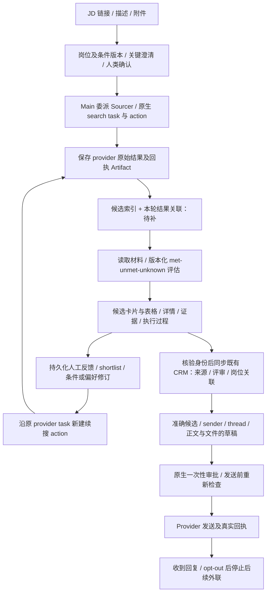

# WeKruit Recruiting Implementation Plan

> **For agentic workers:** Use superpowers:executing-plans to execute this plan inline, task by task. Independent work may run in parallel under the user's explicit authorization; keep file ownership separate and centralize deployment/acceptance.

**Goal:** 在现有 Rakazo 网页交付 Main/Sourcer 原生协作、可恢复交互与记忆，迁入现有招聘工作，完成 [GOAL.md](GOAL.md) 的 P0–P6 基础闭环与 [PRODUCT-SCOPE.md](PRODUCT-SCOPE.md) 的 Juicebox / Metix / Grok Bot 完整产品范围。

**Architecture:** 沿用 Rakazo Web → authenticated API → Postgres/worker → Pi → native tools/connectors → persisted result → Web。Supabase 独立数据库保存状态，原生 memory provider 保存记忆，Modal Volume 保存文件/检查点，E2B 提供原生执行环境。集成进入已有边界，不另建 harness。

**Tech Stack:** Rakazo/TypeScript、Pi、官方 Codex OAuth、Supabase Postgres、Graphile、Modal、E2B。

## 当前发布与缺口（2026-10-16）

Execution priority: feature implementation and direct product validation come first. Do not wait for CodeQL/CI after each push or treat those waits as a product milestone. Keep focused checks and preserve the full live acceptance requirements; merge, deployment, production migration and paid-resource authorization remain separate.

### 产品、数据与 UI 总览（当前执行入口）

**最终产品是一个可直接操作的招聘工作台和协作 Agent，包含持久数据、可追溯执行和完整界面。** P0–P6 是 M1 业务闭环；Juicebox/Metix 工作台、Grok Bot 式 Agent 产品、现有工作迁入和整品验收仍分别属于 M2–M5，181 项适用动作的范围不变。

下面按产品能力区分代码、发布和真实验收。历史记录里的通过只覆盖当次边界，不累加成完成率；不使用一个没有验收分母的总百分比。

| 能力 | 现在已成立 | 真正还缺什么 |
| --- | --- | --- |
| 登录、Codex OAuth、Main/Sourcer 与 Crew | 既有云端页面有正常登录、连续聊天和委派的窄范围证据 | 多用户/human 群成员、全部权限和任务树验收 |
| 原生记忆、选择、自定义 input、审批及恢复 | 部分原卡在真实容器替换后继续；记忆有写入/跨对话召回证明 | 所有卡型、多用户、未知外部写入、完整生命周期验收 |
| 岗位、来源和评估 | 版本化岗位、已保存评估、三态、Cards/Table 和部分原消息定位已发布 | 完整真实 profile/JD/PDF、全部输入类型、真实候选语义验收 |
| 原件读取、来源高亮、brief 与 G1/G2 | 新原件查看器、brief 确认与 G1/G2 执行连接已有工作分支代码；最近已提交 `dfd85463` | 尚未部署；不能当当前网页已有功能或真实业务通过 |
| 人工编辑岗位条件 | 原 Role 面板的语义条件、结构化年限规则及 hard/preferred 编辑已有代码，同事务保存真实人类来源和版本/CAS；未发布 | 条件增删/逻辑组重构、独立召回 filters 和全流程验收仍在 J06 |
| Autumn | 已接只读服务；原生 task/action/请求/回执及同 task 续搜有代码 | 新真实搜索→证据→反馈→原 task 续搜的整条业务链未通过 |
| CRM | 用户 OAuth、组织身份和只读发现已接；已有来源/评审写工具；发送前上下文读取已提交 [CRM PR #44](https://github.com/WeKruit/headhunter-agent/pull/44)，未发布 | 新人导入、身份/岗位关联、实际写读、可信发送镜像；PR 中抑制规则迁移尚未执行 |
| Instantly | 已接只读服务 | 真实精确审批发送、发送确认、回复停止；当前 REST 和既有 MCP 合同须分别核验 |
| 候选人完整工作台/Dashboard | 现有面板只读展示已保存评估和原始结果文件 | 未评估候选索引、岗位总览、批次/名单、服务端分页/筛选/排序、外联/面试看板和真实统计尚未完成 |
| 执行过程展示 | 原生 `ToolActivityDisclosure`、事件和 Activity 视图可复用 | 完整招聘步骤、委派树、任务/结果/证据/反馈的关联展示与实时/重载验收 |
| Agent 可替换底座与插件 | Pi、逐 bot 模型和原生 memory/skills/MCP/文件/routines 可复用 | 每 bot runtime/明确 connection、运行配置冻结、human 群成员等 M3 实际缺口未完成 |

#### 一条完整业务流，以及候选人什么时候落库

“找到候选人”就要保留原始结果和结果关联，不等评估完成才在产品里出现。**当前实现尚未做到完整结果索引**：原始页保存在 Artifact，已评估者在 `recruiting_assessments`；不能把这个现状描述成所有候选人已经进入 CRM 或可按字段筛选的人才库。provider 报告总数、实际拉取并保存的行数、本地去重人数分别展示；不能把第一页或未读 cursor 后的结果当作完整名单。

#### 数据存储：现有记录与需要补齐的应用记录

继续同一 Supabase 项目里的独立 `rakazo` 应用数据库及原有 CRM 数据库；文件使用现有 ArtifactStore/Modal Volume。不另建人员主库、记忆服务或 Agent harness。

| 数据 | 现有落点 / 关联 | 要补齐的产品行为 |
| --- | --- | --- |
| 岗位/JD/条件 | `recruiting_roles` + 不可变 `recruiting_role_revisions`；原件为 Artifact | 原文、hard/preferred、AND/OR/NOT、来源与版本差异可读/可改；计算条件同时保存真实规则，不能只改展示文字；修订使旧判断过期、旧批准不适用于新版 |
| 搜索/续搜 | `recruiting_research_tasks` / `recruiting_research_actions`；provider task ID、角色版本、请求/上下文/回执文件引用 | 每轮明确 action，继续同一 task；已排队、已完成、结果未知分开，不把 turn 停止当 provider 停止 |
| 原始结果/材料 | `artifacts` 保存元数据、hash、版本、权限；真实字节在 ArtifactStore | 保留原始字段和分页/时间，不用模型总结覆盖原件 |
| 候选身份与岗位名单 | **待补岗位候选索引**，沿用现有 `candidateKey` 关联评估；CRM `candidates` 仍是已接入人员的主记录 | 保存可靠 provider 身份或已核验 LinkedIn、展示字段、首次/最近发现、真实 CRM 引用；未知身份保留独立来源键，不按姓名自动合并 |
| 每轮找到哪些人 | **待补 action→候选结果关联索引**，绑定原始 Artifact/页/行 | 同一人重复出现不重复建人；每轮名单、原始来源、排序/页码可追溯，前端不必下载全部历史 JSON 来分页 |
| 资格评估 | `recruiting_assessments` 的 `(roleId,candidateKey,version)`；绑定岗位版本、facts/judgments/sourceRefs | 逐项 met/unmet/unknown、缺口、计算依据、历史版本；旧岗位评估显示过期 |
| 人工选择与反馈 | 原生人类消息/事件保留来源；**名单索引需补 shortlist/评审状态及对应版本/事件** | 临时 UI 选中不当作持久 shortlist；接受/拒绝/跳过与资格三态、CRM pipeline stage 分开 |
| CRM | 既有 `candidates` / `candidate_sources` / `candidate_pipeline` / audit | 新人导入、同源身份去重和岗位关联走明确用户/组织权限；来源保存成功不等于新人已创建或已归岗位 |
| 外联草稿/回执 | 原生 `external_effects` 的精确 request/result、审批事件及必要的原始回执 Artifact | 批准前没有发送；未知结果不重发。既有 CRM pending 队列不是草稿，也不能当已发日志；真实镜像才进 `instantly_emails` |
| 记忆/技能/连接 | 原生 memory documents/revisions、skills、加密 connections | 招聘记录不塞进长期记忆代替业务表；可复用偏好有 scope/版本/来源，插件可以替换但产品任务关联保持 |

岗位候选索引和每轮关联索引是待实现的数据索引职责，不是已经存在的表或已应用的迁移。具体字段沿当前 contracts/Prisma/API 最小实现，不建立重复的 CRM 人员库。去重使用同组织/客户及可靠身份，不自动套用旧脚本目录、CSV 或未经批准的跨客户冷却规则。

#### 前端必须交付的页面和交互

| 页面/区域 | 用户看到与能做的事 | 数据要求 |
| --- | --- | --- |
| Dashboard / 岗位总览 | 当前岗位、运行/等待/失败任务、待确认卡、候选数/待评审数、外联进展、最近活动 | 从持久记录/真实回执聚合；原始行数、去重人数、已评估、shortlist 和已发送分开计数，不造百分比 |
| 岗位工作台 | JD/条件、Candidates、搜索轮次/名单、外联、面试、Activity；同页可开 Crew chat | 当前 role/version/task 范围明确，切岗位不串候选、草稿、composer 或迟到响应 |
| 候选表格/卡片 | 姓名、职位/公司、地点、LinkedIn、匹配三态、缺口、人类评审/shortlist、CRM/外联状态、来源轮次；筛选/排序/分页/批量选择 | 未读取字段显示缺失；稳定 ID、服务器分页、持久 shortlist；不继续以技术 candidateKey 充当完整候选 profile |
| 候选详情 | 职业/简历、逐条件证据、unknown 缺口、原文/PDF/高亮定位、评估/反馈历史、所属岗位、CRM 与邮件时间线 | 始终回到具体保存版本与真实来源；profile/JD 往返保留各自阅读位置 |
| Crew / 执行过程 | Main/Sourcer 对话、@、委派、当前步骤、工具活动、任务/批次结果和下一步；原卡选择/input/审批 | 使用同一原生 thread/run/card；刷新或重启不新造任务；错误、未知、等待不能标成功 |
| Memory / Agent / 服务设置 | 实际采用的偏好及版本、每 bot 模型/连接/skills/tools/MCP、可用服务与权限 | 当前已配置、已连接、实际业务已通过分别显示；秘密不进 UI/日志 |

“思考链路”在产品里交付为**可核验的执行过程和判断依据**：需求版本 → 委派 → 实际工具/请求 → 原 task/轮次 → 原始结果 → 已读证据 → 判断/缺口 → 用户反馈 → 后续采用 → 审批/回执。每步可定位原消息、run/action、文件或 effect。仅在 provider 实际返回并允许展示时显示其活动/推理摘要，不请求、推测或伪造隐藏思考；已有 ToolActivityDisclosure 复用到这条链，不能拿转圈动画或 bot 自述当执行成功。

#### 接下来的交付批次

1. **首批代码已实现、待发布验收**：人工条件编辑（原面板 + 真实人类来源/CAS，计算条件使用结构化规则编辑）；CRM 发送前上下文/抑制读取（复用用户 OAuth/RLS）。候选角色兴趣使用现有 per-role RPC，不伪造 pipeline 的全局 interest 字段。
2. **候选数据与工作台**：补所有已找到候选的索引/轮次关联，接真实 name/profile 字段，交付服务端分页/筛选/排序、持久 shortlist 和 Dashboard 真实聚合。复用现有 Cards/Table/五视图，保留未评估者。
3. **反馈与 CRM**：从真实候选反馈到版本化规则、同 provider task 续搜，再完成已存在候选的来源/评审写读，以及新人导入/身份去重/岗位关联；写失败不能显示已同步。
4. **外联闭环**：G3/G4 精确内容/名单/设置审批；发送前读取真实 hold/pass/suppression/重复及邮件状态，保存 provider 回执，回复/opt-out 停止。优先原生 provider stop，不额外搭 outbox/poll 引擎；附件能力以实际合同为准。
5. **其余 M3/M4 与 M5**：每 bot runtime/connection/config snapshot、人类群成员、插件/文件/服务迁入等按 181 项并行补齐；最后逐项做多用户、跨对话、原卡等待时重启、未知结果恢复和整品验收。

每个批次都交付可测试页面/真实状态、代码 revision 和有边界的截图/回执。发布另行确认；生产迁移、工具分配扩大、定时续跑和真实外发不因计划写完而自动获准。完整闭环未通过前，M1/P6 不完成；全部适用动作未验收前，总 Goal 不完成。

当前条件编辑批次的 199 项聚焦离线检查及四个相关包类型检查通过。年限编辑直接改变实际计算规则，并用同一合成年限事实验证结果随门槛改变；不会只修改标签或从文字正则猜年限。原逻辑组/稳定 atom ID 保留，空提交不产生版本，失败和迟到响应保留或隔离正确草稿。CRM PR #44 的 26 项离线 MCP/auth 检查和类型检查通过。新增 PostgreSQL 用例与 CRM 的 17 条 SQL 断言均未执行；没有启动本地数据库、执行生产迁移或部署。这些结果不等于真实网页、数据库并发或完整招聘业务验收。

### Native document and calibration approvals (not deployed)

The next feature slice connects native human approvals to research dispatch. `recruiting_request_approval` uses the existing effect, file blocks and approval card for either an exact role document package (G1) or ten saved, sourced assessment versions plus rule changes (G2). The human can approve once or deny; an always-allow rule or model review cannot supply this business decision. The full redacted request remains available in the native card. The result preserves the original human approval event time, and its immutable receipt commits with the effect.

Research purpose and approval reference belong to each action, so calibration can progress to scale through a new action on the same provider task. Preparation, admission and execution claim verify the exact current role revision and the required native receipt. A confirmation in another owned thread remains valid; changing the old approval thread's selected role does not invalidate an unchanged approved role. Historical requests stay readable without inventing a purpose or replaying an unbound mutation. This preserves account access, quota and provider rate limits without adding approval to every search call; G1/G2 remain the playbook's human document and calibration decisions.

The additive migration only adds nullable purpose and approval-reference fields to existing research actions. It has not been applied to Supabase or any other database. No local PostgreSQL server is started. The final focused contracts/core/adapters/mocked-DB batch passes 518 checks across 12 files, seven related packages pass type checks, formatting passes, and independent specification and quality reviews pass. Regressions cover native one-time approval and frozen-payload replay, cross-thread confirmation, current versions, duplicate profile identities, exact observed URL versus prefix/query/fragment, native read proof and JSON JD body availability. The PostgreSQL fixtures were updated but not executed. This is not live Main/Sourcer, original-JD, PostgreSQL recovery or P6 acceptance. G3/G4 outbound enforcement, document generation, prompt/skill adoption and the full business flow remain open. CodeQL default setup was disabled at the owner's request; CI waits are not part of this work.

### Local takeover and real PostgreSQL acceptance (not deployed)

The owner explicitly returned execution to the existing local session. The earlier cloud-only execution requirement no longer applies; reuse the current checkout and preserve private configuration and work. This does not authorize deployment, production migrations, outbound actions or scheduled continuation. M1–M5 and all 181 applicable actions remain the finish line.

The five cloud commits through `756408e` were verified as descendants of the original handoff and fast-forwarded into the existing branch. The complete 494-line v1.0 playbook was recovered from its original recorded reads; its SHA256 matches the uploaded attachment. The original stays private rather than being replaced with the plan's summary.

Current migrations, including the new brief column, were applied only to a disposable PostgreSQL 16.15 database. The inherited recruiting suite passed all 208 checks. Seven added checks in the existing PostgreSQL file now exercise the real confirmation boundary: an immutable original draft and exact confirmed copy, one native human receipt, reconfirmation without duplicate writes, two-connection confirmation contention, an edit committed after confirmation preflight, rollback after the actual role-pointer update, and foreign-owner/space or changed-source rejection. Native Prisma query extensions provide the race barrier and post-write fault; database persistence and rollback are real, rather than mocked results. The final suite passes **215/215 with zero skips**, and DB type checking and formatting pass. The totals overlap and must not be added together.

One extended-suite attempt failed in setup because a test-cluster restart did not retain the custom Unix socket options; all 215 checks were skipped, not passed. The task-owned cluster configuration was corrected and its database, owner, data directory and socket-only listener were verified before the final run. The temporary server was stopped afterward. No production connection or migration, provider search, deployment, billing action or outbound message was performed.

These checks establish the tested database boundaries, not live UI/model, original-JD, complete playbook or M1–M5 acceptance. The product origin is reachable from this local session, unlike the earlier cloud proxy. A subsequent read-only pass captured all five current shared SKILL.md bodies from their native editors, without saving, and both Main/Sourcer instructions from the dedicated product database in a verified read-only transaction scoped to the existing Crew/thread and matching owner/space. The native editor screenshot, original instructions and skill text stay private. These are the existing configurations; they have not been rewritten or accepted against v1.0. Original-JD rereading, actual prompt/skill adoption, G1–G4 dispatch integration and the complete recruiting workflow remain open.

### Independent Agent instructions editor (not deployed)

Product state continues to use the existing independent Supabase database. The disposable local PostgreSQL server is stopped; no database server or migration was needed for this editor change.

A later process inventory found three additional idle legacy recruiting test/pilot clusters. All three had no client sessions and were stopped gracefully, retaining their data directories and leaving unrelated projects untouched. The checkout's ignored local environment file still describes the retired pilot; it is not the cloud deployment configuration. Do not restart those services for ordinary product or UI work.

Web/Electron and mobile settings now edit the full native instructions separately from the short description, using the existing update contract and its independent limits. Description/model/voice saves omit untouched instructions. Web saves retain failed drafts and newer edits during a pending save; genuine server refreshes update clean fields without discarding unsaved text. An instructions-only API update now emits the existing durable `bot.updated` invalidation event. The obsolete description-to-instructions helper is removed; bot creation retains its existing behavior.

Verification: 31 focused Web/API checks pass, with destructive description updates and in-flight revert loss reproduced before their fixes. Web/API type checking, formatting and catalog compilation pass. The existing mobile mocked component suite passes 16 checks using temporary resolution to already-installed React; the standard mobile startup still lacks native dependencies, so no full mobile type/device acceptance is claimed. The existing bot CRUD E2E test now saves instructions, captures the editor and checks them after a description edit/reload; that database-backed E2E has not run here. A screenshot of the existing local component fixture establishes the rendered controls only, not persistence or live model behavior. Generated catalogs include previously unextracted current UI messages as required by the existing extraction check.

This is a portion of B10, not Agent definition revisioning or B12 runtime configuration snapshots. Existing Main/Sourcer instructions and skills have not been rewritten, the production brief migration is still unapplied, and the original-JD/playbook and full M1–M5 acceptance remain open. No deployment, new dependencies, paid resources or outbound actions were performed.

### Saved evidence source inspection (not deployed)

The existing recruiting panel now opens retained source text and highlights the exact quoted UTF-16 range. Its shared Artifact reference checks the actual returned ID, byte length and SHA-256 before exposing the file or text. Native text and typed nested JSON string selections preserve whitespace and Unicode; HTML is plain text, and a PDF or invalid selection does not invent extracted evidence. Existing file preview/download, source kind, read state and unknown judgments remain intact. IDs/hash are disclosed only under Details. The DB persistence boundary and viewer use the same JSON/range readers; no new schema, dependency, harness or provider is introduced.

Actor access denial clears the snapshot, candidate selection and cached excerpts. This includes a late denial after another parallel recruiting/memory read already failed offline. Ordinary transient offline errors retain loaded results. Thread/candidate/source changes discard late reads, and changing roles remounts the source subtree rather than depending on an intermediate React render. Destructive integrity/cache behavior was reproduced before the fixes and covered in the existing component tests.

Verification: six focused core, adapter, mocked-persistence and panel files pass 222 checks. Core/DB/Web/adapters types and changed-code formatting pass. The existing browser fixture and Artifact preview test were extended; manual Chrome inspection confirms the actual panel's nested-JSON original text, highlighted quote and unchanged unknown verdict. This fixture is explicitly synthetic, not a live candidate, model, database or provider acceptance. The CI browser screenshot capture is authored but not run here. No PostgreSQL server, production mutation, search, release or paid resource was used.

The retained native JD bytes were also reread locally, with their hash and length matched to the original native capture. Responsibilities, qualifications, bonus sections and structured salary are present. This resolves the local original-material read gap; it does not establish website freshness or that the runtime has reread/adopted the material. No existing role was corrected or new search launched. The private audit keeps the original bytes and provenance out of the public repository.

A separate B12 audit confirms that resumed attempts reload current Bot instructions, model/defaults, tools and skills; ordinary runs have no immutable adopted Bot configuration. Original native approval requests/ownership remain bound. Optional Pi recordings and model-used telemetry cannot establish a historical configuration snapshot, so old waiting runs were not retroactively populated or touched. Actual prompt/skill adoption, configuration freezing, G1–G4 integration and complete M1–M5 acceptance remain open.

### Native approval provenance (not deployed)

Accepted approval-card answers now append a typed `effect.approval.answered` event in the existing answer transaction. The proof binds the actual authenticated approver, original card/index/effect, offered answer and SHA-256 of the canonical persisted request. Event creation time supplies the timestamp; the event does not copy request contents, secrets, or mutable effect timestamps. Allow-once, always-allow and denial retain their existing authorization and state transitions. A duplicate or rejected submission adds no proof, and realtime follows only the committed final event sequence. Ordinary answers and secret cards keep their separate paths; no historical approvals are backfilled.

The 19 focused mocked-persistence and contract files pass 342 checks, including 95 native event checks. Canonical hashing, teammate attribution, invalid/missing effects, forbidden answers, duplicate/claim loss, strict payloads and proof-append failure are covered. DB/contracts/core/API/Web/worker types and changed-file formatting pass; independent specification and quality reviews pass. This establishes the native proof-writing path, not real PostgreSQL rollback, live approval recovery or G1–G4 enforcement. No database schema, service, dependency or UI copy is added.

Original v1.0 requires G1 for normal calibration and G2 for later scale. The next integration must bind an immutable document package and exact role revision to the native approved request, distinguish calibration/scale in the frozen research action, and verify the trusted proof again at admission and execution claim. Existing `ExternalEffect.request` already preserves the exact structured request, so do not introduce another receipt service or duplicate request archive. A normal always-allow or model review is not a business gate proof, and a changed role/package cannot inherit approval by assumption. The separately permitted early-calibration exception remains unsupported until its exact human authorization is represented.

CI/release evidence: the repository's original workflows are present, but the live Actions page explicitly reports that inherited workflows are disabled on the fork. Four green CodeQL checks do not establish native lint/type/unit/Postgres/browser CI or produce its screenshot artifacts. The API's general Actions-enabled flag does not override this fork restriction. No workflow setting was changed. A read-only billing check also reports existing billable workspace usage, not an application-specific total; no new cloud build, deployment, production migration or paid resource was initiated.

### Playbook v1.0 implementation batch (not deployed)

The complete user-supplied v1.0 (2026-10-16 PT) supersedes v0.2 for product behavior. Older documents remain evidence archives. Its legacy paths map to native role revisions, ArtifactStore, encrypted connections and existing DB/MCP records; they do not establish local file availability or authorize tracker migration. Proposed [I]/[GAP] items, historical approvals and templates are not live approval. No new vendor, scheduler, filesystem tracker or agent harness is introduced.

| Playbook scope | Existing implementation / plan mapping | Acceptance still required |
| --- | --- | --- |
| S1 company context, original JD and G0 brief | M1 T02/T04/T07; M2 I01/J01/J03/J06/J16. This batch adds field provenance, material-only clarification selection, immutable brief revisions and a human-only CAS confirmation in the existing Role panel/API. Draft/inferred rules cannot become hard rejection criteria. | Main/Sourcer instructions, all five shared skills and the retained native JD have now been read locally. Runtime original-material rereading, semantic adoption against v1.0 and live confirmation remain open. |
| S2 named/anonymous JD PDF, deck, G1 | M1 original artifacts; M2 J11/J16; M3 G library/files; M4 authorized source migration. | PDF generation/preview and exact document approvals; no invented extraction or deck. |
| S3 exactly ten-profile calibration, G2 | M1 T05/T06/T10; M2 I04/I05/J05/J08/J10. Shared gate guard checks ten distinct evidenced profile identities and current exact receipts. | Real sourced ten-profile batch and native persisted G1/G2 approvals; no live query performed. Explicit early-calibration exception remains unsupported rather than implicitly allowed. |
| S4 feedback and versioned learned rules | M1 T03/T04/T05/T06; M2 J05/J06/J17. Confirmed brief rules are frozen into the actual subsequent provider request, not only panel text; later revisions invalidate confirmation. | Real original-task continuation, feedback-to-rule UI/semantic acceptance, revocation and provider adoption evidence. |
| S5 scale, dedupe, quota | M1 T05/T09; M2 I06/I09/J09/J14. Preserve existing task/action/usage identities and unknown-result handling. | Per-client dedupe/suppression, cross-client overlap, quota and full scale admission integration. Proposed cooldown is not installed as policy. |
| S6 email enrichment | M1 P4; M2 I13/J14; M4 authorized services. | Existing connected vendor/permission/quota validation, no phone collection, personal/work policy, verification and source receipts. Proposed fallback vendors remain disconnected and unapproved. |
| S7 draft campaigns/import/activation, G3 | M1 P4/P5; M2 I10/I11/J07/J13 and Metix M11–M14; M3 native approvals. | Persisted exact copy/list/exclusions/settings approvals and dispatch enforcement. No campaign import/activation in this batch. |
| S8 approved copy | M1 P5; M2 I10 and Metix M11/M12. G3/G4 policy primitives bind exact payload/revision/actor. | Approved salary/disclosure/opt-out wording, em-dash/content/package checks and actual native approval storage adapters. |
| S9 replies, suppression, CRM-note exception | M1 P5/P6; M2 I07/I11/I12; M4 mail/CRM. Deterministic suppression, hold/pass and duplicate blocks precede every exception; missing checks fail closed. H9 uses actual verified discovery provenance, never a canned false LinkedIn claim. | Canonical suppression/read histories and runtime connector dispatch integration; no automatic replies authorized by this document. |
| S10 resume/prescreen/comp-gap handling | M1 P5/P6; M2 I04/I07; M4 CRM/mail/forms. | Two-follow-up cap, actual resume/PDF/deck evidence, strong-candidate comp-gap flagging and human decisions. Inferred timing remains a proposal. |
| S11 approved client submission | M1 P5/P6; M2 J13/J14; M4 CRM/ATS. | Exact submission approval, consent/STOP checks, client-facing redaction and durable receipts. |
| S12–S13 scheduling, prebrief, outcomes | M1 P5/P6; M3 native cards/files; M4 calendar/mail; M5 recovery/permissions. Scheduling always needs exact approval, including under CRM-note/policy exceptions. | Named JD/deck/resume package, thread/calendar reads, HM confirmation, one-shot booking and prebrief; no booking/link/invite sent here. Proposed reminder timing remains unapproved. |
| CRM, audit, ownership, surfaces and recovery throughout | M1 T09; M2 workspace; M3 agent/group/memory/plugin boundaries; M4 migration; M5 all 181 applicable-action acceptance. | Full actor/organization/mobile/read-only/recovery and external uncertain-write checks. Historical pending cards/effects remain unchanged. |

G0 is integrated into native research preparation and dispatch. G1–G4 exact-receipt and outbound-blocking primitives have deterministic offline tests, but their native approval-storage adapters and complete connector-dispatch integration are still open; this is not a claim that all outbound routes enforce the new playbook. The brief schema migration is authored only and has not been applied to production. Real PostgreSQL atomicity/concurrency and live UI acceptance remain unverified in this batch. New human-facing copy is limited to brief fields/provenance, confirmation and a conflict error shown only when relevant.

First-batch verification: the eight targeted English test files have 233 passing checks after resolving the observed failures, including intake policy, mocked confirmation persistence, native API/panel, research adoption, context projection and eval registration. DB/adapters/API/Web/contracts/core/testkit type checks passed. Existing unrelated passing suites are not rerun for activity. No production mutation, deployment, authentication setup, credential read, scheduler change or external message was performed. Mocked transaction checks do not establish real PostgreSQL concurrency/recovery, and eval registration/grader checks are not model trials or sourcing-quality results.

Review follow-up: current-revision G0 is checked at preparation, admission and execution claim; role/brief writes retain actor/space scoping and native human provenance validation, and revisions clear prior confirmation. A focused regression reproduced an empty projected artifact page whose continuation offset did not advance when no code point fit. Projection now returns the existing same-offset retry instruction instead. The eight targeted English suites pass 234 checks, with another 17 artifact authorization/integrity/API checks passing; adapters type checking and formatting pass. These remain offline/mock/jsdom checks, not PostgreSQL, original-JD, live UI or model acceptance. G1–G4 dispatch integration and the full M1–M5 goal remain open.

Legacy replay/G0 fixture repair: completed native role receipts serialized before the brief column now compare a missing brief as null only; returned/stored receipts are unchanged and other canonical/ownership checks remain strict. The executable replay regression failed before the fix and passes afterward, with foreign actor/space and unrelated tamper rejection checks. Shared PostgreSQL research fixtures now use sourced draft data and the actual human confirmation function, including reconfirmation after revisions and dynamic revision expectations; draft/stale G0 rejection cases are retained or added. Focused English offline suites pass 153 checks and DB type checking passes. PostgreSQL collection reports 208 skipped tests with database opt-in and connection variables explicitly unset: no designated isolated nonproduction database or local PostgreSQL executables are available. These fixture changes are statically checked, not real PostgreSQL acceptance; no database connection, migration or production action was performed. M1–M5 and live-source acceptance remain incomplete.

The external quality suite is [LessieAI/people-search-bench](https://github.com/LessieAI/people-search-bench), inspected at `f1afbb928e7eb6104e8255d5a882fc1820682cb7`. It is separate from internal playbook acceptance and does not establish the location of the user's older benchmark. Two English adapted prompts (`rec_0001`, `rec_0002`) are explicitly labeled in the existing eval cases; age-based `rec_0006` is excluded. The existing cases/runner/services are reused for synthetic intake diagnostics; neither model trials nor the external live-verification benchmark have run, and no benchmark score/equivalence is claimed. No missing dependencies were installed.

云端接手批次 `37d943e` 已推送工作分支，仍未部署：共享原件授权读取与原生只读 `artifact_read` 已实现，核验实际字节/hash/长度并按 Unicode code point 连续分页；不改变 context budget。当前云端冻结离线安装、官方 Prisma generate、原两份 adapter 回归 120 项、相关回归 285 项（含六项新增读取检查）、DB/adapters/API/contracts/core 类型与格式检查通过。原生文件存储重新打开仅为离线合成恢复证据；真实同线程原件读取、条件修订和生产恢复仍待验收。

网络诊断已区分执行沙箱权限与目标策略：使用平台支持的网络执行权限后，既有代理可访问代码仓库与官方包索引；Modal 域名仍被代理策略拒绝，等待官方云配置审核放行。官方 Modal CLI 及代理支持已装入独立私有工具环境，产品依赖不变；当前版本无 `--no-browser`，正常 headless 回退会显示本人授权 URL。尚未生成真实授权入口或完成本人批准，未部署、迁移、读取 Secret 或业务外发。真实主机、私有路径与认证/执行回执单独保留，不写入公开计划。沿用现有原生云端调度，不另建 scheduler/harness 或重复 Goal 文档；M1–M5/181 项范围与所有未验收边界保持。

Your dot 接手入口为 [DOT-HANDOFF.md](DOT-HANDOFF.md)，含代码/发布基线、私有访问说明的交付方式、第一项实现和可复现检查。下面历史记录中的“原文件完整”不能直接否定模型显示截断：本轮源码检查及离线重放已确认 retrieval 策略会缩短已有后续工具调用的较早结果，并标记 `contextTruncated:true`；原文件仍可为 `truncated:false`。当时实际模型投影未保存，不能声称已重建历史输入。保存 v2 不代表已重读原件或正确判断条件；下一步复用原生 Artifact 授权/存储，补通用只读原件读取，不改全局预算或追加固定业务流程。

当前线上代码为 `46b880f`，实际容器源码和 API health/ready 已核对（ready 非 degraded）。普通 Ask 恢复改用经过原生回执核验的当前人类答案、真实 user/assistant 历史和受上下文预算保护的原目标/问答；保留私有任务状态及技能，不伪造 toolCall/checkpoint，不新增存储字段、依赖或 harness。审批、密码及 takeover 仍走原有独立恢复路径，混合暂停的完整线上验收保留。

`fac9883` 的实际容器替换前后，原 Crew 的 93 条消息/39 个 run、Intake 的 16 条消息/5 个 run、旧 effect、成员、连接及记忆逐项相同，五份原生文件字节/哈希匹配。随后点击替换前已等待的第三张语言原卡：同一 run 完成，原 sourceMessageId 不变，仅新增人类答案和准确的 English 代码块，没有第四次提问或额外工具。另一次正常聊天产生新卡，多行自定义输入含首尾空白、中文与 emoji，共 37 个 UTF-16 单位，原卡/人类消息/最终代码块逐字一致，同一 run 完成，无新 effect；这轮自定义输入没有再替换服务容器，不能冒称该新卡的独立跨重启验收。

岗位引文也已复用评估链的真实文件读取与精确 quote 核验：先授权后读字节，提交时复核来源权限、哈希/长度/原生读回执和选区；角色 sourceRefs 的消息定位统一为 `blocks[n].text`，Artifact `text` 只指向实际文本或 JSON 的 text 字符串，不支持的定位拒绝。无 quote 的引用仍只是位置索引，不追认旧引文。普通问答链 356 项离线、完整招聘真实 Postgres 196 项、API/DB/adapters/worker 类型与独立审查通过；检查不替代实际 JD 岗位创建验收。

`231c090` 已发布原生引文错误反馈修复，源码与 API health/ready 已核对。真实失败的四条引文省略或拼接了已读正文，另外两条连续原文合法；权限、字节/hash、读取回执都正常。共享边界只在已授权文本找不到提交引文时给出引用 ID/locator 和连续原文修正提示；权限/hash/回执及 typed selection 错误保持原拒绝，不返回材料或引文正文。原生 effect 确定性关闭、API 返回 BAD_REQUEST，原有不确定结果处理不变。24 项真实 Postgres、104 项相关单测、三包类型/格式及独立 28 项检查通过。实际聊天能否据此正确创建岗位仍以本轮重试为准。

本次发布另补齐新自定义卡等待时的实际容器替换：Intake 26 条消息/8 个 run、原卡和六份文件字节/hash全部相同；原 Crew 的 93/39 及旧记录不变。恢复后在同一卡提交 42 单位多行原文，同一 run/source 完成，卡片/人类消息/代码块逐字一致，仅新增两条消息，没有新 effect/文件或外部业务。Agent 额外读取一次内部历史，因此原卡回环通过，但测试中的“只回复、无其他工具”约束未全部满足；不隐去该调用。

`231c090` 的实际 JD 重试仍未通过：模型先把 criterion 的 sourceRefs 写成字符串，原生校验拒绝后改为八个真实来源对象和短引文；创建进入共享事务，实际在 15,348ms 时超过现有 15,000ms 预算并回滚。后续原生读取和面板均确认无岗位/版本，没有搜索、CRM 或外发。报错的 thread.findFirst 仅是事务过期时的位置，不当作最慢 SQL 的证据。共享来源链对同一文件的八条引文重复读取/授权已定位，查询计数和最小复用方案正在核对，尚未修改或提高超时。此次 create effect 仍为 executing，另加入 T09 原生审计，不能因为 run completed 就当作成功或清理记录。

`d5a3cb7` 已修复并发布同一来源的重复元数据读取：实测同文件一条引文 54 次 SQL、八条不同引文 110 次，新增七条引文各重复八次来源链读取。在单次事务校验内复用已锁定消息/Artifact、读回执及来源身份；每条 quote、URL/readAt/hash、locator/selection 仍独立核验，不跨 actor/事务缓存，不提高 15 秒预算。完整招聘 Postgres 198 项、最终 focused 4 项、独立真实 Postgres 4 项及类型/格式检查通过。

此次真实容器替换前后，Intake 的 30 条消息/9 个 run/八个旧 effect 与原 Crew 的 93 条消息/39 个 run 保持；七份既有原生文件字节/hash相同。随后网页正常 @Sourcer 的 JD 录入已保存并绑定本群岗位 v1：数据库角色/修订/线程绑定、completed create 回执和 Role 面板一致，六条 hard 与五条 preferred 保留真实原文来源，5+ 年是 hard、React/TypeScript 是 preferred。仅新增一轮 run、两条消息和一次成功 create；第一次缺 definitionQuestions 数组被原生 schema 拒绝后由同 run 修正，失败记录保留。实际保存的读取文件为 truncated:false、text 4993 字符；Agent 却在岗位及回复声称显示截断。该不一致作为输出/抽取完整性缺口保留，不把模型注记当作上游截断事实；年限/示例技术定义和完整 JD 抽取/P6 仍待验。

`46b880f` 已发布 native role 领域与回执同事务提交：复用已有评估模式，在原事务锁 run/effect，验证真实 actor/源输入/精确 request/live lease fence，保存岗位/版本/绑定、不可变 completed receipt 和现有事件。两处重放入口重新核验历史角色版本、真实人类与材料原文，不受已清理 steering 关联影响，不覆盖后来的人类修订/绑定；返回仍脱敏，私有领域回执不再被 materialized 输出覆盖。直接人类 API、模型 schema、15 秒预算和历史 executing 都不改。最终真实隔离 Postgres 206/206、adapter 120/120、两包类型与六文件格式通过；独立 PG8/executor5 通过，非选中用例不计为通过。生产新容器 health/ready 非 degraded；替换前后 Intake 32 条消息/10 个 run/岗位 v1、九份文件与原 Crew 93/39 逐项保持。

随后普通同群聊续聊实际修订同一岗位 v1→v2：名称、全部 criteria/preferences 与原有 sourceRefs 逐字保留，只移除一条截断注记并新增当前真实人类来源；旧 v1 不变，DB/immutable receipt/effect.recorded/面板 v2 一致。一轮 run、两条消息、一条 read 与一次 revise，没有新建岗位、搜索、CRM 或外发。但 Agent 没有读取原材料，仍把此前截断说明当作事实，未核实原文件与模型显示上下文的区别，且未正确执行请求中的条件判断。只验收版本保存/原子回执，不验收来源核对和完整指令语义；下一步复用原材料/Artifact 读取入口，不能用旧 bot 注记充当事实或追加固定业务流程。历史 executing 记录仍单独审计，不因本次成功销账。

`fac9883` 的自然 JD 录入未通过：Sourcer 完整读取公开正文及真实 sourceMaterial 后，创建请求被来源边界拒绝；随后一次 `bind:null` 返回未改变、无岗位。没有搜索、CRM 或外发。真实失败请求和回执保留，继续核对具体的来源身份/quote 校验，不放松权限或把 Agent 回复冒充保存成功。

上一轮线上代码 `3d8ee97` 新增首份 JD 的原生读取回执、标准 JobPosting 正文读取、原始检索快照读取视图及服务端拥有的新建岗位初始版本；不新增执行器、依赖或存储表。真实官方 JD 在尚无岗位的新群里读取成功，原生文件实际字节与哈希已核对，容器替换后仍相同。但正常录入任务尚未成功保存岗位：第一次因初始版本工具参数失败，修复后第二次仍在进入执行器前失败且没有当次参数记录。新增原生审计后，第三次实际定位到 atom ID 缺失，纠正后又出现来源嵌套层级/readState/readAt 错误；校验均拒绝，未产生岗位。`3dcb390` 已补齐工具说明的精确结构；本轮已从普通聊天重新提交公开 JD 录入，结果单独验收。

此前 `6db30b2` 的 T07 原卡/局部重评、共享事务预算及评估工具原文保真继续保留：原卡跨实际容器替换后，从 Missing info 选择返回同一原卡并恢复原 run 已验；修复前的重评失败保留。普通聊天继续保存 v2，新 run 的面板选择→第二张原卡→等待时实际容器替换→自定义输入→一次局部重评 v3 已验，未受影响来源和职业判断保持，没有另发继续消息或新建 run。岗位定义补问及完整卡片/业务验收仍待完成。

M2 原始检索快照读取已实现并发布：按真实 task/action/Artifact/hash 校验，保留 provider_report、原始字段、来源与 cursor，未评估行不冒充候选资格判断。当前生产领域 task/action 仍为空，旧 MCP 归档没有被伪造映射；此部分有离线检查，真实新检索结果网页验收仍待完成。完整搜索代际、分页、筛选、排序与 profile 继续保留。

`afe69d9` 补齐原生 Pi 在执行器之前拒绝工具时的现有完成审计，主 agent/subagent 共用，成功及 host 错误不重复；不保存完整被拒参数，未知工具用固定错误。相关四文件 258 项检查、adapters 类型检查、Biome 和独立审查通过，另独立重跑五个真实 Pi 假模型流用例通过。原始模型错误和参数校验保持；此修复不等于已经定位或修好 JD 创建。实际新容器 health/ready 已通过，发布前后原 Crew 与新 intake 群原生记录逐项相同。

两条历史测试 executing 回执仍待 T09 审计：T06 旧语义校验错误、T07 旧 5 秒事务超时。后续成功不代表旧记录已收尾。合成材料验证不替代真实招聘闭环、web/PDF/CSV 完整材料提取或数值规则网页验收。

`bf7a6d6` 同批发布原文输入修复：复用现有 Textarea，普通卡片、composer、附件正文、bot/group 等待回答与后台续执行不再整体 trim；DB 人类消息证明改为精确比较。225 项离线检查、3 条真实隔离 PostgreSQL 的 custom/choice/composer 持久恢复路径、Core/DB/API/Web 类型检查和独立审查通过。移动端源码同步，但本机缺依赖，未声称移动端类型、设备或完整跨端验收。原生选项匹配语义保留。网页已确认实际重启后的原卡保存 26、34、37 UTF-16 单位的非选项自定义原文；这只证明输入与持久化，不代表正确续执行。第一次 Main 回答后转去处理旧 JD；已定位 conversational 回答仅保留答案、Pi 又按原 sourceMessageId 去重删原请求，`a43508b` 保留了原目标及问答。随后模型仍重复提问。`3d8ee97` 在共享恢复函数加入通用已回答阶段说明，通过 322 项离线检查、3 项真实 Postgres、类型/Biome 与独立审查；实际替换容器后，第二张原卡、原 run、14 条消息及五份 Artifact 保持，37 单位原文回到同一原卡、原目标只保留一份，但 Main 又提出第三张相同问题。此完整聊天续执行未通过，不把测试 green 或通用说明当作解决。未新增读取、业务效果或岗位；原 Crew 的 93 条消息、39 个 run、成员、模型连接及旧待答卡逐项保持。后续须收口当前回答身份与原任务/历史消息的恢复协议，先获取实际运行内容证据，不继续追加业务提示词或改用固定对话流程。

M1–M5 均未完成。完整范围和 181 项动作继续执行，P6 通过后不停止；M2 候选读取工作台已按共享读取/API 与原生 Panel 分工并行。

M2 首批 `a7f52e1` 与原卡回答元数据修复 `6db30b2` 已一起发布；新容器源码、health/ready 已核对。发布前后原有 87 条消息、38 个 run、成员、模型连接引用、effect、记忆、文件状态和评估逐项保持。网页实际验证 Cards/Table、选中详情、刷新后保持、原岗位版本条件及 Message 按钮定位原消息。此批只展示已保存评估，完整 profile、搜索结果代际/分页/筛选/排序与完整 M2 继续保留。

本批 9 个 focused 文件共 398 项检查通过（含 191 项真实隔离 Postgres），API/Web/adapters 类型检查、Web 生产构建、9 个代码文件 Biome 和独立审查通过。此前自定义答案已回到原卡，但 Agent 把 50 单位选区写成 43 而被拒绝；现已让同一 run 的真实卡片回答复用启动/steering 的来源元数据 helper，并提供完整 UTF-16 selection，不放松来源校验。新的“选择→第二张原卡→等待时重启→自定义输入→局部重评”直达路径已在网页通过；两张卡和两次回答归同一 run，恰好一个成功 reassess effect、一条最终回复，版本 v3 以 0..50 选区精确引用新答案，原来源和职业判断相同。此窄路径不代表所有卡片、岗位定义补问或真实招聘业务已通过。

## 总交付范围（2026-10-16 扩展确认）

P0–P6 保留为 M1，不能再作为最终停止条件。完整动作与验收见 [PRODUCT-SCOPE.md](PRODUCT-SCOPE.md)：原 Grok 139 项加已研究工作台/Agent 补充能力，共 181 个稳定 ID。上游现成能力先检查实际调用链并验收；没有逐项核对的能力保守标为待验，不一律重写。

| 里程碑 | 实施范围 | 当前进度 |
| --- | --- | --- |
| M1 基础闭环 | 本文 P0–P6、T01–T10、CRM/审批发送/回复停止 | 继续执行，未完成 |
| M2 招聘工作台 | JD/条件、项目/岗位、候选 card/table、证据定位、校准、搜索轮次/名单/外联/interview 与用量 | 五视图只读部分已实现并发布；真实数据、编辑与其他动作继续验收 |
| M3 完整 Agent 产品 | Agent/群聊/A2A/subagent、每 bot 配置、可替换 runtime/memory/skills/MCP、全部卡片、文件/Library/Computer/routines | 部分原生能力已有窄范围线上证明；完整动作未验收 |
| M4 服务/工作迁入 | 原 Grok 服务、文件、任务/去重/checkpoint、例行工作，招聘业务集成 | 对话已归档，三服务只读已接，完整迁入未完成 |
| M5 整品验收部署 | 全量动作、多个真实用户/组织、当前版本网页/适用跨端、恢复/取消/幂等及部署 | 未完成；不能以 M1 或离线 green 代替 |

原生源码核对已确认 M3 的真实缺口：逐 bot runtime/credential、human 群成员、逐成员/子任务取消、SKILL.md/plugin 的逐 bot 分配、team 记忆提升、多选/schema/URL 表单，以及部分 Library 预览/改名/外部来源索引。普通自定义输入的原始文本保留已在共享输入链修复，完整续执行仍按最新发布验收记录判断。逐 bot 模型、bot 群聊、taught skills、单选/自定义文本、原生 Artifact 与 routines 有可复用调用链，仍按各自证据验收；不能把这些相近能力当作缺口已完成。

并行顺序：先收口当前读取恢复、原生面板与证据 core；同时按矩阵核对已有 Rakazo agent/settings/group/plugin/routine 能力。源材料与 UI/API/业务权限独立推进，所有共享 executor/contracts/router 仍统一集成。所有参考分析发现保留出处与“已观察/静态推断/未知”的差别，不把分析工具的输出当产品正确性证明。

## 当前执行重心：招聘产品

已纳入另一 session 的 [T01–T10 招聘产品计划](RECRUITING-DOMAIN-PLAN.md)。原 P0–P6 继续作为 M1 闭环框架；完整 Goal 以 M1–M5 和 181 项动作验收为准，新计划自己的六个阶段不覆盖或重新编号本文件的阶段。当前先补产品真值与交互，不继续执行此前的 Dyna 搜人示范。

搜索/续搜按已授权账号能力、现有额度和 provider rate limit 执行，不逐次弹人工审批。原生审批仍用于外发等确需人类决定的副作用；需要新增付费就停。当前真实 JD 样例采用用户确认的 5+，所有年限/月份门槛由当前岗位版本提供，导入计划的 7+/84 月不是全局规则。

| 新任务 | 纳入原阶段 | 当前状态 |
| --- | --- | --- |
| T01 契约与三态 | P2/P3 基础 | 已随 `6554c46` 发布，25 项 focused/类型检查及独立审查通过；尚不代表网页逐项筛选已验收 |
| T02 岗位版本/隔离 API | P2/P3/P6 | 代码完成：五类记录、thread/run 字段及七个受权 RPC；8 项真实 Postgres 与 5 项 API 检查、独立审查通过；已随 `6554c46` 发布并在独立应用数据库应用迁移；业务 UI 验收待完成 |
| T03 memory 生命周期 | P2/P6 | CAS 已贯通 Web、原生工具/Pi、模拟执行器及导入；撤销和受权历史检查通过；T04 已补采用快照的代码，均随 `6554c46` 发布；新生命周期网页验收仍待完成 |
| T04 语义写入/上下文采用 | P2/P3 | 原生岗位/上下文快照、四类反馈、偏好写入守卫及普通原卡回答作者链已有代码；偏好来源 UI 和完整验收仍待完成；已有代码随 `6554c46` 发布 |
| T05 Autumn 业务 action/恢复 | P3/P6 | 五个原生操作、冻结请求/回执、跨 run action 与同 task 续搜代码已随 `6554c46` 发布；原读回执跨新 run 自动补齐与原 effect 的 lease/权限校验已在 `2cfb909` 实现及审查；云端业务恢复仍待验收 |
| T06 证据与资格判断 | P3/P6 | 已贯通 typed facts/精确来源、原生评估工具、不可变持久评估及网页三态/年限展示；普通聊天保存、读回、重启保留及合成材料局部重评 v3 已验；完整材料提取、真实数值门槛及真实招聘材料重评仍待验收 |
| T07 补问/局部重评 | P2/P3/P6 | 已复用原生问答卡、effect、作者链和五视图接入岗位/候选版本绑定与局部重评；代码检查及独立审查通过，已发布 `6db30b2`；原卡跨实际容器替换恢复及面板选择续跑已验；普通聊天继续完成局部重评 v2；新 run 的连续两张原卡/选择/自定义输入跨实际重启直接保存 v3 已验，岗位定义补问仍待验 |
| T08 五视图/手机原卡 | P2/P6 | 五视图、原卡消息导航/面板回答已发布；当前增加已保存候选 Cards/Table、原岗位版本详情及消息证据导航并实际验收；完整 profile/材料定位、编辑、手机及全部交互仍待完成 |
| T09 隔离/恢复全链路 | P6 | 现有窄范围回归保留，新增领域链未验收 |
| T10 真实样本报告 | P3/P6 | 产品接通后再验收，不现在运行样例搜索 |

M1 内顺序：T01 → T02/T03 → T04 → T05/T08 → T06 → T07 → T09/T10；共享 executor/router/contracts 统一集成。原任务 7/8 的 CRM 与 Instantly 仍保留，并在产品链后完成，不因新计划未包含外联而缩小 P6。M2–M5 继续按完整矩阵推进。

### 并行推进的 M2 首批：候选读取工作台

- 扩展现有 `listAssessments/getAssessment` 的同一读结果：返回评估对应的原岗位修订和服务端核验可见的来源消息目标。条件标签/要求或偏好取该评估的原修订，当前修订只决定是否过期。
- 在现有 Evidence 页复用 Card/Button/Tabs，增加 Cards/Table 和选中候选详情；原生语义 table，不新增页面、表或依赖。来源通过已有 `onRevealMessage` 打开实际 bot/group 的原消息，Artifact 继续既有下载路径。
- DB/contracts/API 与 Panel 按文件边界并行；用原修订、跨会话/越权、切换/刷新/迟到响应检查共享读取链，集中集成后发布及网页验收。
- 此批仅展示已保存评估；未评估搜索结果、结构化 profile、搜索代际、服务端分页/筛选/排序、精确片段高亮继续保留，不据此标记 J10/J11/M04/M08 或整个 M2 完成。

## 实现与发布记录（2026-10-16，按批次保留）

以下历史批次中的“未发布”“下一批”与未完成项保留当时边界；当前线上状态以上述摘要和最新发布记录为准。

本批 T01/T02/T03 的 17 个 focused 文件共 248 项检查通过（含 22 项真实 Postgres，零跳过）；另有原生认证 API 两项定向越权检查通过，API/testkit 类型检查通过。T02 与 T03 分别经独立 spec/quality 审查；岗位条件修订与记忆保存都在原生事务中处理版本冲突，不另建 harness、依赖或模型。网页冲突会保留草稿和原版本；同一 bot 连续记忆不会抹掉前一条。直接 pg adapter 提交冲突已在共享重试函数修正，只对既有两类事务冲突最多尝试三次。

T04 本次补齐原生岗位读/建/修订/选择工具，写入来源取真实人类消息及已领取 steering，并保留版本冲突检查。运行指令、工具返回和 steering 使用当前数据库岗位及原生记忆的完整采用快照；原生 Artifact/event 保留具体版本、哈希、使用片段和截断状态。上下文加载中断后的完成回执能恢复，不重复创建；取消选择后不复用旧快照。岗位硬条件及记忆全文读取不被工具压缩截断；Pi 的既有 schema 转换保留递归条件定义。此项是 T04 的一部分，不代表反馈、通用记忆语义约束或完整招聘链完成。

本次 T04 集成的 19 个 focused 文件共 379 项检查通过，含 19 项真实隔离 Postgres，零跳过；contracts/DB/adapters/API/worker 类型检查、21 个变更代码文件的 Biome 及独立 spec/quality 审查通过。检查包括原生工具 schema 到 Pi 验证、完成回执后的中断/竞争恢复、steering 来源与实际注入、递归条件及长上下文保真。未调用真实 provider、未修改生产数据库、未新增发布。

T04 第二批新增原生 recruiting_feedback：岗位、本轮召回、候选事实只记录带来源/版本的提议，交给对应领域工具，不冒充已改动 Action/Assessment；明确可复用的偏好经原生 MemoryStore CAS 写入。精确 UTF-16 文本锚点支持添加、替换及撤销，其他正文保持不变。remember/shared/save_memory 的招聘写入走同一校验，不复制到 semantic provider；实际写入事务重新验证当前 run、真实人类来源、scope、版本和完整正文，覆盖直接脚本写入路径。

偏好文档、revision 和原生 memory.revised 来源回执同事务提交，保留操作、原锚点、新锚点及实际人类来源；已记录的新来源阻止旧输入覆盖。原来源被删除或属于无记录的历史时，明确标为来源顺序未验证，不伪造历史。既有工具及底层记忆工具的审批/禁用规则都保留；未知写入错误不伪造成完成回执。第二批 26 个 focused 文件共 527 项通过，含 40 项真实隔离 Postgres，零跳过，独立 spec/quality 审查通过。

普通原生 Ask 已补真实作者链：卡片点击创建原生人类消息，输入框回答复用同一条消息；原卡、原 run 与严格的来源引用事件在同一事务保存。选择记录实际可见的标签，自定义输入保留原文，审批和密码不产生普通回答授权。重启后的岗位/偏好写入核对真实作者与原卡，并采用实际回答；Main 委派或无起始消息的例行任务同样适用。后续已领取的人类消息不会被旧完成回执倒退覆盖。逐条偏好的当前锚点及 UI、T05/T06 对提议的应用仍未完成，尚不作为云端网页验收。

本批作者链集成检查：28 个文件共 700 项通过，包含 75 项真实隔离 Postgres（领域 41、记忆提交 20、采用快照 9、记忆 API 5），零跳过；API/worker 类型检查、10 个变更代码文件的 Biome 及独立 spec/quality 审查通过。没有新迁移、真实搜索、生产数据库修改或新增付费发布。下一步沿既有 MCP/ExternalEffect 实现 T05 的冻结请求、跨 run 业务 action、同任务续搜及未知结果恢复，不新增 provider 客户端或执行队列。

T05 本批沿用原生 MCP discovery、ExternalEffect、Artifact 与 Pi，接入 recruiting_research 的 prepare/start/status/rows/continue。发送前固定岗位版本、实际记忆及请求原文；跨 run 使用同一业务 action/effect，先保存真实 MCP 回执再归并 task。续搜只对原 provider task 调用 reply；queued 不视为完成，结果未知不换 nonce 重发。只保存任务级真实 usage，额度/限流拒绝与 retry_after 保留在回执，不推算人均费用。

原生 Main→Sourcer handoff 经实际消息、发送 run、group.handoff 事件及当前成员验证后可准备搜索，不要求新的人类确认；岗位/偏好写入仍验证真实人类原文。直接 MCP 与原生入口采用同一任务守卫及审批/禁用规则，其他连接的同名工具保持原路径。两对话启动/取消使用原生 thread 锁排序；续搜完成后的 status/rows 仍归当前 action，分页读取不凭空重开已完成任务。已保存的完成回执可在原连接停用后恢复。

本批 31 个文件共 894 项检查通过，零跳过，包含 100 项真实招聘 Postgres、20 项原生记忆提交、9 项采用快照及现有记忆 API 数据库检查；API/worker/adapters/DB 类型检查、16 个变更代码文件的 Biome 通过。独立审查提出的入口、权限、来源、上下文、回执与并发问题已修复并回归。没有新依赖、数据库迁移、真实 provider 搜索或生产数据库修改。

T05 尚未完整验收：读取结果已记入原生 effect、但快照未提交就崩溃时，跨全新 run 的自动补齐仍待 T09；当前只验证同 run 回放与终态后的历史回执保存。T04 偏好来源 UI/当前锚点、T06 逐项证据判断、T07/T08 产品视图及 P4–P6 闭环继续保留。

用户明确要求发布后，`6554c46` 已发布到现有 Modal 应用，复用原 Secret/Volume/独立数据库，未创建新资源或升级订阅。新容器已核对源码版本、API health/ready 成功；原生迁移共 103 项，招聘迁移已完成。发布前后的原 Crew 59 条消息、26 个 run（含原待答卡）、成员、模型凭证引用、effect 请求哈希及评审记忆逐项保持。正常网页登录/历史已恢复；发布后 Sourcer 用保存的 Codex OAuth 真实回复，准确延续分工和本轮 5+，只新增两条消息、一个 completed run，旧 effect 未变。原读回执跨 run 恢复与 T08 面板仍是下一批，T06 证据判断及 P3–P6 业务验收未完成。代码检查和数据库迁移不替代真实招聘闭环验收。

`16d7505` 已发布到同一现有 Modal 应用：原生读取回执恢复、生产语言目录及工具必填字段/脱敏校验反馈一起上线，源码标记和 API health/ready 已核对。发布前后的原 Crew 63 条消息、28 个 run、原待答卡、模型凭证引用、旧 effect 请求/状态及评审记忆逐项保持。网页自然岗位描述经真实 `recruiting_role` 创建并自动绑定版本 1，随后同群读取核对；五视图中的 Role 显示两个分开的硬要求/偏好及真实人类消息引文。只新增六条消息、三个 run、四个 `recruiting_role` effect，没有业务服务检索、CRM 写入或外发。

本轮失败也保留：JD 链接录入时模型给了不存在的消息来源 ID，原边界正确拒绝，尚不算完整 JD URL 入口验收；描述录入成功后，模型额外尝试一次 bind 并错误报告“未绑定”，经原生读取纠正。不能用面板可读替代自然输入稳定性、T06 证据判断或全部 P6 验收。读取恢复的 150 项数据库/历史检查、229 项相关 executor/工具检查、10 项真实语言目录编译检查及相应类型/构建与独立审查通过；离线结果不是线上 provider 故障恢复证明。

T06 本批复用原生 `web_fetch`、Artifact、ExternalEffect 和评估记录，不新增 harness、模型、存储表或依赖。已读材料保留原始字符串的 UTF-16 定位或 JSON 字符串路径，并核对真实消息作者、文件权限、哈希与原生读取回执；服务报告不能改标成原始证据。Agent 提交语义判断和带来源的事实，服务端组合条件与计算显式岗位规则的年限边界；未知日期、缺失历史和未读材料保留不确定性，不使用全局年限阈值。

保存评估、原生 effect 回执及事件在同一事务提交；重启后的已完成调用复核当前来源权限，不再次生成评估版本。网页读取实际保存的 hardGate、逐项三态和年限上下界；岗位变化后旧评估显示过期。独立审查发现的完成读取缓存、结果脱敏和取消岗位后的内存上下文残留均已修正。本批 13 个 focused 文件共 567 项通过（含 165 项真实 Postgres，零跳过），contracts/core/DB/adapters/API/worker/Web 类型检查、Web 生产构建通过；这是工程证明，尚不等于真实招聘闭环、所有材料格式或全量产品验收。

`cd0a2fe` 已发布到现有云应用，包含 `8a68e06` 的 T06 基线、`ea3adef` 的真实消息来源元数据和确定性校验错误收尾。新容器源码、API health/ready 已核对。网页通过普通 @ 给 Sourcer 提供一份虚构履历，实际保存 employment/statement 两种事实、精确人类消息选区和评估版本 1；第二轮在刷新后仅调用原生读取，仍为同一版本，硬条件总体因未定义要求保持 unknown。原 69 条消息、31 个 run、旧 effect、模型凭证及记忆保持；只增加四条消息和两个 completed run。最终容器替换后 73 条消息、33 个 run 及评估原记录保持，没有 CRM 写入、检索或外发。

本轮未掩盖自动修正的失败参数：一条旧语义校验调用留下 executing 记录；共享校验错误分类已修复，旧记录仍待原生恢复审计。真实数值门槛的网页验收、web/PDF/CSV 原材料抽取、反馈后的局部重评、完整 P6 与 181 项整品验收均未完成；本例保存/读回不替代它们。现有资源复用，没有新增购买或升级订阅。

---

T07 本批复用原生 Ask、ExternalEffect、message/event 和现有 Recruiting 面板：问题绑定实际岗位版本、候选评估版本和原卡；普通选择与自定义输入仍经原生回答接口返回同一 run。问题、原卡、等待状态与完成回执同事务提交，重放读取原卡的真实答案，不再次暂停；过期、取消或已移除的群成员不能回答。局部重评提交完整事实/来源及受影响条件，未变语义复用，服务端重新组合条件与显式数值规则。没有新表、依赖、队列或 harness。

本批 12 个 focused 文件共 539 项检查通过，含 186 项真实隔离 Postgres，零跳过；DB/adapters/API/worker/Web 类型检查、Web 生产构建、独立 spec/quality 审查通过。原卡打开按钮已补齐生产语言目录。云端发布与真实网页回答/局部重评仍待完成，不能用这些工程结果替代业务验收。

## 当前进度

| 阶段 | 当前证据 | 退出条件 |
| --- | --- | --- |
| P0 部署与状态 | 云端登录、独立数据库、Crew、聊天重启延续已验证；实际 E2B 暂停、Volume checkpoint、容器替换后的原文件只读恢复已验证 | 同一部署可用，状态及测试文件重启后可读，原 CRM 不变 |
| P1 模型连接 | 官方 Codex OAuth 与真实回复已验证；Sourcer 独立换模型后召回原记忆并恢复原设置；明确授权失效的后台刷新清理已修复 | 保存连接跨重启继续，明确过期/重连行为 |
| P2 原生产品与迁移准备 | Crew 上下文、Main/Sourcer 及共享记忆跨对话召回已验证；选择原卡跨重启继续、全对话归档已验证；自定义 input/一次性审批原卡跨重启继续、角色与五份 skills 已验证；其余卡片和迁移待验收 | 记忆、原卡恢复通过；Grok 完整归档与服务清单可核查 |
| P3 Autumn | 官方 MCP 已完整读回两个 Dyna 任务共 30 行；获准四行已在原 Crew 生成来源/证据/缺口表并保存私有来源索引 revision 1；云端原生只读调用已验收；原批次关联及实际续搜未验收 | 创建、证据、反馈、原任务续搜回执一致 |
| P4 现有 CRM | PR #39–#42 已合并，consent 页面上线；获准来源函数、ACL及迁移账本已核对；MCP 已发布，用户 OAuth/组织身份与四人 LinkedIn 精确匹配已验收；业务写读及越权仍待验收 | 用户/组织鉴权、获准写入读回及越权拒绝通过 |
| P5 审批发送 | 官方 MCP Bearer 已配置；Sourcer 云端真实只读列表调用通过；发送和回复停止未验收 | 精确内容一次性审批、发送确认和回复停止通过 |
| P6 全链路 | 完整链路未验收；云端匿名拒绝 10/10、独立真实 Postgres 的原生认证 API 25/25 通过；线上第二用户及业务链仍未验收 | 完成任务 9 的权限、恢复、业务与无重复效果检查 |

按明确的文件和责任边界并行执行：网页原生能力与恢复、源工作迁移、Autumn 任务关联、CRM/Instantly 接入准备。
只有真实依赖串行：先保存精确审批规则再开放写工具、先获得具体批准再执行副作用、先核对原任务再续搜；最后集中验收任务 9。
只有实际验收后才能勾选。文档更新不要求重新部署，仅部署产品修复或配置变更。

## 当前优先修复：切换对话空白

网页已复现：只有一份全局 snapshot，切换目标后先显示空消息，远程查询完成前无加载状态。
在现有 Shell 中保留本次登录最近 20 个 thread 的原生 snapshot，原生 refresh/SSE 继续更新；
首次加载使用既有 Shimmer 显示 Loading…；路由模块加载复用现有 ShellSkeleton，显示 Opening your Space…。账号/space 改变时直接重建认证路由树，跨标签页原生 session/storage 更新同样隔离；旧异步 bootstrap 不再污染新身份。
复用现有 Web E2E 验证延迟 snapshot 返回时仍展示该会话记录且不泄露另一个会话。
状态：已部署并在真实网页验证。首次打开显示 Loading…；已访问对话切回立即显示自己的历史，原生 refresh/SSE 继续更新。组件检查 10 项通过；延迟请求的现有 Web E2E 回归已添加，尚未执行，不作为已通过证据。

首次页面加载还发现更早的两段空白：HTML 的空 root，以及语言包等待时的空 div。`5e90daf` 已将两处改为可见 Loading/既有 Shimmer，8 项针对检查及 Web TypeScript、独立审查通过。云端实际 reload 首屏出现 Loading，随后原 Crew 历史和待答卡恢复；未宣称 JS 禁用或入口模块失败已做恢复。

追加审查已修复账号/space 所有者切换和 MCP 工具权限刷新后控件残留的两个状态边界：相关 6 个 focused 检查先红后绿；多人真实账号/组织权限仍单独验收，组件回归不替代该项。

远程数据库发送也已补做真实验收：默认 5 秒事务曾导致一条明确 @Main 的正常发送返回 P2028/500；原事务完整回滚。统一 send 边界改用同文件既有的 15 秒执行、5 秒等待预算，保留原子提交、锁、原卡和提交后调度，不加超时自动重试。单目标群聊跨默认预算的检查先红后绿，相关 72 项通过。部署后仅重新提交一次原草稿，恰好新增一条用户消息、一个 Main run 和一张原生待答卡；原 26 条历史、12 个已完成 run 和原审批效果保持不变。具体历史耗时分布没有 tracing，不能把报错位置归因为某一慢 SQL。

## 任务 1：Main/Sourcer 持久记忆及跨对话召回

**复用：** packages/memory/src/index.ts、packages/adapters/src/memory-context.ts、
packages/adapters/src/executor.ts、apps/api/src/router.ts；原生 remember、save_shared_memory 与 memory 页面。

- [x] 当前网页让 Main 调用 remember，写入一条新测试偏好和唯一标记；记录 memory revision、sourceRunId、sourceThreadId。
- [x] 切到另一 Main 对话，仅询问偏好，不在问题泄露标记；核对真实回复及持久记录。
- [x] Sourcer 独立写入并跨对话召回，核对原生 bot scope；多用户隔离由任务 7/9 验收。
- [x] Main 用 save_shared_memory 写一份新共享招聘约束，Sourcer 在另一对话召回；只覆盖专用测试文档。
- [x] 已保存原生共享记忆页面与跨对话召回截图；bot/user scope 由持久记录核对。跨人/组织隔离仍由任务 7/9 单独验收。

**通过：** 真实工具调用、持久 revision、不同对话的回复对应；共享事实通过共享 scope 读取。

Codex 连接维护另已补齐 detached catalog refresh 的终态失效处理：复用既有精确 credential/secret fence，明确 invalid_grant 才退休连接；网络/5xx及已轮换 secret 保持。新增 4 项与相关 12 项、类型/风格检查及独立审查通过，已部署；没有人为失效真实登录来替代在线验收。

MCP 连接身份变更另已修复两个实际代码窗口：执行共享入口在连接前核对已解析调用与同次 assignment 的 server revision，旧调用必须重新发现工具；交互 OAuth 在现有事务内同时发布新凭证和 revision，旧 pending/quiet provider 不得跨代覆盖新账号。纯 already_connected 检查不回写未改变的旧 OAuth；真实同代刷新继续保存。复用原加密存储、pending session、advisory lock 和 CAS，无新 schema。88 项相关离线检查、Adapter 类型/格式检查和独立审查通过；它们不代表真实服务换账号或在线审批竞态已经验收，也不补齐远端 MCP 多字段卡。

## 任务 2：选择、自定义 input 与原卡续跑

**复用：** packages/adapters/src/pi-runtime.ts、apps/web/src/components/AskCard.tsx、
apps/api/src/router.ts、packages/db/src 的现有卡片/任务持久化。

- [x] 正常招聘讨论中生成原生 ask_user 的 2–4 选项，记录 card/message/run/thread ID 及待答状态。
- [x] 保持卡片未答，受控重启当前服务；重开网页核对同一原卡和消息，无重发任务。
- [x] 点击原卡选项，核对保存的 action、真实继续回复及原任务关联；截图待答和继续结果。
- [x] 同一业务上下文生成第二张原生卡，跨部署保留待答状态，使用原生自定义答案输入框填写新值并继续；原 8 个 run ID、16 条原消息保留，同一 waiting run 完成，仅增加 1 条继续回复。
- [x] 检查原生普通选择卡的取消、重复回答与失效状态：双网页重复提交只恢复一次；取消后旧卡失效，新卡的自定义答案只继续新任务。原共享回答函数另验证混用旧 message/new run 与重复回答均拒绝；未声称云端直接重放旧 RPC 得到 409。

追加真实边界验收：Main 私聊待答卡经原生 Stop 后显示 No longer active，原 run cancelled、无外部效果；Crew 原卡保持等待。

`6108bad` 修复并部署了共享执行入口的已复现缺口：重复 run.continue 原先可以领取未回答的 waiting_input。现只有原生回答事务将原 run 变 queued 后才继续；原队列、事务、takeover 和审批规则保持原样。320 项相关检查通过，独立审查通过。云端对 Sourcer 的新待答卡实际重投一次原生继续任务，job 消费后原 run/card/checkpoint/attempt/effect 均未变；再点原卡选项，同一 run completed、只新增一条继续回复。该场景不是重复 HTTP 回答或未知外发结果的完整验收。

双网页并发回答另已实际验证：两个正常登录网页同时点击同一张新 Sourcer 原卡；一端显示原生冲突提示，保存的原 run 仅新增一个恢复 attempt 和一条继续回复，未新增 effect。已答卡在两个网页都收起按钮。

旧卡跨新任务也已通过真实网页核对：Sourcer 待答问题从另一正常标签页 Stop 后，两页旧卡均显示 No longer active、移除按钮；再正常聊天生成一张不同问题的新卡。在原标签页填写自定义答案后，新卡在原 message 上保存答案、同一新 run 完成，恰好增加一个恢复 attempt 和一条回复；旧 run 保持 cancelled，旧消息/attempt 不变，两轮均无 effect，原 Crew 待答卡未动。共享 answerRunInput 新增一条旧/新卡顺序检查，文件 64/64 通过；它是事务 mock 的单元检查，未冒充真实 Postgres 或线上旧 RPC 重放。审批重复点击见任务 3，未知外发结果和远端多字段 MCP 仍分别待验收。

**通过：** 按钮选择及自定义答案都走原生 answer 路径，等待卡跨重启继续，无人工改库或伪造卡。

**明确缺口：** 当前 MCP 两条路径未声明/注册 elicitation/create；MessageBlock 与 answer 只有字符串交互，尚无多字段 schema。原生 OAuth 连接流程已经存在，不能替代远端 URL elicitation。补接时复用 SDK 类型/handler 与原生持久状态；远端必须支持 session replay/tasks，才能证明重启恢复同一请求，不能重新发起有副作用 tools/call。

已安装 SDK 1.30 的六进程离线检查与独立审查确认：公开 Tasks/TaskStore API 可恢复同一原 task；普通 SSE 只在真实表单前 cursor/远端保留等条件下恢复成功结果，最终 JSON-RPC error 的旧 ID 映射和恢复 token callback 仍有实际 SDK 缺口。这是离线 SDK 验证，不是产品多字段卡验收。随后另以已有官方 helper 只读核对真实 Autumn 握手：协商协议为 2025-06-18，仅声明 tools、无 tasks；不为它先建 MCP TaskStore，业务任务继续用既有 research/get_task/reply。Autumn 业务 task_id 不能当 MCP taskId。原模型 toolCall/transcript、两条调用共享暂停边界和并发/取消仍须一起验收，不能只把任意远端表单答案追加成新用户消息。

追加只读核对确认 Autumn 官方服务合同为 stateless JSON，无 SSE/session，不能充当原 elicitation RPC 跨重启恢复的服务端。Pi 已有 JsonlSessionRepo 和 Agent.continue() 可复用，但当前 recorder 的 best-effort/opt-in 写入不是持久 checkpoint，executor 也未消费 runtime checkpoint 事件。完整桥接仍需选定具备真实 Tasks 或可恢复会话合同的服务，并同时接原卡、connector pause、原 effect 和原 toolCallId；此项保持未完成，不另建 TaskStore 来替远端补能力。

## 任务 3：一次性审批、文件与恢复

**复用：** packages/core/src/action-approval.ts、packages/adapters/src/approval-effect.ts、
packages/adapters/src/executor.ts、infra/modal/app.py 及原生 sandbox/checkpoint。

- [x] 使用原生 save_shared_memory 的精确 require_approval 规则，对新共享评审文档做无外发/费用的真实审批；普通 shell/write_file 不充当审批证明。
- [x] 已修共享审批生成函数，展示真实参数并保护凭证；待定时记录原卡/effect/run 与参数 hash 后重启，全部保持一致。
- [x] 原卡仅 Allow once 后，同一 effect/run 完成，新共享文档仅 revision 1、仅一条继续回复；另已实测 Deny 无写入，未创建永久允许规则。
- [x] 再次实际容器替换后核对已完成的原 effect/run/参数 hash、记忆 revision 1 保持不变，没有重放旧写入。
- [x] 双网页同时点击同一原生审批卡的 Allow once，一端接受、另一端显示重复提交拒绝；同一 effect 只完成一次，独立测试记忆仍 revision 1，未新增永久批准规则。
- [ ] 验证真实外部写入结果未知时，恢复不产生第二个效果；上游缺陷复现后只修改共享调用链。
- [x] 原生文件工具写入公开测试文件，经实际 E2B paused、Modal Volume checkpoint 及服务容器替换后，同一 Sourcer 对话仅调用 read_file 读回原内容；未重建文件。
- [x] 已保存待审批、重启后原卡、Allow once 后继续和原生记忆页面截图及数据库回执，未执行历史外发。

文件检查已通过：E2B 的预期非零闲置探测曾被 SDK CommandExitError 丢弃，导致保持 running；共享 provider 最小修复及 73 个相关检查通过，已部署。静态 provider getInfo 独立确认 paused，Volume 原路径读回测试内容；服务替换后原 provider 恢复 running，同一对话的真实 tool audit 只有 read_file。云端 adapters 类型检查通过。

恢复边界另复用上游 executor-lifecycle.test.ts，在同一类隔离真实 Postgres 中只执行两个既有用例：2 通过、19 跳过。预置 executing effect 恢复为 uncertain、仅一个 reconciled 事件且内存 connector 无新增记录；预置 intended effect 恢复为绑定原 effect 的原生待审批卡且不调用 connector。没有新增测试框架或修改此文件；这不是远端实际写入成功后丢 ACK 的故障注入，也不据此勾选完整未知结果验收。

重复审批的真实网页验收另使用 Main 独立私聊及一个事先确认不存在的测试文档。两个正常登录页面同时点击同一张精确 payload 原卡的 Allow once，一端出现原生重复提交拒绝；原 card/effect/run 保持绑定。工具审计是一轮 paused、批准后一轮 succeeded，同一 effect 只完成一次，仅增加一个恢复 attempt 和一条回复；文档及 revision 记录均为 1，既有三条 require_approval 规则不变，未产生其他效果，Crew 原卡保持等待。此项只验证内部记忆写入，不能替代未知外发结果验收。

**通过：** 待审批原卡恢复，授权绑定相同 payload，操作一次，文件经原生恢复路径读回。

## 任务 4：完整导出 Grok Bot 与服务盘点

**产物：** 私有原始对话归档、完整性 manifest、脱敏能力/服务清单。原始聊天、个人资料、
凭证、附件和私有路径不进入公开仓库。

- [x] 优先使用原生导出，枚举全部可访问 bot、群聊及各 session，包含可访问的归档对话。
- [x] 导出每个 session 全部分页，保留消息顺序、交互结构、来源 ID、时间、附件引用；区分已下载附件与仅引用。
- [x] manifest 记录会话/消息数量、分页结束、校验值和逐项失败；未完成分页不得声称全部导出。
- [x] 本次全量导出沿获准的只读原生接口，内存解密、仅官方 host、私有存储；无凭证输出/落盘，无旧任务执行。
- [x] 已将原生连接设置与对话来源映射为服务/角色/认证/文件脚本/routine 清单，明确配置证据、调用报告及未迁入状态的差别。
- [x] 历史动作仅归档；迁移包不包含永久自动批准规则或激活旧队列。

当前导出证据：原生只读接口枚举 11 个可访问 Bot/群聊、11 个 session，7,074 条 transcript entries；
分页全部完成、无失败，会话文件校验通过。原始归档保留 177 条附件引用（115 条 Bot 附件、62 条用户附件）；其中两份历史 Dyna CSV 已另行下载并验证 SHA/EOF，其余引用没有文件 payload。
UI 已盘点 9 项已安装插件，8 项显示 Connected，1 项待认证；方法/脚本依赖已按来源核对。两份关键 CSV 已只读下载并校验，并通过原生附件消息归档到 Sourcer，云端原生 Artifact Store 的字节数和 SHA256 与原件一致；不代表最新去重/联系状态，也未认定外部任务关联。其余附件、脚本及真实 provider task/checkpoint 仍待迁入。

**通过：** 所有可访问 session 有完整或明确失败记录；服务清单可追溯到真实配置/调用。

## 任务 5：通过原生配置迁入招聘能力

**复用：** packages/adapters/src/builtin-tools.ts、packages/adapters/src/installed-connectors.ts、
packages/adapters/src/mcp-connector.ts、apps/api/src/integration-catalog.ts 及原生 bot settings/memory/skills/secrets。

- [x] Main/Sourcer 职责与五份招聘方法已通过原生设置/skill_create 保存并读回核对，附归档来源；另三份历史记忆草稿尚未合并，不冒充已导入。
- [x] Main 通过原生 handoff_to_bot 委派 Sourcer，后者使用已安装技能和共享规则，在原 Crew 返回实际 Dyna 检索计划与证据表；本次没有执行业务检索。
- [ ] 原始聊天保留为归档；只有原生导入/召回验收的内容标记为可用记忆，不将全部聊天拼成系统提示词。
- [ ] 服务清单映射原生 connector、已安装 API 或 MCP；已有能力直接配置，不加第二套注册系统。
- [ ] 在服务端原生加密 secret store 配置已提供的 Autumn、Instantly、LeadMagic、ContactOut、FullEnrich 等实际所需凭证。
- [ ] Gmail、Calendar、Drive 及其他实际发现的服务用原生 OAuth；新权限展示真实授权页，不复制 Grok OAuth token。
- [ ] 各服务分别记录配置存在、认证通过、agent 调用通过、业务闭环通过；先验证不消费检索/enrichment 额度的操作。
- [ ] 原生 routines 依据迁入后的任务及权限重建；不激活旧待发送队列或自动触发历史动作。

**通过：** 服务在网页原生设置可见，agent 使用获准工具，凭证隔离，工作能调用迁入规则和记忆。

来源审阅后已通过原生 remember 迁入 Sourcer 的一条稳定偏好：每批展示实际完整 prompt/brief 和规则；实际 bot scope、revision 1、source run/thread 已读回。其余历史流程主要已由五份 skills/角色指令覆盖，不整份重复塞入 memory；历史岗位标准与任务 checkpoint 仍不是当前授权或已恢复状态。

Dyna 岗位资料另已实际迁入 Sourcer 正常聊天：只提供经审阅的历史来源条目和当前公开岗位事实，明确区分旧用户反馈、旧 bot 推断与当前官方要求，没有将冲突年限/Staff 条件合并成筛选规则。原生 remember 只新增私有来源索引 revision 1，其余九份记忆不变。随后在原 Crew 只 @Sourcer，问题不提供链接或日期；实际回复从持久记忆召回这些值，不调用工具或业务服务。原 28 条消息和 13 个 run 原样保留，只新增一轮 Sourcer 交接，Main 原待答卡不动。完整历史 JD、旧 task 映射及最新去重/联系状态仍缺。两份来源文档此次通过消息正文提供，浏览器文件上传受扩展权限限制，未伪称新增 artifact。

原生 sourcing skill 已追加真实 Autumn 工具名/参数、同 task 反馈、分页来源、费用未知与不盲重试的规则；业务选择与工具执行审批分开。更新前核对原七步版本未被改动，Main 通过 skill_read → skill_update → skill_read 完成恰好一次配置写入；完整持久正文仅有原生 frontmatter 规范化，其他四份 skill 不变。Sourcer 在另一私聊只调用 skill_read，实际读到新版并正确回答原任务 reply、未知写结果和历史 CSV 的边界。没有安装凭证、调用业务服务或触发检索；原 Crew 待答 run/checkpoint 保持不变。配置已在当前云端生效，不为此重建部署或 harness。

服务准备追加进展：LeadMagic、ContactOut、FullEnrich 官方账户读取各 HTTP 200，没有候选补全/查询调用；三者均有官方 hosted MCP，可直接复用现有 HTTP MCP/OAuth/工具 allowlist。LeadMagic hosted MCP 需 OAuth，不能把 REST key 当作登录；其他准确工具名仍以连接后的 tools/list 为准。这些只是账户认证与配置准备，尚未安装云端凭证或分配给 bot。

## 任务 6：Autumn → 证据 → 反馈 → 原任务续搜（P3）

**复用：** 原生 API/tools、任务/run 存储、Crew、choice/input 与实际 Autumn 官方接口。

当前入口：用户直接发送 JD URL、粘贴描述或上传材料，不先要求填写 CRM 表单或旧 task ID。对本轮新 JD 建立明确来源/版本的 brief，按产品授权、现有额度和限流创建真实 task；后续反馈只回该 task，旧 Grok 批次映射未知不用于臆造新任务关系。先完成 T01–T08 的产品链再做真实样本验收。

- [ ] 正常聊天输入 JD 链接／描述后，实际读取完整职责、必备资格、加分和地点，生成可审阅 brief；缺少段落写未核全，不声称原文未规定。
- [ ] 核对创建、查询、反馈/继续接口及费用，确认既有账户授权覆盖实际检索，否则停在待授权步骤。
- [ ] 约定招聘需求后创建一个外部任务，保存外部 ID 与用户/组织/bot/thread 的对应关系。
- [ ] 在原 thread 展示真实候选来源与证据，区分事实、推断、缺口及模型评分。
- [ ] 原生 choice/input 收集反馈，通过支持的继续操作续搜；外部任务 ID 保持不变。
- [ ] 持久化任务状态、去重与反馈；重试/重启不重复创建或重复消耗相同请求。

**通过：** 创建、证据、反馈及同一外部任务续搜有真实回执；缺失继续接口不能换新任务冒充。

当前只读进展：官方任务列表/状态核对两个完成的 Dyna Data Infra 任务，各 15 行；代表任务 get_rows 读取一行并返回真实 next_cursor。两个检查窗口余额变化均为 0。全部旧对话中没有这些 provider ID 的精确来源，不能把相似岗位任务认定为旧批次；原工作区任务索引仍缺。没有调用 research/reply/stop_task。

随后复用现有 McpSession 完整只读取得上述两任务各 15 行，均无 next_cursor；保存时排除 email/phone 等联系字段，两个任务合计 30 个不同的 profile URL。读取前后同一 credits 窗口不变。各取返回数组前两行，逐项核对原值后经用户明确批准，已通过原 Crew 正常消息交给 Sourcer。私有来源索引由 remember 写入 revision 1，仅记录 task ID、行数、snapshot 来源和关联缺口，不存候选评价。首条回复只确认索引；同一对话补问后，Sourcer 未重取资料、未调用工具，实际返回四行来源/证据/缺口表，保留原 task/row/source_id 和链接，明确 provider 标记未经独立核验，不评分或筛人。

实际持久记录确认两轮均 completed，只有一次 remember 写入；原 30 条消息、其他十份记忆及 Main 待答卡/checkpoint 不变，当时 Crew 34 条消息、16 个 run。网页原生表格和 Memory revision 均有截图。该轮仅证明已有结果整理及来源索引；后续云端连接见下段，完整候选核验、原 Grok 批次映射与续搜仍未验收。

### 最新云端连接验收

已通过 Rakazo 原生 MCP 设置保存 Autumn/Instantly 的已有凭证，使用原加密 SecretStore；没有新增环境密钥文件、模型或 gateway。初装时四份原生 bot allowlist 均为 All tools=false：Autumn 两 bot 只有 credits/list_tasks/get_task/get_rows；Instantly Main 只有 list_accounts/list_campaigns/list_emails，Sourcer 只有 list_campaigns。

在原 Crew 正常 @Sourcer，真实 credits、两个原 get_task、Instantly list_campaigns(limit=1) 均返回完成；四个原生 effect 有真实结构化结果。两 task 仍 completed、各 15 行；campaign 返回 1 条不表示账号总数。原 Main 待答卡及全部 11 份记忆未改。31 项私有只读回执检查及独立审阅通过，没有 research/reply 或外发。

JD 输入已在原卡实际继续：用户提供当前官方 Ashby URL，经同一 Sourcer 卡的自定义输入保存并继续；原生 web_fetch 对该 JS 页面只得到空壳，E2B 未提供 page-browser 方法，现有 computer_observe/computer_act 可只读打开真实 Overview。初版摘要漏读资格段落（错误声称无最低年限），已通过独立原页核对发现；原群现已更正为 5+ 年、Python/后端、几何算法、数据库/云及数据调试，React/TypeScript 与其他 Bonus 分开。Sourcer 明确披露资格部分来自本轮补充的官方页面摘要；未伪称自己独立完整读到该节。因此链接输入、原卡续接与描述补充通过，不将这次结果算作无人辅助的完整 JD 解析验收。

已通过 Main 原生 skill_read → skill_update → skill_read 保存同一共享 intake skill 的“JD 链接/描述/附件直接启动”段落，完整正文与预期一致，其他四份 skill 不变；不新建解析服务或 harness。逐节完整性约束已补入同一配置并读回，全文 SHA256 为 9a8cf9b4cb654a4948bdb96ca06d12247381fd2bcce602f8b0d26436b44d1257。首次完整性更新因模型比较错误而停止、没有覆盖；澄清为仅替换唯一原短语后成功，只记录一次原生 skill_update 效果。Autumn 的 research/reply 已在实际 actor/space 保存精确 require_approval 后，才仅向 Sourcer 开放这两项工具；Main 保持四个读工具，不授予 stop_task、购买或永久自动批准。规则及受限分配已读回，尚无实际执行的研究或续搜。

本轮正常聊天已在同一 Crew 生成真实 `mcp__autumn__research` 原生审批。初稿请求混入给网关的审批说明，已在执行前 Deny；同一 Sourcer run 接受更正，重新生成精确请求卡 `cmvahn22a00id1ifqrr474ahg`，effect `cmvahn1og00ib1ifq7vdlb4n1` 为 intended、result=null，run 为 waiting_input。完整 prompt 与准备值逐字一致，包含当前 JD URL、最多 10 人、明确资格/加分及证据列，不包含审批元指令。实际只完成 credits 读取，研究尚未发送；原 Main 待答卡/checkpoint 不变。需真人在此卡 Allow once 后才开始研究，单次费用尚未由 provider 报告；没有新增购买或订阅。

以上为先前交互验收历史。用户随后明确产品优先并改搜索策略为 full access + rate limit，当前测试卡已拒绝、没有创建任务，不再等待该卡批准。历史逐次审批规则/技能文字已按下段同步新策略；不放开外发/购买权限，不重放被拒绝请求。

新策略已实际保存并读回：两个搜索 Ask first 规则移除，原邮件/购买/shared memory 三条及未启用的自动审查状态保持。Main 仅执行两次原生 skill_update，将现有 intake/sourcing 工作法改为账号访问/额度/rate limit，不再逐次审批；全文精确匹配，其他三份 skill、原 Main 待答卡/checkpoint 不变。旧研究 effect 均 denied，未创建 task。此项是原生策略/配置验收，不宣称 T05 的限流或恢复产品链已实现。

## 任务 7：现有 Supabase 身份、组织与 CRM（P4）

**复用：** 原生认证/连接鉴权、现有 CRM 身份、成员、RLS 及业务接口。

- [x] 只读核对现有身份、组织和 CRM schema；已用真实用户 OAuth/MCP 读回身份、membership、获准候选及来源，原表/RLS 保持。此项不代表业务写入或第二用户越权验收。
- [ ] 后端绑定实际操作人及组织，每次调用核验权限；不通过通用 service-role 工具绕过权限。
- [ ] 将获准候选来源、证据、反馈和内部备注写入现有 CRM 后读回，不无意改变候选阶段。
- [ ] 验证其他用户/组织不能读任务、记忆、credential、CRM 行或批准卡。

**通过：** 获准写入/读回一致，越权实际拒绝，现有 CRM 结构与规则保持不变。

当前连接：正式站点 consent、官方 Supabase 用户 OAuth/MCP 已实际上线。获具体批准后启用 OAuth Server/DCR、保留正确 Site URL 和 /oauth/consent，只对 mcp 关闭平台 legacy JWT gate；官方用户 JWT 中间件与原组织权限继续执行。原生页面确认当前签名为 ECC (P-256)，未轮换密钥。发布匿名检查 5/5：initialize、tools/list、whoami 无凭证均为应用 401，官方资源/授权发现成功。

只读 catalog 审计另确认现有 candidates/candidate_sources 表已有 authenticated 权限及组织 RLS，可沿固定用户操作复用，不必改 CRM 表/列/RLS；此前已发布部分没有独立来源写入口，新增代码与上线状态见下段。来源语义、同 org/candidate 校验和可信原始 artifact 必须对齐，不能借后台 service-only RPC、任意 JSON 或模型自报的 provider receipt 冒充完整接入。

PR #40 已通过真实 Postgres 24 项（含双连接行锁与跨组织冲突）、MCP 14 项、独立审查并合并。新增固定 security-invoker 来源引用 RPC：锁同组织候选、只创建一次、冲突不覆盖、返回真实行。用户批准的函数已实际创建；PR #41 的 ACL 固化及两版本 migration repair 另获具体批准后，精确事务已一次执行成功。原生管理员只读读回 20261016000200/20261016002000 的 3/1 条 statements，逐项指纹与固定源码一致，没有重跑原 CREATE。独立只读审计的 14 项函数检查及 7 类旧对象指纹全部通过：正文保持批准内容、除 owner 外仅 authenticated 可执行，旧表/约束/RLS和旧函数合同不变；没有读取或写入业务行。未向服务角色扩大迁移账本权限。当时工具未分配；本轮随后完成 MCP 发布及真实用户只读调用，来源写工具审批及写读仍待验收。

首轮 CRM MCP 部署包从合并后的 main `ba24663` 精确导出八个运行文件；发布前原生编辑器更新 tools/crm.ts 的来源引用写入口，其余七文件保持。通过原生键盘选择和 DOM textarea 逐段全文读回，八文件 SHA256 全部与该合并提交一致；未读取编辑器私有 model 状态。14 项现有工具检查此前已通过，没有为本次草稿准备重跑。该首轮端点含七个读工具及评审/来源保存两个写工具，使用官方用户 OAuth/RLS，没有 service-role；后续岗位目录更新见下段，两个写工具仍未分配。

实际用户另批准当前 Connect Rakazo 页面，原生 OAuth 回跳后显示 connected。最初 Main/Sourcer 各分配七个 CRM 读工具，写工具未分配；原 Autumn/Instantly 权限保持。原 Crew 的 whoami 实际匹配批准账号，membership 返回 WeKruit；四个姓名查询各返回一条，LinkedIn 与获准原资料逐字匹配，真实 source_context 均为 client=Dyna、role=SWE Data Infra。这里的 client 是招聘来源归属，不是候选当前雇主。此次无 CRM 写入。

实际 source_context 只含 client/role，不含岗位 UUID，导致 agent 无法发现 get_crm_role 的参数。PR #42（main 964e20c）在现有 reads[] 增加七行 list_crm_roles，直接复用网页已用的 crm_sidebar_metadata(p_org)，严格参数与用户身份/组织权限沿原实现；没有迁移或新依赖。19 项 MCP 检查、Deno check、Biome、独立审查及 CI verify/RLS 通过。原生编辑器单文件全文 hash 与提交一致后发布，认证设置保留；Main/Sourcer CRM allowlist 各只增加这一读工具，目前八读、两个写工具均未分配。

新容器实际回复已通过目录找到唯一 Dyna / SWE Data Infra 并成功读取岗位。其 JD URL/正文/摘要/职责/硬条件/地点均为空，须由当前用户确认 brief，不能用历史冲突标准填充。该原 Crew 新 run 同时成功读取原 Autumn task 的 completed/15 行及 Instantly 最小一页，三项服务重启后可继续认证调用。发布更新后匿名 tools/list 仍为应用 401；没有 research/reply、CRM 写入或外发。

此前容器替换的严格读回还确认 3 个 server、6 份权限、11 份记忆、42 条消息、20 个 run、22 个 effect 全等，旧效果未重放；Main 原卡保持待答。该持久性对比与新 provider 调用分别留存回执，不互相替代。

当前部署另已完成真实匿名访问拒绝：使用原生合同验证过的正确请求，公开 health 返回 200，Crew 元数据/历史、Main/Sourcer 记忆、两份原生文件、模型连接元数据及原卡 answer 共 10 项均返回 401。没有发送 Cookie/token/UID/space header，不读取响应或文件内容；随后只读核对原 Crew 等待状态和 checkpoint 未变。此项只证明未登录边界，不勾选其他用户/组织验收，也不增加账号或修改权限。

原生认证 API 的已有 authorization.test.ts 另已在独立真实 PostgreSQL 16、原生测试登录上完成 25/25 检查。使用有效的待审批原卡/effect，跨用户、混用 bot/run/card、同用户切换已有测试 space 后的请求均被拒绝，原 run/card/effect/event 及永久审批规则不变；所有者实际读回原卡和文件字节，越权文件请求没有进入存储读取。未改产品错误映射，原有 IsolationError 的 opaque 500 与混用资源的 409 各按现有合同断言。测试只使用 Unix socket 的临时数据库，结束后已停止并移除；没有接生产数据库、运行 Docker 或新增付费。这不是云端第二账号或 CRM RLS 的用户验收，相关退出条件保持未勾选。

## 任务 8：Instantly 审批发送与回复停止（P5）

**复用：** 原生 API connector、draft/approval、持久 jobs/routines 与已安装 Instantly 操作。

- [ ] 草稿绑定 task、candidate、sender、recipient、正文和附件；修改使旧批准失效。
- [ ] 确定真实收件人及用途并获准后，仅一次批准并发送；没有批准保持草稿。
- [ ] 保存服务回执，区分排队、接收与发送确认；网络不确定先查询服务状态，不盲目重发。
- [ ] 回复后持久化停止状态并取消跟进；发送前复查回复/审批，重启不恢复已停止的跟进。
- [ ] 单独验证附件和服务 API 限制，不用浏览器绕过缺失接口或新增权限。

**通过：** 一次精确批准对应一次确认发送；重复点击、重试、重启及已确认回复不引发第二次外发。

现有 CRM 的 post-message RPC 会立即插入 pending 发送队列，不是未批准草稿，不在本轮调用。先复用 Rakazo 原生持久化 tool approval 保存精确 Instantly 参数；不得同时把同一消息加入 CRM pending 造成双发。现有 CRM 还缺只记录已发 provider receipt 的用户入口，业务验收需单独对齐这一边界。

## 任务 9：P6 全链路验收与交付

- [ ] T01–T10 及 AC01–AC26：有版本条件、真实采用记录、三态证据/缺口、局部重评、memory 撤销/历史、五视图及适用的手机同卡交互分别有产品和验收证据。
- [ ] 网页实际完成 Main → Sourcer → Autumn → 证据 → 反馈 → 原任务续搜 → CRM → 草稿 → 审批 → 发送确认 → 回复停止。
- [ ] 在等待选择、等待 input、等待审批、外部任务运行、发送状态未知各状态恢复，核对原任务/原卡及回执。
- [ ] 验证对话切换、多用户/组织权限、独立 bot 配置、取消/拒绝/失效卡及重复提交；单账号 Crew 不代表多人权限通过。
- [ ] bot/subagent 使用原生连接配置，换模型不重建聊天、memory、服务连接；不同 runtime 内部 session 不承诺相同。
- [ ] 更新 revision、测试网址、截图、阶段状态和剩余缺口；业务证据完整才标记 P6 完成。

逐 bot 换模型已做网页正向验收：Sourcer 从 Space default 切到同一现有 Codex OAuth 的另一模型，真实新 run 使用所选模型并召回原私有记忆；Main 设置、旧消息、记忆/skills、文件、模型连接和 MCP 分配不变，随后恢复原设置。此项证明同一 Pi harness 内的独立模型配置，不代表不同账号、Claude/Grok 或不同 harness 已接通；完整多用户及运行服务替换仍待验收。

## 检查与修复规则

先用网页复现，再沿 Web intent → API 鉴权 → 持久状态 → worker/Pi/tool → 服务回执 → Web 定位。
原生能力通过就不改代码；确认缺陷才在共享函数修复，并留下一个捕获该缺陷的最小检查。
不运行 Docker/Electron 测试、不启动旧本机服务，不为文档变更执行整个测试集。

实际修改对应边界时，从仓库根目录选择已有检查：

    pnpm exec vitest run packages/memory/src/index.test.ts packages/adapters/src/memory-context.test.ts
    pnpm exec vitest run packages/adapters/src/pi-runtime-choice.test.ts apps/web/src/components/AskCard.test.tsx
    pnpm exec vitest run packages/core/src/action-approval.test.ts packages/adapters/src/approval-effect.test.ts packages/adapters/src/executor-approval-replay.test.ts

预期为所选检查通过；离线结果不替代真实 Codex、数据库、原卡恢复与业务服务验收。
私有回执记录 revision、场景、原生 ID、预期/实际及截图；公开仓库只放脱敏结论。
