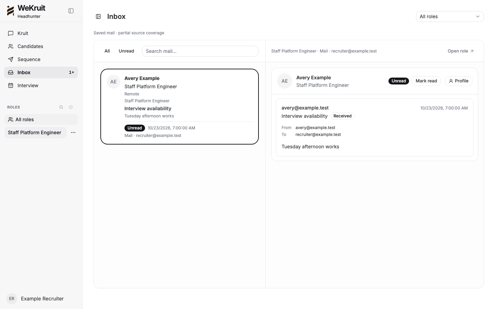
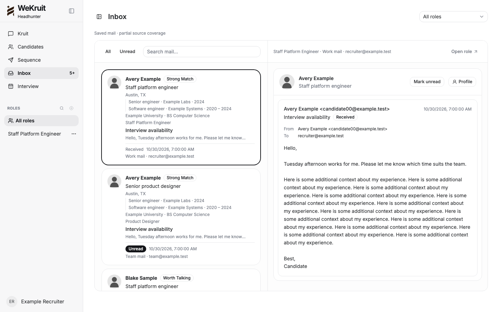
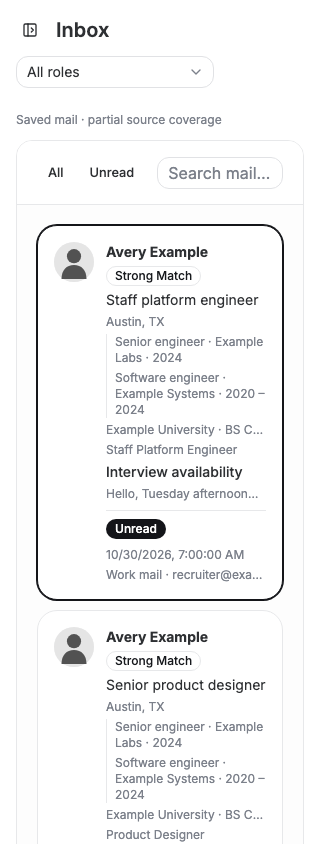
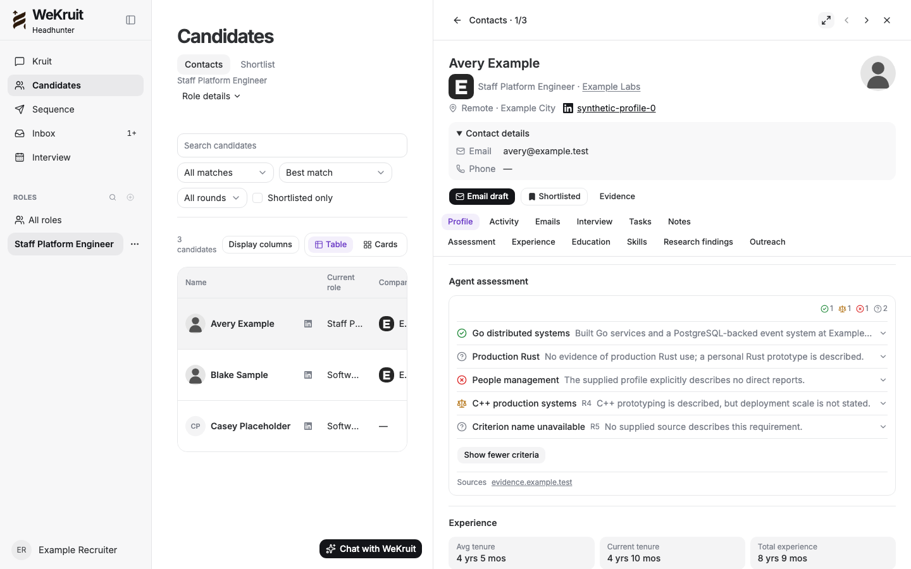
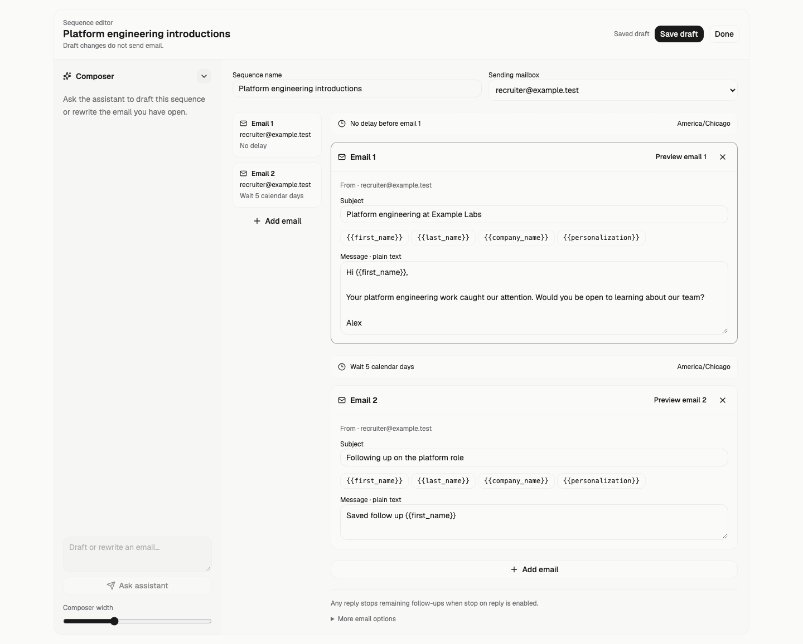
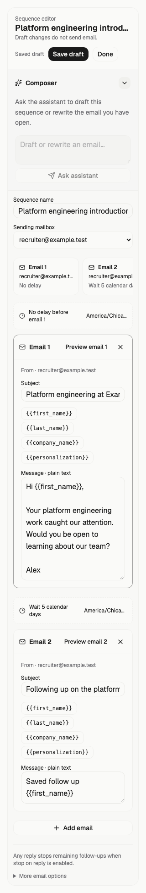
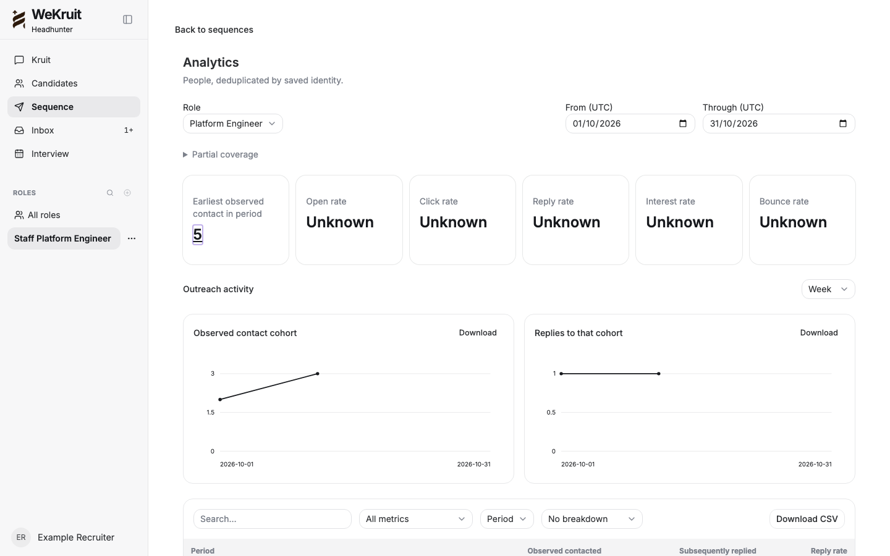
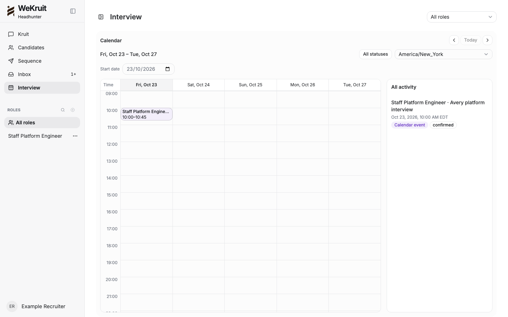
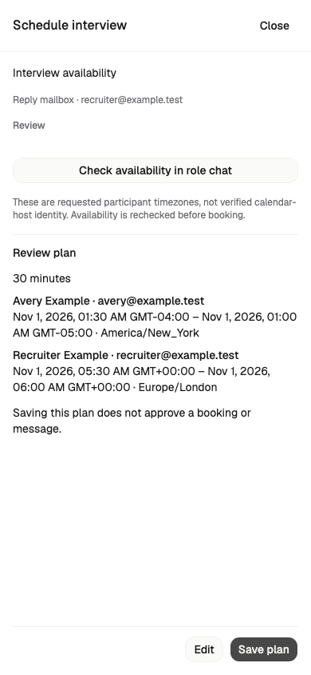
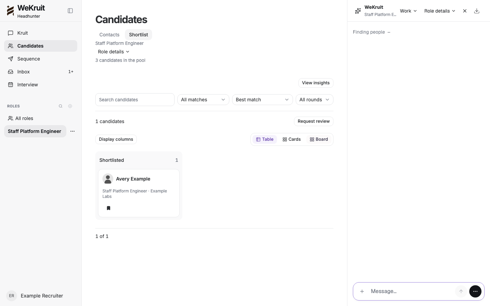

# Synthetic browser proof

These are screenshots of the implemented React screens from the 20 passing local Playwright scenarios. All people, addresses, sources and companies are synthetic. They establish layout/interaction, not an online deployment, provider delivery or customer-data acceptance.

## navigation-1440

## global-inbox-1440

## global-inbox-320

## profile-drawer-1440

## sequence-1440

## sequence-320

## analytics-1440

## interview-calendar-1440

## scheduling-review-390

## shortlist-1440

